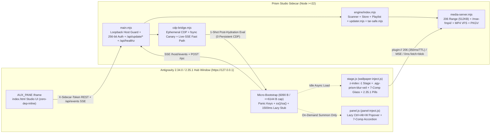

# Wallpaper Prism (`agy-wallpaper-prism`) — 下一代 AI 维护者工程交接手册

> **适用基线版本**：`v2.1.0`（GitHub: `https://github.com/azwosile/agy-wallpaper-prism`；统一整合原 `v2.0.9` WIP、Issue `#10`、PR `#8` / PR `#9`、P0 安全/性能修复 `D1` & `D2` 及 7 项核心特性）  
> **定位**：Google Antigravity 宿主整窗液态玻璃皮肤（Obsidian Prism 6 层光学体系 + 7 组件独立磨砂引擎）+ Steam Wallpaper Engine (`431960`) / 本地多媒体动态壁纸工作台插件。  
> **核心工程信条**：**Zero Agent Tokens · Zero `app.asar` Modification · Zero-Enable Ephemeral CDP · Fail-Open First · Zero Session Disruption · Symbol-First Anchoring**

> [!NOTE]
> **防漂移符号锚定规范（Symbol-First Anchoring Standard）**：本文档除 `§1.3` 顶部清单/版本锚点外，一律优先使用稳定的 **`path/to/file :: symbolName`** 符号/常量/选择器锚点，避免正文行号随版本演进腐烂。

---

## 0. 当前工作区交接状态快照（下一位 AI 接手必读）

### 0.1 版本、运行态与全量验证基线
- **当前代码版本**：`v2.1.0`（全仓 **7 处核心版本同步锚点 + 3 项构建/文档伴生校验**均已对齐 `2.1.0`，详见 `§1.3`）。
- **本机安装同步状态**：通过 `node scripts/build.mjs && node scripts/install-local.mjs` 将 9 个运行时根目录以真实文件拷贝同步至 `~/.gemini/config/plugins/agy-wallpaper-prism`（**严禁 NTFS Junction / Symlink**），保持 `test/verify-all.mjs :: syncFiles` 全部 **26 个运行时核心文件**（含 `v2.1.0` 新增的 `src/shared/semver.mjs`、`src/engine/tar-safe.mjs`、`src/engine/updater.mjs`）`SHA-256` 字节级一致并在线热替换生效，无需重启 `Antigravity.exe`。
- **端到端验证门禁（`node test/verify-all.mjs` 三大套件全量 `34 / 34 PASS`，`0 FAIL`）**：
  - **Suite 1（Manifest / Static / Hygiene / Sync）**：`v2.1.0` 7 处版本锚点、Git 分支与工作树审计（提交前需设置 `PRISM_ALLOW_DIRTY_GIT=1`，提交后严格洁净树校验）、`cdp-bridge.mjs` 零侵入 CDP 静态扫描、`assets/logo.svg` 与 `SKILL.md` Frontmatter + 零 `plugin://` 硬门禁、`sidecar.json` `on-failure` 契约、`sidecars/prism_studio/index.html` 纯 LF `zero-dep-inline` 确定性内联产物校验、全仓 **26 个 JS/MJS 文件 `node --check`** 语法检查、Zero-PII 扫描与 `~/.gemini` **26 文件 `SHA-256`** 字节同步校验；
  - **Suite 2（Engine / Canary / Streaming / Updater / Packager）**：DSH 发现/扫描/VFS/PKGV 引擎、两阶段 `fsync` Boot Canary 熔断与重置、PR `#6` 加固 `0ms fetch+blob`、PR `#7` `/video-stage/` + `v2.0.8` OOPIF Web Audio 路由与 `MAX_STUDIO_SSE = 2` / `MAX_HOST_SSE = 2` 驱逐、`v2.0.7` `plugin://` 206 代理 + `971 MB` `MediaSource` `/mse-fmp4/`、PR `#9` Scenario `2D-bis`（`deadPluginOrigins` TTL + `AbortError` 不投毒 + `wake()` 活跃 SSE 快路径）、`v2.1.0` 离线 Mock GitHub Release 1-Click 自更新安全测试（SemVer、DNS-rebinding `403`、`X-Sidecar-Token` `401`/`403`、Zip-Slip/symlink/Windows 保留名拦截、`.git` `409`、原子替换与回滚）及 `scripts/pack-release.mjs` 三产物校验；
  - **Suite 3（Studio UI & Headless Chrome `1440×900` E2E）**：微引导载荷体积（`6090 B <= 6144 B`）与 PR `#8` Check 1A 页脚重挂载保活、Fail-Open 首帧门控与 `z-index: -1` 惰性舞台、Antigravity `2.34.0`/`2.35.1` 选择器与 `[data-browser-hole]` GPU 圆角镂空 + `D2` `ResizeObserver` 防风暴、Issue `#10` 光学预设零布局跳动与 `.agy-prism-blur-veil` / `.mini-blur-veil` 零缩放抖动、`Ctrl+Alt+Shift+R` 逃生舱、Req `#1` `hideWelcomeLogo` 全 5 模式零误杀、Req `#2` `2.35.1` 紧凑顶栏胶囊（`pills`/`bar` + `P$c` 下拉 + `D18` 层级）、Req `#3` `0..64px` 宏/嵌套模糊与快捷浮窗 CSS 继承、Req `#4` 7 组件 `surfaceTints` + `128/128` WCAG AA `>= 4.5:1`、Req `#6` `Antigravity-Chinese-Localization` 共存及三端一键主开关 E2E。

### 0.2 Git 提交基线与 `v2.1.0` 发布变更全景
- **已发布上游基线**：`v2.0.6`（`ba0b6de`，合入 PR `#6` & PR `#7` 首发）、`v2.0.7`（`8e51651`）、`v2.0.8`（`8e58e268e2c1a81eb4a341296ca1eb733d679e3f`，annotated tag `v2.0.8`，已合入 PR `#7` 追补 `fa1f877` 并推送至 `origin/main`）。
- **`v2.1.0` 统一发布定位**：直接吸纳并完成了原未提交的 `v2.0.9` WIP 改动（Issue `#10` + PR `#8` 加固 + PR `#9` 加固），同时合入 P0 安全/性能修复（`D1`、`D2`）与 7 项 `v2.1.0` 用户需求（Req `#1`–`#7`）：
  - **新增 5 个文件**：
    1. `src/shared/semver.mjs` — 零依赖 SemVer 2.0.0 解析与比较器；
    2. `src/engine/tar-safe.mjs` — 纯 Node POSIX USTAR+PAX 安全解包器、Zip-Slip/符号链接/保留名/大小写碰撞拦截与预替换清单校验器；
    3. `src/engine/updater.mjs` — 零依赖安全一键自更新引擎（6h TTL + ETag `304` + 限流回退 + 每跳 HTTPS 白名单 + 强制 `.sha256` 校验 + Windows 锁安全替换 + 崩溃恢复日志 + 原子回滚）；
    4. `scripts/pack-release.mjs` — 确定性三产物 Release 打包脚本（`dist/*.tar.gz`、`dist/*.tar.gz.sha256`、纯 Node `dist/*.zip`）；
    5. `.github/workflows/release.yml` — `v*.*.*` 标签自动构建、全静态/单测验证、三产物打包与 GitHub Releases 发布流水线。
  - **同步更新的核心文件**：`.gitignore`（新增 `dist/`）、`plugin.json`、`package.json`、`README.md`、`skills/wallpaper-prism/SKILL.md`、`docs/{AI_HANDOFF,dsh-parity-spec,prism-design-spec,legacy-audit}.md`、`src/shared/{schema,i18n}.mjs`、`src/engine/{store,media-server,runtime/web-shim}.mjs`、`src/host/{index.mjs,wallpaper-inject.js,panel-inject.js}`、`src/studio-ui/{app.mjs,styles.css,template.html}`、`sidecars/prism_studio/{main.mjs,cdp-bridge.mjs,index.html}`、`scripts/{build,install-local}.mjs`、`test/{mock-hub-template,verify-all}.mjs`。

### 0.3 社区 Issues & PRs 落地总账

#### 历史已合入归档（`v2.0.4`–`v2.0.8`）
| 编号 | 类型 | 摘要 | 落地版本 / 提交 | 状态 |
| :---: | :---: | :--- | :--- | :---: |
| `#1` / `#2` | Issue + PR | Antigravity `2.34.0` 深浅色容器与弹窗选择器适配 | `v2.0.4` | Merged / Closed |
| `#3` / `#4` / `#5` | Issues/PRs | 早期浅色/WCO/侧栏与快捷面板问题修复 | `v2.0.4`–`v2.0.5` | Closed |
| `#6` | PR | `fix(host): fall back to fetch+blob when HTTPS hub stalls HTTP loopback media` (`be354e7`) | `v2.0.6` (`ba0b6de`) | Merged |
| `#7` | PR | `fix(media,host,studio): stream cross-scheme videos via /video-stage/ iframe, sync Studio via SSE & tint header bar` (`0c67d36` + `fa1f877`) | `v2.0.6` + `v2.0.8` (`8e58e26`) | Merged |

#### 本次 `v2.1.0` 落地项（Issue `#10`、PR `#8`、PR `#9`）
- **Issue `#10`**（`https://github.com/azwosile/agy-wallpaper-prism/issues/10`，作者 `yuezhu114`）：`[Bug] Switching optical scene presets to focus (沉静柔焦) / eco (极简省电) causes noticeable layout & wallpaper jitter` -> 在 `v2.1.0` 中以 **光学预设全量解耦布局 + `.agy-prism-blur-veil` / `.mini-blur-veil` 零缩放边缘钳位模糊层 + `D2` `ResizeObserver` 防风暴** 彻底根治（Commit Message 包含 `Fixes #10`）。
- **PR `#8`**（`https://github.com/azwosile/agy-wallpaper-prism/pull/8`，作者 `zmzwynzj`，Head `00521cc10dfbaee7042fce6f4f43da179ad3c613`）：`fix(host): keep lazy #agy-prism-pill alive across React footer remounts` -> 完整合入并加固 `window.__agyPrismKt` 清理与 `pp()` 零写入短路、`D12` 槽位/单壁纸覆盖同步及 Check 1A E2E。
- **PR `#9`**（`https://github.com/azwosile/agy-wallpaper-prism/pull/9`，作者 `zmzwynzj`，Head `f298c8ded2ffc816768ba93955a43cb2744707f0`）：`fix(host,cdp): cache dead plugin:// probes and fast-path wake() on live SSE` -> 完整合入并加固 `AbortError` 不投毒、`teardownSkinDomOnly()` 幽灵视频防护、`alivePluginOrigins` + 有界 TTL `deadPluginOrigins`、`wake({ forceProbe: true })` 与活连接校验 + `broadcastStudioState()` 同步。
- **多父合并归属策略**：正式提交 `v2.1.0` 时执行 **`git merge -s ours --no-commit 00521cc10dfbaee7042fce6f4f43da179ad3c613 f298c8ded2ffc816768ba93955a43cb2744707f0`**，保留全部 `v2.1.0` 加固代码并在 Commit Message 中写入 `Fixes #10` 与 `Co-authored-by: zmzwynzj <177476355+zmzwynzj@users.noreply.github.com>`，推送后 GitHub 自动将 PR `#8` 与 PR `#9` 标记为紫色 **Merged** 并关闭 Issue `#10`（完整命令见 `§5.2`）。

---

## 1. 仓库拓扑、本机路径边界与版本同步锚点

### 1.1 完整目录结构与权威职责树（43 个受控文件）

```text
agy-wallpaper-prism/
├── .gitignore                         # 忽略 node_modules、test/.tmp-verify-*、dist/ 等临时/构建输出
├── .github/
│   └── workflows/
│       └── release.yml                # [v2.1.0 NEW] v*.*.* 标签 CI：7 锚点核验、确定性构建 diff、静态/单测、打包并发布 GitHub Release
├── plugin.json                        # Antigravity 官方 9/10 键插件清单（严禁添加未授权字段）
├── package.json                       # Node >=22 ESM 包配置与 build / pack:release / install:local / test / CLI 脚本入口
├── README.md                          # 用户面向项目主页与版本锚点 #3（v2.1.0）
├── assets/logo.svg                    # >=128x128 (256x256 viewBox) 矢量图标
├── docs/
│   ├── AI_HANDOFF.md                  # 下一代 AI 维护者权威工程交接手册（本文档，v2.1.0）
│   ├── dsh-parity-spec.md             # DSH v1.4.2 逆向研究与 Antigravity v2.1.0 诚实功能对齐清单
│   ├── prism-design-spec.md           # [Historical Archive] v1.0 初始视觉设计规格（顶部已加归档横幅）
│   └── legacy-audit.md                # [Historical Archive] 2026-11-22 pre-v2.0 历史取证快照（顶部已加归档横幅）
├── skills/wallpaper-prism/SKILL.md    # 按需激活的 Agent 技能说明（含 sidecar:// 与 customization://，零 plugin:// 字面量硬门禁）
├── src/
│   ├── shared/
│   │   ├── semver.mjs                 # [v2.1.0 NEW] 零依赖 SemVer 2.0.0 解析与比较器（parseSemver / compareSemver / isNewerVersion）
│   │   ├── schema.mjs                 # 全局唯一配置 Schema、8 套深浅配色、4 套布局解耦 SCENE_PRESETS、7 套 FACTORY_PRESETS、7 组件 surfaceTints、resolveComponentDefaultAlpha 与 sanitizeConfig
│   │   └── i18n.mjs                   # 中/英双语词典（285/285 键 100% 对等，含 surfaceTints 26 键与 updater 28 键）
│   ├── engine/
│   │   ├── index.mjs                  # 引擎门面：生命周期、热缓存启动、后台异步扫描、SSE 状态广播
│   │   ├── store.mjs                  # 原子写盘队列、fsync 金丝雀写入、v1 数据迁移、流式 SHA-256 上传去重、PROFILE_PRESET_KEYS（含 surfaceTints）
│   │   ├── scanner.mjs                # Steam/WE 431960 发现（cache/steam-roots.json）、SCAN_CHUNK_SIZE=12 异步分块扫描、4 层本地目录扫描、路径穿越防护、热快照缓存
│   │   ├── media-server.mjs           # Loopback 媒体服：HTTP 206 Range (512KB chunk)、/mse-fmp4/ 零重编码流、/video-stage/（含 OOPIF Web Audio & CN L10n 防护）、FFmpeg 缩略图
│   │   ├── mp4-vfs.mjs                # 零磁盘拷贝虚拟 moov 前置（faststart，兼容 32 位 stco 与 64 位 co64）
│   │   ├── pkg-scene.mjs              # WE PKGV0002 + LZ4 + TEXB0004 场景解包提取内嵌 MP4/音频流
│   │   ├── playlist.mjs               # 顺序/随机洗牌轮播与定时/播完切换状态机
│   │   ├── tar-safe.mjs               # [v2.1.0 NEW] 纯 Node POSIX USTAR+PAX 安全解包器、Zip-Slip/符号链接/保留名校验、validateStagedPlugin 与 createDeterministicTarGz
│   │   ├── updater.mjs                # [v2.1.0 NEW] 安全一键 GitHub Release 自更新引擎（checkForUpdate / applyUpdate / syncDirectoryLockSafe / sweepRetiredFiles / isManagedSidecar）
│   │   └── runtime/
│   │       └── web-shim.mjs           # WE Web API Shim、Focus Guard、CN L10n 注入防护与 /scene-live/ Prism Aurora HTML 构建器
│   ├── host/
│   │   ├── index.mjs                  # 宿主脚本加载缓存、buildClientSkinPayload、纯静态模式 buildStaticCssSheet（与动态内核 100% 共享 Layer 1 hideWelcomeLogo / pills topbar / 7 组件 surfaceTints 规则）
│   │   ├── wallpaper-inject.js        # 注入 Antigravity 主窗口的微内核（stage.js，ES2020 IIFE，含 .agy-prism-blur-veil、三级视频流 + 350ms/TTL 探活、hideWelcomeLogo、2.35.1 顶栏胶囊、0..64px 两级模糊、7 组件 WCAG >=4.5:1 表面、D2 镂空去重）
│   │   └── panel-inject.js            # 宿主内 Ctrl+Alt+W 懒加载快捷浮窗（panel.js，含三端主开关、单壁纸覆盖路由、7 组件手风琴 + Reset All、hideWelcomeLogo 开关、更新红点提示与 80 条 LRU bindSafeThumb）
│   └── studio-ui/
│       ├── app.mjs                    # 右侧边栏完整工作台前端逻辑（60ms 节流单飞刷盘、.mini-blur-veil 预览、7 组件 surfaceTints 渐进披露、1-Click 更新横幅与 /api/healthz 重连遮罩、0x0 折叠 iframe SSE 守卫）
│       ├── styles.css                 # 工作台样式表（含 21:9 .mini-blur-veil 预览、<=459px 紧凑布局、更新横幅/重连遮罩与 .agy-prism-* 非 body 隔离类）
│       └── template.html              # 工作台 HTML 骨架（#app.agy-prism-root + translate="no" 防汉化脚本误翻）
├── sidecars/prism_studio/
│   ├── sidecar.json                   # AUX_PANE 契约（restart_policy 必须保持 "on-failure"）
│   ├── main.mjs                       # 权威 Sidecar HTTP 服务（全局回环 Host DNS-rebinding 拦截、常开 256-bit X-Sidecar-Token、strict /api/healthz & /api/update/*、plugin:// /media-proxy/* 206 代理、/api/skin/toggle、/api/events SSE、/host/<capToken>/*）
│   ├── cdp-bridge.mjs                 # 零侵入瞬态 CDP 桥接器（6090 B / 6144 B 微引导、1500ms 懒加载胶囊保活、活 SSE 快路径、两阶段 fsync 金丝雀、ss()/sa() 分离、双语 Hub/快捷方式匹配）
│   └── index.html                     # 由 scripts/build.mjs 确定性 zero-dep-inline 生成的单文件内联产物（纯 LF，切勿手改！）
├── host/cli.mjs                       # 命令行工具（全 8 个子命令：status | wake | reset-canary | enable-autostart | disable-autostart | preset | restore | create-shortcut）
├── scripts/
│   ├── build.mjs                      # 确定性离线单文件打包器（默认纯 Node zero-dep-inline + 纯 LF 归一；esbuild 仅 PRISM_USE_ESBUILD=1 显式启用，绝不探测兄弟仓库）
│   ├── install-local.mjs              # 真实文件拷贝安装（9 根目录）+ 同版本/跨版本 Sidecar/Hub/Panel/Iframe 强制热替换（含 window.__agyPrismKt 清理）
│   └── pack-release.mjs               # [v2.1.0 NEW] 确定性三产物 Release 打包器（dist/*.tar.gz + .sha256 + 纯 Node .zip，内建 tar-safe.mjs 自检）
└── test/
    ├── cdp-browser.mjs                # Headless Chrome CDP 测试驱动程序（供 Suite 3 像素级 E2E 使用）
    ├── fixtures-builder.mjs           # 合成 Workshop / MP4 / PKGV / 快捷方式测试夹具生成器
    ├── http-inproc.mjs                # 内存态 HTTP/SSE 请求直调测试框架
    ├── mock-hub-template.mjs          # Antigravity 2.34.0 / 2.35.1 真实 DOM/CSS 权重模拟夹具（含 5 种空态欢迎模式、2.35.1 顶栏 + P$c 下拉、中文汉化 dom-translator 模拟、aux-pane-split 探针）
    └── verify-all.mjs                 # 三大套件全量 34 项端到端自动化验证套件（34 / 34 PASS：Suite 1 静态/26 文件同步 + Suite 2 引擎/更新/打包 + Suite 3 Headless Chrome E2E）
```

> **关联兄弟仓库**：同父工作区下的 `agy-wallpaper-prism-intro`（`https://github.com/azwosile/agy-wallpaper-prism-intro`）为 B 站宣传视频工程，与插件本体完全解耦（`scripts/build.mjs` 在 `v2.1.0` 已彻底移除跨仓库 `esbuild` 探测）。

### 1.2 本机安装路径与运行时数据目录（严禁混淆）

| 路径角色 | Windows 实际位置（示例脱敏） | 关键规则 |
| :--- | :--- | :--- |
| **本机插件安装目录** | `~/.gemini/config/plugins/agy-wallpaper-prism` | **严禁使用 NTFS Junction / Symlink！** Antigravity 的 `GetAllPlugins` 在 Windows 下会静默跳过符号链接目录，且 `updater.mjs` 会对符号链接根目录返回 `409 ERR_SYMLINK_PLUGIN_ROOT`。必须使用 `node scripts/install-local.mjs` 执行真实目录拷贝（保留 `.prism-install-id` 标记），并保持与源码仓库 `test/verify-all.mjs :: syncFiles` 全部运行时核心文件 `SHA-256` 字节级一致。 |
| **Sidecar 权威数据目录** | `ANTIGRAVITY_EXECUTABLE_DATA_DIR` 或 `~/.gemini/antigravity/sidecar_data/agy-wallpaper-prism/prism_studio/data` | 由 `src/engine/store.mjs :: resolveDefaultPrismDataDir` 统一解析。存放 `config.json`、`canary.json`、`server_info.json`（`0o600` 含 256-bit `token`）、`shortcut-backup.json`、`presets/`、`uploads/`、`updates/`（更新暂存、回滚备份、崩溃恢复日志与待清扫 `.old.<ts>`）、`cache/inventory-index.json`、`cache/steam-roots.json`（`src/engine/scanner.mjs :: discoverSteamRoots`）、`cache/thumbs/`、`cache/scene-media/`。插件更新/重装不会丢失用户配置。 |
| **v1 历史遗留目录** | `~/.agy-wallpaper-prism` | 仅当默认启动（未显式传入测试 `dataDir` 或 `AGY_PRISM_DATA_DIR`）且新目录尚无 `config.json` 与 `.migrated-from-legacy.json` 时，由 `src/engine/store.mjs :: migrateLegacyPrismDataIfNeeded` 自动非破坏性迁移。 |

### 1.3 版本号升级必改的 7+3 同步锚点清单（当前 `v2.1.0`）

每次升级版本号，**必须同步修改以下全部 7 处核心锚点 + 3 项伴生同步产物**，否则 `test/verify-all.mjs` Suite 1 或 `.github/workflows/release.yml` CI 校验会直接阻断发版：

| 序号 | 文件路径 | 锚点位置 / 符号 | `v2.1.0` 精确锚点内容 |
| :---: | :--- | :--- | :--- |
| 1 | `plugin.json` | `L5` (`version`) | `"version": "2.1.0",` |
| 2 | `package.json` | `L3` (`version`) | `"version": "2.1.0",` |
| 3 | `README.md` | `L4` & 架构树 `plugin.json` 注释 | `> **Version**: \`2.1.0\`` 与 `Official 10-key Antigravity plugin manifest (v2.1.0)` |
| 4 | `src/shared/schema.mjs` | `L6` (`PLUGIN_VERSION`)、`L13` (`PRISM_DOM.skinVersion`) | `export const PLUGIN_VERSION = '2.1.0';` 与 `skinVersion: '2.1.0',` |
| 5 | `src/host/wallpaper-inject.js` | `L1` 头部注释、`L12` (`VERSION`) | `agy-wallpaper-prism v2.1.0` 与 `var VERSION = '2.1.0';` |
| 6 | `src/host/panel-inject.js` | `L1` 头部注释、`L12` (`VERSION`) | `agy-wallpaper-prism v2.1.0` 与 `var VERSION = '2.1.0';` |
| 7 | `test/verify-all.mjs` | Suite 1 版本 & 打包断言（并由 `.github/workflows/release.yml` 复检） | 7 处核心版本相等/正则断言 + `index.html` 内联版本断言对齐 `'2.1.0'` |
| +A | `src/host/index.mjs` | `L1` & `buildStaticCssSheet` 静态 CSS 头部注释 (`L674, L870`) | `v2.1.0` 注释同步 |
| +B | `sidecars/prism_studio/index.html` | **`node scripts/build.mjs` 重新生成**（切勿手改） | 纯 LF `zero-dep-inline` 产物内含 `2.1.0` 与最新 `schema.mjs` / `i18n.mjs` / `app.mjs` |
| +C | `docs/AI_HANDOFF.md` & `skills/wallpaper-prism/SKILL.md` | 文档基线版本号与运行时契约 | 对齐 `v2.1.0`（且 `SKILL.md` 严格保证 0 处 `plugin://`） |

---

## 2. 架构数据流与五大不可妥协的工程红线



### 红线 1：零侵入瞬态 CDP（Zero-Enable Ephemeral CDP）与微引导字节预算
- **绝对禁止**在 `sidecars/prism_studio/cdp-bridge.mjs` 中出现以下任何调用（由 `test/verify-all.mjs :: Zero-Enable Ephemeral CDP Audit` 做源码级零容忍扫描，且 `.github/workflows/release.yml` CI 同步门禁）：
  - `Page.enable`
  - `Runtime.enable`
  - `Page.addScriptToEvaluateOnNewDocument`
  - `Runtime.addBinding`
- **原因**：用户环境通常同时运行 `gemini-neko-cockpit`、`agy-capsule`、`agy-dart` 等多个连接调试端口的插件。在文档水合前强行挂载持久化 Inspector Domain 或注入大体积脚本，会与同机插件发生竞态碰撞，直接把 React `#root` 卡死在黑屏阶段。
- **正确做法**：
  1. 只通过只读探针 `HUB_READINESS_PROBE_EXPR` 轮询检查 `document.readyState === 'complete'` 且 `#root` 宽高 `>= 200×150`；
  2. 等待 `liveBootDelay`（默认 `1.5s`）稳定窗口后，用瞬态 WebSocket 发送单条 `cdp-bridge.mjs :: buildHostMicroBootstrap` 并**立即关闭 WebSocket**；
  3. 后续状态同步走 `/host/<capToken>/events`（SSE），宿主回调走 `/host/<capToken>/rpc`（HTTP POST）；
  4. 端口发现规则（`cdp-bridge.mjs :: candidatePorts`）：`pf.port !== 9222 || pf.port === configured || sessionForcedWake`（支持 `9339` 与 `--remote-debugging-port=0` 随机端口，冷启动绝不擅自连接共享端口 `9222`）。
- **微引导字节预算硬警告**：`sidecars/prism_studio/cdp-bridge.mjs :: buildHostMicroBootstrap` 当前携带 64-hex `hostCapToken` 时实测体积为 **`6090 B / 6144 B`**（`http://127.0.0.1:53040`，**仅余 `54 B` 裕量**；最坏情况 `https://127.0.0.1:65535` 为 `6091 B`，余 `53 B`）。后续任何改动都必须确保 UTF-8 字节数 `<= 6144 B`，否则 Suite 3 Check 1A 会直接失败！

### 红线 2：双门控免黑屏舞台（Dual-Gate Fail-Open）、边缘钳位模糊层与 `z-index: -1` 惰性层
- **双属性门控**：
  - `html[data-agy-prism-glass="ready"]`：挂载基础 CSS 变量、滚动条与实心浮层保护；
  - `html[data-agy-prism-wallpaper="ready"]`：**仅当图片完成 `img.decode()` 或视频首帧解码完成（`readyState >= 2 && videoWidth > 0`）后才允许通过 `wallpaper-inject.js :: setWallpaperReady(true)` 挂载！** 在此之前严禁将 `#root` 或 `.browser-hole-opaque` 背景刷成透明。一旦壁纸 `404`、超时或解码失败，自动保持原生 `#070708` / `#F7F7F8` 实心底色（Fail-Open）。
- **粒子画布 `#agy-prism-fx-canvas` 必须同步受 `state.wallpaperReady` 门控**：
  - 当 `!state.wallpaperReady` 时，`wallpaper-inject.js :: setWallpaperReady` 与 `ensureFxCanvas` 必须立即隐藏 `#agy-prism-fx-canvas` 并清空 `state.fxParticles = []`，指针事件停止产粒子，严禁在 Fail-Open 原生黑底上出现孤立悬浮的星尘或点击波纹。
- **底层舞台与零抖动模糊幕布（`v2.1.0`）**：
  - `#agy-prism-stage`（`wallpaper-inject.js :: buildStructuralPrismCss / ensureStage`）必须锁定 `position: fixed; inset: 0; z-index: -1 !important; pointer-events: none; background-color: transparent; contain: style` 且 `stage.inert = true`；**切勿改回 `contain: layout paint style`**（带 `paint` containment 时 Chromium 遮挡追踪器会误判底层 `<video>` 被 `#root` 遮挡而停止提交视频帧）；
  - 舞台内部严格保持 `z-index` 叠序：**媒体包裹层 `0` < `.agy-prism-blur-veil` `1` < `.agy-prism-scrim` `2` < `.agy-prism-vignette` `3` < `.agy-prism-grain` `4`**，新媒体节点统一通过 `stage.insertBefore(nextWrap, stageAnchor || null)` 锚插在 `.agy-prism-blur-veil` 之前，杜绝缩放跳动与模糊漏边。

### 红线 3：Antigravity `2.34.0`/`2.35.1` 三层 `WebContentsView` 浏览器圆角镂空（`[data-browser-hole]`）
- **宿主机制**：内置浏览器网页渲染在主界面 `hubWcv (z=1)` **下方**的独立 `clipView (z=0)` 中，主界面对应区域放置透明占位框 `[data-browser-hole="true"]` 并在 `<html>`/`<body>` 标记 `data-has-browser-hole="true"`。
- **必须遵守的联动规则**：
  1. 当 `data-has-browser-hole="true"` 存在时，`<html>`、`<body>` 及 `.browser-hole-ancestor` 链必须全部让渡为 `background-color: transparent !important`（使 Skia 合成帧在该区域 `alpha === 0`）；
  2. `wallpaper-inject.js :: syncBrowserHoleCutout` 同步读取所有可见 `[data-browser-hole]:not([data-browser-hole="false"])` 的边界与外层浮岛圆角，生成逆时针 `evenodd` SVG 路径赋给 `#agy-prism-stage` 与 `#agy-prism-fx-canvas` 的 `clip-path`；`ensureHoleActiveObservers`（`v2.1.0` 修复 `D2`）必须先比对观察目标节点集合身份，仅在集合变化时才 `disconnect()`/`observe()`，严禁每帧重建 `ResizeObserver`；
  3. 宿主内打开的 `#agy-prism-popover`（`panel-inject.js :: open`）必须设置 `data-browser-occluder="true"`，通知宿主 `catcherView` 不要把浮窗点击穿透给底层网页。

### 红线 4：两阶段 `fsync` 启动金丝雀（Boot Canary）与一键逃生舱
- 首次向某窗口注入前，`canary.arm()` 通过 `src/engine/store.mjs :: writeFsyncJsonSync`（`openSync -> writeSync -> fsyncSync -> closeSync -> renameSync`）将 `canary.json` 置为 `"arming"`；挂载稳定后置为 `"healthy"`。若进程崩溃导致下次启动仍见到前一次 `browserSessionId` 遗留的 `"arming"`，自动触发熔断 `"tripped"` 并将 `skinEnabled` 持久化为 `false`。
- 紧急逃生热键（独立绑定于 `cdp-bridge.mjs :: buildHostMicroBootstrap`，不依赖 `stage.js` / `panel.js`）：**`Ctrl+Alt+Shift+R`** 或 **`900ms` 内连按 `4× Escape`**，立即调用 `sa()` 全量清除所有 `#agy-prism-*` 节点、`data-(?:agy-)?prism*` 属性、恢复原生 WCO 颜色，并持久化 `skinEnabled = false`。

### 红线 5：零会话中断、同版本强制热替换、零隐私泄露与回环安全边界
- **严禁杀掉或重启用户正在运行的 `Antigravity.exe`！** `sidecar.json` 采用 `"restart_policy": "on-failure"`，开发调试统一运行 `node scripts/build.mjs && node scripts/install-local.mjs` 完成在线热替换（一键自更新仅在托管 Sidecar 内先刷出 HTTP `200` 再执行 `close({ preserveHostDom: true })` + `process.exit(1)` 由宿主自动拉起新 Sidecar，零重启宿主窗）。
- **同版本号热替换铁律（`scripts/install-local.mjs` & `cdp-bridge.mjs :: REMOVE_PANEL_EXPR`）**：
  1. 先调用 `POST /api/host/reload` 刷新 Sidecar 进程内存脚本缓存；
  2. 通过瞬态 `evaluateTargetEphemeral` 显式清理 **`window.__agyPrismKt` 定时器**（PR `#8` 加固必做，防热替换后旧间隔复活懒加载胶囊）、调用旧实例 `window.__agyPrismPanel.destroy()` 与 `window.__agyPrism.destroy()` 并 `delete` 全局引用（同时携带 `carry` 最新状态载荷）；
  3. 直接在页面内同步执行 `getHostSkinScript({ reload: true })` 最新磁盘闭包并轮询确认 `wallpaperReady === true`，严禁因 `wallpaper-inject.js` 同版本幂等守卫 `prev.version === VERSION && prev.alive()` 而短路跳过！
- **零隐私泄露（Zero-PII）**：严禁在仓库代码、测试夹具、文档或 Commit Message 中写入本机真实用户名、真实个人绝对路径或第三方 API Token，所有路径示例脱敏为 `~/.gemini/...` 或 `<USER_HOME>/...`，每次提交前须通过 `test/verify-all.mjs :: Zero-PII Audit`。
- **回环安全边界（`v2.1.0` `D1` 加固）**：`sidecars/prism_studio/main.mjs` 在 `handleRequest` 顶部强制执行全局回环 `Host` DNS-rebinding 校验（非回环返回 `403 ERR_DNS_REBINDING` 且 0 CORS），常开 256-bit `effectiveAuthToken`（`0o600` 写入 `server_info.json`），并对 `/api/healthz` 与 `/api/update/*` 实施非通配 `sendStrictJson` + 严格 `Origin` 与仅 Header `X-Sidecar-Token` 常量时间校验。

---

## 3. 核心架构演进与专题机制详录（`v2.0.6`–`v2.1.0`：现象 · 根因 · 现行机制 · 防回退约束）

### 3.1 PR #6 跨协议回环 `fetch+blob` 加固（Chrome 152 `https:` 宿主 -> `http://127.0.0.1` 媒体停滞）
- **根因**：Antigravity（内嵌 `Chrome 152`）主窗口运行在 `https://127.0.0.1:<port>`，而媒体服运行在 `http://127.0.0.1:<mediaPort>`。直接向 `<video>.src`、`.src` 写跨协议明文 `http://` 回环地址会静默卡死在 `readyState === 0, networkState === 2` 至 6s 超时回退黑底，而同页面 `window.fetch() -> Blob URL` 在数毫秒内完成。
- **现行加固机制（`src/host/wallpaper-inject.js`）**：
  - **常量与判定**：`MAX_BLOB_MEDIA_BYTES = 256 * 1024 * 1024`（`256 MiB`）、`BLOB_FETCH_TIMEOUT_MS = 20000`（`20s`）、`isCrossSchemeLoopbackMediaUrl(url)` 严格匹配 `https:` 宿主访问 `http://(127.0.0.1|localhost|[::1])`。
  - **`<video>` / `<audio>` `0ms` 直走 `startBlobFetch`**（`attachLoopbackMediaSrc`）：命中跨协议立即 `0ms` 拉流（绝不先写 `http://` 给 `el.src`），配合 `el.__prismMediaToken`、`wrap.__prismAbortControllers`、20s 超时与双重体积门控（`content-length` 头预拦截 + `blob.size` 二次复核，超限抛出 `err.code = 'BLOB_CAP_EXCEEDED'`）。
  - **有界 `armPendingVideoGuard` 与 `BLOB_CAP_EXCEEDED` 两级接管**：`blobWaitTicks < 16`（最多 `16 × 1500ms = 24s`，杜绝无限递归）；捕获 `BLOB_CAP_EXCEEDED` 后，**优先检查 `mseFmp4Url && typeof W.MediaSource === 'function'` 并调用 `mountMseStreamVideo`**（无损 fMP4 滚动驱逐流，详见 `§3.7`），仅当 `MediaSource`/FFmpeg 不可用或流异常时才降级执行 `fallbackToPoster()`，通过 `attachLoopbackImageSrc` 渲染 `item.thumbUrl` 高清静态封面，保持 `data-agy-prism-wallpaper="ready"` 与整窗毛玻璃。
  - **`` 全链路 `0ms` 直走 `startBlobFetch` 与统一零泄漏回收**：自 `v2.0.7` 起，`attachLoopbackImageSrc` 在命中 `isCrossSchemeLoopbackMediaUrl(url)` 时同样**直接 `0ms` 调用 `startBlobFetch()`**（不再先赋值 `img.src = http://...` 等待 `onerror`，详见 `§3.7`），仅在同源或 `plugin://` 场景直赋 `img.src = url`；`disposeWrap(wrap)` 统一 `.abort()` 所有 `AbortController` 并对 `video, audio, img` 全部 `revokeObjectURL`。
- **防回退约束**：严禁恢复 `900ms` 直连探测、严禁移除 `BLOB_FETCH_TIMEOUT_MS` / `blobWaitTicks < 16` 上限、严禁在 `BLOB_CAP_EXCEEDED` 分支跳过 `mountMseStreamVideo`。

### 3.2 动态壁纸顿挫四重根因与修复
1. **看门狗最小采样间隔与禁止反向 GOP 冲刷**（`wallpaper-inject.js :: state.lastVidCheckAt / checkVideoLiveness`）：当 `moved === false` 但距上次采样 `< 900ms` 时免检返回；彻底移除 `isWake` 反向 Seek 分支；尾部回环收紧至 `vidStallCount >= 2 && curT >= dur - 0.75`，中段恢复至 `>= 3`，D3D11 重载至 `>= 5`。
2. **DirectComposition NV12 零拷贝叠加层保护**（`schema.mjs :: DEFAULT_CONFIG.mediaSaturate = 100`、`wallpaper-inject.js :: isZeroCopyOverlaySafe`）：默认/无滤镜（含历史持久化旧默认 `105%`）输出 `--prism-media-filter: none`；`.agy-prism-media-wrap` 按需开启 `will-change: (cfg.parallaxEnabled ? 'transform' : 'auto')`。
3. **零 `getComputedStyle` 粒子与 `fpsCap` 节流**（`wallpaper-inject.js :: state.accentRgbStr / stepParallax / ensureFxCanvas / stepFx`）：强调色预缓存于内存字符串，指针事件 `0` 次 `getComputedStyle`；`fpsCap` 接入 `rAF` 帧节流；`#agy-prism-fx-canvas` 锁定 `1×` CSS 视口分辨率（2x HiDPI 降低 `75%` 像素填充开销）。
4. **回环媒体流 `512 KiB` 分块**（`src/engine/media-server.mjs :: serveFileWithRange`）：普通文件流显式配置 `highWaterMark: 512 * 1024`，降低高码率 4K60 顺序读 `fs.read` 次数 8 倍。

### 3.3 SideBar 深色毛玻璃载体与双端自动跟随滑块
- **可空配置键与双向同步**：`schema.mjs :: DEFAULT_CONFIG` 提供 `sidebarOpacity: null`、`sidebarBlur: null`（经 `nullableNum` 归一，`null` 表示 1:1 跟随主界面）；自 `v2.1.0` 起范围已扩展为 `sidebarOpacity: 0..0.98`、`sidebarBlur: 0..64px`，并与 7 组件体系中的 `surfaceTints.sidebar.opacity` 双向同步（详见 `§3.10` Req `#4`）。
- **深色取暗底色与防嵌套叠加**：`wallpaper-inject.js` & `src/host/index.mjs` 在暗色模式对 `--prism-sidebar-rgb` 取 `minLuminance(shadeRgb, baseRgb)`（如 `host-native` 暗色锁定 `7, 7, 8`）；`GLASS_CARRIER_SIDEBARS` 通过互斥 `:not(...)` 防止双层叠加并统一由 `::before` 承载 `backdrop-filter`（父元素强制 `backdrop-filter: none !important`），清空侧栏内非 sticky `.bg-sidebar` 与 `.monaco-workbench` 内层实色容器，并将 `[data-sidebar-section-drop-id]` 纳入吸顶磨砂规则。
- **双端联动**：Studio UI（`app.mjs :: renderSliderRow / syncNullableFollowersInDom / syncPairedSlidersInDom`）与快捷浮窗（`panel-inject.js`）均实时显示 `跟随 / Auto` 读数并支持 `↺` 一键复位 `null`。

### 3.4 `Customizations`（插件市场与已安装管理页）深色毛玻璃适配
- **主视图 `::before` 载体**（`wallpaper-inject.js :: GLASS_CARRIER_MAIN_PAGES` & `src/host/index.mjs :: mainPageCarriers`）：命中 `div.bg-background:not(.agy-shell):not(.sticky):not([style*="sticky"]):not(.agy-dialog):not(.settings-modal-container):has([data-testid="customizations-search"], [data-testid="customizations-marketplace"], [data-testid="customizations-installed"])` 与 `[data-testid="plugin-detail"]`。
- **防回退铁律**：**严禁直接在上述父容器上挂 `backdrop-filter`！** 父容器必须锁定 `backdrop-filter: none !important`，全部磨砂挂于 `::before`（`z-index: -1; pointer-events: none`），避免截断 `[data-testid="marketplace-filter-menu"]` 等 `position: fixed` 浮层（由 `test/mock-hub-template.mjs :: #v234-cust-fixed-probe` 断言 `top === 0 && left === 0`）；并为 `[data-testid="customization-card"]`、`.agy-spotlight-card`、`[data-testid="marketplace-bundles-banner"]` 与搜索/Tab 胶囊补齐半透卡片与顶缘高光。

### 3.5 PR #7 `/video-stage/` 同源流式舞台与 Studio `/api/events` SSE 实时同步
- **`/video-stage/<token>` 的现行调度定位（Priority 2）**：由 `media-server.mjs :: buildVideoStageHtml` 生成，内建 NV12 零拷贝样式、`< 900ms` 看门狗免检、`dur - 0.75` 尾帧循环、`+0.04` 正向微推与 `v2.0.8` OOPIF Web Audio 路由。在 **`v2.0.7+` 现行三级调度**（`wallpaper-inject.js :: continueAfterPluginProbe`）中，Priority 1 为 `plugin://` 206 直放；`/video-stage/` 位于 **Priority 2**，仅用于特权 `pluginVideoStageUrl` 或无 `window.MediaSource` 的 VM 沙箱——**在具备 `window.MediaSource` 的真实 `https:` Chrome 152 宿主下，明文 `http://` `/video-stage/` iframe 会被自动跳过**，直接进入 Priority 3（`0ms fetch+blob` / `/mse-fmp4/`），避免 15.5s Mixed Content 阻塞（互引 `§3.7` & `§3.9`）。
- **Studio `/api/events` SSE 同步**：`main.mjs :: GET /api/events` 与 `broadcastStudioState()`（挂载于 `pushToHost()` 开头，并配合 `v2.1.0` 脏重跑循环）实时推送配置/状态变更至 `app.mjs :: connectStudioEvents / applyExternalStateSnapshot`。

### 3.6 四项毛玻璃 UI 改造架构约束（Bug 1–4 + `v2.1.0` 演进）
1. **WCO 右上角三键透明底与 `#agy-prism-wco-pill`**：仅对 `body` 注入 `--background: #00000000 !important;` 杜绝 `meter-renderer.js` 回写黑底；`syncWcoGlassPill()` 监听 `geometrychange` 动态写入 `--prism-wco-inset-right` 与动态高度 `--prism-wco-pill-top` / `--prism-wco-pill-h`；`v2.1.0` 新增 `state.lastWcoSig` 变化门控避免冗余确认脉冲、修复 `D18` 将 `#agy-prism-wco-pill` 与 `#agy-prism-topbar-pills` 锚定在 `z-index: 0 < 45`（不遮挡 `#agy-prism-popover`）且 `onThemeMut` 忽略无关 `body.style` 变动。
2. **顶部菜单栏**：`GLASS_CARRIER_TITLEBARS` 锁定 `overflow: visible !important; backdrop-filter: none !important;`；在 `v2.1.0` 中针对 Antigravity `2.35.1` 升级为默认 `topbarStyle: 'pills'` 紧凑文本胶囊（详见 `§3.10` Req `#2`），同时保留完整 `bar` 模式与 `SOLID_POPOVERS` 菜单保护。
3. **左侧栏 `Projects` 吸顶头与 `[data-testid="project-header"]`**：通过 `--prism-sidebar-deep-rgb` / `--prism-surface-sidebar-deep` + `::before` 圆角深色胶囊渲染，剥离外层直角吸顶黑带。
4. **右侧 Aux Pane 解耦左栏深色载体**：`[data-testid="aux-pane-split"] > div:last-child` 与 `.part.auxiliarybar` 从 `GLASS_CARRIER_SIDEBARS` 移除，在 `v2.1.0` 进一步拆分为独立的 `GLASS_CARRIER_CHAT::before`（`workspace`）与 `GLASS_CARRIER_RIGHT_PANES::before`（`rightPane`），允许用户在 `surfaceTints` 中分别微调中栏与右栏深度。

### 3.7 `v2.0.7` 零挂起图片、超大视频三级流式加载与三端一键主开关
- **全链路 `0ms fetch+blob` 图片零挂起**：`wallpaper-inject.js :: attachLoopbackImageSrc`、`extractAccent`（4s 超时 + 立即释放 Blob）与 `panel-inject.js :: bindSafeThumb`（80 条 LRU `thumbBlobCache`）在 `https:` 宿主下均 `0ms` 直走 `fetch+blob`，`--prism-wall-image` 与 `video.poster` 不再写入跨协议 `http://` URL。
- **`971 MB+` / `>256 MiB` 超大视频三级流式管线**：
  1. **Priority 1（`plugin://` 206 零拷贝直放）**：`main.mjs :: getPluginOrigin` 暴露特权协议代理 `GET/HEAD /media-proxy/<subRoute>/*`；宿主对 `item.pluginMediaUrl` 发起 **`350ms`** `HEAD` 探测（`v2.0.9`/`v2.1.0` 由原 `800ms` 收紧），并结合 **`state.alivePluginOrigins`** 与 **有界 TTL `state.deadPluginOrigins`**（`60s` 超时 / `15s` 已证实活源重试 / `5m` 硬失败，详见 `§3.9`）实现不可达源 `0ms` 跳过与瞬态抖动自愈；
  2. **Priority 2（特权 `pluginVideoStageUrl` / 无 `MediaSource` 沙箱 `/video-stage/` iframe）**：具备 `window.MediaSource` 的真实 `https:` 浏览器跳过明文 `http://` iframe；
  3. **Priority 3（`<=256 MiB` `0ms fetch+blob` -> `>256 MiB` `MediaSource` `/mse-fmp4/` 滚动驱逐流 -> `0ms fetch+blob` 静态封面）**：`media-server.mjs` 提供 `ffmpeg -c:v copy` 无损分片流（断连立即 `SIGKILL`），`wallpaper-inject.js :: mountMseStreamVideo` 在播放 `>25s` 且缓冲 `>20s` 时执行 `sb.remove(0, curT - 15)` 保持常驻内存 `<32 MiB`，无 `ffmpeg`（`501`）平滑降级封面。
- **三端一键启用/禁用主开关与持久化 `#agy-prism-pill`**：`main.mjs` 提供 `POST /api/skin/toggle` & RPC `skin.toggle`（自动解除 `tripped` Canary 并以 `{ forceProbe: true }` 唤醒）；`cdp-bridge.mjs :: buildHostMicroBootstrap` 拆离常态禁用 `ss()`（保留 `#agy-prism-pill` + `data-skin-enabled="false"` 与浮窗供一键重开）与紧急逃生 `sa()`（全量剥离并断 SSE）；同步覆盖 Studio `#prism-master-toggle-btn`、浮窗 `[data-testid="prism-power-toggle"]` 及 `#agy-prism-pill`（`Shift+Click` / 中键）。

### 3.8 `v2.0.8` OOPIF Web Audio 音频时钟路由与 Studio/Host SSE 6-Socket 防饥饿
- **OOPIF `/video-stage/` 音频时钟冻结修复**（`src/engine/media-server.mjs :: buildVideoStageHtml`）：设置 `v.crossOrigin = 'anonymous'`，引入 `ensureWebAudioRoute()`（`AudioContext -> createMediaElementSource(v) -> GainNode -> destination`）与 `syncWebAudioGain()`；当 `!v.muted && stallTicks >= 2 && v.readyState >= 2` 时触发 `audioClockFallback = true` 快速静音切回单调视频时钟并向宿主上报 `audio-clock-fallback`。
- **Studio `0×0` 折叠 iframe 防护与服务端 6-Socket 上限驱逐**：
  - 服务端硬上限：`main.mjs :: MAX_STUDIO_SSE = 2` 与 `cdp-bridge.mjs :: MAX_HOST_SSE = 2` 按 FIFO 主动 `.end()` 最旧流，杜绝 Chromium HTTP/1.1 同源 `6-socket` 池饥饿；
  - 前端可见性守卫（`app.mjs :: isStudioVisible / disconnectStudioEvents / syncStudioMediaForVisibility / installStudioVisibilityGuards`）：同时检测 `!document.hidden && w > 20 && h > 20`，折叠为 `0×0` 时立即断开 SSE 并暂停预览视频，恢复可见后自动重连续播。

### 3.9 `v2.0.9` WIP 专项落地（吸纳进 `v2.1.0`：Issue `#10` 零抖动、PR `#8` 保活与 PR `#9` 探测/快路径加固）
1. **Issue `#10` — 光学预设全量解耦布局与零缩放边缘钳位模糊架构**：
   - `src/shared/schema.mjs :: SCENE_PRESETS` 与 `src/host/panel-inject.js` 的全部 **4 套光学预设**（`crystal`、`islands`、`focus`、`eco`）均移除了 `layoutMode`/`islandGap`/`workspacePad`/`cornerStyle`/`leftSidebarRadius`/`rightSidebarRadius`/`hideWelcomeLogo`/`topbarStyle`，显式重置 `surfaceTints: null` 并恢复 `fpsCap: 60`（`eco: 30`，离开 `eco` 不再粘滞低帧率；切换到 `eco` 时同步清零 `--prism-px`/`--prism-py` 并卸载 `#agy-prism-fx-canvas`）；7 套完整工作台配置仍保留在 `FACTORY_PRESETS` 中；
   - **彻底消灭 `mediaBlur` 缩放抖动**：宿主舞台新增独立 **`.agy-prism-blur-veil`**（`backdrop-filter: blur(var(--prism-media-blur))`，`z-index: 1`，位于媒体层 `0` 与 `.agy-prism-scrim` `2` 之间，所有 4 处 `stage.insertBefore(nextWrap, stageAnchor || null)` 严格锚插其前），将 `blurOverscale` 收敛为 **`cfg.parallaxEnabled ? 1.05 : 1`**（`0.00%` 模糊缩放跳变）；Studio 21:9 预览同步引入 **`.mini-blur-veil`**（严格 `z-index: 0 < 1 < 2 < 3 < 4 < 5`，彻底移除 `.mini-media-el` 的 `blur(...)` 与 `* 1.04` 硬编码，杜绝双重模糊）；
   - 移除轮播图 `imgA/imgB` 内联 `style.transition`，使过渡动画严格受 `@media (prefers-reduced-motion: no-preference)` 管控；
   - WCO 增加 `state.lastWcoSig` 差值门控，未变化时不重复触发 `45ms`/`250ms` 确认脉冲；`D2` 修复 `ensureHoleActiveObservers` 节点集合身份比对，消除 `[data-browser-hole]` 活跃时的 `ResizeObserver` 重排风暴；`we-lifecycle` `postMessage` 补齐 `source: 'agy-prism-stage'`。
2. **PR `#8` 加固（`00521cc`）— 懒加载 `#agy-prism-pill` `1500ms` 保活与 `D12` 对齐**：
   - `cdp-bridge.mjs :: buildHostMicroBootstrap`（`6090 B / 6144 B`）引入 `window.__agyPrismKt` `1500ms` 保活定时、`pp()` 稳态短路（`if(d.skinEnabled===se)return;` 实现 0 DOM 文本写入）、`.composer-bar` 槽位与非破坏性唤起态（`opacity: .55`）、`b.className=P+"pill"` 非 `<body>` 类隔离及 `topbar-pills` 懒卸载项；
   - `cdp-bridge.mjs :: REMOVE_PANEL_EXPR` 与 `scripts/install-local.mjs` 均清理 `window.__agyPrismKt`；
   - `panel-inject.js` 补齐单壁纸覆盖 `perWallpaperOverrides[activeId]` 读写镜像与 `themeObserver` 实时主题重绘（解决 `D12`）。
3. **PR `#9` 加固（`f298c8d`）— `350ms` 探测、`alivePluginOrigins` + 有界 TTL `deadPluginOrigins` 与 `wake()` 活跃 SSE 快路径**：
   - `wallpaper-inject.js` 将 `plugin://` `HEAD` 超时由 `800ms` 收紧至 **`350ms`**，维护 `state.alivePluginOrigins`（曾证实可达的源不会因单次 `>350ms` 瞬态抖动被直接拉黑）与**有界 TTL `state.deadPluginOrigins`**（超时 `60s` / 活源重试 `15s` / 硬失败 `5m`，彻底解决永久黑名单隐患 `D13`），并加固 `AbortError` 不投毒及 `teardownSkinDomOnly()` 递增 `state.mediaMountSeq` 防止切关皮肤后幽灵视频回挂；
   - `cdp-bridge.mjs :: wake({ forceProbe })` 校验 `isSseResponseAlive` + `res.on('error')` + `sseDeliveredCount === 0` 回退并在 `!pluginEnabled` 时执行 `closeAllSseClients()`；`main.mjs` 的 `skin.wake` 与 `skin.toggle`（启用分支）传 `{ forceProbe: true }`，`wallpaper.apply`/`preset.apply`/`skin.wake`/`POST /api/wallpaper/apply` 均调用 `broadcastStudioState()`，且 `pushToHost()` 引入脏标志重跑循环杜绝并发吞帧。

### 3.10 `v2.1.0` 七大核心用户需求与 `D1` 安全加固详录（Req `#1`–`#7`）
1. **Req `#1` — 隐藏空对话/欢迎页居中水印 Logo（`hideWelcomeLogo`，默认 `false`）**：
   - 纯 CSS 实现（`opacity: 0 !important; visibility: hidden !important; pointer-events: none !important;`），**零 DOM 删除、零英文文案耦合**；
   - `wallpaper-inject.js :: resolveWelcomeLogoScopes` 支持多窗格空态识别（`NON_NARRATIVE_SUBTREE` + `resolvePaneComposer`），Layer 1 选择器与 `src/host/index.mjs` 静态模式保持字节级一致，Layer 2 几何护栏与 Layer 3 伪元素水印守护共同防止误伤聊天消息与工具卡片；`hideWelcomeLogo` 归属全局配置（不写入单壁纸覆盖），并在 Studio 与快捷浮窗同步提供开关，`REMOVE_SKIN_EXPR` 卸载时清除 `[data-agy-prism-welcome-logo],[data-agy-prism-welcome-logo-pseudo]`。
2. **Req `#2` — Antigravity `2.35.1` 紧凑文本胶囊顶栏（`topbarStyle: 'pills' | 'bar'`，默认 `'pills'`）**：
   - 所有顶栏容器选择器严格限定在 `.agy-shell` 内且带 `:not(.agy-shell):not(#root):not(body)`（绝不在 `.agy-shell` 上施加 `-webkit-app-region: drag`），空置中间区域完全透明透出壁纸；
   - `wallpaper-inject.js :: syncTopbarGlassPills` 测量实际顶栏菜单/标题组并渲染 `#agy-prism-topbar-pills` 紧凑圆角玻璃胶囊（同步支持 macOS `minLeft` 避让与 `bar` 整条模式、动态 `--prism-wco-pill-top` / `--prism-wco-pill-h`、`P$c` 下拉菜单排除、fail-open 恢复及 `D18` `z-index: 0 < 45`）；`src/host/index.mjs` 静态模式对等实现 `pills`/`bar` `::before` 规则。
3. **Req `#3` — `0..64px` 宏/嵌套两级磨砂模糊与顺滑拖拽**：
   - `glassBlur` / `sidebarBlur` 扩展至 **`0..64px`**，Studio 与快捷浮窗提供 `0 / 8 / 18 / 36 / 56px` 5 档快捷芯片，且左栏与外观页 `sidebarOpacity` 下限统一开放至 `0`；
   - `wallpaper-inject.js :: buildBackdrop(px, isLight, isNested)` 与 `app.mjs :: buildSimBackdrop` 实行两级饱和度曲线：宏观主面 `180%/190%`、嵌套子面饱和度上限 `115%`（避免深模糊色溢），Studio 预览以 `0.85×` 比例真实还原；
   - `app.mjs :: CONFIG_THROTTLE_MS = 60` 采用 Leading+Trailing 节流 + 单飞串行队列；`panel-inject.js` 移除全部内联 `--pp-backdrop`/`--pp-bg`/`--pp-bg-solid` 硬覆盖，直接继承宿主磨砂令牌。
4. **Req `#4` — 7 组件独立磨砂深度/色偏/明暗（`surfaceTints`）与 4 阶段 WCAG `>= 4.5:1` 对比度引擎**：
   - `schema.mjs :: SURFACE_TINT_COMPONENTS` 定义 7 个表面组件：**`topbar`、`sidebar`、`workspace`、`rightPane`、`composer`、`card`、`popover`**（`opacity` 均支持 `0..0.98`，其中 `popover` 受 `0.50..0.99` 可读性底限保护；`tone: -100..+100`；`tint`: 严格 `#RRGGBB` 校验过滤 XSS）；
   - 宿主 CSS 拆分 `GLASS_CARRIER_CHAT::before`（`workspace`）与 `GLASS_CARRIER_RIGHT_PANES::before`（`rightPane`），同时修复 `D4` 转义选择器 `#antigravity\\.agentSidePanelInputBox`；
   - `schema.mjs :: resolveComponentDefaultAlpha(comp, cfg, isLight)` 为全局统一真值公式（与 `panel-inject.js` 达成 `896/896` 矩阵全等），配合 `sanitizeConfig` 4 分支双向 `sidebarOpacity <-> surfaceTints.sidebar.opacity` 同步、`main.mjs :: routeRpcConfigPatch`、`app.mjs :: buildConfigPatchForKey / mergeConfigPatches / syncSurfaceTintsHeaderInDom` 保证全局与单壁纸覆盖（含 Reset All）零回弹、零吞值；
   - 4 阶段自适应对比度引擎覆盖全部 8 套配色 × 深/浅色 × 极端色偏/明暗（`128/128` 组合全部达到 WCAG AA `>= 4.5:1`）。
5. **Req `#5` + P0 `D1` — 安全一键 GitHub Release 自更新引擎与回环鉴权加固**：
   - **安全基础设施**：`src/shared/semver.mjs` + `src/engine/tar-safe.mjs`（解包上限 `50 MiB` / 单文件 `25 MiB` / `1000` 条目，拒绝 Zip-Slip、绝对路径、符号/硬链接、设备节点、Windows 保留名 `CON`/`NUL`/`COM1` 等及大小写碰撞，`validateStagedPlugin` 预替换强制校验 `plugin.json` 10 键白名单、SemVer 严格升级 `isNewerVersion` 及内联 `index.html`）；
   - **自更新管线（`src/engine/updater.mjs`）**：`checkForUpdate`（`6h` TTL + ETag `304` + `force` + 离线静默 + `403` 限流 `HEAD /releases/latest` 零配额回退）；`applyUpdate`（单飞互斥 `409`、`.git` 开发仓与符号链接根目录 `409`、绝不接受客户端 URL、手写每跳 HTTPS 白名单 `<= 5` 跳、强制拉取伴生 `.sha256` [`<= 4 KiB`] 并 fail-closed 核验、`onBeforeSync` 暂停 `watchTimer`、保留 `.prism-install-id`、Windows `EBUSY` 锁定文件退避重命名为 `.old.<ts>` 并由 `sweepRetiredFiles` 清扫、`canary.json` `arming -> healthy` 结算、异常同步回滚 + 崩溃恢复日志 `recoverPendingJournal()`）；
   - **Sidecar 鉴权与接口（`sidecars/prism_studio/main.mjs`）**：全局回环 `Host` 守卫（`403 ERR_DNS_REBINDING`）、常开 256-bit `effectiveAuthToken`（`0o600` 写入 `server_info.json`）、strict 非通配路线 `GET /api/healthz`、`GET /api/update/status`、`POST /api/update/apply`（严格 `Origin` `403`、仅 Header `X-Sidecar-Token` `timingSafeEqual` `401`、拒绝非 `application/json` `415`、刷出 HTTP `200` 回调后再执行 `close({ preserveHostDom: true })` + `process.exit(1)` 托管重启）；
   - **前端体验**：Studio 启动静默查更、`#prism-update-banner` 顶栏通知与系统页手动查更/一键升级、`#prism-update-reconnect-modal` 轮询 `/api/healthz`（`24 × 900ms ≈ 21.6s`）及超时非死锁操作（重载面板/重试/关闭），快捷浮窗顶栏同步 `[data-testid="prism-update-dot"]`。
6. **Req `#6` — `Antigravity-Chinese-Localization` 深度兼容**：
   - `main.mjs :: PRELOAD_SHIM_JS`、`media-server.mjs :: buildVideoStageHtml` 与 `web-shim.mjs :: buildFocusGuardScript` 均在脚本首行置位 `window.__agyDomTranslatorInitialized = true;` 防止汉化扩展重复注入污染 Studio/舞台 iframe；
   - 所有插件挂载 DOM（Studio `#app.agy-prism-root` 及弹窗/遮罩、宿主 `agy-prism-stage` / `agy-prism-pill` / `agy-prism-popover` / `agy-prism-topbar-pills` / `agy-prism-wco-pill`、场景容器 `.agy-prism-scene-stage`）均携带非 `<body>` 的 `agy-prism-*` 类名与防翻译属性；
   - `cdp-bridge.mjs :: selectHubTargets` 使用 `^` 锚定中英双语匹配避免误伤含 `Antigravity` 字样的普通页面，`inspectNormalShortcuts` 兼容中文 `反重力` 快捷方式名称。
7. **Req `#7` — 确定性纯 LF `zero-dep-inline` 构建、三产物打包器与 GitHub Actions 自动发版**：
   - `scripts/build.mjs` 默认采用确定性纯 Node Zero-Dep ESM-to-IIFE 打包器（`vm.Script` 语法核验 + `.replace(/\r\n?/g, '\n')` 强制纯 LF；`esbuild` 仅在 `PRISM_USE_ESBUILD=1` 时探测本仓 `node_modules`，确保 Windows 与 Ubuntu CI 产物字节级一致）；
   - `scripts/pack-release.mjs`（`npm run pack:release`）输出 3 个确定性产物至被 `.gitignore` 忽略的 `dist/`：`agy-wallpaper-prism-v<ver>.tar.gz`、`agy-wallpaper-prism-v<ver>.tar.gz.sha256`、`agy-wallpaper-prism-v<ver>.zip`（纯 Node `deflateRawSync` + IEEE CRC-32），并内建 `tar-safe.mjs` 自检；
   - `.github/workflows/release.yml` 在 `push.tags: ['v*.*.*']` 或 `workflow_dispatch` 时全自动校验 7 处版本锚点、`git diff --exit-code sidecars/prism_studio/index.html`、静态与安全单测、打包并发布三产物至 GitHub Releases。

---

## 4. 早期已攻克疑难归档（`v2.0.1`–`v2.0.5`，切勿在后续重构中回退）

1. **动态壁纸全屏/切窗假死与后台冷启动误杀（`v2.0.1` + `v2.0.5`，`v2.0.6` 精化阈值）**
   - **静音视频轨道回收 + 尾部时长差死锁**：`src/host/wallpaper-inject.js :: armRvfcKeepAlive` 单链保活 + `checkVideoLiveness`（`900ms` 最小采样间隔与 `vidStallCount >= 2 && curT >= dur - 0.75` 判定）自动学习 `__prismEffectiveEnd` 提前无感回环。
   - **Windows DWM 遮挡态冷启动保活**：`src/host/wallpaper-inject.js :: armPendingVideoGuard` 在 `readyState = 1, videoWidth > 0, error = null` 遮挡态下绝不销毁 `<video>`，切回前台瞬间唤醒首帧解码。
2. **Sidecar 重启端口漂移自动重绑（`v2.0.1`）**
   - `sidecars/prism_studio/cdp-bridge.mjs :: needsBridgeRebind` 检测 `hostBase` 变化、`sseState === 2` 或 `skinVer` 不一致时自动重绑新端口与新脚本。
3. **跨版本热缓存零阻塞升级（`v2.0.5`）**
   - `src/engine/scanner.mjs :: loadWarmInventorySnapshot` 兼容读取旧版缓存标记 `staleVersion: true`，冷启动 `<15ms` 秒出壁纸后再异步 `scheduleDeferredRefresh(350)` 重建索引。
4. **Windows 右上角原生控制按钮透明底（`v2.0.2`）**
   - `src/host/wallpaper-inject.js :: syncWindowControlsOverlay` 通过 `setTitleBarOverlay({ color: '#00000000', symbolColor })` 透明化按钮底色，配合 `themeObs`（`75ms` 二次覆写 + `v2.1.0` `onThemeMut` 无关样式变动过滤）防止宿主主题切换回写不透明色块。
5. **左侧边栏会话行悬停按钮清晰度（`v2.0.3`）**
   - `src/host/wallpaper-inject.js :: buildStructuralPrismCss (.agy-sidebar-row)` 使用 CSS `mask-image: linear-gradient(...)` 对标题尾部做像素级 Alpha 渐隐并为 `.agy-row-actions > button` 添加微磨砂底衬。
6. **Antigravity 浅色模式样式陷阱与同机兄弟插件隔离（`v2.0.4`）**
   - **严禁使用属性子串选择器 `[class*="bg-background"]`**（误中 `.hover:bg-background`）；
   - **反色前景胶囊**：`buildStructuralPrismCss` 对 `.text-background, .ag-cs-home-heat-hint` 强制 `color: rgb(var(--prism-base-rgb)) !important;`；
   - **侧栏吸顶分组头**：必须用 `::before` 承载 `backdrop-filter`，严禁直接挂父容器；
   - **图片预览 Lightbox**：`wallpaper-inject.js :: SOLID_POPOVERS` 排除 `:not([data-testid="media-modal"])`，`SIBLING_EXCLUDE` 排除 `modal-backdrop` / `media-modal`；
   - **兄弟插件 DOM 隔离**：`wallpaper-inject.js :: SIBLING_EXCLUDE` 永久排除 `#gemini-neko-pet-root`、`#gemini-neko-observer-modal`、`#gemini-neko-stats-bar`、`#ag-usage-monitor-capsule`、`#ag-usage-monitor-portal`、`#ag-context-meter`、`#deck-metrics-strip`，且所有插件自有节点保留 `translate="no" data-no-translate="true" data-ag-no-i18n="1"` 及非 `<body>` `agy-prism-*` 类名。

---

## 5. 标准开发、全量验证与发版 SOP

### 5.1 本地修改、同版本热替换与全量验证闭环

> [!IMPORTANT]
> **`install-local.mjs` 不重打包已有 `index.html` 陷阱**：`scripts/install-local.mjs :: installLocalPlugin` 仅在 `sidecars/prism_studio/index.html` **不存在**时才会调用 `buildStudioBundle()`。修改任何 `src/shared/*` 或 `src/studio-ui/*` 文件后，**必须先显式执行 `node scripts/build.mjs`**（生成纯 LF `zero-dep-inline` 产物，0 `\r` 字节），再运行 `node scripts/install-local.mjs`！

```powershell
# 1. 重新打包确定性单文件内联 Studio UI（sidecars/prism_studio/index.html，纯 LF，zero-dep-inline）
node scripts/build.mjs

# 2. 真实文件拷贝至 ~/.gemini/config/plugins/agy-wallpaper-prism 并强制热替换运行中宿主内核（零重启）
node scripts/install-local.mjs

# 3. （可选）本地试打包三产物至 dist/ 并验证 tar-safe.mjs / SHA-256 / 纯 Node ZIP
npm run pack:release

# 4. 提交前运行全量 34 项三大套件验证（允许工作区存在未提交改动，必须 34 / 34 PASS）
$env:PRISM_ALLOW_DIRTY_GIT='1'; node test/verify-all.mjs

# 5. Git 提交后再次运行严格模式验证（校验工作树干净 + 26 文件 syncFiles SHA-256 一致 + 0 PII + 0 CRLF）
node test/verify-all.mjs
```

### 5.2 通用发版与多父 PR 合入 SOP（附 `v2.1.0` 标准发版模板）

历史先例：`v2.0.6`（`ba0b6de`）合并 PR `#6`/`#7` 首发，`v2.0.8`（`8e58e26`）合并 PR `#7` 追补 `fa1f877`。发布 **`v2.1.0`**（合并 PR `#8` `00521cc` & PR `#9` `f298c8d` + `Fixes #10`）的标准命令如下：

```powershell
# 1. 核验 7+3 版本锚点均为 2.1.0，重构纯 LF index.html 并同步本机安装
node scripts/build.mjs
node scripts/install-local.mjs
$env:PRISM_ALLOW_DIRTY_GIT='1'; node test/verify-all.mjs

# 2. 多父合并保留 PR #8 (00521cc) 与 PR #9 (f298c8d) 完整谱系与作者归属而不覆盖 v2.1.0 加固代码
git fetch origin pull/8/head:pr-8 pull/9/head:pr-9
git merge -s ours --no-commit 00521cc10dfbaee7042fce6f4f43da179ad3c613 f298c8ded2ffc816768ba93955a43cb2744707f0
git add -A
git commit -m "release: Wallpaper Prism v2.1.0 (zero-jitter presets, 2.35.1 topbar pills, 7-comp glass, 1-click updater & CN L10n)" -m "Fixes #10. Merges #8 (00521cc) and #9 (f298c8d) with hardening, P0 D1/D2 fixes, and v2.1.0 features.

Co-authored-by: zmzwynzj <177476355+zmzwynzj@users.noreply.github.com>"

# 3. 严格洁净树复检 + 本地验证 Release 三产物（dist/ 已被 .gitignore 忽略）
node scripts/install-local.mjs
node test/verify-all.mjs
npm run pack:release

# 4. 仅在用户明确批准推送时打标签并推送远端（推送 v2.1.0 将自动触发 .github/workflows/release.yml 发布 GitHub Release）
git tag -a v2.1.0 -m "Wallpaper Prism v2.1.0"
git push origin main v2.1.0
```

### 5.3 超大视频（`971 MB+` / `>256 MiB`）三级流式播放与兜底说明
`https://127.0.0.1:<port>` 宿主采用三级零挂起视频传输管线：
1. **Tier 1（首选）**：通过 Antigravity 宿主特权 `plugin://agy-wallpaper-prism--prism_studio-<port>/media-proxy/media/<token>` 直连 `206 Partial Content` + `mp4-vfs` 零内存拷贝播放（`HEAD` 探测 **`<= 350ms`**；配合 `alivePluginOrigins` 防误杀与有界 TTL `deadPluginOrigins` [`60s`/`15s`/`5m`] 实现不可达源 `0ms` 跳过与瞬态恢复）；
2. **Tier 2 / Tier 3（`plugin://` 不可用时）**：`<= 256 MiB` 走 `0ms fetch+blob`；`> 256 MiB`（如 `971 MB` 原盘视频）自动经 `MediaSource` + `GET /mse-fmp4/<token>`（`ffmpeg -c:v copy` 无损分片流 + `SourceBuffer` 滚动驱逐，常驻内存 `< 32 MiB`）流式播放，跳过明文 `http://` iframe 的 Chrome 152 阻塞；
3. **末级安全兜底**：若环境无 `ffmpeg`（`/mse-fmp4/` 返回 `501`）或编解码器不受支持，立即平滑降级至 `0ms fetch+blob` 渲染 `item.thumbUrl` 高清静态封面，保持 `data-agy-prism-wallpaper="ready"` 与整窗毛玻璃完好生效。

---

## 6. 已知缺陷演进总账（`v2.1.0` 已解决 & 后续延后 Backlog）

### 6.1 已在 `v2.1.0` 彻底解决的历史缺陷（RESOLVED）

| ID | 原严重级 | 摘要 | `v2.1.0` 解决方案与源码锚点 | 状态 |
| :---: | :---: | :--- | :--- | :---: |
| **`D1`** | **P0 (Security)** | 未认证回环接口与通配 CORS / DNS-rebinding 风险 | `sidecars/prism_studio/main.mjs` 入口增加全局回环 `Host` 校验（`403 ERR_DNS_REBINDING`）、常开 256-bit `effectiveAuthToken`（`0o600` 写入 `server_info.json`）保护全部写接口及 `/api/update/*`，并对 `/api/healthz` & `/api/update/*` 启用非通配 `sendStrictJson` + 严格 `Origin` + 仅 Header `X-Sidecar-Token` `timingSafeEqual`。（*残余只读 `GET /api/fs/browse` 细粒度令牌化记入下方 `D1-GET` 后续优化*） | **RESOLVED in `v2.1.0`** |
| **`D2`** | **P0 (Perf)** | `[data-browser-hole]` 活跃期 60 FPS `ResizeObserver` 重复 `disconnect()`/`observe()` 重排风暴 | `src/host/wallpaper-inject.js :: ensureHoleActiveObservers` 比对观察节点集合身份，仅集合变化时重建观察，彻底消除每帧风暴 | **RESOLVED in `v2.1.0`** |
| **`D4`** | **P1 (Selector)** | `wallpaper-inject.js` 中 `#antigravity.agentSidePanelInputBox` 漏转义点号 | `src/host/wallpaper-inject.js` 与 `src/host/index.mjs` 均统一为转义后的 `#antigravity\\.agentSidePanelInputBox` | **RESOLVED in `v2.1.0`** |
| **`D6`** | **P0 (Release)** | `sidecars/prism_studio/index.html` 停留在旧版 `2.0.8` 导致 Studio 复现 Issue `#10` | `scripts/build.mjs` 默认切换为确定性纯 LF `zero-dep-inline` 打包并由 `.github/workflows/release.yml` CI `git diff --exit-code` 门禁守护 | **RESOLVED in `v2.1.0`** |
| **`D12`** | **P1 (UX)** | 懒加载胶囊与完整浮窗槽位/主题/单壁纸覆盖不一致 | `src/host/panel-inject.js` 补齐 `perWallpaperOverrides[activeId]` 读写路由、双向 `sidebarOpacity` 同步及 `themeObserver` 实时重绘；`scripts/install-local.mjs` 补齐 `.agy-prism-pill` 胶囊类与 `window.__agyPrismKt` 清理 | **RESOLVED in `v2.1.0`** |
| **`D13`** | **P2 (Reliability)** | PR `#9` `deadPluginOrigins` 永久拉黑无恢复机制 | `src/host/wallpaper-inject.js :: deadPluginOrigins / alivePluginOrigins` 引入有界 TTL（`60s`/`15s`/`5m`）与已证实活源防误杀 | **RESOLVED in `v2.1.0`** |
| **`D18`** | **P1 (UI)** | `#agy-prism-wco-pill` `z-index: 55 > 45` 遮挡 `#agy-prism-popover` 及 `themeObs` 无关 `body.style` 误触发 | `src/host/wallpaper-inject.js` 将 `#agy-prism-wco-pill` 与 `#agy-prism-topbar-pills` 降至 `z-index: 0 < 45`，`onThemeMut` 仅在宿主主题实际变化时触发 WCO 同步 | **RESOLVED in `v2.1.0`** |

### 6.2 后续版本延后技术债 Backlog（Deferred Post-`v2.1.0`）

| ID | 严重级 | 源码符号锚点 | 核实现象与建议后续演进 |
| :---: | :---: | :--- | :--- |
| **`D1-GET`** | **P1 (Security)** | `sidecars/prism_studio/main.mjs :: handleRequest (GET /api/fs/browse)` | 全局回环 `Host` 防护与写接口/`/api/update/*` 强鉴权已就绪，但常规只读 `GET /api/*`（含 `/api/fs/browse` 目录浏览）仍免令牌以兼容现有只读探测。后续可为敏感 `GET` 路径（尤其 `/api/fs/browse`）要求 `X-Sidecar-Token` 并收紧常规 `GET` 的 `ACAO`。 |
| **`D5`** | **P1 (Functional)** | `src/host/wallpaper-inject.js :: stepSlideshow` vs `mountStageMedia` | `stepSlideshow(dir)` 递增 `state.slideIdx` 后调用 `mountStageMedia(true)`，而后者内会重置 `state.slideIdx = 0`。建议跨轮播重挂保留 `state.slideIdx` 或直接就地切帧。 |
| **`UI-SLIDE`** | **P1 (Functional)** | `src/studio-ui/app.mjs` (`apiJson(item.slidesUrl)`) vs `src/engine/media-server.mjs` (`intervalMs`) | Studio 21:9 预览拉取 `slidesUrl` 时使用 `apiJson` 附带 `X-Sidecar-Token`（不在 `media-server.mjs` 允许的 CORS 头中）且读取 `intervalSec` 而非服务端返回的 `intervalMs`。建议改用普通 `fetch()` 并按 `intervalMs / 1000` 换算。 |
| **`ENG-09`** | **P1 (Functional)** | `src/engine/playlist.mjs :: step` (`reason === 'videoEnd'`) | `videoEnd` 触发分支仅校验 `settings.trigger !== 'videoEnd'`，遗漏 `!settings.enabled || cfg.paused` 守卫（与 `timer` 分支不一致）。 |
| **`ENG-01`** | **P2 (Media)** | `src/engine/pkg-scene.mjs :: readPkgEntryHeaderPrefix / probeLz4Chain` | 快速探测仅读取前 `512 B` 传入要求全块长度一致的 `probeLz4Chain`，导致 `>512 B` 的 LZ4 分块 `TEXB0004` 视频误判为 `not-video`。建议快速探测仅校首块头。 |
| **`ENG-03/06/07/08`** | **P2 (Engine)** | `pkg-scene.mjs` (`==` 先于 `===`)、`mp4-vfs.mjs`（尾 `moov` `size32 === 0`）、`store.mjs :: flushConfigNow`（入队前快照竞态与中止上传 `.tmp` 清理）、`host/cli.mjs`（顶层未守卫 `import.meta.url`） | 引擎底层解析器与持久化边界加固项，宜在独立引擎专项 PR 中配二进制夹具集中修复。 |
| **`UI-WATCH`** | **P2 (UX/Perf)** | `src/studio-ui/app.mjs`（预览视频看门狗 `curT - 0.035`）与 `src/host/wallpaper-inject.js :: checkVideoLiveness` 尾部回退路径 | Studio 预览看门狗仍保留旧版 `-0.035` 反向 Seek，建议与宿主统一改为正向 `+0.04` 微推。 |
| **`D3/D7/D19`** | **P2 (Cross-Platform & CDP)** | `sidecars/prism_studio/cdp-bridge.mjs :: readDevToolsActivePort / CdpSession.close` & `src/host/panel-inject.js` 快捷键 | 补齐 macOS/Linux `DevToolsActivePort` 路径与 `Option+Cmd+W/R` 键位、`4× Esc` Vim 编辑器保护，以及 `CdpSession.close()` 提前置 `closed = true` 时主动 reject `this.pending`。 |
