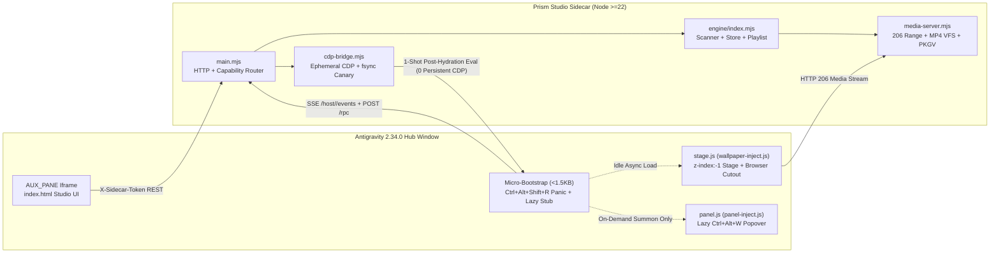

# Wallpaper Prism (`agy-wallpaper-prism`) — 下一代 AI 维护者工程交接手册

> **适用基线版本**：`v2.0.5`（GitHub: `https://github.com/azwosile/agy-wallpaper-prism`）  
> **定位**：Google Antigravity 宿主整窗液态玻璃皮肤（Obsidian Prism 6 层光学体系）+ Steam Wallpaper Engine (`431960`) / 本地多媒体动态壁纸工作台插件。  
> **核心工程信条**：**Zero Agent Tokens · Zero `app.asar` Modification · Zero-Enable Ephemeral CDP · Fail-Open First · Zero Session Disruption**

---

## 1. 仓库拓扑、目录职责与版本同步清单

### 1.1 目录结构与权威边界

```text
agy-wallpaper-prism/
├── plugin.json                        # Antigravity 官方 9/10 键插件清单（严禁添加未授权字段）
├── package.json                       # Node >=22 ESM 包配置与 CLI 脚本入口
├── assets/logo.svg                    # >=128x128 (256x256 viewBox) 矢量图标
├── skills/wallpaper-prism/SKILL.md    # 按需激活的 Agent 技能说明（含 sidecar:// 与 customization:// 链接）
├── src/
│   ├── shared/
│   │   ├── schema.mjs                 # 全局唯一配置 Schema、8 套深浅配色、预设快照、重置域与清洗函数
│   │   └── i18n.mjs                   # 中/英双语词典（工作台与后端共享）
│   ├── engine/
│   │   ├── index.mjs                  # 引擎门面：生命周期、热缓存启动、后台异步扫描、SSE 状态广播
│   │   ├── store.mjs                  # 原子写盘队列、fsync 金丝雀写入、v1 数据迁移、流式 SHA-256 上传去重
│   │   ├── scanner.mjs                # Steam/WE 431960 发现、4 层本地目录递归扫描、路径穿越防护、热快照缓存
│   │   ├── media-server.mjs           # Loopback 媒体服：HTTP 206 Range、WE Web 沙箱注入、FFmpeg 3 并发视频缩略图
│   │   ├── mp4-vfs.mjs                # 零磁盘拷贝虚拟 moov 前置（faststart，兼容 32位 stco 与 64位 co64）
│   │   ├── pkg-scene.mjs              # WE PKGV0002 + LZ4 + TEXB0004 场景解包提取内嵌 MP4/音频流
│   │   └── playlist.mjs               # 顺序/随机洗牌轮播与定时/播完切换状态机
│   ├── host/
│   │   ├── index.mjs                  # 宿主脚本加载缓存、buildClientSkinPayload、纯静态模式 buildStaticCssSheet
│   │   ├── wallpaper-inject.js        # 注入 Antigravity 主窗口的微内核（stage.js，ES2020 自包含 IIFE）
│   │   └── panel-inject.js            # 宿主内 Ctrl+Alt+W 懒加载快捷浮窗（panel.js，0 KB 冷启动开销）
│   └── studio-ui/
│       ├── app.mjs                    # 右侧边栏完整工作台前端逻辑（单向事件委托至 #app）
│       ├── styles.css                 # 工作台样式表
│       └── template.html              # 工作台 HTML 骨架
├── sidecars/prism_studio/
│   ├── sidecar.json                   # AUX_PANE 契约（restart_policy 必须保持 "on-failure"）
│   ├── main.mjs                       # 权威 Sidecar HTTP 服务 + /host/<capToken>/* 能力路由
│   ├── cdp-bridge.mjs                 # 零侵入瞬态 CDP 桥接器、两阶段 fsync 金丝雀、普通快捷方式 .lnk 补丁/无损还原
│   └── index.html                     # 由 scripts/build.mjs 构建生成的单文件内联产物（切勿手改！）
├── host/cli.mjs                       # 命令行工具（status | wake | reset-canary | enable-autostart | restore）
├── scripts/
│   ├── build.mjs                      # 离线单文件打包器（esbuild 优先，内置零依赖 AST fallback）
│   └── install-local.mjs              # 真实文件拷贝安装 + 运行中 Sidecar/Hub/Panel/Iframe 无感热升级
└── test/verify-all.mjs                # 21 项端到端全量验证套件（Manifest + 引擎 + Headless Chrome 2.34.0 像素级验证）
```

> **关联兄弟仓库**：同父工作区下的 `agy-wallpaper-prism-intro`（`https://github.com/azwosile/agy-wallpaper-prism-intro`）为 B 站宣传视频工程（WebGL2 + TTS 合成管线），与插件本体完全解耦。

### 1.2 本机安装路径与运行时数据目录（严禁混淆）

| 路径角色 | Windows 实际位置 | 关键规则 |
| :--- | :--- | :--- |
| **本机插件安装目录** | `~/.gemini/config/plugins/agy-wallpaper-prism` | **严禁使用 NTFS Junction / Symlink！** Antigravity 的 `GetAllPlugins` 在 Windows 下会静默跳过符号链接目录。必须使用 `node scripts/install-local.mjs` 执行真实目录拷贝，并保持与源码仓库 `23+` 个运行时文件 `SHA-256` 字节级一致。 |
| **Sidecar 权威数据目录** | `ANTIGRAVITY_EXECUTABLE_DATA_DIR` 或 `~/.gemini/antigravity/sidecar_data/agy-wallpaper-prism/prism_studio/data` | 存放 `config.json`、`canary.json`、`server_info.json`、`shortcut-backup.json`、`presets/`、`uploads/`、`cache/inventory-index.json`、`cache/thumbs/`。插件目录更新/重装不会丢失用户配置。 |
| **v1 历史遗留目录** | `~/.agy-wallpaper-prism` | 仅当默认启动（未显式传入测试 `dataDir`）且新目录尚无 `config.json` 与 `.migrated-from-legacy.json` 时，由 `migrateLegacyPrismDataIfNeeded` 自动非破坏性迁移。 |

### 1.3 版本号升级必改的 7 处同步点

每次升级版本号（如 `2.0.5 -> 2.0.6`），**必须同步修改以下全部位置**，否则 `install-local.mjs` 热升级判断或 `test/verify-all.mjs` 会报错：
1. `plugin.json` -> `"version"`
2. `package.json` -> `"version"`
3. `README.md` -> 顶部 `**Version**` 与架构树注释
4. `src/shared/schema.mjs` -> `PLUGIN_VERSION` 与 `PRISM_DOM.skinVersion`
5. `src/host/wallpaper-inject.js` -> `var VERSION = '...'`
6. `src/host/panel-inject.js` -> `var VERSION = '...'`
7. `test/verify-all.mjs` -> Suite 1 版本断言

---

## 2. 架构数据流与五大不可妥协的工程红线



### 红线 1：零侵入瞬态 CDP（Zero-Enable Ephemeral CDP）
- **绝对禁止**在 `cdp-bridge.mjs` 中出现以下任何调用（`test/verify-all.mjs` 会做源码级零容忍扫描）：
  - `Page.enable`
  - `Runtime.enable`
  - `Page.addScriptToEvaluateOnNewDocument`
  - `Runtime.addBinding`
- **原因**：用户环境通常同时运行 `gemini-neko-cockpit`、`agy-capsule`、`agy-dart` 等多个连接调试端口的插件。在文档水合前强行挂载持久化 Inspector Domain 或注入大体积脚本，会与同机插件发生竞态碰撞，直接把 React `#root` 卡死在黑屏阶段。
- **正确做法**：
  1. 只通过极小只读探针 `HUB_READINESS_PROBE_EXPR` 轮询检查 `document.readyState === 'complete'` 且 `#root` 宽高 `>= 200×150`；
  2. 等待 `liveBootDelay`（默认 `1.5s`）稳定窗口后，用瞬态 WebSocket 发送单条 `buildHostMicroBootstrap` 并**立即关闭 WebSocket**；
  3. 后续状态同步走 `/host/<capToken>/events`（SSE），宿主回调走 `/host/<capToken>/rpc`（HTTP POST）；
  4. `DevToolsActivePort` 端口发现规则：`pf.port !== 9222 || pf.port === configured || sessionForcedWake`（支持 `9339` 与 `--remote-debugging-port=0` 随机端口，冷启动绝不擅自连接共享端口 `9222`）。

### 红线 2：双门控免黑屏舞台（Dual-Gate Fail-Open）与 `z-index: -1` 惰性层
- **双属性门控**：
  - `html[data-agy-prism-glass="ready"]`：挂载基础 CSS 变量、滚动条与实心浮层保护；
  - `html[data-agy-prism-wallpaper="ready"]`：**仅当图片完成 `img.decode()` 或视频首帧解码完成（`readyState >= 2 && videoWidth > 0`）后才允许挂载！** 在此之前严禁将 `#root` 或 `.browser-hole-opaque` 背景刷成透明。一旦壁纸 `404` 或解码失败，自动保持原生 `#070708` / `#FFFFFF` 实心底色（Fail-Open）。
- **底层舞台属性**：`#agy-prism-stage` 必须锁定 `position: fixed; inset: 0; z-index: -1; pointer-events: none; background-color: transparent; contain: style` 且 `stage.inert = true`。
  - **切勿改回 `contain: layout paint style`**：带有 `paint` containment 且位于 `z-index: -1` 时，Chromium Blink 遮挡追踪器会将底层 `<video>` 误判为被 `#root` 完全遮挡而直接停止提交视频帧！

### 红线 3：Antigravity `2.34.0` 三层 `WebContentsView` 浏览器圆角镂空（`[data-browser-hole]`）
- **宿主机制**：Antigravity `2.34.0` 的内置浏览器网页渲染在主界面 `hubWcv (z=1)` **下方**的独立 `clipView (z=0)` 中，主界面对应区域放置透明占位框 `[data-browser-hole="true"]` 并在 `<html>`/`<body>` 标记 `data-has-browser-hole="true"`。
- **必须遵守的联动规则**：
  1. 当 `data-has-browser-hole="true"` 存在时，`<html>`、`<body>` 及 `.browser-hole-ancestor` 链必须全部让渡为 `background: transparent !important`（使 Skia 合成帧在该区域 `alpha === 0`）；
  2. `syncBrowserHoleCutout()` 同步读取所有可见 `[data-browser-hole]:not([data-browser-hole="false"])` 的边界与外层浮岛圆角，生成 `evenodd` SVG 路径（`M0,0 H... Z M... A... Z`）赋给 `#agy-prism-stage` 的 `clip-path`，精确挖出带圆角的透明窗口；
  3. 宿主内打开的 `#agy-prism-popover` 必须设置 `data-browser-occluder="true"`，通知宿主 `catcherView` 不要把浮窗上的点击穿透给底层网页。

### 红线 4：两阶段 `fsync` 启动金丝雀（Boot Canary）与一键逃生舱
- 首次向某窗口注入前，`canary.arm()` 通过 `openSync -> writeSync -> fsyncSync -> closeSync -> renameSync` 将 `canary.json` 置为 `"arming"`；挂载稳定后置为 `"healthy"`。若进程崩溃导致下次启动仍见到前一次 `browserSessionId` 遗留的 `"arming"`，自动触发熔断 `"tripped"` 并将 `skinEnabled` 持久化为 `false`。
- 紧急逃生热键（微引导层独立绑定，不依赖 `stage.js` / `panel.js` 加载成功）：**`Ctrl+Alt+Shift+R`** 或 **`900ms` 内连按 `4× Escape`**，立即清除所有 `#agy-prism-*` 节点与 `data-prism-*` 属性、恢复原生标题栏按钮颜色，并通知后端持久化 `skinEnabled = false`。

### 红线 5：零会话中断（Zero Session Disruption）与零隐私泄露（Zero-PII）
- **严禁在任何时候杀掉或重启用户正在运行的 `Antigravity.exe`！** `sidecar.json` 采用 `restart_policy: "on-failure"`，开发调试统一运行 `node scripts/build.mjs && node scripts/install-local.mjs` 完成在线热替换。
- **严禁在仓库代码、测试夹具、文档或 Commit Message 中写入本机用户名路径或任何第三方 API Token**。每次提交前必须运行 `test/verify-all.mjs` 通过 Suite 1 的 Zero-PII 扫描。

---

## 3. 已攻克的历史疑难细节（切勿在后续重构中回退）

1. **动态壁纸全屏/切窗假死与后台冷启动误杀（`v2.0.1` + `v2.0.5`）**
   - **静音视频轨道回收 + 尾部时长差死锁**：部分创意工坊 MP4 视频轨比容器 `mvhd` 短约 `0.4s`（如 `11.596s / 12.033s`）。从后台切回或全屏切换恢复轨道时若落在尾部无关键帧区间，原生 `video.loop` 会卡死在 `paused === false && readyState === 2 && dt === 0`。`wallpaper-inject.js` 通过单链 `armRvfcKeepAlive()` 保活 + `checkVideoLiveness()` 帧时钟看门狗自动学习 `__prismEffectiveEnd` 提前无感回环。
   - **Windows DWM 遮挡态冷启动保活**：若冷启动时 Antigravity 被浏览器等窗口遮挡，Chromium 只解析出视频宽高（`readyState = 1, videoWidth > 0, error = null`）而暂缓解码首帧。`armPendingVideoGuard` 绝不在 `error === null` 时销毁 `<video>`，而是在切回前台瞬间立即唤醒解码。
2. **Sidecar 重启端口漂移自动重绑（`v2.0.1`）**
   - 当宿主因插件更新重启 Sidecar 分配新动态端口后，已打开的主窗口内旧 `EventSource` 可能卡在 `readyState === 0 (CONNECTING)`，旧 `<video src>` 仍指向旧媒体端口。`cdp-bridge.mjs` 的 `needsBridgeRebind`（检测 `probe.hostBase !== expectedBase || probe.sseState === 2 || probe.skinVer !== skinVersion`）会自动关闭旧连接并无感切换至新端口。
3. **跨版本热缓存零阻塞升级（`v2.0.5`）**
   - `scanner.mjs` 的 `loadWarmInventorySnapshot` 兼容读取旧版（`version >= 2`）缓存并标记 `staleVersion: true`，保证升级插件后冷启动依然 `<15ms` 秒出壁纸，再由 `scheduleDeferredRefresh(350)` 在后台异步重建新版索引，避免数十秒同步扫盘阻塞。
4. **Windows 右上角最小化/最大化/关闭按钮默认透明（`v2.0.2`）**
   - 配置项 `transparentWindowControls`（默认 `true`）通过宿主自带 `window.electronNative.setTitleBarOverlay({ color: '#00000000', symbolColor })` 将原生按钮底色设为全透明；宿主切换明暗主题时内部 `fhc("--sidebar")` 会回写 6 位纯色，因此 `themeObs` 会在 `75ms` 后二次执行 `syncWindowControlsOverlay(false, true)` 覆盖回来。
5. **左侧边栏会话行悬停按钮清晰度（`v2.0.3`）**
   - 悬停 `.agy-sidebar-row` 时，通过 CSS `mask-image: linear-gradient(...)` 对标题容器尾部做精确像素级 Alpha 渐隐（自动区分是否有 `.agy-row-status` 时间戳及按钮数量），并为 `.agy-row-actions > button` 添加 `blur(8px)` 微磨砂底衬，杜绝白色标题字穿透在图标正后方。
6. **Antigravity `2.34.0` 浅色模式三处样式陷阱与兄弟插件隔离（`v2.0.4`）**
   - **严禁使用属性子串选择器 `[class*="bg-background"]`**（会误中未悬停的 `.hover:bg-background` 标签页）；
   - **反色前景胶囊**：`GW + ' :is(.text-background, .ag-cs-home-heat-hint) { color: rgb(var(--prism-base-rgb)) !important; }'` 解决浅色模式输入框 Voice 按钮变纯黑圆点及热力图提示文字消失；
   - **侧栏吸顶分组头（`Projects` / `Conversations`）**：必须使用 `::before` 伪元素承载 `backdrop-filter: blur(14px)`，严禁直接在父容器上加 `backdrop-filter`（否则会形成新的包含块捕获内部 `position: fixed` 菜单/浮窗！）；
   - **图片预览 Lightbox**：从 `SOLID_POPOVERS` 的 `[role="dialog"]` 中排除 `:not([data-testid="media-modal"])`，并在 `SIBLING_EXCLUDE` 排除 `modal-backdrop` / `media-modal`，避免看大图周围变成不透明纯白；
   - **同机插件 DOM 隔离**：`SIBLING_EXCLUDE` 永久排除 `#gemini-neko-pet-root`、`#gemini-neko-observer-modal`、`#ag-usage-monitor-capsule`、`#ag-usage-monitor-portal`、`#ag-context-meter`、`#deck-metrics-strip`；并在 `#agy-prism-popover` 和 `#agy-prism-pill`（含懒加载启动胶囊）保留 `translate="no" data-no-translate="true" data-ag-no-i18n="1"`。

---

## 4. 标准开发、验证、合并社区 PR 与发布 SOP

### 4.1 本地修改与热安装闭环

```powershell
# 1. 修改 src/* 或 sidecars/* 后，重新打包单文件 Studio UI
node scripts/build.mjs

# 2. 热同步至 ~/.gemini/config/plugins/agy-wallpaper-prism（自动热重载当前运行窗口，零重启）
node scripts/install-local.mjs

# 3. 提交前运行全量 21 项验证套件（允许工作区未提交）
$env:PRISM_ALLOW_DIRTY_GIT='1'; node test/verify-all.mjs

# 4. Git 提交后再次运行严格验证（确保工作区干净 + SHA-256 完全一致 + 0 PII）
node test/verify-all.mjs
```

### 4.2 处理社区 PR 的标准做法

1. 先只读拉取审查：`git fetch origin pull/<PR_NUM>/head`，重点检查：
   - 是否基于旧版本切出导致回退了 `VERSION` 或丢失新增配置键；
   - 是否提交了 `CRLF` 换行或过期 `sidecars/prism_studio/index.html` 构建产物；
   - 是否违反上文五大工程红线（如无 `ffmpeg` 机器的 404 裂图、自吞 `<cacheDir>/thumbs`、误用废弃变量等）。
2. 合入方式：
   - 若无冲突：使用 `git merge -X renormalize FETCH_HEAD` 合入，再在后续提交补充打磨项并重新运行 `node scripts/build.mjs`；
   - 若存在旧基线冲突：使用 `git merge -s ours FETCH_HEAD` 将 PR 头提交纳入 `main` 第二父节点，再落盘精确修复代码并在 Commit Message 保留 `Co-authored-by: <author>`，这样推送 `main` 后 GitHub 会自动将 PR 标记为紫色 **Merged** 并计入 Contributors。

### 4.3 发布 GitHub Release 标准流程

```powershell
# 1. 打带注释的版本标签并推送到远端
git tag -a v2.0.5 -m "Wallpaper Prism v2.0.5"
git push origin main v2.0.5

# 2. 使用 git archive 生成干净的预构建插件压缩包（不含 .git 与测试临时文件）
git archive --format=zip --prefix=agy-wallpaper-prism/ -o agy-wallpaper-prism-v2.0.5.zip v2.0.5
```
随后通过 GitHub CLI 或 REST API（通过 `git credential fill` 读取本机已授权 HTTPS 凭证，严禁将凭证输出至终端或日志）创建 Release 并上传 `agy-wallpaper-prism-vX.Y.Z.zip`。
