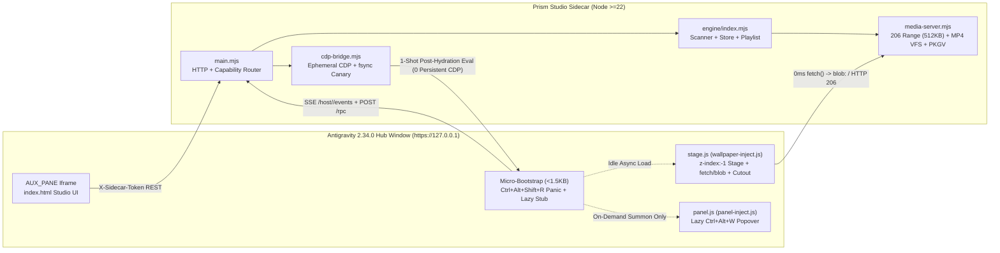

# Wallpaper Prism (`agy-wallpaper-prism`) — 下一代 AI 维护者工程交接手册

> **适用基线版本**：`v2.0.7`（GitHub: `https://github.com/azwosile/agy-wallpaper-prism`）  
> **定位**：Google Antigravity 宿主整窗液态玻璃皮肤（Obsidian Prism 6 层光学体系）+ Steam Wallpaper Engine (`431960`) / 本地多媒体动态壁纸工作台插件。  
> **核心工程信条**：**Zero Agent Tokens · Zero `app.asar` Modification · Zero-Enable Ephemeral CDP · Fail-Open First · Zero Session Disruption**

---

## 0. 当前工作区交接状态快照（下一位 AI 接手必读）

### 0.1 版本、运行态与全量验证基线
- **当前代码版本**：`v2.0.7`（全仓 **7 处版本同步锚点**已全部对齐 `2.0.7`，详见 `§1.3`）。
- **本机安装同步状态**：`~/.gemini/config/plugins/agy-wallpaper-prism` 下全部 **23 个运行时核心文件**已通过 `node scripts/install-local.mjs` 真实文件拷贝同步（`SHA-256` 字节级一致）并在线热替换生效，无需重启宿主 `Antigravity.exe`。
- **端到端验证基线**：`node test/verify-all.mjs` 全量 **27 / 27 PASS**（覆盖 Suite 1 清单/Zero-CDP/Zero-PII/SHA-256 同步、Suite 2 引擎/金丝雀/PR #6 加固跨协议 `fetch+blob`/PR #7 `/video-stage/` 同源流式舞台与 Studio `/api/events` SSE/`v2.0.7` `plugin://` 206 代理 + `971 MB` `MediaSource` `/mse-fmp4/` 流式播放 + 全链路 `0ms fetch+blob` 图片零挂起回归、Suite 3 Headless Chrome `1440×900` 像素级 E2E + 4 项毛玻璃 UI 架构断言 + `v2.0.7` 三端一键启用/禁用主开关与持久化 `#agy-prism-pill` E2E）。

### 0.2 Git 提交基线与工作区状态（切勿执行破坏性回滚！）
> [!CAUTION]
> 当前 Git 分支为 `main`，`v2.0.6` 已合入 PR #6 & PR #7 提交至 `ba0b6de`（`release: Wallpaper Prism v2.0.6`）。`v2.0.7` 全部源码、测试断言升级、打包产物与交接文档同步位于当前工作树（提交前严禁执行 `git checkout -- .`、`git restore .`、`git reset --hard` 或 `git clean -fd`）。

当前 `v2.0.7` 涉及的全部 **16 个更新文件**如下：

```text
 M README.md
 M docs/AI_HANDOFF.md
 M package.json
 M plugin.json
 M sidecars/prism_studio/cdp-bridge.mjs
 M sidecars/prism_studio/index.html
 M sidecars/prism_studio/main.mjs
 M src/engine/media-server.mjs
 M src/host/index.mjs
 M src/host/panel-inject.js
 M src/host/wallpaper-inject.js
 M src/shared/i18n.mjs
 M src/shared/schema.mjs
 M src/studio-ui/app.mjs
 M src/studio-ui/styles.css
 M test/verify-all.mjs
```

### 0.3 社区 PR #6 & PR #7 双 PR 合入关联说明
- **关联 PR #6**：`https://github.com/azwosile/agy-wallpaper-prism/pull/6`（标题：`fix(host): fall back to fetch+blob when HTTPS hub stalls HTTP loopback media`，Head Commit：`be354e792d99625c333f19e0c4f02263682ff2a7`）
- **关联 PR #7**：`https://github.com/azwosile/agy-wallpaper-prism/pull/7`（标题：`fix(media,host,studio): stream cross-scheme videos via /video-stage/ iframe, sync Studio via SSE & tint header bar`，Head Commit：`0c67d36bf1d2f98c584b3a02aea5b480cd9fe55e`）
- **贡献者信息**：`zmzwynzj <177476355+zmzwynzj@users.noreply.github.com>`（两个 PR 均基于 `v2.0.5` `7ec0686` 提交）
- **合入策略**：工作区已完整吸收并加固 PR #6（`0ms` 直拉、`20s` 超时、`256 MiB` 封面降级、`` 兜底、FX 画布门控）与 PR #7（`/video-stage/<token>` 同源流式 `<iframe>` + `900ms` 防顿挫看门狗 + 异常无感回退 `0ms fetch+blob`、Studio `/api/events` SSE 实时同步、主对话顶栏 `[data-main-content-header]` 染色对齐、纯 LF `esbuild` 打包）。正式提交 `v2.0.6` 时，使用 **`git merge -s ours <PR6_SHA> <PR7_SHA> --no-commit`** 将双 PR 头提交同时挂接为 Merge 父节点而不覆盖工作区加固代码，并在 Commit Message 末尾保留：
  `Co-authored-by: zmzwynzj <177476355+zmzwynzj@users.noreply.github.com>`
  推送 `main` 后，GitHub 会自动将 PR #6 与 PR #7 均标记为紫色 **Merged** 并计入 Contributors（完整命令见 `§5.2`）。

---

## 1. 仓库拓扑、本机路径边界与 7 处版本同步锚点

### 1.1 目录结构与权威职责树

```text
agy-wallpaper-prism/
├── plugin.json                        # Antigravity 官方 9/10 键插件清单（严禁添加未授权字段）
├── package.json                       # Node >=22 ESM 包配置与 CLI 脚本入口
├── assets/logo.svg                    # >=128x128 (256x256 viewBox) 矢量图标
├── docs/AI_HANDOFF.md                 # 下一代 AI 维护者权威工程交接手册（本文档）
├── skills/wallpaper-prism/SKILL.md    # 按需激活的 Agent 技能说明（含 sidecar:// 与 customization:// 链接）
├── src/
│   ├── shared/
│   │   ├── schema.mjs                 # 全局唯一配置 Schema、8 套深浅配色、预设快照、nullableNum 与清洗函数
│   │   └── i18n.mjs                   # 中/英双语词典（工作台与后端共享）
│   ├── engine/
│   │   ├── index.mjs                  # 引擎门面：生命周期、热缓存启动、后台异步扫描、SSE 状态广播
│   │   ├── store.mjs                  # 原子写盘队列、fsync 金丝雀写入、v1 数据迁移、流式 SHA-256 上传去重
│   │   ├── scanner.mjs                # Steam/WE 431960 发现、4 层本地目录递归扫描、路径穿越防护、热快照缓存
│   │   ├── media-server.mjs           # Loopback 媒体服：HTTP 206 Range (512KB chunk)、/mse-fmp4/ 零重编码流、/video-stage/、WE 沙箱注入、FFmpeg 缩略图
│   │   ├── mp4-vfs.mjs                # 零磁盘拷贝虚拟 moov 前置（faststart，兼容 32位 stco 与 64位 co64）
│   │   ├── pkg-scene.mjs              # WE PKGV0002 + LZ4 + TEXB0004 场景解包提取内嵌 MP4/音频流
│   │   └── playlist.mjs               # 顺序/随机洗牌轮播与定时/播完切换状态机
│   ├── host/
│   │   ├── index.mjs                  # 宿主脚本加载缓存、buildClientSkinPayload (含 plugin*Url / mseFmp4Url / videoStageUrl)、纯静态模式 buildStaticCssSheet
│   │   ├── wallpaper-inject.js        # 注入 Antigravity 主窗口的微内核（stage.js，ES2020 自包含 IIFE，含三级大视频流、0ms 图片/取色、WCO 胶囊与 4 项毛玻璃架构）
│   │   └── panel-inject.js            # 宿主内 Ctrl+Alt+W 懒加载快捷浮窗（panel.js，含顶栏一键开关、持久化胶囊与 80 条上限 bindSafeThumb）
│   └── studio-ui/
│       ├── app.mjs                    # 右侧边栏完整工作台前端逻辑（顶栏 #prism-master-toggle-btn 主开关 + 单向事件委托至 #app + /api/events SSE 实时同步）
│       ├── styles.css                 # 工作台样式表（含 .prism-master-toggle 主开关与 21:9 迷你工作台浮岛预览，.mini-aux 对齐 .mini-center）
│       └── template.html              # 工作台 HTML 骨架
├── sidecars/prism_studio/
│   ├── sidecar.json                   # AUX_PANE 契约（restart_policy 必须保持 "on-failure"）
│   ├── main.mjs                       # 权威 Sidecar HTTP 服务 + plugin:// /media-proxy/* 206 流代理 + /api/skin/toggle + /api/events SSE + /host/<capToken>/*
│   ├── cdp-bridge.mjs                 # 零侵入瞬态 CDP 桥接器、两阶段 fsync 金丝雀、ss() 保留胶囊卸载 / sa() 紧急逃生、普通快捷方式 .lnk 补丁
│   └── index.html                     # 由 scripts/build.mjs 构建生成的单文件内联产物（纯 LF，切勿手改！）
├── host/cli.mjs                       # 命令行工具（status | wake | reset-canary | enable-autostart | restore）
├── scripts/
│   ├── build.mjs                      # 离线单文件打包器（esbuild 优先，内置零依赖 AST fallback）
│   └── install-local.mjs              # 真实文件拷贝安装 + 同版本/跨版本 Sidecar/Hub/Panel/Iframe 强制热替换
└── test/
    ├── mock-hub-template.mjs          # Antigravity 2.34.0 真实 DOM/CSS 权重模拟夹具（含顶栏下拉、项目文件夹、aux-pane-split 双栏探针）
    └── verify-all.mjs                 # 27 项端到端全量验证套件（Manifest + 引擎 + PR #6/#7 + v2.0.7 plugin:// & MSE & 三端一键主开关 + Headless Chrome 像素级 E2E）
```

> **关联兄弟仓库**：同父工作区下的 `agy-wallpaper-prism-intro`（`https://github.com/azwosile/agy-wallpaper-prism-intro`）为 B 站宣传视频工程（WebGL2 + TTS 合成管线），与插件本体完全解耦。

### 1.2 本机安装路径与运行时数据目录（严禁混淆）

| 路径角色 | Windows 实际位置（示例脱敏） | 关键规则 |
| :--- | :--- | :--- |
| **本机插件安装目录** | `~/.gemini/config/plugins/agy-wallpaper-prism` | **严禁使用 NTFS Junction / Symlink！** Antigravity 的 `GetAllPlugins` 在 Windows 下会静默跳过符号链接目录。必须使用 `node scripts/install-local.mjs` 执行真实目录拷贝，并保持与源码仓库 `23` 个核心同步文件（`test/verify-all.mjs:384-408`）`SHA-256` 字节级一致。 |
| **Sidecar 权威数据目录** | `ANTIGRAVITY_EXECUTABLE_DATA_DIR` 或 `~/.gemini/antigravity/sidecar_data/agy-wallpaper-prism/prism_studio/data` | 由 `resolveDefaultPrismDataDir`（`src/engine/store.mjs:178-190`）统一解析。存放 `config.json`、`canary.json`、`server_info.json`、`shortcut-backup.json`、`presets/`、`uploads/`、`cache/inventory-index.json`、`cache/thumbs/`、`cache/scene-media/`。插件目录更新/重装不会丢失用户配置。 |
| **v1 历史遗留目录** | `~/.agy-wallpaper-prism` | 仅当默认启动（未显式传入测试 `dataDir` 或 `AGY_PRISM_DATA_DIR`）且新目录尚无 `config.json` 与 `.migrated-from-legacy.json` 时，由 `migrateLegacyPrismDataIfNeeded`（`src/engine/store.mjs:197-254`）自动非破坏性迁移。 |

### 1.3 版本号升级必改的 7 处同步锚点（当前 `v2.0.7` 精确行号）

每次升级版本号（如 `2.0.7 -> 2.0.8`），**必须同步修改以下全部 7 处锚点**（另建议同步更新 `src/host/index.mjs:276, 347` 的静态样式表头部注释），否则 `install-local.mjs` 热升级校验或 `test/verify-all.mjs` Suite 1 第一项断言会直接失败：

| 序号 | 文件路径 | 当前行号 | `v2.0.7` 精确锚点内容 |
| :---: | :--- | :--- | :--- |
| 1 | `plugin.json` | `L5` | `"version": "2.0.7",` |
| 2 | `package.json` | `L3` | `"version": "2.0.7",` |
| 3 | `README.md` | `L4`、`L55` | `> **Version**: \`2.0.7\`` 及架构树 `Official 10-key Antigravity plugin manifest (v2.0.7)` |
| 4 | `src/shared/schema.mjs` | `L6`、`L13` | `export const PLUGIN_VERSION = '2.0.7';` 与 `PRISM_DOM.skinVersion: '2.0.7'` |
| 5 | `src/host/wallpaper-inject.js` | `L1`、`L12` | 顶部注释与 `var VERSION = '2.0.7';` |
| 6 | `src/host/panel-inject.js` | `L1`、`L12` | 顶部注释与 `var VERSION = '2.0.7';` |
| 7 | `test/verify-all.mjs` | `L221-L227`（及顶部 `L3, L192, L201`） | Suite 1 版本一致性断言（`assert.equal(raw.version, '2.0.7', ...)` 等 7 项正则/相等校验） |

---

## 2. 架构数据流与五大不可妥协的工程红线



### 红线 1：零侵入瞬态 CDP（Zero-Enable Ephemeral CDP）
- **绝对禁止**在 `sidecars/prism_studio/cdp-bridge.mjs` 中出现以下任何调用（`test/verify-all.mjs:254-268` 会做源码级零容忍扫描）：
  - `Page.enable`
  - `Runtime.enable`
  - `Page.addScriptToEvaluateOnNewDocument`
  - `Runtime.addBinding`
- **原因**：用户环境通常同时运行 `gemini-neko-cockpit`、`agy-capsule`、`agy-dart` 等多个连接调试端口的插件。在文档水合前强行挂载持久化 Inspector Domain 或注入大体积脚本，会与同机插件发生竞态碰撞，直接把 React `#root` 卡死在黑屏阶段。
- **正确做法**：
  1. 只通过极小只读探针 `HUB_READINESS_PROBE_EXPR` 轮询检查 `document.readyState === 'complete'` 且 `#root` 宽高 `>= 200×150`；
  2. 等待 `liveBootDelay`（默认 `1.5s`）稳定窗口后，用瞬态 WebSocket 发送单条 `buildHostMicroBootstrap` 并**立即关闭 WebSocket**；
  3. 后续状态同步走 `/host/<capToken>/events`（SSE），宿主回调走 `/host/<capToken>/rpc`（HTTP POST）；
  4. `DevToolsActivePort` 端口发现规则：`pf.port !== 9222 || pf.port === configured || sessionForcedWake`（支持 `9339` 与 `--remote-debugging-port=0` 随机端口，冷启动绝不擅自连接共享端口 `9222`）。

### 红线 2：双门控免黑屏舞台（Dual-Gate Fail-Open）、粒子门控与 `z-index: -1` 惰性层
- **双属性门控**：
  - `html[data-agy-prism-glass="ready"]`：挂载基础 CSS 变量、滚动条与实心浮层保护；
  - `html[data-agy-prism-wallpaper="ready"]`：**仅当图片完成 `img.decode()` 或视频首帧解码完成（`readyState >= 2 && videoWidth > 0`）后才允许通过 `setWallpaperReady(true)`（`src/host/wallpaper-inject.js:2038-2057`）挂载！** 在此之前严禁将 `#root` 或 `.browser-hole-opaque` 背景刷成透明。一旦壁纸 `404`、超时或解码失败，自动保持原生 `#070708` / `#F7F7F8` 实心底色（Fail-Open）。
- **粒子画布 `#agy-prism-fx-canvas` 必须同步受 `state.wallpaperReady` 门控（`v2.0.6` 新增铁律）**：
  - 当 `!state.wallpaperReady` 时，`setWallpaperReady`（`src/host/wallpaper-inject.js:2049-2055`）与 `ensureFxCanvas`（`L3736, L3747`）必须立即将 `#agy-prism-fx-canvas` 设为 `display: none` 并清空 `state.fxParticles = []`，同时 `pointermove`（`L3820`）与 `pointerdown`（`L3859`）必须停止产生新粒子，严禁在 Fail-Open 原生黑底（`#070708`）上出现孤立悬浮的星尘或点击波纹！
- **底层舞台属性**：`#agy-prism-stage`（`src/host/wallpaper-inject.js:1352-1364, 2168`）必须锁定 `position: fixed; inset: 0; z-index: -1; pointer-events: none; background-color: transparent; contain: style` 且 `stage.inert = true`。
  - **切勿改回 `contain: layout paint style`**：带有 `paint` containment 且位于 `z-index: -1` 时，Chromium Blink 遮挡追踪器会将底层 `<video>` 误判为被 `#root` 完全遮挡而直接停止提交视频帧！

### 红线 3：Antigravity `2.34.0` 三层 `WebContentsView` 浏览器圆角镂空（`[data-browser-hole]`）
- **宿主机制**：Antigravity `2.34.0` 的内置浏览器网页渲染在主界面 `hubWcv (z=1)` **下方**的独立 `clipView (z=0)` 中，主界面对应区域放置透明占位框 `[data-browser-hole="true"]` 并在 `<html>`/`<body>` 标记 `data-has-browser-hole="true"`。
- **必须遵守的联动规则**：
  1. 当 `data-has-browser-hole="true"` 存在时，`<html>`、`<body>` 及 `.browser-hole-ancestor` 链必须全部让渡为 `background-color: transparent !important`（使 Skia 合成帧在该区域 `alpha === 0`）；
  2. `syncBrowserHoleCutout()`（`src/host/wallpaper-inject.js:1992-2036`）同步读取所有可见 `[data-browser-hole]:not([data-browser-hole="false"])` 的边界与外层浮岛圆角，生成逆时针 `evenodd` SVG 路径（`M0,0H...Z M...A...Z`）赋给 `#agy-prism-stage` 与 `#agy-prism-fx-canvas` 的 `clip-path`，精确挖出带圆角的透明窗口；
  3. 宿主内打开的 `#agy-prism-popover`（`src/host/panel-inject.js:1806-1807`）必须设置 `data-browser-occluder="true"`，通知宿主 `catcherView` 不要把浮窗上的点击穿透给底层网页。

### 红线 4：两阶段 `fsync` 启动金丝雀（Boot Canary）与一键逃生舱
- 首次向某窗口注入前，`canary.arm()` 通过 `writeFsyncJsonSync`（`src/engine/store.mjs:137-168`：`openSync -> writeSync -> fsyncSync -> closeSync -> renameSync`）将 `canary.json` 置为 `"arming"`；挂载稳定后置为 `"healthy"`。若进程崩溃导致下次启动仍见到前一次 `browserSessionId` 遗留的 `"arming"`，自动触发熔断 `"tripped"` 并将 `skinEnabled` 持久化为 `false`。
- 紧急逃生热键（微引导层独立绑定，不依赖 `stage.js` / `panel.js` 加载成功）：**`Ctrl+Alt+Shift+R`** 或 **`900ms` 内连按 `4× Escape`**，立即清除所有 `#agy-prism-*` 节点与 `data-prism-*` 属性、恢复原生标题栏按钮颜色，并通知后端持久化 `skinEnabled = false`。

### 红线 5：零会话中断（Zero Session Disruption）、同版本强制热替换与零隐私泄露（Zero-PII）
- **严禁在任何时候杀掉或重启用户正在运行的 `Antigravity.exe`！** `sidecar.json` 采用 `restart_policy: "on-failure"`，开发调试统一运行 `node scripts/build.mjs && node scripts/install-local.mjs` 完成在线热替换。
- **同版本号热替换铁律（`v2.0.6` 强化，`scripts/install-local.mjs:96, 130-225`）**：开发期频繁出现版本号不变（如 `2.0.6 -> 2.0.6`）但微内核代码已更新的场景。若仅靠 `<script src="/stage.js">` 重载，`wallpaper-inject.js:35` 的同版本幂等守卫 `if (prev.version === VERSION && prev.alive())` 会直接短路跳过新代码！因此 `install-local.mjs` 必须：
  1. 先调用 `POST /api/host/reload` 刷新 Sidecar 进程内存脚本缓存；
  2. 通过瞬态 `evaluateTargetEphemeral` 显式调用旧实例 `window.__agyPrismPanel.destroy()` 与 `window.__agyPrism.destroy()` 并 `delete` 全局引用（同时携带 `carry` 最新状态载荷）；
  3. 直接在页面内同步执行 `getHostSkinScript({ reload: true })` 最新磁盘闭包并轮询确认 `wallpaperReady === true`（`L248-L261`），严禁因版本号相同而短路跳过！
- **严禁在仓库代码、测试夹具、文档或 Commit Message 中写入本机真实用户名、真实个人绝对路径或任何第三方 API Token**。所有文档路径示例一律脱敏为 `~/.gemini/...` 或 `<USER_HOME>/...`，每次提交前必须通过 `test/verify-all.mjs:347-432` 的 Zero-PII 扫描。

---

## 3. `v2.0.6` 查明并攻克的四大核心问题详录（现象 · 根因证据 · 代码机制 · 防回退约束）

### 3.1 重启黑屏与 PR #6 跨协议回环 `fetch+blob` 加固（Chrome 152 `https:` 宿主 -> `http://127.0.0.1` 媒体停滞）

#### 1) 现象与现场遥测铁证
- **现象**：开启普通快捷方式自启（`--remote-debugging-port=9339`）并选用动态视频壁纸（如 Workshop MP4 或 `scene.pkg` 内嵌视频）后，重启 Antigravity `2.34.0` 会出现壁纸无法透出、主界面回退为 `#070708` 纯黑底色（若同时开启了 `fxEnabled: true`，旧版还会在纯黑底板上孤立漂浮彩色鼠标星尘粒子，极易被误判为“渲染器黑屏死机”）。
- **遥测铁证**：
  - Antigravity `2.34.0`（内嵌 `Chrome/152.0.7977.167` / `Electron/44.9.1`）主窗口运行在 **`https://127.0.0.1:<port>`**，而 Sidecar 媒体服运行在 **`http://127.0.0.1:<mediaPort>`**；
  - 当 `wallpaper-inject.js` 直接把 `http://127.0.0.1:<mediaPort>/media/...` 赋给 `<video>.src` 或 `<audio>.src` 时，Chromium 152 的 `type: "Media"` 资源加载器在发出 `Network.requestWillBeSentExtraInfo` 之前就会永久卡死在 **`readyState === 0, networkState === 2`**（既不触发 `loadeddata`，也不触发 `error`）；
  - 6 秒后 `armPendingVideoGuard(6000)` 超时触发 `onVideoFailed() -> failMount()`，摘除 `html[data-agy-prism-wallpaper="ready"]`，触发 Fail-Open 退回 `#070708` 实心黑底；而同一页面中对同一回环地址发起 `window.fetch()` 转 `Blob` URL 则在数毫秒内完成。

#### 2) 社区 PR #6（`be354e792d99625c333f19e0c4f02263682ff2a7`）原实现的 6 处工程隐患
PR #6 准确命中了上述跨协议 `type: "Media"` 停滞根因，但其原始补丁不能直接裸合，存在 6 处隐患：
1. **旧基线分叉**：基于 `v2.0.5`（`7ec0686`）切出，缺少 `v2.0.6` 版本锚点与其余三大修复；
2. **冷启动白等 `900ms` 且残留废连接**：首次挂载先赋值 `el.src = url` 硬等 `CROSS_SCHEME_MEDIA_PROBE_MS = 900` 毫秒超时才切 `fetch()`，既拖慢冷启动首帧近 1 秒，又在 Chromium 内部留下挂起的 `type: "Media"` 废连接；
3. **无超时 `fetch` 叠加无限递归死循环**：原 `W.fetch(url)` 未设超时定时器，而 `armPendingVideoGuard` 写了无计数上限的 `if (video.__prismFetchingBlob) { armPendingVideoGuard(1500); return; }`——一旦回环连接半开挂死，守卫将永远每 `1.5s` 递归自转，彻底丧失超时 Fail-Open 能力；
4. **`512 MiB` 双缓冲导致 `~1 GiB` 渲染进程 OOM 风险且无降级**：原上限设为 `512 MiB`，在壁纸切换过渡（`inWrap` 与 `outWrap` 并存）期间渲染进程堆内存峰值可达 `1 GiB`；且超限视频直接抛错进入黑底 `failMount()`，未降级展示 `item.thumbUrl` 封面；
5. **遗漏 `` 跨协议兜底、`disposeWrap` 漏回收 `img` Blob 且未门控 FX 粒子**：`image` / `slideshow` 未挂接 `fetch+blob` 错误回退，`disposeWrap` 仅查询 `'video, audio'`，且未修复 `!wallpaperReady` 时 `#agy-prism-fx-canvas` 在黑底上孤立绘制粒子的问题；
6. **测试覆盖单薄**：仅含简化的 `node:vm` 假 DOM 单测，未验证 `0ms` 零延迟直拉、`AbortController` 信号挂载、`>256 MiB` 封面降级与 `404` 粒子隐藏。

#### 3) `v2.0.6` 现行加固机制与源码定位
- **核心常量与跨协议判定**（`src/host/wallpaper-inject.js:2231-2243`）：
  - `MAX_BLOB_MEDIA_BYTES = 256 * 1024 * 1024`（`256 MiB` 安全上限）
  - `BLOB_FETCH_TIMEOUT_MS = 20000`（`20s` 硬超时）
  - `isCrossSchemeLoopbackMediaUrl(url)`：严格匹配 `W.location.protocol === 'https:'` 且目标 URL 匹配 `/^http:\/\/(127\.0\.0\.1|localhost|\[::1\])(:\d+)?\//i`。
- **`<video>` / `<audio>` 零延迟直走 `startBlobFetch`**（`attachLoopbackMediaSrc`，`src/host/wallpaper-inject.js:2249-2346`）：
  - 检测到跨协议回环 URL 时，**`0ms` 直接调用 `startBlobFetch()`**（`L2340-L2345`），绝不先向 `<video>.src` 写入 `http://` 触发死锁连接；
  - 每次挂载递增 `el.__prismMediaToken`（`L2254`），配合 `AbortController`（存入 `wrap.__prismAbortControllers`，`L2269-L2273`）与 `20000ms` 超时定时器（`L2274-L2280`）；
  - 双重体积门控：响应头 `content-length > MAX_BLOB_MEDIA_BYTES` 时**立即 `ac.abort()` 阻断流下载**（`L2285-L2293`），下载后二次核验 `blob.size > MAX_BLOB_MEDIA_BYTES`（`L2306-L2310`），超限统一抛出 `capErr.code = 'BLOB_CAP_EXCEEDED'`；
  - 生成 `blobUrl = W.URL.createObjectURL(blob)` 后先复核 `isCurrent()`（失活立即 `revokeObjectURL`，`L2312-L2318`），覆盖前释放旧 `el.__prismBlobUrl`（`L2321-L2325`），再赋给 `el.src`。
- **有界 `armPendingVideoGuard` 与超 `256 MiB` 自动封面降级**（`src/host/wallpaper-inject.js:3209-3342`）：
  - `blobWaitTicks < 16`（`L3209, L3219-L3227`）：`video.__prismFetchingBlob` 期间最多宽限 `16 × 1500ms = 24s`，绝不无限递归；
  - 当捕获 `err.code === 'BLOB_CAP_EXCEEDED'` 且 `item.thumbUrl` 存在时（`L3259-L3339`），自动移除 `<video>` 节点并在同一 `nextWrap` 内挂载 ``，经 `attachLoopbackImageSrc` 加载 `item.thumbUrl` 静态高清封面并触发 `commitMount()` 与动态取色，保持整窗毛玻璃与 `data-agy-prism-wallpaper="ready"` 完好生效！
- **`` 按需跨协议回退与统一零泄漏回收**：
  - `attachLoopbackImageSrc(img, url, wrap, onFail)`（`src/host/wallpaper-inject.js:2348-2455`）：供 `image`（`L2928`）、`slideshow`（`L2968, L3029`）与大视频封面降级（`L3337`）共用；优先直连 `img.src = url`，一旦在 `https:` 宿主下触发 `onerror` 立即单次自动回退 `fetch+blob`；
  - `disposeWrap(wrap)`（`src/host/wallpaper-inject.js:2457-2502`）：遍历 `wrap.__prismAbortControllers` 全部 `.abort()`，并对 `wrap.querySelectorAll('video, audio, img')` 全部递增 token、清定时器、清空 `src` 并调用 `W.URL.revokeObjectURL(el.__prismBlobUrl)`。
- **防回退约束**：严禁恢复 `900ms` 直连探测；严禁移除 `BLOB_FETCH_TIMEOUT_MS` 或 `blobWaitTicks < 16` 上限；回归单测见 `test/verify-all.mjs:993-1506`。

---

### 3.2 动态壁纸播放偶发“一卡一卡”顿挫的四重根因与修复

#### 根因 ①：`checkVideoLiveness` 缺少采样时间间隔校验，唤醒检查误判帧静止并污染循环终点
- **旧逻辑缺陷**：`visibilitychange` / `window.focus`（`L3645, L3650`）与 `evaluateAutoPause`（`L3629`）调用的 `scheduleWakeVideoCheck(150/180)`，极易在 `1100ms` 周期定时器 `state.videoWatchTimer`（`L3662-L3664`）刚采样完后的 `<33ms`（不足 30fps 一帧间隔）内再次执行 `checkVideoLiveness(true)`。此时视频正常播放但下一帧尚未提交（`moved === false`），导致双重顿挫：
  1. 旧版 `isWake` 分支当场执行 `vid.currentTime = curT - 0.035` 反向 Seek，迫使硬件解码器冲刷重解整个 GOP 关键帧序列，每次点击/聚焦窗口就“咯噔”顿挫一下；
  2. 若唤醒恰好落在视频末尾 `1.5s` 内，旧版 `vidStallCount === 1` 即把当前时间戳写入 `vid.__prismEffectiveEnd`，使原本丝滑的原生 `video.loop` 永久退化为 `4Hz` `timeupdate`（`L3072-L3081`）手动跳回 `0s` 的硬切卡顿！
- **`v2.0.6` 修复**（`src/host/wallpaper-inject.js:551, 3466-3590`）：
  - 新增 `state.lastVidCheckAt` 时间戳（`L551`），当 `moved === false` 但距上次有效采样不足 **`900ms`** 时直接免检返回：`if (state.lastVidCheckAt > 0 && (now - state.lastVidCheckAt) < 900) return;`（`L3534-L3536`）；
  - 彻底删除 `isWake` 立即反向跳帧分支；
  - 将尾部时长差自愈（Case 1，`L3543-L3559`）收紧至 **`state.vidStallCount >= 2` 且 `curT >= dur - 0.75`**（真正卡死 `>= ~1.8s` 且处于末尾 `0.75s` 内才记录 `__prismEffectiveEnd`）；将中段微推恢复（Case 2，`L3578-L3585`）收紧至 **`state.vidStallCount >= 3`**（`>= ~2.7s`）；将 D3D11 解码器重载（Case 3，`L3562-L3577`，保留 `vid.__prismBlobUrl`）收紧至 **`state.vidStallCount >= 5`**。

#### 根因 ②：默认 `mediaSaturate: 105` 与常驻 `will-change` 破坏 Windows DirectComposition NV12 零拷贝硬件叠加层
- **旧逻辑缺陷**：旧默认配置 `mediaSaturate: 105` 使所有 `<video>` 默认挂载 `filter: saturate(105%)`。在 Chromium / Windows DWM 管线中，`<video>` 一旦带有任何非 `none` 的 CSS `filter`，Skia 就无法走 DirectComposition NV12 硬件零拷贝叠加层（Hardware Overlay），每帧 1080p/4K 画面都必须拷回 GPU RGBA 离屏纹理跑着色器滤镜；同时 `.agy-prism-media-wrap` 常驻 `will-change: transform, opacity, clip-path` 额外锁死了大尺寸合成层显存。
- **`v2.0.6` 修复**：
  - 将 `DEFAULT_CONFIG.mediaSaturate` 默认值校准为 **`100`**（`src/shared/schema.mjs:764`、`src/host/wallpaper-inject.js:933`）；
  - 在 `computeSkinTokens`（`src/host/wallpaper-inject.js:1100-1121`）新增 **`isZeroCopyOverlaySafe`** 判定：当无模糊/滤镜预设、亮度与对比度为 `100%`、且饱和度为默认 `100%` **或历史持久化的旧默认值 `105%`**（`Math.abs(cfg.mediaSaturate - 1.05) <= 0.006`）时，统一输出 `--prism-media-filter: none`（用户手动调至 `130%` 等值时仍正常输出 `saturate(130%)`，由 `test/verify-all.mjs:2017-2046` E2E 守护）；
  - `.agy-prism-media-wrap` 的 `will-change` 改为按需开启：`will-change: (cfg.parallaxEnabled ? 'transform' : 'auto')`（`src/host/wallpaper-inject.js:1211, 1377`）。

#### 根因 ③：`pointermove` 每 `28ms` 同步调用 `getComputedStyle` 触发主线程重排、`fpsCap` 未接入宿主及 HiDPI 粒子超采样
- **旧逻辑缺陷**：开启鼠标粒子（`fxEnabled`）后，指针移动每 `28ms` 在主线程调用 `getComputedStyle(doc.documentElement)` 读取强调色，触发高频同步样式重算；配置项 `fpsCap` 未接入宿主 `rAF` 循环；且全屏粒子画布按 `devicePixelRatio`（2x 下像素面积 4 倍）分配缓冲。
- **`v2.0.6` 修复**（`src/host/wallpaper-inject.js`）：
  - 在 `computeSkinTokens`（`L1015`）将当前强调色 RGB 预缓存至 `state.accentRgbStr`（`L578`），`pointermove`（`L3824`）与 `pointerdown`（`L3860`）直接读取内存字符串，**0 次 `getComputedStyle` 调用**；
  - 将 `state.cfg.fpsCap`（`L943`）接入 `stepParallax`（`L3702-L3710`）与 `stepFx`（`L3754-L3762`）帧间隔节流（`minInterval = Math.floor(1000 / state.cfg.fpsCap) - 2`）；
  - `ensureFxCanvas`（`L3740-L3745`）将 `#agy-prism-fx-canvas` 锁定为 `1x` CSS 视口分辨率（`W.innerWidth × W.innerHeight`），在 2x HiDPI 屏幕上降低 `75%` 粒子填充开销。

#### 根因 ④：Loopback 媒体服普通文件流默认 `64 KiB` 小分块系统调用频繁
- **`v2.0.6` 修复**（`src/engine/media-server.mjs:642-644`）：在 `serveFileWithRange` 的 `plain` 文件分支显式配置 **`highWaterMark: 512 * 1024`**（`512 KiB` 分块），将高码率 4K60 视频顺序流与 `fetch+blob` 回环读取的 `fs.read` 次数降低 8 倍。

---

### 3.3 SideBar 背景过亮修复、深色毛玻璃载体补齐与双端自动跟随滑块

#### 1) 查明的 4 项根因
1. **`.agy-inset-shell [data-side-panel-body]` 漏配毛玻璃载体**：Antigravity `2.34.0` 内嵌工作台侧栏采用 `[data-side-panel-body]`，旧版未将其纳入 `::before` 磨砂载体列表；同时当 `.agy-sidebar` 嵌套在 `[data-testid="sidebar-split"] > div:first-child` 内时，双层选择器同时命中会导致双倍底色叠加；
2. **内层实色容器遮盖**：Hub 侧栏内部的非吸顶 `.bg-sidebar` 子块以及 `.monaco-workbench` 侧栏内部的 `> .content / .title / .composite.title / .header-or-footer` 仍涂有实色或无模糊背景，遮挡了外层 `::before` 的 `backdrop-filter`；
3. **旧侧栏不透明度公式 `g * 0.72` 偏薄且 `host-native` 暗色 `shadeRgb` 偏灰亮**：主界面 `glassOpacity = 0.76` 时旧公式仅给侧栏 `0.547` Alpha，叠加亮色壁纸后发白过亮；且 `host-native` 暗色方案中 `shadeRgb`（`17, 17, 20`）反而比 `baseRgb`（`7, 7, 8`）更灰亮；
4. **`2.34.0` 侧栏分组吸顶头属性差异**：新版分组头使用 `[data-sidebar-section-drop-id]`（`position: sticky`），旧选择器仅匹配 `[data-index][style*="sticky"]`。

#### 2) `v2.0.6` 现行机制与源码定位
- **Schema 双可空配置键与 `nullableNum` 清洗器**：
  - 在 `src/shared/schema.mjs` 新增 **`sidebarOpacity: null`** 与 **`sidebarBlur: null`**（`DEFAULT_CONFIG` `L747-L748`、4 套 `SCENE_PRESETS` `L407-408/433-434/459-460/485-486`、7 套 `FACTORY_PRESETS`、重置域 `RESET_SCOPES.skin` `L850-851`、单壁纸覆盖 `PER_WALLPAPER_OVERRIDE_KEYS` `L917-918` 及快照导出键 `src/engine/store.mjs:82-83`）；
  - `nullableNum(v, min, max, decimals)`（`src/shared/schema.mjs:949-958`）：将 `null | undefined | '' | 'auto'` 统一归一为 `null`（代表 **1:1 自动跟随主界面 `glassOpacity` / `glassBlur`**），设置自定义数值时分别钳制在 `[0.2, 0.98]`（`L1183`）与 `[0, 48]`（`L1184`）。
- **深色取暗底色与 1:1 自动跟随光学公式**（`src/host/wallpaper-inject.js:1028-1051, 1095, 1133, 1164` & `src/host/index.mjs:131-154, 176, 204`）：
  - `sbBaseRgb` 在暗色模式下自动取 `minLuminance(shadeRgb, baseRgb)`（如 `host-native` 暗色自动取深黑 `7, 7, 8` 而非 `17, 17, 20`），输出为 `--prism-sidebar-rgb`；
  - `sidebarOpacity === null` 时 `effSbOp = g`（默认 `0.76`，彻底废除偏薄的 `g * 0.72`），`sidebarBlur === null` 时 `sbBlurPx = cfg.glassBlur`（默认 `16px`）；
  - `wallpaper-inject.js:4272-4274` 的 `updateConfig` 在收到 `{ sidebarOpacity: null }` 时同步执行 `delete ovClone[k]`，确保开启单壁纸独立覆盖时点击重置也能干净恢复自动跟随。
- **防嵌套重复叠加的 `GLASS_CARRIER_SIDEBARS` 与内层清零**（`src/host/wallpaper-inject.js:344-352, 1437-1465, 1503-1529` & `src/host/index.mjs:254-264, 344-368, 383-407`）：
  - `GLASS_CARRIER_SIDEBARS` 通过 `:not([data-testid="sidebar-split"] > div:first-child *)` 与 `:not(.agy-sidebar *)` 互斥排除祖先已挂载载体的内层侧栏，统一用 `::before` 承载 `--prism-surface-sidebar` 与 `--prism-sidebar-backdrop`（父元素强制 `backdrop-filter: none !important`，确保侧栏内固定定位菜单零捕获）；
  - 清空侧栏内非 sticky 的 `.bg-sidebar`（`L1503`）与 `.monaco-workbench` 内层 `.content/.title/.composite.title/.header-or-footer`（`L1504`）；
  - 将 `[data-sidebar-section-drop-id]` 纳入吸顶分组头 `::before` 磨砂规则（`L1505-L1526`）。
- **Studio UI 与 `Ctrl+Alt+W` 快捷浮窗双端联动**：
  - **Studio UI**（`src/studio-ui/app.mjs`）：`renderSliderRow` 支持 `nullableFallbackKey`（`L1321-L1348`），在「棱镜外观」页（`L1956-L1981`）与左栏「当前壁纸详情与光学速调」卡（`L3472-L3485`）渲染侧栏不透明度/模糊滑块，未自定义时显示 `跟随 · 76%` / `Auto · 76%`（`data-dirty="false"`）；拖动主滑块时通过 `syncNullableFollowersInDom`（`L3646-L3667, L4086-L4095`）实时联动跟随读数，左栏与外观页同名滑块通过 `syncPairedSlidersInDom`（`L3616-L3644`）双向同步，21:9 迷你预览同步渲染 `--sim-sidebar-bg` / `--sim-sidebar-blur`（`L469-L475, L505-L506`，`src/studio-ui/styles.css:688-698, 722-732`），点击 `↺`（`reset-key` `L4301-L4305` / `reset-module` `L4316-L4318`）立即写回 `null` 恢复跟随；
  - **`Ctrl+Alt+W` 浮窗**（`src/host/panel-inject.js:881-929, 1261-1262, 1689-1707`）：同步提供 `sidebarOpacity` 与 `sidebarBlur` 滑块及 `↺` 一键置 `null` 恢复跟随。
  - **E2E 验证**：见 `test/mock-hub-template.mjs:546, 589` 与 `test/verify-all.mjs:2718-3096`。

---

### 3.4 `Customizations`（插件市场与已安装管理页）深色毛玻璃适配

#### 1) 宿主 `main.js` 真实组件 DOM 结构（只读源码取证结论）
Antigravity `2.34.0` 的 `/customizations` 与 `/customizations/installed` 路由（宿主 `main.js` 组件 `Mcd` / `Dcd` / `z5`）真实结构如下：
- **外层页面根容器**：`<div class="flex-1 flex flex-col overflow-hidden h-full min-h-0 bg-background">`（无外层 `data-testid`！），插件详情子页为 `<div class="... bg-background" data-testid="plugin-detail">`；
- **吸顶顶栏**：`<div class="sticky top-0 z-20 bg-background">`，内含视图切换胶囊 `<nav data-testid="plugins-tabs" class="agy-pill ... bg-secondary/20">`、搜索框 `<div class="agy-field ... bg-muted"><input data-testid="customizations-search" /></div>`、以及分类过滤按钮 `[data-testid="marketplace-filter-button"]` 与浮动菜单 **`[data-testid="marketplace-filter-menu"]`**；
- **内容区与卡片**：子视图根为 `[data-testid="customizations-marketplace"]` 与 `[data-testid="customizations-installed"]`；Featured 轮播卡为 `.agy-spotlight-card.bg-card`，Bundles 横幅为 `[data-testid="marketplace-bundles-banner"].bg-card`，而**标准插件/技能卡片 `<div class="agy-card ... hover:bg-muted/70" data-testid="customization-card">` 原生不带 `bg-card` 与 `border`**！
- **原发缺陷**：全局镂空将 `--background` 设为 `transparent` 后，`Customizations` 外层 `div.bg-background` 直接退化为无磨砂全透明，高对比壁纸直接穿透文字，且无 `bg-card` 的 `[data-testid="customization-card"]` 完全隐形；仅 `div.sticky.top-0.z-20.bg-background` 被吸顶规则单独加了毛玻璃，导致上下半屏割裂。

#### 2) `v2.0.6` 现行适配机制与防回退红线
- **主视图 `::before` 磨砂载体 `GLASS_CARRIER_MAIN_PAGES`**（`src/host/wallpaper-inject.js:354-357, 1532-1560` & `src/host/index.mjs:265-270, 409-429`）：
  - 精确选择器：
    1. `div.bg-background:not(.agy-shell):not(.sticky):not([style*="sticky"]):not(.agy-dialog):not(.settings-modal-container):has([data-testid="customizations-search"], [data-testid="customizations-marketplace"], [data-testid="customizations-installed"])`
    2. `[data-testid="plugin-detail"]`
  - **严禁直接在上述父容器上挂 `backdrop-filter`！** 父容器必须锁定 `position: relative !important; isolation: isolate; background-color: transparent !important; backdrop-filter: none !important;`，全部 `--prism-surface-sidebar` 底色、`--prism-sheen` 光泽与 `--prism-sidebar-backdrop` 高斯模糊统一挂在 `::before`（`z-index: -1; pointer-events: none`）上，否则会形成包含块截断分类下拉菜单 `[data-testid="marketplace-filter-menu"]` 等 `position: fixed` 浮层（由 `test/mock-hub-template.mjs:550-555` 的 `#v234-cust-fixed-probe` 与 `test/verify-all.mjs:2237-2256` 严格断言 `top === 0 && left === 0`）！
- **分层玻璃卡片与搜索/Tab 胶囊衬底**（`src/host/wallpaper-inject.js:1561-1575` & `src/host/index.mjs:430-444`）：
  - 为 `:is([data-testid="customization-card"], .agy-spotlight-card, [data-testid="marketplace-bundles-banner"])` 补齐 `--prism-surface-card` 半透卡片底、`1px solid var(--prism-border-card)` 描边与 `inset 0 1px 0 var(--prism-specular-top)` 顶缘高光，悬停 `[data-testid="customization-card"]:hover` 提亮至 `--prism-secondary-bg` + `--prism-accent-border`；
  - 为 `:is(.agy-field:has([data-testid="customizations-search"]), [data-testid="plugins-tabs"])` 赋予 `rgba(var(--prism-sidebar-rgb, var(--prism-shade-rgb)), 0.62 / 0.72)` + `blur(10px)` 微磨砂胶囊质感；
  - 吸顶栏 `div.sticky.top-0.z-20.bg-background` 由 `.sticky:is(.bg-sidebar, .bg-background):not(.pointer-events-none):not(:has([data-testid="project-header"])):not(:has([data-project-card]))::before`（`wallpaper-inject.js:1632`）无缝衔接高遮蔽磨砂顶栏。

---

### 3.5 PR #7 同源 `/video-stage/` 流式视频舞台与 Studio `/api/events` SSE 实时同步（加固版）
- **核心架构**：
  1. **`GET`/`HEAD /video-stage/<token>` 同源流式舞台**（`src/engine/media-server.mjs:257-488, 1064-1093, 1231-1235`）：由 `syncLibrary` 为普通视频与 `scene-video` 生成 `videoStageUrl`，经 `buildClientSkinPayload`（`src/host/index.mjs:68, 85`）透传至宿主。在 `https:` 宿主访问 `http://127.0.0.1` 媒体时，`wallpaper-inject.js`（`L3650-3793`）优先挂载同源 `<iframe data-prism-video-stage="1" sandbox="allow-scripts allow-same-origin" allow="autoplay">`，内部 `<video>` 直接走同源 `HTTP 206 Range` + `mp4-vfs` 零内存缓冲秒开播放（`0` 次 `fetch+blob`，彻底解除 `>256 MiB` 超大原盘视频体积限制），并通过 `prism-video-stage`（`ready` / `ended` / `error`）与 `prism-video-ctl` / `we-lifecycle` 双向 `postMessage` 联动；
  2. **`v2.0.6` 防顿挫与异常无感回退加固**：`buildVideoStageHtml` 植入 `<video>` DirectComposition NV12 零拷贝样式（`filter: none; will-change: auto; background: transparent;`）与 `lastCheckAt < 900ms` 看门狗免检、`stallTicks >= 2 && curT >= dur - 0.75` 尾部回环、`stallTicks >= 3` 正向 `+0.04` 微推（禁用 `-0.035` 反向 GOP 冲刷）与 `stallTicks >= 5` `v.load()` 重载；若 iframe 异常触发 `error` 或超时，`fallbackToDirectVideo()` 自动清理该 iframe 并单次无感回退至 `0ms fetch+blob` -> `>256 MiB` 封面降级 -> `failMount()`；
  3. **Studio `/api/events` SSE 实时同步**（`sidecars/prism_studio/main.mjs:403-437, 769-805, 823-842, 1122-1132` & `src/studio-ui/app.mjs:5249-5451`）：`main.mjs` 新增 `GET /api/events`（兼容 `isInMemory` 测试与 15s `: keepalive` 心跳）、`broadcastStudioState()`（挂载于 `pushToHost()` 开头）并在 `/api/status` 返回 `config`；`app.mjs` 接入 `connectStudioEvents()`、`ensureLiveSyncPoll()`、`focus`/`visibilitychange` 同步及滑块拖拽保护，并在 `externalStateSignature()` 补齐 `sidebarOpacity`、`sidebarBlur`、`transparentWindowControls`、`cornerStyle`、`leftSidebarRadius`、`rightSidebarRadius`、`islandGap`、`workspacePad`、`codeReadabilityMode`、`borders`、`shadows` 等全部配置键。

---

### 3.6 `v2.0.6` 四项毛玻璃 UI 专项改造架构约束（Bug 1–4 防回退铁律）
1. **Bug 1（右上角 WCO 三键透明底 + `#agy-prism-wco-pill` 圆角毛玻璃胶囊 + 防 `meter-renderer.js` 黑底抢写）**：
   - `wallpaper-inject.js:1420-1422`（及 `src/host/index.mjs:391-398`）仅针对 `body` 注入高优先级 `--background: #00000000 !important;`（不改 `#root .dark`），确保在 Electron `contextBridge` 冻结 `window.contextMeterAPI` 时，`meter-renderer.js` 读到的也是合法 8 位全透明 Hex `#00000000` 而彻底消灭 `"transparent"` 黑底；同时保留 `installContextMeterOverlayGuard` 可逆包装，叠加 `45ms + 250ms` 双确认定时器与 `geometrychange` 限次高度自愈（锁定 `TARGET_WCO_HEIGHT = 35`）；
   - `syncWcoGlassPill()`（`wallpaper-inject.js:4607-4689`）监听 `navigator.windowControlsOverlay.geometrychange` 与 `resize`，动态写入 `--prism-wco-inset-right` 并在 `document.body` 挂载 `#agy-prism-wco-pill`（`::before` 承载 `--prism-surface-sidebar` + `--prism-sidebar-backdrop`，圆角 `var(--prism-r-island)`），停用或逃生时彻底移除。
2. **Bug 2（顶部任务栏/菜单栏 `[data-testid="title-menu-bar"]` & `.part.titlebar` 圆角毛玻璃）**：
   - `GLASS_CARRIER_TITLEBARS`（`wallpaper-inject.js:355-358, 1520-1547, 1839-1850` & `src/host/index.mjs:297-299, 405-430`）强制父容器 `overflow: visible !important; backdrop-filter: none !important;`（绝不截断 `z-[8000]` 下拉菜单或捕获 `position: fixed`），由 `::before` 承载毛玻璃与顶缘高光；`islands` 模式下赋予 `border-radius: var(--prism-r-island)` 与 `margin-right: max(0px, calc(var(--prism-wco-inset-right, 0px) - var(--prism-workspace-pad, 0px))) !important`（消除双计 `workspacePad`，使顶栏到右上角 WCO 胶囊间距精准等于 `islandGap = 8px`）；下拉菜单 `[data-testid="title-menu-bar"] [data-browser-occluder="true"]` 纳入 `SOLID_POPOVERS`（`alpha >= 0.94`）。
3. **Bug 3（左侧栏 `Projects` 吸顶头与 `[data-testid="project-header"]` 文件夹行更深色圆角毛玻璃胶囊）**：
   - 新增深层侧栏光学令牌 `--prism-sidebar-deep-rgb` / `--prism-surface-sidebar-deep`（暗色 alpha `>= 0.88`，浅色 `>= 0.90`，显著深于普通侧栏底色 `0.76`）；
   - 将 `[data-sidebar-section-drop-id]:has([data-testid="project-header"], [data-project-card])` 从吸顶规则中精准剥离并清零外层背景与 `::before { content: none !important; }`（消灭直角黑带），分别在 `Projects` 吸顶头与 `button[data-testid="project-header"]` 上通过 `::before` 挂载圆角 `var(--prism-r-ctl)` 更深色毛玻璃胶囊（父容器严格保持 `backdrop-filter: none !important`）。
4. **Bug 4（右侧分栏 Aux Pane 对齐中间主界面样式，解耦左栏深色载体）**：
   - 从 `GLASS_CARRIER_SIDEBARS`（`wallpaper-inject.js:347-353` & `src/host/index.mjs:301-307`）移除 `[data-testid="aux-pane-split"] > div:last-child` 与 `.part.auxiliarybar`，并将左侧独立载体收窄为 `aside[data-side-panel-body]:not(.agy-sheet *):not([data-testid="aux-pane-split"] *)`；
   - `islands` 模式下 `[data-testid="aux-pane-split"]` 左右主栏与右栏统一承载单层 `var(--prism-surface-chat)`（`NOT_HOLE` 保护 WCV 镂空），内层 `[data-main-content-header]`、`[data-testid="conversation-view"]`、`[data-side-panel-strip]` 与 `.agy-sheet [data-side-panel-body]` 透明去重并隐藏原生内嵌 `::after` 边框；`flush` 模式下主对话区与右栏共享单层 `--prism-surface-chat`；Studio 21:9 预览 `.mini-aux`（`src/studio-ui/styles.css:723-730`）同步改用 `--sim-chat-bg` 与 `.mini-center` 100% 对齐，左侧栏滑块 `sidebarOpacity` / `sidebarBlur` 严格仅控制左侧栏。

---

### 3.7 `v2.0.7` 专项架构：Chrome 152 `https:` 零挂起图片、`971 MB+` 大视频三级流式加载与三端一键主开关

#### 1) Chrome 152 `https://127.0.0.1` 全链路 `0ms fetch+blob` 图片零挂起
- **根因**：在 Antigravity `2.34.0`（Chrome 152）的 `https://127.0.0.1` 宿主中，直接向 `.src`、`video.poster` 或 CSS `--prism-wall-image` 写入明文 `http://127.0.0.1` 回环地址会静默挂起至 `6000ms` 超时（既不触发 `onload` 也不触发 `onerror`）。
- **`v2.0.7` 零挂起机制**：
  - **`attachLoopbackImageSrc`**（`src/host/wallpaper-inject.js:2657-2786`）：命中 `isCrossSchemeLoopbackMediaUrl(url)` 时在 `0ms` 直接 `W.fetch(url) -> Blob -> URL.createObjectURL(blob)`（`directHttpImgSrcs === 0`），一次性消除 `image` 壁纸、`slideshow` 首帧与轮播以及大视频海报降级的 6s 挂起；所有 `img.__prismBlobUrl` 均由 `disposeWrap` 统一 `revokeObjectURL` 释放；
  - **`extractAccent`**（`src/host/wallpaper-inject.js:822-899`）：跨协议字符串 URL 同样走 `0ms fetch+blob`（`4000ms` `AbortController` 超时），并在 `finish()` 立即 `revokeObjectURL` 释放临时 Blob；
  - **浮窗缩略图网格 `bindSafeThumb`**（`src/host/panel-inject.js:609-730, 1735-1745`）：维护最大容量 `80` 条的 `thumbBlobCache`（LRU 淘汰并 `revokeObjectURL`，`destroy()` 全量清空），`https:` 宿主下不直赋 `http://`；
  - **消除其余被动 Mixed Content 源**：`computeSkinTokens` 的 `--prism-wall-image`（`wallpaper-inject.js:1270-1281`）在跨协议时仅输出 `plugin://` 或 `'none'`；`mountDirectVideo` 的 `video.poster`（`wallpaper-inject.js:3773-3779`）仅在同协议或 `plugin://` 时赋值。

#### 2) `971 MB+` / `>256 MiB` 超大视频三级零挂起流式管线（`plugin://` 206 代理 + `MediaSource` `/mse-fmp4/` 零重编码流）
- **后端特权代理与无损 fMP4 分片流**：
  - **`sidecars/prism_studio/main.mjs`**（`L205-210, L786-911`）：暴露 `getPluginOrigin()`（`plugin://agy-wallpaper-prism--prism_studio-<port>`，命中 Antigravity 宿主注册的 `secure: true` 特权协议）与免令牌白名单流式代理 `GET/HEAD /media-proxy/<subRoute>/*`（透传 `Range` -> `206 Partial Content`、`X-Prism-Mse-Mime` 与断连 `upReq.destroy()`，拒绝路径穿越返回 `403`）；
  - **`src/engine/media-server.mjs`**（`L120-139, L974-1057, L1347-1349`）：新增 `GET/HEAD /mse-fmp4/<token>`（仅读前 `64 KiB` 探测编解码器并输出 `X-Prism-Mse-Mime`，`GET` 启动 `ffmpeg -c:v copy -an -f mp4 -movflags frag_keyframe+empty_moov+default_base_moof pipe:1` 零重编码纯解复用分片流，客户端断连或关闭时立即 `SIGKILL` 杜绝孤儿进程，无 `ffmpeg` 返回 `501`）；
  - **`src/host/index.mjs`**（`L55-121`）：`buildClientSkinPayload` 通过 `toPluginProxyUrl` 输出 `pluginMediaUrl`、`pluginThumbUrl`、`pluginAudioUrl`、`pluginVideoStageUrl` 与 `mseFmp4Url`。
- **宿主三级调度优先级**（`src/host/wallpaper-inject.js:2790-3088, 4128-4368`，`status().videoTransport` 报告实际传输通道 `'plugin' | 'iframe' | 'mse' | 'blob' | 'direct' | 'none'`）：
  1. **Priority 1（`plugin://` 206 零拷贝直放）**：`item.pluginMediaUrl` 经 `800ms` `HEAD` 探测通过后直接 `video.src = item.pluginMediaUrl`，原生支持 `971 MB+` / `4 GB` 零内存拷贝秒开播放（`video.onerror` 自动单次兜底回退）；
  2. **Priority 2（特权 `pluginVideoStageUrl` / 无 `MediaSource` 沙箱兼容 iframe）**：真实 `https:` 浏览器（存在 `window.MediaSource`）跳过明文 `http://` iframe（彻底消灭 Chrome 152 Mixed Content `15.5s` 阻塞），同时保留无 `MediaSource` VM 沙箱与 `plugin://` 舞台兼容（超时收紧至 `2500ms` + 最多 1 次重试）；
  3. **Priority 3（`<=256 MiB` `0ms fetch+blob` -> `>256 MiB` `MediaSource` `/mse-fmp4/` 滚动驱逐流 -> `0ms fetch+blob` 静态封面）**：当 `content-length > 256 MiB` 触发 `BLOB_CAP_EXCEEDED` 且 `mseFmp4Url` 与 `MediaSource` 可用时，由 `mountMseStreamVideo` 通过 `SourceBuffer` 分块流式喂帧并在播放 `>25s` 且缓冲 `>20s` 时执行 `sb.remove(0, curT - 15)` 滚动驱逐，使 `971 MB+` 大视频常驻内存 `<32 MiB`；仅在无 `ffmpeg`（`501`）或 `SourceBuffer` 异常时平滑降级至 `0ms fetch+blob` 高清封面。

#### 3) 三端便捷一键启用/禁用主开关与持久化 `#agy-prism-pill`
- **权威统一后端入口**（`sidecars/prism_studio/main.mjs:559-581, 1196-1200`）：新增 RPC `skin.toggle` 与 `POST /api/skin/toggle`（支持显式 `{ enabled: boolean }` 或缺省翻转）；一键启用时若 `canary.state === 'tripped'` 自动解除历史熔断、`localSessionAwake = true` 并调用 `cdpBridge.wake()` 立即唤醒注入。
- **微引导拆离 `ss()` 与 `sa()`**（`sidecars/prism_studio/cdp-bridge.mjs:1484-1505`）：
  - 常态禁用（`m.skinEnabled === false`）调用 **`ss()`**：仅卸载 `window.__agyPrism` 与 7 个皮肤节点/皮肤 `data-*` 属性、还原 WCO，**保留 `#agy-prism-pill`（同步 `data-skin-enabled="false"`）、`.prism-corner-orb` 与 `window.__agyPrismPanel`（并续调 `syncState(m.data)`）**，让用户永远保留宿主内一键重开入口；占位胶囊支持 `Shift+Click` 直接调用 `rpc("skin.toggle", {})`；
  - 紧急逃生（`Ctrl+Alt+Shift+R` / `4× Esc`）仍调用完整 **`sa()`**：全量剥离全部 `[id^="agy-prism-"], .prism-corner-orb` 与全部 `data-(?:agy-)?prism*` 属性并关闭 SSE 防止延迟帧复活。
- **双前端入口同步**：
  - **Studio 顶栏**（`src/studio-ui/app.mjs:3337-3351, 3812-3829, 4018-4064` & `src/studio-ui/styles.css:439-543`）：全 Tab 置顶 `#prism-master-toggle-btn`（`role="switch"`, `data-action="toggle-skin-master"`, `data-enabled`），对接 `topbar.skinToggleOn/Off/HintOn/HintOff` 词条与 `POST /api/skin/toggle`（带 `masterToggleBusy` 防重入与失败回滚）；
  - **`Ctrl+Alt+W` 快捷浮窗顶栏与底部胶囊**（`src/host/panel-inject.js:896-928, 1147-1162`）：新增 `[data-testid="prism-power-toggle"]`（`role="switch"`, 调 `skin.toggle` RPC），`#agy-prism-pill` 与 `.prism-corner-orb` 实时同步 `data-skin-enabled="true"|"false"`，且 `#agy-prism-pill` 支持 `Shift+左键` 与鼠标中键（`auxclick` `button === 1`）免展开一键切换。

---

## 4. 早期已攻克疑难归档（`v2.0.1`–`v2.0.5`，切勿在后续重构中回退）

1. **动态壁纸全屏/切窗假死与后台冷启动误杀（`v2.0.1` + `v2.0.5`，`v2.0.6` 精化阈值）**
   - **静音视频轨道回收 + 尾部时长差死锁**：部分创意工坊 MP4 视频轨比容器 `mvhd` 短约 `0.4s`（如 `11.596s / 12.033s`）。从后台切回或全屏切换恢复轨道时若落在尾部无关键帧区间，原生 `video.loop` 会卡死在 `paused === false && readyState === 2 && dt === 0`。`wallpaper-inject.js` 通过单链 `armRvfcKeepAlive()`（`L3085-L3108`）保活 + `checkVideoLiveness()`（`L3466-L3590`，含 `900ms` 最小采样间隔与 `vidStallCount >= 2` & `dur - 0.75s` 判定）帧时钟看门狗自动学习 `__prismEffectiveEnd` 提前无感回环。
   - **Windows DWM 遮挡态冷启动保活**：若冷启动时 Antigravity 被浏览器等窗口遮挡，Chromium 只解析出视频宽高（`readyState = 1, videoWidth > 0, error = null`）而暂缓解码首帧。`armPendingVideoGuard`（`L3237-L3246`）绝不在 `error === null` 时销毁 `<video>`，而是在切回前台瞬间立即唤醒解码。
2. **Sidecar 重启端口漂移自动重绑（`v2.0.1`）**
   - 当宿主因插件更新重启 Sidecar 分配新动态端口后，已打开的主窗口内旧 `EventSource` 可能卡在 `readyState === 0 (CONNECTING)`，旧 `<video src>` 仍指向旧媒体端口。`cdp-bridge.mjs` 的 `needsBridgeRebind`（检测 `probe.hostBase !== expectedBase || probe.sseState === 2 || probe.skinVer !== skinVersion`）会自动关闭旧连接并无感切换至新端口。
3. **跨版本热缓存零阻塞升级（`v2.0.5`）**
   - `scanner.mjs` 的 `loadWarmInventorySnapshot` 兼容读取旧版（`version >= 2`）缓存并标记 `staleVersion: true`，保证升级插件后冷启动依然 `<15ms` 秒出壁纸，再由 `scheduleDeferredRefresh(350)` 在后台异步重建新版索引，避免数十秒同步扫盘阻塞。
4. **Windows 右上角最小化/最大化/关闭按钮默认透明（`v2.0.2`）**
   - 配置项 `transparentWindowControls`（默认 `true`）通过宿主自带 `window.electronNative.setTitleBarOverlay({ color: '#00000000', symbolColor })`（`src/host/wallpaper-inject.js:4007-4029`）将原生按钮底色设为全透明；宿主切换明暗主题时内部 `fhc("--sidebar")` 会回写 6 位纯色，因此 `themeObs`（`L4136-L4140`）会在 `75ms` 后二次执行 `syncWindowControlsOverlay(false, true)` 覆盖回来。
5. **左侧边栏会话行悬停按钮清晰度（`v2.0.3`）**
   - 悬停 `.agy-sidebar-row` 时，通过 CSS `mask-image: linear-gradient(...)`（`src/host/wallpaper-inject.js:1466-1502`）对标题容器尾部做精确像素级 Alpha 渐隐（自动区分是否有 `.agy-row-status` 时间戳及按钮数量），并为 `.agy-row-actions > button` 添加 `blur(8px)` 微磨砂底衬，杜绝白色标题字穿透在图标正后方。
6. **Antigravity `2.34.0` 浅色模式三处样式陷阱与兄弟插件隔离（`v2.0.4`）**
   - **严禁使用属性子串选择器 `[class*="bg-background"]`**（会误中未悬停的 `.hover:bg-background` 标签页）；
   - **反色前景胶囊**：`GW + ' :is(.text-background, .ag-cs-home-heat-hint) { color: rgb(var(--prism-base-rgb)) !important; }'`（`src/host/wallpaper-inject.js:1757-1759`）解决浅色模式输入框 Voice 按钮变纯黑圆点及热力图提示文字消失；
   - **侧栏吸顶分组头（`Projects` / `Conversations`）**：必须使用 `::before` 伪元素承载 `backdrop-filter: blur(14px)`，严禁直接在父容器上加 `backdrop-filter`（否则会形成新的包含块捕获内部 `position: fixed` 菜单/浮窗！）；
   - **图片预览 Lightbox**：从 `SOLID_POPOVERS` 的 `[role="dialog"]` 中排除 `:not([data-testid="media-modal"])`（`L373`），并在 `SIBLING_EXCLUDE` 排除 `modal-backdrop` / `media-modal`（`L315`），避免看大图周围变成不透明纯白；
   - **同机插件 DOM 隔离**：`SIBLING_EXCLUDE`（`L312-L315`）永久排除 `#gemini-neko-pet-root`、`#gemini-neko-observer-modal`、`#gemini-neko-stats-bar`、`#ag-usage-monitor-capsule`、`#ag-usage-monitor-portal`、`#ag-context-meter`、`#deck-metrics-strip`；并在 `#agy-prism-popover` 和 `#agy-prism-pill`（含懒加载启动胶囊）保留 `translate="no" data-no-translate="true" data-ag-no-i18n="1"`。

---

## 5. 标准开发、27 项全量验证与发版 SOP

### 5.1 本地修改、同版本热替换与 27 项全量验证闭环

```powershell
# 1. 修改 src/* 或 sidecars/* 后，重新打包单文件内联 Studio UI（sidecars/prism_studio/index.html，纯 LF）
node scripts/build.mjs

# 2. 真实文件拷贝至 ~/.gemini/config/plugins/agy-wallpaper-prism 并强制热替换运行中宿主内核（零重启）
node scripts/install-local.mjs

# 3. 提交前运行全量 27 项验证套件（允许工作区存在未提交改动）
$env:PRISM_ALLOW_DIRTY_GIT='1'; node test/verify-all.mjs

# 4. Git 提交后再次运行严格模式验证（校验工作树干净 + 23 文件 SHA-256 一致 + 0 PII + 0 CRLF）
node test/verify-all.mjs
```

### 5.2 发布 `v2.0.7` 标准流程（含 `v2.0.6` PR #6/#7 历史记录）

`v2.0.6` 已通过 `git merge -s ours` 挂接 PR #6（`be354e7`）与 PR #7（`0c67d36`）提交至 `ba0b6de` 并附 `Co-authored-by: zmzwynzj <177476355+zmzwynzj@users.noreply.github.com>`。发布 `v2.0.7` 时执行：

```powershell
# 1. 提交 v2.0.7 全部变更
git add -A
git commit -m "release: Wallpaper Prism v2.0.7 (1-click master toggle, plugin:// 206 proxy, MSE >256MB streaming & zero-stall HTTPS images)"

# 2. 同步本机安装并运行严格无脏树全量验证（必须 27 / 27 PASS）
node scripts/install-local.mjs
node test/verify-all.mjs

# 3. 打带注释的 v2.0.7 标签并推送远端
git tag -a v2.0.7 -m "Wallpaper Prism v2.0.7"
git push origin main v2.0.6 v2.0.7
```

### 5.3 超大视频（`971 MB+` / `>256 MiB`）三级流式播放与兜底说明
在 `v2.0.7` 中，`https://127.0.0.1:<port>` 宿主采用三级零挂起视频传输管线：
1. **Tier 1（首选）**：通过 Antigravity 宿主特权 `plugin://agy-wallpaper-prism--prism_studio-<port>/media-proxy/media/<token>` 直连 `206 Partial Content` + `mp4-vfs` 零内存拷贝播放（`HEAD` 探测 `<=800ms`）；
2. **Tier 2 / Tier 3（`plugin://` 不可用时）**：`<=256 MiB` 走 `0ms fetch+blob`；`>256 MiB`（如 `971 MB` 原盘视频）自动经 `MediaSource` + `GET /mse-fmp4/<token>`（`ffmpeg -c:v copy` 无损分片流 + `SourceBuffer` 滚动驱逐，常驻内存 `<32 MiB`）流式播放，跳过明文 `http://` iframe 的 `15.5s` Chrome 152 阻塞；
3. **末级安全兜底**：若环境无 `ffmpeg`（`/mse-fmp4/` 返回 `501`）或编解码器不受支持，立即平滑降级至 `0ms fetch+blob` 渲染 `item.thumbUrl` 高清静态封面，保持 `data-agy-prism-wallpaper="ready"` 与整窗毛玻璃完好生效。
