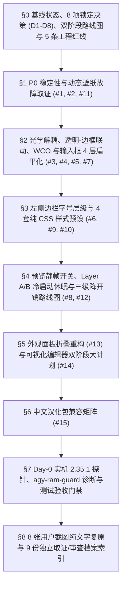

# Wallpaper Prism (`agy-wallpaper-prism`) — `v2.2.0` / `v2.3.0` 下一代 AI 接手执行交接手册

> **文档定位**：面向下一位接手开发 `v2.2.0` 与 `v2.3.0` 的 AI 工程师的**独立、自包含、全实证、可执行级**交接手册（锁定决策 **`D1`**）。本文档完整收录全部 **15 项用户反馈（`#1`–`#15`）**、**8 张用户反馈截图的纯文字像素级描述**、**8 轮 `/grill-me` 用户锁定决策（`D1`–`D8`）**、全部源码级根因取证与可执行实施蓝图；**接手 AI 无需读取前序聊天记录或外部图片文件即可零盲区直接开工**。
>
> **基线仓库状态**：`agy-wallpaper-prism` **`v2.1.0`**（`git HEAD = ded7824`，工作区 100% 干净，`node test/verify-all.mjs` 三大套件 **`34 / 34 PASS`**，`<USER_HOME>/.gemini/config/plugins/agy-wallpaper-prism/` 全部 26 个核心运行时文件 `SHA-256` 字节级一致）。既有 `v2.1.0` 架构总览仍完整保留于 [AI_HANDOFF.md](AI_HANDOFF.md)，本文档不覆盖之。
>
> **锚定与诚实纪律**：正文全部源码锚点同时采用 **`path/to/file :: symbolName`（防漂移符号锚点）** 与 **`HEAD ded7824` 精确行号 `file:Lstart-Lend`** 及逐字原文摘句；工作区中不存在的标识符、宿主未公开字段或 Antigravity `2.35.1` 解包前端源码均显式标注 **`未找到`**，绝不臆造。

---

## 全文架构导航



---

## §0 基线状态、8 项锁定决策、双阶段路线图与 5 条硬性工程红线

### 0.1 `v2.1.0` 已验证代码与运行基线

| 维度 | `HEAD ded7824` 实测基线 |
| :--- | :--- |
| **Git 基线** | `ded7824` — `release: Wallpaper Prism v2.1.0 (Issue #10, PR #8/#9, 2.35.1 topbar, glass optics, 1-click updater & CN l10n)` |
| **自动化验证** | `node test/verify-all.mjs` 三大套件 **`34 / 34 PASS`**（`0 FAIL`），`<USER_HOME>/.gemini/config/plugins/agy-wallpaper-prism/` 26 个运行时文件 `SHA-256` 同步一致 |
| **关键产物体积** | `sidecars/prism_studio/index.html` = `457,913 B`（纯 LF 确定性内联）；`src/studio-ui/app.mjs` = `290,317 B`（6,842 行）；`src/studio-ui/styles.css` = `78,263 B`（3,077 行）；`src/shared/schema.mjs` = `51,364 B`（1,498 行）；`src/shared/i18n.mjs` = `33,590 B`（662 行） |
| **微引导载荷实测** | `cdp-bridge.mjs :: buildHostMicroBootstrap` 最坏情况（`https://127.0.0.1:65535` + 64 字符 `capToken`）= **`6,091 B`**（`http` = `6,090 B`），距硬上限 `6,144 B` **仅余 `53 B`** |
| **对比插件基线** | 已安装 `agy-ram-guard` `v0.1.0`（`<USER_HOME>/.gemini/config/plugins/agy-ram-guard/`；注：其与工作区 `../agy-ram-guard/` 在 `src/webview-cdp/hibernator.mjs` 与 `hibernator-script.mjs` 存在版本漂移，下文按安装版与工作区版分别标明行号）；已逆向 `Antigravity-Chinese-Localization` commit `403d92fa`（`v2.35.1`） |

### 0.2 8 项用户已锁定 `/grill-me` 决策（`D1`–`D8` · 硬性规范，不得擅自偏离）

> [!IMPORTANT]
> 下表 8 项决策均已经用户逐题拍板锁定。若下层取证报告（`../swarm/prism-v22-handoff-recon/`）中曾列出开放选项或旧建议（例如「实时同步命名配置」「手风琴单开 JS 监听」「默认切为 `underline`」），**一律以本表 `D1`–`D8` 为唯一最终权威**。

| 决策编号 | 议题 | 用户最终锁定方案 |
| :---: | :--- | :--- |
| **D1** | 交接文档落盘与源码边界 | 新建独立交接文档 `docs/V2.2_NEXT_AI_HANDOFF.md`；保留既有 `v2.1.0` `docs/AI_HANDOFF.md` 原貌。 |
| **D2** | 里程碑双阶段拆分 | **两阶段交付**：`v2.2.0` 落地 `#1`–`#13` + `#15` + 统一 `regions` Schema + `#14 阶段一`（Studio 可放大画布模态 + 浏览器全屏编辑器）；`v2.3.0` 落地 `#14 阶段二`（基于 CDP 的真实 Antigravity 宿主窗口实时点选拾取器）。 |
| **D3** | `#14 阶段一` 交互入口 | 侧栏内展开全高画布模态（`320–560 px` 窄屏自适应堆叠）+ 一键 **`↗ 浏览器全屏编辑`** 弹出独立窗口（URL 零明文 token、严格 `POST /api/studio/popout` 鉴权与无 Shell `execFile`、独立 `CSP: frame-ancestors 'none'`、`MAX_STUDIO_SSE = 4`、SSE 实时联动、退出自动保存）。 |
| **D4** | `#1` 自动保存与多配置心智 | **静默自动保存「当前工作态」**（无保存成功弹窗 Toast）；**已命名配置为独立快照**（不随日常调参悄悄覆写用户珍藏配置！提供一键切换 + 新建 + 显式覆盖更新 + 重命名 + 复制 + 可选勾选「同时绑定当前壁纸」+ 彻底解决 `perWallpaperOverrides` 遮蔽）。 |
| **D5** | `#6/#9/#10` 左侧栏样式与零 JS 手风琴 | **保留 `'capsule'` 为默认值**兼容 `v2.1.0` 老用户与既有测试；新增 **`'underline'` / `'accordion'` / `'tree'`** 共 4 套 **100% 纯 CSS** 可选样式（`0` DOM 注入，实时模式与 `static-css` 全通）；**明确不做 JS 自动折叠其他父级菜单监听**（彻底规避 `@tanstack/react-virtual` 视口外不可达、上方收起滚动跳动、右键/编辑中断与 `2.35.1` DOM 脆弱性）。 |
| **D6** | `#8/#12` 预览静帧与冷启动默认 | 顶部 21:9 预览默认静帧省电（**`previewLiveMedia: false`**，预览卡 HUD 提供一键动态画面开关，不暂停宿主壁纸），壁纸库默认静态首帧 + 悬停播放（`/preview/<token>?static=1` + `libraryAnimatedThumbs: 'hover'`），Quick Panel 真懒加载；侧栏不可见/未选中时 Layer B 执行**冷启动休眠**（`T+0ms` 刷盘暂停，`T+5s` 深度释放视频解码器/定时器/列表 DOM 并完整保留未保存输入草稿）。 |
| **D7** | `#14` 自定义色值可读性护栏 | **智能可读性保护**：默认启用相反锚点 **`enforceFgContrastRgb`**（WCAG AA `>= 4.5:1`），同时提供一键 **「允许原始色值」** 解锁开关；当 `opacity < 0.55` 时改为温和提示（对比度受底图/暗幕影响）不强行锁死；强制使用 `:not(...)` 排除代码块、终端、图标、兄弟插件与弹窗。 |
| **D8** | `#13` 宽屏左栏去重与外观精简 | **极简左栏去重**：`>=840px` 宽屏左侧栏仅保留可点击跳转区域/进编辑器的 21:9 预览卡 + 媒体播控 + 场景/配置快捷切换，**移除重复的 5 个光学滑块**（`glassOpacity`/`glassBlur`/`sidebarOpacity`/`scrimOpacity`/`mediaBlur`）与重复取色读数；Quick Prism 同步删除重复渲染的第 2 个 `sidebarOpacity`；「棱镜外观」重构为 **8 大区域分组且默认全部收起**（持久化折叠态）。 |

### 0.3 全部 15 项用户反馈与双阶段里程碑总账

| 反馈 | 关联截图 | 核心诉求 | 目标版本 | 锁定决策 | 详述章节 |
| :---: | :---: | :--- | :---: | :---: | :---: |
| **#1** | 截图 1 | 修复卡顿时「保存当前配置」失效；改为静默自动保存 + 多配置无缝创建/切换/管理 | `v2.2.0` | `D4` | `§1.1` |
| **#2** | 截图 2 | 修复卡顿时启用/禁用壁纸失效或回弹；21:9 预览在禁用壁纸时切换为原生停用样式 | `v2.2.0` | `D6` | `§1.2` |
| **#3** | — | 中间主栏（`workspace`）毛玻璃模糊度与开关独立于右栏及全局可调 | `v2.2.0` | `D2` | `§2.1` |
| **#4** | — | 调低任意区域透明度时，边框、顶光高光、白雾 Sheen 与投影随背景同步渐隐（`0%` 归零） | `v2.2.0` | `D2` | `§2.2` |
| **#5** | — | 右上角最小化/最大化/关闭胶囊（`#agy-prism-wco-pill`）独立透明度与边框联动 | `v2.2.0` | `D2` | `§2.3` |
| **#6** | 截图 3 | 去除侧栏 `项目`/`📁 项目名`/`对话` 突兀四边暗框，提供纯底边极简样式（`'underline'`） | `v2.2.0` | `D5` | `§3.1` |
| **#7** | 截图 4/5 | 消除 Composer 输入框四周 4 层同心圆角嵌套边框，统一为单层干净毛玻璃框 | `v2.2.0` | `D2` | `§2.4` |
| **#8** | 截图 2 | Studio 预览卡动态开关、壁纸库静帧降耗、侧栏隐藏/未选中时冷启动不加载 UI | `v2.2.0` | `D6` | `§4.1`, `§4.2` |
| **#9** | 截图 6 | 修正左侧栏分组头小暗 vs 项目/对话大的字号层级倒挂，规范胶囊与按钮比例 | `v2.2.0` | `D5` | `§3.2` |
| **#10** | 截图 7/8 | 提供 4 套纯 CSS 左侧栏风格（`capsule` / `underline` / `accordion` / `tree`） | `v2.2.0` | `D5` | `§3.3` |
| **#11** | — | 核查动态壁纸不动与 `agy-ram-guard` 因果关系，根治 Prism P1–P5 冻帧缺陷 | `v2.2.0` | — | `§1.3` |
| **#12** | — | 不损视觉前提下系统性降低 CPU / GPU / RAM 总开销（Tier 1 / 2 / 3 路线图） | `v2.2.0` | `D6` | `§4.3` |
| **#13** | 截图 1 | 重构「棱镜外观」为 8 大区域默认全折叠结构 + 宽屏极简左栏去重 | `v2.2.0` | `D8` | `§5.1` |
| **#14** | 截图 2 | 交互式可视化外观编辑器：阶段一 Studio 放大画布 + 浏览器全屏；阶段二 CDP 真实窗口点选 | `v2.2.0` / `v2.3.0` | `D2`, `D3`, `D7` | `§5.2`–`§5.6` |
| **#15** | 截图 3–6 | 全部新功能 100% 兼容 `Antigravity-Chinese-Localization`（`403d92fa`）中文汉化包 | `v2.2.0` / `v2.3.0` | — | `§6` |

### 0.4 五条绝不可破的硬性工程红线（Engineering Redlines）

> [!CAUTION]
> 以下 5 条红线均有自动化门禁或实测故障背书，**任何违反都将直接导致回归故障或 Suite 1/3 失败**。

1. **红线 1 — `buildHostMicroBootstrap <= 6,144 B` 字节硬上限（现余量仅 `53 B`！）**：
   - `sidecars/prism_studio/cdp-bridge.mjs :: buildHostMicroBootstrap`（`L1508-L1543`）在 `test/verify-all.mjs:L4471-L4481` 的最坏情况断言下实测 **`6,091 B`**（`https://127.0.0.1:65535` + 64 字符 `capToken`；`http` 为 `6,090 B`），距离 `6,144 B` 上限仅剩 **`53 B`**。
   - **强制约束**：
     - `#2` 软停用必须复用 `wallpaper-inject.js:L7414` 已有短别名 `W[K].apply`（`W[K]&&W[K].apply?W[K].apply({skinEnabled:0}):ds(W[K])`）并顺手压缩 ~10–15 B 冗余字面量（详见 `§1.2`），严禁写入 `+63 B` 的长写法；
     - `stateRev` 单调序列号校验必须放在 `wallpaper-inject.js` 与 `panel-inject.js` 内，**0 B** 计入微引导；
     - `#14 阶段二`（`v2.3.0`）实机点选器必须经 `cdp-bridge.mjs :: evaluateTargetEphemeral` 注入外联 `<script src=".../inspector.js">`，**0 B** 计入微引导。
2. **红线 2 — `bundleZeroDepEsm` 值拷贝非活绑定约束 + 多清单同步**：
   - `scripts/build.mjs:L69-L241` 的零依赖拓扑 IIFE 打包器按值拷贝导出（`L95`：`const ${p} = ${depNsVar}.${p};`、`L231`：`return { ${props.join(', ')} };`，**无 ES Live Bindings**），仅支持单标识符导出正则（`L194`：`^\s*export\s+(const|let|var)\s+([A-Za-z_$][\w$]*)`），且严禁循环依赖（`L102` TDZ）。
   - **强制约束**：拆分的 `src/studio-ui/**/*.mjs` 必须严格组成无环 DAG；可变状态必须封装于 `export const store = { ... }` 容器对象或 getter/setter 函数（**严禁**重赋值 `export let` 原始类型或解构导出）；同步更新 `scripts/build.mjs:L248` 支持相对 CSS `@import` 内联；新增模块必须同步登记进 `test/verify-all.mjs:L358`（`node --check` 列表），新增宿主/运行时文件（如 `v2.3.0` `src/host/inspector-inject.js`）必须同步登记进 `scripts/pack-release.mjs:L55-L71`（`REQUIRED_RUNTIME_FILES`）与 `test/verify-all.mjs:L412-L439`（`syncFiles`）。
3. **红线 3 — `skills/wallpaper-prism/SKILL.md` 零 `plugin://` 硬门禁**：
   - Suite 1 静态审计强制要求 `skills/wallpaper-prism/SKILL.md` 中不得出现任何 `plugin://` 字面量（仅允许 `sidecar://` 与 `customization://`）。
4. **红线 4 — 纯 UTF-8 LF（`0` 个 `\r`）与零 PII 隐私门禁**：
   - 仓内全部文本文件及构建产物 `sidecars/prism_studio/index.html` 必须为纯 LF；严禁出现本机用户名、个人绝对盘符路径或私钥令牌（`test/verify-all.mjs:L371-L404` 扫描全仓及 `git diff HEAD`），统一使用仓库相对路径或 `<USER_HOME>` / `%USERPROFILE%`。
5. **红线 5 — 严禁跳过 Day-0 实机 `2.35.1` 只读探针盲写 `#7` / `#9` / `#10` 未知宿主类名**：
   - Antigravity `2.35.1` 解包前端源码在工作区中 **`未找到`**。在最终提交 `#7` Composer Layer 1–3 剥离选择器与 `#9`/`#10` `h2`/`aria-expanded` 样式前，必须先在用户实机 `2.35.1` 窗口执行 1 次 `§7.1` 只读探针确认真实类名。

### 0.5 强制依赖执行顺序（`v2.2.0` 开工防踩坑顺序）

1. **Step 0（Day-0 探针）**：执行 `§7.1` 实机 `2.35.1` Composer/Sidebar 1-shot 只读探针 + `§7.2` 动态壁纸 3 命令只读诊断。
2. **Step 1（P0 动态壁纸止血 — 先修 MSE 再调上限！）**：修复 `#11` 的 `P1`（`eco` 粘性暂停）与 **`P2a` / `P2b` / `P2c`（MSE 三联 Bug）** 及 `P4`/`P5` — **必须先完成 `P2a/P2b/P2c` 修复，之后才允许在 `#12` 中把 `MAX_BLOB_MEDIA_BYTES` 从 `256 MiB` 下调至 `32–48 MiB`**！
3. **Step 2（统一数据底座与稳定状态机）**：落地 `config.regions` 统一 Schema（含 8 组件含 `wco`、每区域 `blur`/`glassEnabled`/`borderOpacity`/`borderStyle`/`radius`/`font*`、`sidebarListStyle`、`previewLiveMedia`、`libraryAnimatedThumbs`）、4 层 `(regionId, propKey)` 深合并、单调 `stateRev`、`main.mjs` `flush` 与 `pushToHost()` 非阻塞解耦，以及 `#1`/`#2` 前后端竞态与软停用修复。
4. **Step 3（宿主光学与布局引擎）**：在 `src/host/wallpaper-inject.js` 与 `src/host/index.mjs` 对等实现 `#3`（`--prism-right-pane-backdrop` 拆分）、`#4`（共享 `computeBorderFactor`/`computeShadowFactor` 覆盖全部 8 区域 + `GLASS_CARRIER_MAIN_PAGES` + `flush` `::after` + `index.mjs:L604`）、`#5`（`wco` 独立变量守 `D18`/`wcoH`）、`#7`（Composer 单载体扁平化，保护附件芯片边框）、`#6/#9/#10`（4 套纯 CSS 侧栏样式 + `11..15px` 排版与 `18×18px` 按钮）。
5. **Step 4（性能、静帧预览与冷启动休眠）**：落地 `#8a`（`/preview/<token>?static=1`、`previewLiveMedia: false` 默认 + HUD 开关、Quick Panel `IntersectionObserver`）、`#8b`（Layer B 休眠冷启动门控 + `T+0ms`/`T+5s` 状态机）与 `#12`（Tier 1 零损优化含 Alpha 门控模糊裁剪、停用生产 `watchTimer`、修 `pointermove`/`holeSubObs`/`welcomeLogoObs`/`web-shim`/`mp4-vfs`）。
6. **Step 5（Studio 模块化重构 + `#13` + `#14 阶段一`）**：按无环 DAG 拆分 `src/studio-ui/`、升级 `scripts/build.mjs` CSS `@import`、落地极简左栏（`D8`）+ 8 区域默认折叠外观 + 阶段一画布模态与安全浏览器全屏 Popout（`D3`/`D7`）。
7. **Step 6（`#15` 汉化兼容复验 + `verify-all.mjs` 全绿验收）**：更新既有测试契约、新增 Suite 1/2/3 回归用例，执行 `node scripts/build.mjs && node scripts/install-local.mjs && node test/verify-all.mjs` 全绿验收。

---

## §1 P0 稳定性与动态壁纸故障取证（反馈 `#1`、`#2`、`#11`）

### 1.1 反馈 `#1`（截图 1）：「保存当前配置」卡顿失效 + 静默自动保存与多配置切换（`D4`）

#### A. 真实符号映射（纠正模糊名称）
- `save-profile` / `POST /api/profiles` / `#profile-name-input` / `saveProfile` / `saveBusy` / `beforeunload` / `sendBeacon` / `keepalive` / `AbortController` / `presets/rename` / `presets/duplicate`：全仓 **`未找到`**。
- **真实调用链**：`src/studio-ui/app.mjs:L2205-L2211`（`#prism-preset-name-in`, `#prism-preset-desc-in`, `data-action="save-profile-preset"`；文案在 `src/shared/i18n.mjs:L47-L48` `完整配置快照` / `保存当前配置`）→ `app.mjs:L5137-L5144`（草稿输入）→ `app.mjs:L6015-L6029`（点击分支）→ `sidecars/prism_studio/main.mjs:L1580-L1589`（`POST /api/presets/save`）→ `src/engine/index.mjs:L502-L507`（`engine.savePreset`）→ `src/engine/store.mjs:L668-L707`（`store.savePreset`）。

#### B. 四个代码级实证根因（`1A`–`1D`）

| 根因 | 严重度 | 源码位置 | 精确故障机理 |
| :---: | :---: | :--- | :--- |
| **1A** | **P0** | `src/studio-ui/app.mjs:L424-L429, L4762-L4778, L5467, L6507-L6511, L6611-L6632, L6758-L6767` | **点击中途 `scroller.innerHTML` 重建吞掉 `click`**：鼠标在 `💾 保存当前配置` 按下（`mousedown`）时，焦点立刻离开 `#prism-preset-name-in`，使 `isEditingField` 翻为 `false`（`L6617-L6620`）；卡顿期间只要任一滞后 SSE `state`、2.5s `syncExternalStateNow()`、`focus`、`armedConfirm` 6s 定时器或内联数字框 `blur` 触发 `scroller.innerHTML = renderActiveTabContentHtml()`（`L4768` / `L6627`），按钮 DOM 在 `mouseup` 前被销毁，浏览器按规范**静默吞掉 `click` 事件**（零请求、零提示、零报错）。另 `renderActiveSurface()`（`L4772-L4778`）仅恢复 `#prism-lib-search` 焦点，会打断配置名称输入与中文 IME 组合。 |
| **1B** | **P0** | `src/studio-ui/app.mjs:L1444-L1498, L6015-L6024`；`sidecars/prism_studio/main.mjs:L1536-L1542, L1580-L1589`；`src/engine/store.mjs:L674-L676` | **未刷盘 `pendingConfigPatch` 竞态 + 滑块视觉回弹**：`save-profile-preset` 既不 `await flushConfigPatch()`，也不传客户端 `patch`（且 `main.mjs:L1580-L1588` 根本不读取 `body?.patch`）；卡顿时前一个 `POST /api/config` 在 `main.mjs:L1539` 同步阻塞于 `await pushToHost()`（最长卡 2.8s+4.0s 瞬态 CDP），导致 `POST /api/presets/save` 抢跑并快照了**修改前的旧服务端配置**；更糟的是返回后 `app.mjs:L6020` 无条件执行 `ingestServerState(res)`（无视非空 `pendingConfigPatch`），**把用户刚调好的滑块当场弹回旧值**！ |
| **1C** | **P1** | `src/studio-ui/app.mjs:L77-L106, L2210, L6015-L6029`；`src/engine/index.mjs:L238-L243, L505`；`src/engine/store.mjs:L683-L686`；`sidecars/prism_studio/main.mjs:L893-L899` | **无互斥锁 / 无超时 / 草稿脱节 / 无跨端广播**：无 `saveBusy` 锁与按钮禁用态，`apiJson` 无 `AbortController` 超时，仅读 `store.presetDraft` 未兜底读取 DOM `.value`；卡顿连点时同一秒内静默互相覆盖、跨秒产生重复 `Custom Prism HH:MM:SS` 卡片；`engine.savePreset` 仅 `emitStateChange(false)`（派发 `'change'`，被 `main.mjs:L894-L897` 忽略），不广播 `broadcastStudioState()`。 |
| **1D** | **P1** | `src/engine/store.mjs:L63-L123, L656-L666`；`src/shared/schema.mjs:L766-L784, L893-L895, L966-L992, L1489-L1498`；`src/studio-ui/app.mjs:L5544, L6002-L6014` | **快照丢键 + `perWallpaperOverrides` 遮蔽失效**：`PROFILE_PRESET_KEYS`（`store.mjs:L63-L123`）缺失壁纸绑定键（`activeWallpaperId`/`wallpaperId`/`kind`）且**漏掉 3 个 `v2.1.0` 皮肤键**（`topbarStyle`, `transparentWindowControls`, `hideWelcomeLogo`）；此外 `applyPreset()` 不像 `apply-scene-preset`（`app.mjs:L5544`）那样处理 `perWallpaperOverrides[activeId]`，只要当前壁纸开启了 📌 单独记忆光学参数，切换自定义配置后全部 **25 个 `PER_WALLPAPER_OVERRIDE_KEYS`** 被强行遮蔽，视觉上“切换配置毫无反应”！ |

#### C. 锁定决策 `D4` 执行蓝图（静默自动保存当前态 + 独立命名快照套组）

1. **当前工作态静默自动保存（零 Toast 轰炸）**：
   - 所有滑块/开关/颜色/区域调参继续经 `queueConfigPatch`（60ms 节流）静默落盘 `config.json`（`store.mjs:L644` 250ms 原子写入），成功后**绝不弹窗 Toast**，仅在顶部显示柔和 1 行内联态（`保存中…` → `✓ 已自动保存`，失败时才提示重试）。
   - **后端非阻塞解耦（`sidecars/prism_studio/main.mjs:L1536-L1542`）**：`POST /api/config` 在内存同步 `engine.updateConfig(patch || {}, { debounce: body?.flush !== true })` 后，直接派发 `void pushToHost()`（或仅等待本地 SSE 即时写入，绝不让 HTTP 响应死等 4 秒瞬态 CDP WebSocket 回退！）。
   - **卸载/隐藏零丢失刷盘**：在 `pagehide` 与 `visibilitychange(hidden)` 时若 `pendingConfigPatch` 非空，立即发出最小脏增量（`< 2 KB`）`fetch('/api/config', { method: 'POST', keepalive: true, headers: { 'Content-Type': 'application/json', 'X-Sidecar-Token': tok }, body: JSON.stringify({ patch, flush: true }) })`（**严禁用 `sendBeacon`**，因无法带 `X-Sidecar-Token`）。
2. **独立命名配置快照（不随日常调参悄悄污染用户已存配置）**：
   - 扩充 `PROFILE_PRESET_KEYS`（`store.mjs:L63-L123`）纳入：`topbarStyle`, `transparentWindowControls`, `hideWelcomeLogo`, `regions`, `globalFontSize`, `globalFontFamily`, `globalFontColor`, `sidebarListStyle`, `sidebarTypographyMode`, `sidebarFontSize`, `previewLiveMedia`, `libraryAnimatedThumbs`；可选绑定壁纸字段 `activeWallpaperId`, `wallpaperId`, `kind`（由保存时复选框 **「同时绑定当前壁纸」** `includeWallpaper` 控制；若绑定的壁纸已被删除，切换时优雅降级保留当前壁纸并轻提示）。
   - 升级 `POST /api/presets/save` 支持 `{ id?, name, description?, patch?, includeWallpaper?, mode?: 'create' | 'overwrite' }`：先 flush 服务端待写配置，合并客户端传入的 `body.patch`，冲突安全命名（`配置 1` / `<name> (2)` 取代秒级时间戳），并调用 `void broadcastStudioState()`。
   - 新增 `POST /api/presets/rename`（`{ id, name, description? }`）与 `POST /api/presets/duplicate`（`{ id, name? }`）。
   - 修复 `store.applyPreset(presetId)` 与 `perWallpaperOverrides[activeId]` 冲突：当当前壁纸已开启单壁纸覆盖时，将目标配置的光学键同步写入当前覆盖或提供明确切换语义（清除冲突覆写键 / 覆盖当前壁纸槽），确保**切换任意命名配置 100% 立即视觉生效**！
   - 前端防吞点与防竞态：① 保存/切换前必须 `await flushConfigPatch()` 并附带客户端 `patch`；② 新增 `store.profileOpBusy` 互斥锁 + 按钮禁用态 + `apiJson` 8s `AbortController` 超时；③ 读取输入值时兜底 `document.getElementById('prism-preset-name-in')?.value ?? store.presetDraft.name`；④ 追踪 `pointerDownInsideScroller`，指针按下期间禁止 `scroller.innerHTML` 整块重写（改用局部更新 `#prism-presets-grid` 容器，绝不销毁输入框与按钮 DOM，同时保留输入框焦点与光标位置）。

---

### 1.2 反馈 `#2`（截图 2）：启用/禁用壁纸卡顿失效或回弹 + 21:9 预览禁用样式

#### A. 全部 9 处启用/禁用入口清点
1. Studio 顶栏总开关 `#prism-master-toggle-btn`（`app.mjs:L4802-L4809, L5017-L5063` → `POST /api/skin/toggle`）
2. Studio 系统页「立即应用棱镜皮肤」`data-action="enable-skin"`（`app.mjs:L3353-L3355, L6189-L6192`）
3. Studio 系统页「还原宿主默认外观」`data-action="exec-restore-host"`（`app.mjs:L3485-L3491, L6257-L6268` → `POST /api/skin/restore`）
4. Studio 系统页 Wake / Reset Canary（`app.mjs:L3085-L3093, L6193-L6233`）
5. Quick Prism 顶部电源开关 `[data-testid="prism-power-toggle"]`（`panel-inject.js:L1282-L1302, L1605-L1618` → RPC `skin.toggle`）
6. Quick Prism 输入栏胶囊 `Shift+Click` / 中键 `#agy-prism-pill`（`panel-inject.js:L1371-L1386`）
7. Quick Prism 状态页还原/重新应用 `els.restoreBtn`（`panel-inject.js:L2091-L2119`）
8. 宿主惰性 Stub 胶囊 `Shift+Click`（`cdp-bridge.mjs:L1529, L1532`）
9. 宿主紧急逃生快捷键 `Ctrl+Alt+Shift+R` / `4× Esc`（`cdp-bridge.mjs:L1533, L1537` → `sa()` + `skin.panicRestore`）

#### B. 五个代码级实证根因（`2A`–`2E`）

- **`2A` [P0] `wake({ forceProbe: true })` + 破坏性 `ss()` 引爆 3 次串行 CDP 超时**：
  - `sidecars/prism_studio/main.mjs:L819` 在 `skin.toggle(true)` 中硬传 `await cdpBridge.wake({ forceProbe: true })`，无条件关闭了 `cdp-bridge.mjs:L2143-L2162` 现成的 SSE 快路径（`usedFastPath = false`）。
  - 同时，上一次禁用执行的 `ss()`（`cdp-bridge.mjs:L1526`）调用了 `ds(W[K])`（`window.__agyPrism.destroy()`），把微内核彻底销毁；重新启用时 `probe.skinVer` 变成 `'' !== '2.1.0'`，导致 `needsBridgeRebind`（`cdp-bridge.mjs:L1783-L1789`）**100% 恒为 `true`**，每次重新启用都强行串联 `runSerializedTick` + 端口探测 + `/json/list` + **3 次串行瞬态 CDP WebSocket 连接**（`L1775`, `L1811`, `L1829`，每次最高 2.8s+4.0s）。卡顿时轻松突破 `panel-inject.js:L1047-L1052` 的 **6000ms `callRpc` 超时**返回 `null`，并让 Studio `store.masterToggleBusy` 长期锁死吞掉后续点击（`app.mjs:L5018`）。
- **`2B` [P0] 在途 `/stage.js` 僵尸复活 + 破坏性卸载废掉快路径**：
  - `cdp-bridge.mjs:L1526, L1535, L1539`、`main.mjs:L1012-L1022`、`wallpaper-inject.js:L7435-L7438`：在 Chromium 中，`ss()` 移除仍在下载的 `<script id="agy-prism-stage-loader">` **并不会中止脚本执行**！1–3 秒后 `/stage.js`（7,441 行，内置 `window.__AGY_PRISM_BOOT_PAYLOAD__ = { skinEnabled: true }`）到达，`wallpaper-inject.js:L7435-L7438` **从未检查 `window.__agyPrismOn === false`**，直接 `applyPayload(bootPayload)` 让已禁用的壁纸**僵尸复活**！
  - 此外 `ss()` 销毁 `W[K]` 使 Quick Prism 的乐观启用（`panel-inject.js:L1288-L1296`）彻底沦为空操作，且三重广播风暴（`main.mjs:L817`, `L819`, `cdp-bridge.mjs:L1829`）反复 `ld(SL, "/stage.js", 1)` 引发竞态。
- **`2C` [P0] 缺少单调 `stateRev` 导致滞后响应把开关弹回**：
  - Studio `flushConfigPatch()`（`app.mjs:L1484-L1498`）不检查 `store.masterToggleBusy`；`syncExternalStateNow()`（`L6586-L6590, L6641-L6652, L6758-L6767`）与 `ensureStandbyStatusPoll()`（`L6780-L6783`）无请求序号守卫；Quick Prism `toggleSkinMaster()`（`panel-inject.js:L1282-L1302, L2600-L2605, L2639`）无忙碌锁、无序号守卫、无超时回滚，开窗瞬间的异步 `state.get` 返回即可把刚点的开关弹回。
  - 精确区分 `exec-restore-host` 与 `executeSkinToggle`：`exec-restore-host`（`app.mjs:L6257-L6268`）绕过 `store.masterToggleBusy`（虽有调用 `renderActiveSurface()` → `L4784` `syncMiniPreviewMedia()`，但预览组件对 `skinEnabled === false` 盲视），而 `executeSkinToggle()`（`app.mjs:L5038-L5043`）在 `store.activeTab !== 'system'` 时**确实跳过了 `syncMiniPreviewMedia()` 与 `updateLeftRailPanels()`**。
- **`2D` [P1] 禁用超时时静默删除 `activeTargets` 导致后续禁用永久失灵**：
  - `cdp-bridge.mjs:L1892-L1899`：当 Host SSE 断链且瞬态 `evaluateTargetEphemeral(..., REMOVE_SKIN_EXPR)` 超时，`.catch()` 直接 `activeTargets.delete(tid)` 并吞错；`POST /api/skin/toggle` 仍返回 `{ ok: true, skinEnabled: false }`，宿主壁纸却还亮着，后续禁用因 `activeTargets.size === 0` 全部失效。
- **`2E` [P0] `#prism-mini-stage` 对 `store.skinEnabled === false` 100% 盲视**：
  - `data-skin-enabled` 在 `app.mjs` 与 `styles.css` 中 **`未找到`**；`syncOpticalCssVars()`（`L636-L804`）、`syncMiniPreviewMedia()`（`L821-L974`）、`1250ms` 卡顿看门狗（`L6461-L6473`）与可见性恢复钩子（`L6672-L6689`）均只判断 `eff.paused` 与 `document.hidden`，**在壁纸禁用期间仍全速解码视频、保持毛玻璃浮岛样式和 `ISLANDS · 5px` 徽章**！

#### C. 非破坏性软停用 + `<= 6,144 B` 微引导字节控制策略（3 条硬性约束）

1. **用软停用替代常规禁用的 `destroy()`，严格压在 `<= 6,144 B` 内**：
   - 在 `cdp-bridge.mjs:L1526` 的 `ss()` 中，常规停用（**非**逃生 `sa()`）调用 `wallpaper-inject.js:L7054-L7058` 已提供的非破坏性 `teardownSkinDomOnly()`（移除全部 DOM/CSS/媒体但保留 `window.__agyPrism` 内核，重启用 `< 10 ms` 零 `/stage.js` 重载、零 `needsBridgeRebind`！）。
   - **微引导精确字节控制（硬上限 `6,144 B`，现 `6,091 B`，余量 `53 B`）**：
     - 严禁写入 `+63 B` 的 `W[K]&&W[K].applyPayload?W[K].applyPayload({skinEnabled:false}):ds(W[K])`；
     - 改用 `wallpaper-inject.js:L7414` 已有导出别名 **`W[K].apply`**：将 `ds(W[K])`（`8 B`）替换为 `W[K]&&W[K].apply?W[K].apply({skinEnabled:0}):ds(W[K])`（`53 B`），净增 **`+45 B`**（最坏情况 `6,091 + 45 = 6,136 B <= 6,144 B`，仅余 `8 B` 边际），同时建议顺手压缩 `cdp-bridge.mjs:L1520-L1542` 中约 `12–20 B` 重复字面量（如合并 `clr`/`rm` 字符串与短变量名）留足安全余量，确保严格通过 `test/verify-all.mjs:L4478-L4481`。
2. **封堵 `teardownSkinDomOnly()` 定时器泄漏（`wallpaper-inject.js:L5416-L5422, L6886-L6966, L7373-L7374`）**：
   - 现有 `blurPollTimer`（`3000ms`）与 `videoWatchTimer`（`1100ms`）仅在 `destroy()`（`L7373-L7374`）中被清理。改为软停用后，**必须在 `teardownSkinDomOnly()` 内同步 `clearInterval` 两者并置 `0`，在 `applyPayload()` 重启用时幂等重新挂载**，保证禁用态零后台轮询开销。
3. **拆分 `REMOVE_SKIN_EXPR`（`cdp-bridge.mjs:L1345-L1347, L1896`）**：
   - 常规禁用回退（`L1896`）改为软停用表达式（若 `window.__agyPrism?.apply` 存在则调 `apply({ skinEnabled: false })`，否则剥离 DOM），超时失败时调度一次 `tick()` 恢复而不静默删靶；完整破坏性 `REMOVE_SKIN_EXPR`（调 `destroy()`）严格保留给紧急逃生 `sa()`、`rollbackCanary`、插件停用与 sidecar `stop()`（`L1855-L1868`）。
4. **防僵尸复活 + `stateRev` + 前端状态机**：
   - `wallpaper-inject.js:L7435-L7438` 启动加载 `bootPayload` 前强制检查 `if (W.__agyPrismOn === false)`，绝不允许迟到 `/stage.js` 复活已禁用壁纸。
   - `main.mjs` 维护单调递增 `stateRev`，随 SSE / RPC / `stage.js` 下发；`wallpaper-inject.js`、`panel-inject.js`、`app.mjs` 丢弃 `rev < lastAppliedRev` 的乱序旧包。
   - `main.mjs:L819` 改用 `await cdpBridge.wake({ forceProbe: false })` 并对 `engine.updateConfig` 与 `wake` 去重广播；Studio 队列合并连点（`pendingToggleTarget`）+ `exec-restore-host` 统一经 `executeSkinToggle(false)` + 8s `AbortController` 超时；Quick Prism 补齐 `toggleSeq`、忙碌合并与超时回滚提示。

#### D. `#prism-mini-stage`（截图 2）禁用态视觉与媒体规格
当 `store.skinEnabled === false` 时：
- 在 `#prism-mini-stage` 与外层预览卡设置 `data-skin-enabled="false"`（同步于 `mountFullShell()`、`syncOpticalCssVars()`、`executeSkinToggle()`，且 `executeSkinToggle()` 必须调用 `syncMiniPreviewMedia()` + `updateLeftRailPanels()`）。
- **彻底停止预览解码**：`syncMiniPreviewMedia()` 暂停/释放 `<video>` 与 `slideshowTimer`；`app.mjs:L6462` 看门狗与 `L6680` 可见性恢复均增加 `store.skinEnabled` 门卫。
- **原生宿主预览外观（`.prism-mini-stage[data-skin-enabled="false"]`）**：
  - 壁纸层 `.mini-media-layer` 退隐灰度暗化（`opacity: 0.14; filter: grayscale(100%) blur(2px)`），隐藏 `.mini-blur-veil` / `.mini-vignette` / `.mini-grain`；
  - `#prism-mini-hub` 瞬切为**宿主原生无圆角平铺实色界面**（`padding: 0; gap: 0; border-radius: 0; backdrop-filter: none; box-shadow: none;`，暗色 `#131316 / #0B0B0D / #131316`、亮色 `#F3F4F6 / #FFFFFF / #F3F4F6`）；
  - 右上 HUD 徽章切换为 `NATIVE · 已停用` / `NATIVE · DISABLED`；
  - 居中叠放轻量状态胶囊：`壁纸与棱镜皮肤已停用 · 宿主原生外观` + 一键点击按钮 `✦ 重新启用`（`data-action="enable-skin"`）；
  - 下方播控条 `.prism-transport-bar` 视觉弱化（`opacity: 0.58`）并显示 `已停用` 标签。

---

### 1.3 反馈 `#11`：动态壁纸不动根因审计与 `agy-ram-guard` 因果结论

#### A. 明确因果判定（100% 源码实证）

> [!IMPORTANT]
> **最终判定**：在 `agy-ram-guard` (`v0.1.0`) **默认配置下，它【不是】直接冻结或暂停 Hub 主窗口动态壁纸的元凶**；但它存在 **1 个高概率间接耦合诱因**（临界内存 GC 引爆 Prism 自身的 MSE Case 3 永久死锁）与 **1 个默认关闭的潜在前缀碰撞 Bug**（Stage 1 冻结）。当前“动态壁纸不动”的最可能根因位于 **`agy-wallpaper-prism` (`v2.1.0`) 内部 `P1`–`P5`**。

- **运行时配置只读边界声明（诚实 `未找到`）**：
  - `<USER_HOME>/.gemini/config/plugins/agy-ram-guard/local.config.json`：实测 **`未找到`**（`Test-Path === False`，按 `src/shared/config.mjs` 回退至 `DEFAULT_CONFIG`）。
  - `<USER_HOME>/.gemini/antigravity/sidecar_data/agy-ram-guard/ram_guard/data` 与 `<USER_HOME>/.gemini/antigravity/sidecar_data/agy-wallpaper-prism/prism_studio/data` 下的实时运行态文件（`local.config.json` / `runtime.json` / `eco-state.json` / `config.json`）：均为 **`未找到`（沙箱边界限制：Access is denied）**——因此 `§7.2` 提供 3 条实机只读诊断命令用于 10 秒坐实本机实时状态。
- **已排除的 `agy-ram-guard` 直接动作（全量验证）**：
  - Stage 2 OOPIF 休眠器（已安装 `v0.1.0` `hibernator-script.mjs:L103-L113` 仅匹配直接子元素 `[data-testid="sidecar-iframe-slot"] > iframe[data-testid="sidecar-iframe"]`；工作区 `../agy-ram-guard/src/webview-cdp/hibernator-script.mjs:L103-L117` 匹配后代 `iframe[data-testid="sidecar-iframe"]` 且在 `L107, L110` 显式排除 `/\bagy-prism-media-el\b/`；安全红线见 `../agy-ram-guard/skills/ram-guard/SKILL.md:L59`），**绝不触碰** `#agy-prism-stage` / `.agy-prism-media-el`；休眠 Studio UI iframe 也不会停止 `prism_studio/main.mjs` 后台进程。
  - 孤儿收割（`../agy-ram-guard/src/collector/orphans.mjs:L8-L17, L213-L231`）永不匹配 `prism_studio/main.mjs` 或 `ffmpeg.exe` 并硬保护渲染器/GPU/`VideoCaptureService`；工作集裁剪（`../agy-ram-guard/src/mcp-broker/ws-trimmer.mjs:L25-L26, L63-L95`）仅对空闲 Sidecar 做 `K32EmptyWorkingSet`；全仓检索 `Target.closeTarget|setCPUThrottlingRate|setScriptExecutionDisabled|NtSuspendProcess|SuspendThread|\.pause\(` 为 **`未找到`（0 处）**；`agy-wallpaper-prism` 对 `agy-ram-guard:eco-change` / `__agyRamGuardEcoState`（`../agy-ram-guard/src/host-optimizer/eco-state.mjs:L17, L39-L48`）为 **`未找到`（0 处监听）**。
- **3 处必须知晓的 `agy-ram-guard` 条件/间接耦合**：
  1. **`A1` [高概率间接耦合] 临界内存（`RAM >= 88%` 默认自动）或 `reclaim --level deep` 的 CDP 内存压力**：`../agy-ram-guard/sidecars/ram_guard/main.mjs:L133-L148` + `../agy-ram-guard/src/host-optimizer/pressure.mjs:L134-L157, L324-L384` 向全部 `page`/`iframe` 发送 `Memory.simulatePressureNotification({ level: 'critical' })` + `HeapProfiler.collectGarbage`（无壁纸豁免），驱逐 Chromium MSE `SourceBuffer`，**直接引爆下述 Prism `P2c` MSE Case 3 重载永久死锁**！
  2. **`A2` [潜在前缀碰撞 Bug · 默认关闭] Stage 1 冻结（`enableStage1Freeze: false`）**：`hibernator.mjs`（**已安装 `v0.1.0`**：`<USER_HOME>/.gemini/config/plugins/agy-ram-guard/src/webview-cdp/hibernator.mjs:L111-L117, L164-L169, L308-L335`；**工作区版**：`../agy-ram-guard/src/webview-cdp/hibernator.mjs:L191-L197` [`sidecarIdToPluginAuthorityPrefix`], `L242-L250` [`Page.setWebLifecycleState`], `L388-L418` [Stage 1 循环，`L396-L398` 前缀检查]）中 `sidecarIdToPluginAuthorityPrefix('agy-wallpaper-prism/prism_studio')` 返回 `'plugin://agy-wallpaper-prism--prism_studio-'`（无路径过滤），与 Prism 的 `plugin://agy-wallpaper-prism--prism_studio-<port>/media-proxy/video-stage/...`（`sidecars/prism_studio/main.mjs:L295-L299`, `src/host/index.mjs:L56, L96-L97`）发生前缀碰撞；若手动开启 `enableStage1Freeze: true` 且 Studio 隐藏 `>= 15s`，会误发 `Page.setWebLifecycleState({ state: 'frozen' })` 冻住壁纸 iframe。
  3. **`A3` [Opt-in 启动参数压力] `.lnk` GPU 限额**：`../agy-ram-guard/src/shared/constants.mjs:L171-L184`（`256MB` GPU / `64MB` discardable / `32MB` media cache，硬拒 `--disable-gpu`）叠加 Prism `v2.1.0` 全屏 `.agy-prism-blur-veil`（`mediaBlur > 0` 破坏 NV12 DirectComposition 硬件叠加层）可加重 4K60 掉帧。

#### B. `agy-wallpaper-prism` 内部 `P1`–`P5` 冻帧根因排名与修复蓝图

| 优先级 | 根因代号与准确机理 | 关键源码锚点 | `v2.2.0` 必修方案 |
| :---: | :--- | :--- | :--- |
| **#1 (高)** | **`P1` · `eco` 预设粘性 `paused: true`**：`eco` 写入 `paused: true`；虽从 `eco` 直接切至 5 套展开 `SCENE_PRESETS` 的出厂预设会间接解除暂停，但以下 **4 条高频路径均不恢复 `paused: false`**导致永久冻帧：(1) 切换新壁纸 `applyWallpaper()`；(2) 拖动光学滑块切 `preset: 'custom'`；(3) 切至 `factory-frosted` / `factory-night`（`preset: 'custom'`）；(4) 重复应用同 `config.preset` 或未含 `paused` 的用户预设。 | `src/shared/schema.mjs:L464, L488, L512, L516-L541, L646, L676`；`src/engine/index.mjs:L450-L456`；`src/engine/store.mjs:L630-L639, L656-L666`；`src/studio-ui/app.mjs:L5232`；`src/host/panel-inject.js:L191-L211` | `applyWallpaper()` 切动态壁纸时默认写 `paused: false`（除非 `extraPatch` 显式指定）；全部 7 套 `FACTORY_PRESETS` 显式补齐 `paused: false`；在 Studio 预览卡/顶部显著提示「已暂停 / 省电暂停中」+ 一键恢复。 |
| **#2 (高)** | **`P2a / P2b / P2c` · `>256 MiB` 或 `HEAD` 超时回退 MSE 三联 Bug**：<br>• **`P2a`**：`probeMseVideoMime` 仅读文件头 64 KiB，非 faststart HEVC/AV1/VP9 被误判为 `avc1.640028`；且 `syncLibrary` 不为 `kind === 'scene'` 生成 `mseFmp4Url`（`scanner.mjs:L953` 把 `primaryAbs` 设为 `scene.pkg` 喂给 `ffmpeg` 失败）→ **`fallbackToPoster()` 静默替换为静态 `` 且报 `wallpaperReady=true`**！<br>• **`P2b`**：MSE 滚动驱逐 `[0, curT - 15]` 后，`ended` 正确重挂，但 `checkVideoLiveness` Case 1 直接 `vid.currentTime = 0` seek 进已删空洞永久卡死！<br>• **`P2c`**：`onSourceOpen` 存在 `if (opened ...) return;` 单次守卫却把 `MediaSource` URL 存进 `vid.__prismBlobUrl`；Case 3 重赋 `vid.src = vid.__prismBlobUrl` 造成**永久死锁**（会被 `agy-ram-guard` Critical 压力直接引爆）！ | `src/engine/media-server.mjs:L120-L139, L1029-L1068, L1402-L1404`；`src/engine/scanner.mjs:L953`；`src/host/wallpaper-inject.js:L3484-L3486, L3542-L3545, L3615-L3623, L3750-L3752, L4475-L4476, L4631-L4653, L4815-L4823, L5300-L5335` | ① `probeMseVideoMime` 头 64 KiB 未检出时补扫文件尾 256 KiB，并为 `scene` 内嵌提取视频支持 `/mse-fmp4/`；② `checkVideoLiveness` Case 1 遇到 `vid.__prismMseActive && vid.__prismMseEvicted` 时复用 `mountStageMedia(true)`；③ **Case 3 遇到 `vid.__prismMseActive` 严禁复用 `vid.__prismBlobUrl`，改调 `mountStageMedia(true)` 重建全新 `MediaSource`**；④ `fallbackToPoster()` 在 `status()` 暴露 `degradedToPoster: true` + `degradeReason` 并在 Studio 告警。 |
| **#3 (中)** | **`P3` · `startupMode: 'static-css'`**：主动销毁 `window.__agyPrism`，全部动态壁纸退化为 `thumbUrl` 静态背景图。 | `sidecars/prism_studio/cdp-bridge.mjs:L1517, L1539-L1540`；`src/host/index.mjs:L683-L690` | 在 Studio 预览卡/系统页提示当前处于「纯 CSS 静态模式（动态壁纸不播放）」。 |
| **#4 (中)** | **`P4` · `scene-live` 未静音 Autoplay 无降级 & 无视频 `scene.pkg`**：开启音频后 `vid.play().catch(()=>{})` 被策略拦截停在第 0 帧；无内嵌视频的 `scene.pkg` 退化为静态底图 + 42 颗微弱粒子或纯静态 `preview`。 | `src/engine/runtime/web-shim.mjs:L401-L409, L445-L455`；`src/engine/scanner.mjs:L1048-L1058` | `web-shim.mjs` 中 `vid.play()` 失败时立刻执行静音降级重试（`vid.muted = true; vid.play().catch(()=>{})`）。 |
| **#5 (低-中)** | **`P5` · 自动暂停、`activeIframe` 唤醒遗漏与 `video-stage` 盲区**：`evaluateAutoPause()` 唤醒兜底分支遗漏向 `state.activeIframe` / `activeVideoStageFrame` 补发 `pause: false`；`video-stage` iframe 不走宿主 `checkVideoLiveness`，且 `status().videoPaused` 返回配置推测值。 | `src/shared/schema.mjs:L842-L845`；`src/host/wallpaper-inject.js:L5200-L5209, L5229-L5256, L5350-L5388, L7319-L7323`；`src/engine/media-server.mjs:L332-L362, L530-L538` | 唤醒兜底分支同步向 `activeIframe` 与 `activeVideoStageFrame` 补发 `pause: false`；并将 `main.mjs:L1208`、`media-server.mjs:L834, L1095` 的 `req.on('close')` 统一防御加固为 `res.on('close', () => { if (!res.writableEnded) ... })`（实测 Node `24.19.0` 当前未误断，但避免未来消费 `req` 时提前中断流）。 |

> [!WARNING]
> **强制先后顺序红线（`#11` × `#12` 联动）**：**必须先修复 `P2a` / `P2b` / `P2c` 三个 MSE Bug，才允许在 `#12` 中将 `MAX_BLOB_MEDIA_BYTES` 从 `256 MiB` 下调至 `32–48 MiB`**！否则会把海量 `48–256 MiB` 视频提前导流进带缺陷的 MSE 链路，导致大面积静态降级与死锁！
>
> **双插件协同建议（可选 P1/P2）**：用户可临时执行 `node "$env:USERPROFILE\.gemini\config\plugins\agy-ram-guard\bin\agy-ram-guard.mjs" hibernate --pin agy-wallpaper-prism/prism_studio`；后续维护 `agy-ram-guard` 时可在 `hibernator.mjs` Stage 1 循环（已安装 `v0.1.0` `L310-L320` / 工作区 `../agy-ram-guard/src/webview-cdp/hibernator.mjs:L388-L400`）过滤 `/media-proxy/` 路径并在 `pressure.mjs` 跳过 `/video-stage/` 与 `/scene-live/`；Prism 可选增设默认关闭的 `respectRamGuardEco: false` 监听 `agy-ram-guard:eco-change`。

---

## §2 光学独立、透明-边框联动、WCO 胶囊与输入框 4 层扁平化（反馈 `#3`、`#4`、`#5`、`#7`）

### 2.1 反馈 `#3`：中间主栏（`workspace`）毛玻璃模糊独立可调

- **实证现状**：`src/shared/schema.mjs:L395-L422, L796-L801, L1201-L1210` 仅定义 `glassBlur` 与 `sidebarBlur`，`surfaceTints.<comp>` 无 `blur`/`glassEnabled`（**`未找到`**）；`src/host/wallpaper-inject.js:L369-L377, L1686-L1693, L1766-L1774, L2348-L2373`（以及 `src/host/index.mjs:L576-L590, L651-L659, L1110-L1135` 和 Studio 预览 `app.mjs:L753-L756` / `styles.css:L900-L929`）将 `GLASS_CARRIER_CHAT::before`（中栏）与 `GLASS_CARRIER_RIGHT_PANES::before`（右栏）强绑定到同一个 `--prism-chat-backdrop`（`--prism-right-pane-backdrop` **`未找到`**）。
- **解耦方案（同步支撑 `#3`/`#5`/`#13`/`#14`，全走 `<0.3ms` `applyFastCssVars` 快路径）**：
  1. 在 `regions` / `surfaceTints.<comp>` 中为全部 8 个组件统一引入 `blur: null | 0..64`、`glassEnabled: null | boolean`、`borderOpacity: null | 0..1`；按既有 `sidebarOpacity <-> surfaceTints.sidebar.opacity` 4 分支双向同步模板（`schema.mjs:L1287-L1325`、`wallpaper-inject.js:L813-L840`、`main.mjs:L623-L674`、`app.mjs:L1342-L1420`）新增 **`sidebarBlur <-> surfaceTints.sidebar.blur / regions.sidebar.blur`** 双向同步。
  2. 在 `wallpaper-inject.js` 与 `index.mjs` 完整拆分 **8 区域独立 backdrop 变量**：

| 区域 ID | DOM 载体选择器 | v2.2 目标变量 | `blur === null` 默认派生 | `isNested` |
| :--- | :--- | :--- | :--- | :---: |
| `topbar` | `.agy-prism-topbar-pill` / 静态 `tbBeforeCss` | `--prism-topbar-backdrop` | `blurMd` | `false` |
| `wco` | `#agy-prism-wco-pill`（`#5`） | `--prism-wco-backdrop` | 继承 `topbarBlurPx` | `false` |
| `sidebar` | `GLASS_CARRIER_SIDEBARS::before` | `--prism-sidebar-backdrop`（及 `sticky`/`project`） | `sbBlurPx` (`sidebarBlur ?? glassBlur`) | `false` |
| **`workspace`** | **`GLASS_CARRIER_CHAT::before`（仅中栏）** | **`--prism-chat-backdrop`（仅中栏！）** | **`blurMd`** | **`false`** |
| **`rightPane`** | **`GLASS_CARRIER_RIGHT_PANES::before`（仅右栏）** | **`--prism-right-pane-backdrop`（新增拆分！）** | **`blurMd`** | **`false`** |
| `composer` | 统一外层 Composer `::before`（`#7`） | `--prism-composer-backdrop` | `blurLg` (`min(64, glassBlur+4)`) | `true` |
| `card` | 消息/定制页卡片（默认无模糊防过绘） | `--prism-card-backdrop` | `0`（仅显式 `blur > 0` 启用） | `true` |
| `popover` | `SOLID_POPOVERS` & `#agy-prism-popover .prism-sheet` | `--prism-popover-backdrop` | `blurXl` (`min(64, glassBlur+6)`) | `false` |

  3. Studio 21:9 预览同步输出 `--sim-chat-backdrop`（`.mini-center`）、`--sim-right-pane-backdrop`（`.mini-aux` `styles.css:L922`）与 `--sim-wco-backdrop`（`.mini-wco-pill`）。

---

### 2.2 反馈 `#4`：调低透明度时边框/顶光/白雾/投影同步渐隐（统一公式）

- **实证根因**：`wallpaper-inject.js:L1658-L1677` 与 `index.mjs:L601-L605, L642-L663` 的 7 个边缘令牌（`borderHairline`, `borderIsland`, `borderCard`, `borderPopover`, `specularTop`, `sheen`, `shadowIsland`）**全部独立于各组件表面不透明度 `alpha`**（且 `borderPopover` 连 `borders: 'off'` 都不遵守，`index.mjs:L604` 还有 `Math.max(0.35, bScale)` 永不归零幽灵线框）；`sidebar` 子层（`deepSbAlpha` / `stickySbAlpha`，`wallpaper-inject.js:L1623-L1636`、`index.mjs:L559-L572`）硬锁 `0.24 / 0.30`（亮色 `0.32 / 0.38`）底限；`flush` 模式下宿主 `[data-main-content-body]::after` / `[data-side-panel-body]::after`（`0.5px --card-edge`）未隐藏（`wallpaper-inject.js:L2566-L2568` 仅限 `islands`）；Quick Prism `--pp-border*`（`panel-inject.js:L752-L760, L897`）与 Studio `.mini-bubble`/`.mini-code-card`/`.mini-composer`（`styles.css:L974, L991, L1010`）均硬编码不耦合。

- **全仓统一数学模型（跨 `#4` × `#5` × `#6` × `#14` 仅保留一套共享辅助函数）**：
  在 `wallpaper-inject.js`、`src/host/index.mjs` 与 Studio `optics.mjs` 共用以下两函数（`bScale = cfg.borders === 'off' ? 0 : cfg.borders === 'subtle' ? 0.5 : 1`）：
  ```js
  function computeBorderFactor(alpha, bScale, overrideBorderOp) {
    if (overrideBorderOp !== null && overrideBorderOp !== undefined) {
      return clamp(Number(overrideBorderOp), 0, 1);
    }
    if (bScale <= 0 || alpha <= 0.005) return 0;
    return bScale * Math.pow(clamp(alpha / 0.80, 0, 1), 0.90);
  }

  function computeShadowFactor(alpha, shadowsOn) {
    if (!shadowsOn || alpha <= 0.01) return 0;
    return Math.pow(clamp(alpha / 0.65, 0, 1), 1.15);
  }
  ```
  - **已核验 6 档采样点（`borders: 'on'`, `bScale = 1`）**：
    - `alpha = 0.80..0.98` → `borderFactor = 1.000`, `shadowFactor = 1.000`
    - `alpha = 0.76`（默认 sidebar/topbar）→ `0.955` / `1.000`
    - `alpha = 0.50` → `0.655` / `0.739`
    - `alpha = 0.32`（默认暗色 workspace）→ `0.438` / `0.443`
    - `alpha = 0.10` → `0.154` / `0.116`
    - **`alpha <= 0.005`（`0%`）** → **`0.000` / `0.000`**（`border: transparent`, `specular: transparent`, `sheen: none`, `box-shadow: none`，**100% 零残影**！）

- **必须全量覆盖的 16 处表面清单（含独立审查员提醒遗漏点！）**：
  对全部 8 个核心组件（`topbar`, `wco`, `sidebar`, `workspace`, `rightPane`, `composer`, `card`, `popover`）输出 `--prism-border-<c>` / `--prism-specular-<c>` / `--prism-sheen-<c>` / `--prism-shadow-<c>`，并同步覆盖：
  1. 顶栏胶囊 `.agy-prism-topbar-pill`（`islands` & `flush`，`wallpaper-inject.js:L1928-L1949`）及静态顶栏（`index.mjs:L763-L853, L1245-L1281`）；
  2. 右上角 WCO 胶囊 `#agy-prism-wco-pill`（`islands` & `flush`，`L1929-L1956`）；
  3. 左侧栏浮岛、Sticky 分组头、Project 文件夹卡、悬停芯片与 `'tree'` 缩进线（解除 `deepSbAlpha`/`stickySbAlpha` 在 `sbRes.hasCustomOp` 时的 `0.24/0.30` 硬底限，改读 `--prism-border-sidebar` / `--prism-shadow-sidebar` / `--prism-sidebar-tree-guide`）；
  4. 中栏 `GLASS_CARRIER_CHAT`、右栏 `GLASS_CARRIER_RIGHT_PANES`（含标签条/搜索框）、`flush` 分隔线 Sash（`L2576-L2579`）与 `.monaco-workbench .part.*`（`L2548-L2553`）；
  5. **定制/插件主页面 `GLASS_CARRIER_MAIN_PAGES::before`**（`wallpaper-inject.js:L2396-L2408`、`src/host/index.mjs:L1149-L1161`，独立审查员显式提醒补齐，挂载 `workspace` 边缘令牌！）；
  6. Composer 输入框 `GLASS_CARRIER_COMPOSERS`、消息卡片/代码块、`SOLID_POPOVERS`（修正 `L1662` 忽略 `borders: 'off'`）；
  7. **`src/host/index.mjs:L604` 移除 `Math.max(0.35, bScale)`**，确保静态模式归零；
  8. **`flush` 模式同步抑制宿主 `[data-main-content-body]::after` 与 `[data-side-panel-body]::after`（`0.5px --card-edge`）**（放宽 `wallpaper-inject.js:L2566-L2568` & `index.mjs:L1272-L1274`，不再仅限于 `islands`）并耦合 `[data-main-content-body]::before` 内描边；
  9. Quick Prism `--pp-border*`/`--pp-spec`/`--pp-sheen` 接入 `--prism-*-popover`；Studio 21:9 预览输出每组件 `--sim-<c>-border`/`--sim-<c>-shadow` 并清除 `.mini-bubble`/`.mini-code-card`/`.mini-composer` 硬编码边框。

---

### 2.3 反馈 `#5`：右上角窗口控制胶囊（`#agy-prism-wco-pill`）独立透明度

- **实证现状**：`v2.1.0` 中 **`#agy-prism-wco-pill::before` `未找到`**——`#agy-prism-wco-pill` 是直接 `z-index: 0` 叶节点（为满足 `D18`），与 `.agy-prism-topbar-pill` 并列写在同一 CSS 选择器块内（`wallpaper-inject.js:L1928-L1956`），共享 `--prism-bg-topbar` / `--prism-surface-topbar` / `--prism-topbar-backdrop`；`SURFACE_TINT_COMPONENTS`（`schema.mjs:L396-L404`）无 `wco` 键（`未找到`）；`static-css` 模式无 WCO 胶囊 DOM（`#agy-prism-wco-pill` 在 `src/host/index.mjs` 中 `未找到`）。
- **精确拆分方案（`+0 B` 微引导增量，零破坏 `D18` 与 `wcoH`）**：
  1. 在 `SURFACE_TINT_COMPONENTS` / `REGION_IDS` 新增第 8 个组件 **`'wco'`**，`SURFACE_TINT_BOUNDS.wco = Object.freeze({ minOpacity: 0, maxOpacity: 0.98 })`（支持拖到 **`0%`** 全透明无底框，仅保留原生 `-` / `❐` / `×` 图标）。
  2. **默认零回归继承**：当 `wco` 全部字段处于默认态（`opacity === null && tone === 0 && tint === '' && blur === null && glassEnabled === null && borderOpacity === null`）时，`wcoRes` 直接继承 `topbarRes`；一旦用户修改 `wco` 任意项，即独立输出 `--prism-surface-wco` / `--prism-wco-backdrop` / `--prism-border-wco` / `--prism-specular-wco` / `--prism-sheen-wco` / `--prism-shadow-wco`。
  3. **严守不变量**：
     - 保持 `#agy-prism-wco-pill` 为直接叶节点、`position: fixed !important; z-index: 0 !important; pointer-events: none !important;`（`D18`：`0 < 45` `#agy-prism-popover`，`< 1` `#root`，`> -1` `#agy-prism-stage`）；
     - **完全不改动** `syncWcoGlassPill()`（`wallpaper-inject.js:L6759-L6863`）与 `L2166-L2176` 的 `wcoH`（`30/35/40`）对齐几何计算；
     - `transparentWindowControls === false` 时在 Studio/Quick Prism 的 `wco` 控件区显示提示（需先开启右上角窗口控制按钮透明）；
     - Studio 21:9 预览拆分 `.mini-wco-pill` 独立消费 `--sim-wco-*`；
     - **必须同步更新 `test/verify-all.mjs:L6905`**（原断言硬性要求 `topbarPillBg === wcoPillBg`，改为验证「`wco` Auto 时继承 `topbar`，自定义 `wco.opacity` 后与 `topbar` 独立」）。

---

### 2.4 反馈 `#7`（截图 4 & 5）：Composer 输入框 4 层同心圆角边框根因与单载体扁平化

#### A. 四层同心圆角归因与诚实 `未找到` 边界
已实证历史 Hub DOM（`../agy-plugin-wallpaper-engine/out-host/hub-survey.json:L470-L481`）：外层托盘 `div#antigravity.agentSidePanelInputBox`（ID 字面含点号，`768×118`, `rgb(13,13,17)`）直接包裹上方 `38px` 上下文条（`本机 | InteractiveSurface-资产 | 本地检出`）与内卡 `div.surface-composer-card.relative.z-[1]`（`766×80`, `rgb(21,21,26)`）。同时 Prism 存在 **4 项已证实缺陷**：
1. `HOLLOW_SURFACES`（`wallpaper-inject.js:L338-L357`）与 `GLASS_CARRIER_COMPOSERS`（`L389-L394`）均**未覆盖 `#antigravity\\.agentSidePanelInputBox` 本体及外层壳体**；
2. `GLASS_CARRIER_COMPOSERS`（`L389-L394`, `L2426-L2457`）**缺少 `:not(...)` 互斥守卫**（对比侧栏 `L361-L367`），导致父/子同时命中被重复套边框 + `var(--prism-r-card)` (`10px`) 圆角 + `var(--prism-shadow-island)` + `::before` 顶光；
3. 宿主玻璃/边框令牌 `--glass`、`--glass-border`、`--glass-highlight`、`--color-card-border`（`hub-survey.json:L115, L189-L190, L287`）在 Prism 源码中 **`未找到`**（未被覆写）；
4. `test/mock-hub-template.mjs:L610-L613` 夹具失真：误把 ID 拆成 `id="antigravity" class="agentSidePanelInputBox"` 且把所有类名揉在单个 `<div>` 上并缺失上下文条。

| 截图 5 箭头层级 | 像素定位 | 已实证归因 | 工作区 **`未找到`** 的 `2.35.1` 实时信息（须 Day-0 探针确认） |
| :--- | :--- | :--- | :--- |
| **Layer 1（🟡 黄）** | 最外沿大圆角，包住全高 | 宿主外层 Composer 壳体（`div.flex.flex-col.w-full` 等）`border`/`ring`/`box-shadow`，未被镂空 | `2.35.1` 在 `#antigravity.agentSidePanelInputBox` 外侧确切类名与是否挂 `[data-testid="agent-input-box"]`：**`未找到`** |
| **Layer 2（🔴 红）** | 黄框内缩 ~2–3px，包住全高 | `div#antigravity.agentSidePanelInputBox`（`768×118`）原生边框（`--glass-border`/`--border`/`--card-border`），若兼带 `[data-testid="agent-input-box"]` 还会叠加 Prism 框 | `2.35.1` `#antigravity.agentSidePanelInputBox` 实时 `className` 与 `getComputedStyle`：**`未找到`** |
| **Layer 3（🟢 绿）** | 红框内缩 ~2–3px，围合顶部 `本机` 上下文区 | 顶部 `38px` 上下文托盘容器自身的圆角/描边/内高光（`--glass-highlight` `inset`） | `2.35.1` 上下文条确切容器类名与 `data-testid`：**`未找到`** |
| **Layer 4（🔵 蓝）** | 独立包裹下方输入卡 + 亮 1px 顶光 | **100% 实证**：`#antigravity.agentSidePanelInputBox > .surface-composer-card`（`766×80`）命中 `wallpaper-inject.js:L391-L392, L2434-L2456`，被 Prism 强加 `border` + `10px` 圆角 + `shadow` + `::before` 亮顶光 | `.surface-composer-card` 内部是否还有嵌套 `[data-testid="agent-input-box"]`：**`未找到`** |

#### B. 单载体扁平化策略（Day-0 探针后定型）
1. **唯一外层玻璃载体选举（`:not(...)` 严格互斥）**：经 `§7.1` 探针锁定包裹上下文条与输入卡的最外层载体 `<UNIFIED_COMPOSER_OUTER>`（若无 `#antigravity\\.agentSidePanelInputBox` 则优雅退化到最外层 `[data-testid="agent-input-box"]` / `.surface-composer-card` / `.agy-composer` 且禁止后代二次匹配）。载体本体保持 `background: transparent !important; backdrop-filter: none !important; overflow: visible !important;`（确保 `@`/`/` 浮窗与 `#composer-fixed-probe` `top === 0` 零截断！），由唯一 `::before` 渲染 `--prism-surface-composer` / `--prism-composer-backdrop` / `--prism-sheen-composer` / `--prism-specular-composer`，边框/圆角/投影走 `--prism-border-composer` / `--prism-r-composer` / `--prism-shadow-composer`。
2. **彻底剥离内层与冗余外包装边框 + 附件芯片边框保护（审查员重点提醒）**：
   - 将 `<UNIFIED_COMPOSER_OUTER>` 内部的 `.surface-composer-card` / `.surface-composer` / `.agy-composer` / `[data-testid="agent-input-box"]` / `#antigravity\\.agentSidePanelInputBox` 及探针确认的上下文条壳体的 `background`/`border`/`outline`/`box-shadow`/`border-radius`/`backdrop-filter` 与 `::before`/`::after` 全部清零；
   - 若探针证实 Layer 1 为 `#antigravity.agentSidePanelInputBox` 外侧 1–2 层装饰包装 `div`，直接对其清零（或升格为 `<UNIFIED_COMPOSER_OUTER>`），严格限定在 `[data-main-content-body]` / `[data-testid="conversation-view"]` / `[data-testid="aux-pane-split"]` 内部；
   - **附件芯片防误伤约束**：在 Composer 壳层中和 `--glass: transparent; --glass-border: transparent; --glass-highlight: transparent;` 时，**切勿盲目在整棵 Composer 子树上把 `--color-card-border` 置为 `transparent`**，以免误杀输入框内嵌套的附件芯片/文件卡片边框！应优先用精确壳层选择器剥离 Composer 自身边框。
3. **单条轻分隔线 + 零文案依赖 + 兄弟槽位保护**：
   - 仅当 `.surface-composer-card:not(:first-child)`（存在上方上下文条）时加 `border-top: 1px solid var(--prism-border-composer-divider, var(--prism-border-composer)) !important;`；
   - 全程 **0 中英文文案匹配**（100% 兼容 `#15` 汉化），保护 `.agy-composer-footer` / `[data-testid="agent-input-box"] footer` / `.composer-bar`（`#agy-prism-pill` 挂载槽）及外部兄弟 `#gemini-neko-stats-bar`；
   - 同步更新 `src/host/index.mjs:L1178-L1198` 与 `test/mock-hub-template.mjs:L610-L627`（改为真实 `id="antigravity.agentSidePanelInputBox"` + 上下文条 + 内嵌 `.surface-composer-card`，新增断言：Composer 子树有边框节点数 `=== 1`、有 `backdrop-filter` 伪元素数 `=== 1`、`#composer-fixed-probe` `top === 0`）。

---

## §3 左侧栏字号层级与 4 套纯 CSS 样式预设（反馈 `#6`、`#9`、`#10` · 锁定 `D5`）

> [!IMPORTANT]
> **强制执行决策 `D5`**：
> 1. `sidebarListStyle` 默认值保持 **`'capsule'`**（兼容 `v2.1.0` 老用户与既有测试 `verify-all.mjs:L4392-L4396, L4928-L4933, L5028-L5038, L6018-L6039`）；
> 2. 新增 **`'underline'`、`'accordion'`、`'tree'`**，**全部 4 套样式 100% 纯 CSS 实现（`0` DOM 注入，实时模式与 `static-css` 双通，`position: fixed` 零捕获）**；
> 3. **严禁实现 JS 手风琴单开互斥监听**（不新增 `sidebarAccordionSingleOpen`，彻底规避 `@tanstack/react-virtual` 视口外项目未挂载、上方折叠导致滚动跳变、中断右键菜单/行内编辑以及 `2.35.1` 属性漂移风险）。

### 3.1 反馈 `#6`（截图 3）：三处盒装罪魁、Alpha 双叠证明与 `'underline'` 纯底边

- **精确罪魁**：`wallpaper-inject.js:L2257-L2282`（吸顶分组头 `项目`/`对话` `::before`）与 `L2283-L2308`（项目文件夹头 `button[data-testid="project-header"]` `::before`），镜像于 `src/host/index.mjs:L1033-L1084`，在 `::before` 上绘制四边 `1px` 边框 + `var(--prism-r-ctl)` 圆角 + 深黑底色（`0.91`/`0.88`，自定义低透明仍被硬钳 `0.30`/`0.24`）+ 顶光 + 阴影，造成截图 3 中的“双层黑框叠罗汉”。
- **Porter-Duff Alpha 双叠数学证明**：外层 `.agy-sidebar::before` 已有 `α_sb = 0.76`；若吸顶 `sticky::before` 再叠一层同色 `0.76`，合成有效不透明度为 **`1 - (1 - 0.76)^2 = 0.9424`**，视觉上必然出现一条发黑横带！因此 `'underline'` 静止态 `::before` 必须设 `background-color: transparent !important; background-image: none !important; backdrop-filter: none !important; border: none !important; border-radius: 0px !important; border-bottom: 1px solid var(--prism-border-sidebar) !important; box-shadow: none !important;`（边框色严格走 `§2.2` 统一 `computeBorderFactor`，透明度为 `0%` 时底边归零消失；项目行悬停时呈现 `var(--prism-sidebar-muted)` 轻柔底纹 + `var(--prism-accent-border)` 底线）。

### 3.2 反馈 `#9`（截图 6）：字号层级倒挂根因与 `@tanstack/react-virtual` 硬约束

- **源码实证**：全仓检索 `wallpaper-inject.js` 与 `index.mjs` 对侧栏的 `font-size`/`font-family`/`font-weight`/`line-height` 规则均为 **`未找到`**（唯一侧栏 `padding` 为 `.agy-row-actions { padding-left: 4px !important; }`，`wallpaper-inject.js:L2229`、`index.mjs:L1011`）。
- **三层因果链**：Antigravity 原生（实采 `2.34.0` `main.js:L16866` + 截图 6 `2.35.1`）把分组头 `$2c` 设计为低对比度眉标（`h2.opacity-50`, 槽高 **`24px`**, 右侧 `20×20px` `rounded-full` 按钮），而项目按钮 `rld`（`32px`）与对话行 `.agy-sidebar-row`（`31.67px`）使用大而亮的主字号；Prism 给三者全部套上 `inset: 0` 全宽暗黑圆角盒后，瞬间放大了 `24px` 扁盒 vs `32px` 大盒（`33%` 高度差）的层级倒挂，并令 `20×20px` 圆形按钮距离上下 `1px` 边框仅剩 `(24 - 2 - 20)/2 = 1px` 极度紧绷净空！
- **`@tanstack/react-virtual` 绝对安全红线**：左侧栏所有行均为绝对定位虚拟滚动（`position: absolute; transform: translateY(...)`；槽高固定 `24px` 分组头 / `37px` 项目 / `32.67px` 对话行）。**严禁**把分组头撑高超 `24–26px` 或把项目/对话行撑高超 `32px`（绝不可允许无上限字号），否则相邻行直接垂直重叠！
- **安全排版归一化方案**：
  1. 新增 `sidebarTypographyMode: 'balanced' | 'native'` 与 `sidebarFontSize: null | 11..15`（硬上限 **`15px`**，映射到统一 Schema `regions.sidebar.fontSize`），经 `:root` 快路径 CSS 变量下发（零 DOM 变更）：
     - `'balanced'` 模式单调层级（**`分组头 ≥ 项目 ≥ 对话`**）：
       - 分组头（`[data-testid="section-header"] h2`）：`font-size: var(--prism-sb-section-fs, 13px) !important; font-weight: 600 !important; opacity: 0.82 !important; line-height: 1.25 !important;`（`13 × 1.25 = 16.25px`，稳落 `24px` 槽内）；
       - 项目头（`button[data-testid="project-header"], [data-project-card="true"]`）：`font-size: var(--prism-sb-project-fs, 13px) !important; font-weight: 500 !important; line-height: 1.3 !important;`；
       - 对话行（`.agy-sidebar-row, [data-testid="conversation-row-sidebar"]`）：`font-size: var(--prism-sb-item-fs, 12.5px) !important; line-height: 1.3 !important;`（`clamp(11px, base - 0.5px, 14.5px)`）。
     - `'native'` 模式保持 100% 宿主原样。
  2. **按钮精确像素核验**：将 `[data-testid="section-header"]` 右侧操作按钮收束至 **`18×18px`**（`padding: 0; border-radius: var(--prism-r-xs) !important;`）配合 `.group\/section-header { padding-top: 2px !important; padding-bottom: 2px !important; min-height: 24px; }`：**精确净空 `(24 - 2 - 18) / 2 = 2px` 每侧**（距外缘 `3px`），彻底告别紧贴边框；同时将项目按钮 `.group\/headerbtn` 垂直内边距收紧至 `4px`（高度 `~28px`）缩小与 `24px` 分组头的体量落差。

### 3.3 反馈 `#10`（截图 7 & 8）：4 套纯 CSS 侧边栏样式总览与关键规则

通过挂在 **`<html>`** 的 `data-prism-sidebar-style="capsule|underline|accordion|tree"` 门控（模仿 `TOPBAR_STYLE_ATTR` `wallpaper-inject.js:L33, L6530, L6951`，`teardownSkinDomOnly` 移除；全部 4 分支一次内联至样式表，切换仅翻属性 **0ms 无闪烁**；同步镜像进 `src/host/index.mjs`）：

| 样式值 | 定位 | 核心纯 CSS 视觉实现 | 关键防踩坑细节 |
| :--- | :--- | :--- | :--- |
| **`capsule`** *(默认 · `D5`)* | v2.1.0 兼容增强 | 保留圆角磨砂胶囊 + 接入 `§2.2` 透明-边框联动 + `§3.2` 排版与 `18×18px` 按钮归一化 | 100% 保持现有 `verify-all.mjs` 侧栏断言绿灯。 |
| **`underline`** | 反馈 `#6` / 截图 3 | 剥离 3 边边框/圆角/暗底/高光/阴影，仅留 `1px` 底边（`--prism-border-sidebar`） | `::before` 必须 `background: transparent !important; backdrop-filter: none !important;` 杜绝 `0.9424` 黑带。 |
| **`accordion`** | 反馈 `#10` / 截图 7（纯视觉 · 无 JS） | 无框扁平项 + 项目右侧 `6×6px` `::after` 折叠箭头 + 展开态 `var(--prism-accent)` + 选中行 `var(--prism-accent-soft)` 柔光胶囊 + 子对话微弱连续底纹 `rgba(var(--prism-pt-rgb), 0.025)` | ① **悬停/聚焦淡出右箭头防撞 `⋮`/`+`**：`.group\/header:is(:hover,:focus-within) ...::after { opacity: 0 !important; }`；② 展开态同时支持 `[aria-expanded="true"]` 与 `:not([data-sidebar-section-collapsed="true"])` 双属性回退；③ 将 `--prism-accent-soft` 同步镜像进 `src/host/index.mjs`；④ `transform` 仅作用于 `::after` 本身，绝不挂到祖先元素（`position: fixed` 零捕获）。 |
| **`tree`** | 反馈 `#10` / 截图 8 | 紧凑底线顶栏（`4px` 圆角悬停按钮）+ 左侧折叠角标 `button[data-testid="project-header"]::after { order: -1; }`（Flex 子伪元素，0 DOM 注入）+ 同项目子对话 `1px` 连续竖向缩进参考线 | ① 竖线画在 `[data-sidebar-section-id]:not([data-sidebar-section-id="main-section-header"])` 外层槽位 `::before`（`left: 11px; top: 0; bottom: 0; width: 1px; background: var(--prism-sidebar-tree-guide)`），并用 **`:has(.agy-sidebar-row.pl-\[30px\], [data-testid="conversation-row-sidebar"].pl-\[30px\])` 或 `.pl-5` 双分支守卫**，绝不误伤独立 `对话` 行；② 诚实边界：纯 CSS 无法压缩虚拟列表 JS `translateY` 步距（`32.67px`/`37px`）。 |

---

## §4 预览静帧开关、Layer A/B 冷启动休眠与三级降开销路线图（反馈 `#8`、`#12` · 锁定 `D6`）

### 4.1 反馈 `#8a`（截图 2）：预览卡静帧默认 + 壁纸库/Quick Panel 静态首帧

#### A. 实证痛点
1. **`#prism-mini-stage` 双重解码与 11 层 GPU 叠压**：`app.mjs:L464-L476, L821-L905` 无条件挂载第 2 个全分辨率 `<video id="prism-preview-video" autoplay loop preload="auto">`；上方叠加 **8 个默认活跃（最高 10 个）`backdrop-filter` 元素**（`.mini-topbar-pill`, `.mini-wco-pill`, `.mini-sidebar`, `.mini-center`, `.mini-aux`, 嵌套 `.mini-composer`, 2× `.mini-hud-tag`，加条件 `.mini-blur-veil` 与嵌套 `.mini-code-card`）、实时 SVG `<feTurbulence numOctaves="3">` + `mix-blend-mode: overlay`（`template.html:L11-L18`, `styles.css:L765-L774`）、无条件 `mediaEl.style.filter`（`app.mjs:L705-L707` 破坏零拷贝）与 `1.1s` 无限 `.mini-caret` 闪烁（`styles.css:L1028-L1038`）。
2. **隐藏 Aux Pane 仍在后台偷播**：`app.mjs:L712-L716, L882-L886, L938-L942` 只检查 `!document.hidden` 而非 `isStudioVisible()`，Aux Pane 缩成 `0×0` 时立即自动续播；无 `IntersectionObserver`（`未找到`）；`syncStudioMediaForVisibility(false)`（`L6672-L6679`）只 `pause()` 不释放解码器；匿名 `1250ms` 卡顿定时器（`L6461-L6495`）永不清理。
3. **壁纸库与 Quick Panel 动图风暴**：Workshop 项目普遍含动画 `preview.gif`（`scanner.mjs:L651-L660, L931-L933`），`media-server.mjs:L1120-L1123` 原样下发；Studio `<= 120` 项关闭虚拟滚动（`app.mjs:L1735-L1738`），且每张 `.has-pinned` 卡片常驻 **3 个 `backdrop-filter: blur(6px)` 按钮**（`styles.css:L1935-L1955`）；歌单选择器一次渲染 180 张无虚拟化缩略图（`app.mjs:L3653-L3668`）；**Quick Panel `bindSafeThumb`（`panel-inject.js:L456, L908-L941, L975-L1029, L2261-L2276`）在循环中急切 `fetch()` 全部 90 张图并缓存 80 个动图 Blob，彻底绕过了 ``**！

#### B. 锁定决策 `D6` 实施方案
1. **Schema 新增**：`previewLiveMedia: false`（默认静帧省电，**0 双重视频解码**，但 1:1 实时预览全部玻璃/颜色/模糊/布局调参！）与 `libraryAnimatedThumbs: 'hover'`（`'off' | 'hover' | 'always'`）。
2. **预览卡一键动态开关（截图 2 HUD）**：在 `.mini-hud-badges` / `.prism-transport-bar` 增加独立切换胶囊 `▶ 实时画面` / `⏸ 静帧省电`（`data-action="toggle-preview-live"`），只控制 Studio 预览，**绝不暂停宿主桌面壁纸**。
3. **服务端首帧提取 `/preview/<token>?static=1`（`media-server.mjs:L1114-L1143`）**：当 `previewAbs` 为 `.gif`/`.webp` 且带 `?static=1` 时，有 `ffmpeg` 则复用 `ensureVideoThumb` 并发限流（`THUMB_MAX_CONCURRENCY = 3`）提取 `480px` 首帧静态 JPEG 缓存至 `<cacheDir>/thumbs/<sha1>.static.jpg`（`max-age=86400`）；无 `ffmpeg` 则返回头 `X-Prism-Animated-Preview: 1` 由前端单帧画入 `<canvas>` 定格。卡片默认用 `?static=1`，`hover` 模式下 `pointerenter`（180ms 防抖）切原动图、`pointerleave` 切回静帧（全局最多 1 张动图）。
4. **生命周期与 GPU 止血**：将 `app.mjs:L712-L716, L882-L886, L938-L942` 的判断统一改为 `isStudioVisible() && isMiniStageInViewport && store.config.previewLiveMedia && store.skinEnabled`；为 `#prism-mini-stage` 挂载 `IntersectionObserver`；移除 `.prism-card-act` 的 `backdrop-filter: blur(6px)`（改实色 `rgba(12,14,20,0.84)`）；用 `160×160` 静态噪声 data-URI 替换 `.mini-grain` 实时 SVG 滤镜并补齐 `isZeroCopyOverlaySafe`；Quick Panel `bindSafeThumb` 改用 `IntersectionObserver` 真懒加载 + `?static=1`（开窗仅拉可视区 9–12 张）。

---

### 4.2 反馈 `#8b`：侧边栏冷启动 — Layer A 闭源边界 vs Layer B 休眠冷启动门控（`D6`）

#### A. Layer A（Node Sidecar 进程 `sidecar.json` & `main.mjs`）诚实边界
- 查阅全部本地 Antigravity 文档（`sidecar.json:L1-L21`, `ui-plugin-navigation/SKILL.md:L48-L50, L69-L70`, `agy-customizations`, `antigravity_guide`, `automation`），关于 `sidecar.json` 懒启动或隐藏销毁 Aux Pane iframe 的配置字段均为 **`未找到`**（属闭源宿主行为，`main.mjs:L1387-L1388` 已记录宿主会常驻隐藏会话侧栏 iframe）。
- 架构必然性：只要用户启用了开机自动壁纸/玻璃皮肤，**Layer A (`main.mjs`) 必须常驻**以维持 `cdpBridge`、`/host/<capToken>/*`、`/media-proxy/*` 与 `mediaServer`（不需要自动启动的用户已有 `startupMode: 'manual'`）。Layer A 的降开销重点是消除后台空闲 4s/5s/15s 轮询与延后 4s 全库扫描（见 `§4.3`）。

#### B. Layer B（Studio Webview `index.html` = `457,913 B` & `app.mjs:L6723-L6842`）冷启动门控与 `T+0ms`/`T+5s` 休眠状态机
- **现状缺陷**：即便侧栏隐藏于 `0×0` iframe，`init()`（`app.mjs:L6796-L6842`）仍在挂载可见性守卫**之前**急切执行 `mountFullShell()`、启动 `1250ms` 定时器与重复 `visibilitychange`、拉取 `/api/bootstrap` + `/api/library?refresh=0`、挂载 `<video autoplay>`，再无条件启动 `2500ms` `studioSyncPollTimer`、潜在永久泄漏的 `statusPollTimer`（未附着/`arming` 启动后隐藏时 `L6774` 早于 `L6775-L6778` 自清理返回！）以及无可见性守卫的 `800ms` `updateBootCheckTimer`！
- **推荐 `v2.2.0` 实施 Tier-1 单文件休眠门控（保留单文件 `index.html` 契约，零破坏构建/校验；Tier-2 ~2 KB HTML 桩拆包留作未来可选）**：
  1. **清醒判定 `isStudioViewportActive()`**：同时满足 `document.visibilityState === 'visible'` 且 `innerWidth > 20 && innerHeight > 20`（并辅以 `IntersectionObserver` 捕获离屏 `transform`/裁剪；**诚实 API 边界**：`IntersectionObserver` 无法识别 `opacity: 0` 或 `z-index` 遮挡，从 `0×0` 折叠态唤醒的主驱动为 `ResizeObserver(document.documentElement)` + `visibilitychange` + `window.focus`）。
  2. **冷启动休眠态（未激活时）**：删除 `template.html:L11-L18` 静态 SVG 滤镜，门控 `init()` 保留 3 节点轻量 `.prism-boot-shell` — **0 DOM 水合、0 `fetch()`、0 SSE、0 `setInterval`、0 `<video>`/``**，首次可见时 `<30ms` 唤醒！
  3. **隐藏 → 深度休眠 → 瞬醒状态机**：
     - **`T + 0ms`（侧栏隐藏 / `0×0` / 切走）**：立即 `flushConfigPatch()`（`pagehide` 走 `<2 KB` `keepalive` 防止丢编辑）→ 断开 `/api/events` SSE 释放 Chromium 6 槽池 → 暂停 `<video>`/`slideshowTimer` → 加 `html[data-prism-dormant="1"]`（CSS `animation-play-state: paused !important` 停 `.mini-caret`/`.prism-spinner`）→ 取消 `updateBootCheckTimer`。
     - **`T + 5000ms`（持续隐藏 5 秒，期间返回立即取消）**：再次确认 `await flushConfigPatch()` → **将未保存草稿快照进内存 `store`**（`#prism-preset-name-in`, `#prism-preset-desc-in`, `#prism-lib-search`, `store.drawer` 与歌单草稿、`scroller.scrollTop`）→ 调用 `releaseExistingPreviewVideo()`（`pause` + `removeAttribute('src')` + `load()` + 移除节点）彻底释放硬解会话与显存 → `clearInterval` 全部 4 个定时器（为 `1250ms` 看门狗补上句柄）→ 清空 `#prism-tab-scroll` DOM 释放全部缩略图解码器 → 回收临时 `ObjectURL`。
     - **瞬醒（`hidden → visible`）**：取消 5s 定时器；若已深度休眠则恢复 `#prism-tab-scroll` + `scrollTop` + 草稿值，重连 SSE 并执行 1 次合并 `syncExternalStateNow()`（总耗时 `<30ms`）。
  4. **与 `agy-ram-guard` Stage 2 无缝共存（已安装 `v0.1.0` `hibernator-script.mjs:L103-L113` / 工作区 `../agy-ram-guard/src/webview-cdp/hibernator-script.mjs:L116-L117`）**：`T+0ms` 刷盘防止 `agy-ram-guard` `5s` 临界休眠丢改；`T+5s` 深度休眠覆盖未装 `agy-ram-guard` 的全部用户；`T+60s` 若 `agy-ram-guard` 卸载 iframe 至 `about:blank`，触发 `pagehide` 并于重开时无缝冷启动唤醒。
  5. **必改测试契约**：同步更新 `test/verify-all.mjs:L4197, L4258-L4265`（Suite 3A 先断言静帧默认 `found === false`，再点击 `data-action="toggle-preview-live"` 断言 21:9 `<video>` 正常播放）。

---

### 4.3 反馈 `#12`：全栈 CPU / GPU / RAM 开销盘点与三级优化路线图

- **`backdrop-filter` RenderPass 现状**：默认 Islands（`glassBlur=16`, `mediaBlur=0`, `translucent`）仅宿主就有 **12–16 个并发 `backdrop-filter` RenderPasses × 60Hz**；打开 Studio 后升至 **20–24+（最高 22–26+，未计卡片按钮）**！
- **后台轮询、事件与内存泄漏清单**：
  1. `sidecars/prism_studio/main.mjs:L1951-L2010`：生产环境永久运行 `4s` 开发热重载 `watchTimer`（`statSync`）→ 仅 `process.env.AGY_PRISM_DEV_WATCH === '1'` 时启用。
  2. `sidecars/prism_studio/cdp-bridge.mjs:L1918-L1983` + `main.mjs:L395-L421`：SSE 稳态连接期间仍每 `5s` 同步读 `config.json`+`plugin.json` 并调 `buildCanonicalState()`，触发每 `15s` 遍历桌面/开始菜单/任务栏 `.lnk`（240 次/小时！）→ 改 `mtimeMs` 短路且 SSE 稳态直接跳过 `getEngineState()`。
  3. `sidecars/prism_studio/main.mjs:L1225-L1234`：每次 `GET /` 同步 `readFileSync` 458 KB `index.html` → 内存缓存。
  4. `sidecars/prism_studio/cdp-bridge.mjs:L1523, L1530`：宿主 `1500ms` 胶囊保活 `setInterval` 每 1.5s 全树 `querySelector` → 已连通且非 `body` 直子时直接短路，并退避至 `5–10s`。
  5. `src/host/wallpaper-inject.js:L5561-L5577`：`pointermove` **漏判 `state.cfg.interactiveWeb`**（对比 `L5615`/`L5663`），高频鼠标移动持续跨 iframe `postMessage` → 补守卫并按需绑定。
  6. `src/host/wallpaper-inject.js:L2853-L2873`：`holeSubObs` 监听整棵 `document.body` 属性/子节点变化并在回调里**同步**调 `syncBrowserHoleCutout()`（`getComputedStyle`+`getBoundingClientRect` 强制回流）→ 用 `requestAnimationFrame` 合批防抖。
  7. `src/host/wallpaper-inject.js:L6072-L6100`：`welcomeLogoObs` 在 LLM 流式输出 token 期间持续触发重算 → 会话确认非空后短路忽略同会话内追加。
  8. `src/host/wallpaper-inject.js:L5416-L5422` & `panel-inject.js:L2779-L2786`：静态图/未开 `pauseOnBlur` 时仍空跑 `3000ms`/`1100ms`/`2500ms` 定时器 → 按需启停。
  9. `src/engine/runtime/web-shim.mjs:L167-L185, L352-L355, L479-L484`：暂停/隐藏时仍空转 `60Hz` `rAF` 与音频定时器，且 `#stage-bg` 无条件挂 `will-change: transform` → 暂停时停调度 `rAF` 并移除静态 `will-change`。
  10. `src/engine/mp4-vfs.mjs:L21-L23, L374-L437`：`pinnedByToken` 最多保留 `128` 份强引用，架空 `cache` 的 `64 MiB` `moov` 驱逐上限 → 收紧至 `<= 8` 并在切壁纸时释放旧会话；`media-server.mjs:L1029-L1112` 为 `/mse-fmp4/` 增加并发上限（`<= 2`）；`src/engine/index.mjs:L321-L356` 4s 启动全盘扫描延后至开 Studio 或空闲 30s。
  11. **安全不变量**：① **绝不删除 `requestVideoFrameCallback` (`rvfc`) 保活**（`wallpaper-inject.js:L4501-L4525`, `media-server.mjs:L386-L397` 防止 Chromium 全屏静音挂起视频）；② 将 `#agy-prism-stage` 从 `contain: style` 升为 **`contain: strict`**（`L2040`），但**严禁给侧栏/中栏/右栏宿主容器加 `contain: paint`**（会截断 `position: fixed` 下拉弹层）。

#### 三级降开销实施矩阵（严格零视觉退化分级）

| 层级 | 核心优化项 | 预估收益 | 视觉保真约束 |
| :---: | :--- | :--- | :--- |
| **Tier 1 · 零视觉损失（默认全开）** | ① Layer B 休眠冷启动 + `T+5s` 深度休眠；② `#prism-mini-stage` 静帧默认 + 静态噪声瓦片 + 零拷贝 `filter: none`；③ `/preview/<token>?static=1` + 悬停动图 + Quick Panel `IntersectionObserver`；④ **零损冗余嵌套 `backdrop-filter` 裁剪**：无条件移除 Project 胶囊（`L2301`）、侧栏悬停芯片（`L2235, L2314`）、`>= 0.94` 高不透明 `SOLID_POPOVERS`（`L2627`）、Studio `.prism-card-act`（`styles.css:L1954`）模糊；**Alpha 门控裁剪（审查员严控零回退！）**：仅当 **`stickySbAlpha >= 0.88` 或 `'underline'` 模式**时跳过侧栏 Sticky Header 模糊（`L2275`），仅当 **`resolvedComposerAlpha >= 0.92`** 时跳过 Composer 模糊（`L2453`）— 从而 100% 保护低透明滚动内容与 `#3` `workspaceBlur = 0` 场景！；⑤ 清理全部生产轮询与事件/内存泄漏（含修完 P2a–P2c 后将 `MAX_BLOB_MEDIA_BYTES` 从 `256 MiB` 降至 `32–48 MiB`）。 | 隐藏侧栏 **~100% CPU/GPU/VRAM 归零**；宿主每帧减少 **5–13 个 GPU RenderPasses**（~30–50% 合成降载）；消除 10–120 动图解码与空闲磁盘 I/O；中大视频省 **50–200 MB RAM**。 | **0% 视觉损失** |
| **Tier 2 · 自适应降载** | ① `mediaBlur` + `glassBlur` 防双模糊（`effectiveGlassBlur = max(0, glassBlur - mediaBlur * 0.7)`）；② `>28px` 模糊柔膝曲线（内部 GPU 核封顶 ~32px + 饱和度补偿）；③ LLM 流式输出突发期暂让位可选 FX/视差与 `welcomeLogoObs`；④ 高 GPU 负载下（非低透明且非 `workspaceBlur=0` 时）可选节流嵌套 Composer 模糊；⑤ 壁纸库虚拟化阈值从 `120` 降至 `30` + 歌单选择器虚拟化 + `content-visibility: auto`。 | 高模糊省 **50–70% 填充率**；消除 60 tok/s 流式输出主线程争抢。 | 极微弱/几乎不可察 |
| **Tier 3 · 省电档重构（可选开关）** | ① 新增 **「低 GPU 亚克力玻璃（无模糊）」** 档（`glassBlur: 0` 保留半透明色调与边框，取代现 `eco` 把浮岛变不透明实底的粗暴做法）；② 暴露 `pauseOnBlur`/`pauseOnBattery` 快捷省电预设；③ 电池模式 `sceneLiveFps` `30→15fps` + `dpr` 封顶 `1.0`（`web-shim.mjs:L421`）；④ 启动期全库扫描延后至开 Studio。 | 非聚焦/电池/核显降 **60–85% GPU**。 | 明确用户自选省电档 |

---

## §5 Studio 外观面板去臃肿重构（`#13`）与交互式可视化编辑器双阶段大计划（`#14`）

### 5.1 反馈 `#13`：8 大区域默认全收起 + 宽屏极简左栏去重（锁定 `D8`）

- **实证现状**：`renderPrismSkinTab()`（`app.mjs:L2146-L2773`）把 **6 / 6 个 `<details class="prism-section" open>` 全部硬编码展开**（`L2162, L2217, L2307, L2401, L2634, L2735`），一屏倾泻 ~132 个可见控件（展色调抽屉高达 ~195 个），且 `store` 中无任何折叠状态记录（`collapsedSections` **`未找到`**），每次 `scroller.innerHTML` 重绘都把用户手动收起的区块强行弹开！此外存在 4 处已有 Schema 键无 UI（`floaterSolidBase`, `scrimColor`, `fxClickMode`, `fxTrailMode`）、标题错位（「自由构图」`L2634` 实际在 Tab 3）、`>=840px` 左栏重复 5 个滑块（`L4444-L4494`）及 Quick Prism 同页渲染 **2 次 `sidebarOpacity`**（`panel-inject.js:L1957, L1975`）。
- **锁定决策 `D8` 重构结构**：
  1. **极简宽屏左侧栏（`>=840px`）**：仅保留 **可点击区域跳转/放大进编辑器的 21:9 预览卡** + 媒体播控条 + 4 光学场景预设 + 紧凑配置切换器；**彻底删除**左栏重复的 5 个光学滑块（`glassOpacity`, `glassBlur`, `sidebarOpacity`, `scrimOpacity`, `mediaBlur`）与重复取色读数 `#rail-extracted-chips`；**同步删除** Quick Prism 中重复的独立 `sidebarOpacity` 滑块行（`panel-inject.js:L1957`，仅保留在组件手风琴内）。
  2. **外观页顶部紧凑操作带（~76–96 px）**：第 1 行「全局 / 📌 当前壁纸覆盖」作用域开关 + 主按钮 **`🎨 可视化编辑 / Visual Editor`**；第 2 行紧凑命名配置切换条 + `+ 新建` / `更新` / `管理快照…`（抽屉化，不再占首屏 450px 卡片墙）+ `全部展开 / 全部收起` + 自定义计数徽章。
  3. **8 大区域手风琴 — 全部默认收起（`store.openRegions` 持久化至 `localStorage`，重绘绝不回弹！）**：
     每个 `<details class="prism-section prism-region-group" data-region="<id>">` 默认无 `open`，`<summary>` 展示：区域图标 + 双语名 + 实时色块胶囊 + `跟随全局` / `N 项自定义` 徽章 + 快捷重置 `↺`。

| # | `data-region` | 1-to-1 宿主载体（`wallpaper-inject.js`） | 内部完整可编辑项（全量可调，支持滑块/点击精输/取色/重置） |
| :-: | :--- | :--- | :--- |
| **1** | `topbar`（顶部菜单胶囊） | `GLASS_CARRIER_TITLEBARS` (`L379-L382`) + `.agy-prism-topbar-pill` (`L1928-L1949`) | `topbarStyle` (`pills\|bar`), `glassEnabled`, `opacity`, `blur`, `tone`, `tint`, `borderOpacity`, `borderStyle`, `radius`, `fontSize`, `fontFamily`, `fontColor` |
| **2** | `wco`（右上角窗口控制） | `#agy-prism-wco-pill` (`L1911-L1956, L6835-L6863`) + `setTitleBarOverlay` | `transparentWindowControls`, `glassEnabled`, `opacity` (`0–98%`), `blur`, `tone`, `tint`, `borderOpacity`, `borderStyle`, `radius`, `symbolColor` (`fontColor`) |
| **3** | `sidebar`（左侧边栏与导航） | `GLASS_CARRIER_SIDEBARS` (`L361-L367`) + sticky / project / `.agy-sidebar-row` | `glassEnabled`, `opacity`（保留 `data-config-slider="sidebarOpacity"`）, `blur`（保留 `data-config-slider="sidebarBlur"`）, `tone`, `tint`, `borderOpacity`, `borderStyle`, `radius` (`leftSidebarRadius`), **`sidebarListStyle`**（4 套纯 CSS）, **`sidebarTypographyMode`** & `fontSize`（`11..15px`）/`fontFamily`/`fontColor`（*保持 `sidebarOpacity` 与 `sidebarBlur` 同处一个 `.prism-section` 兼容 `verify-all.mjs:L5599-L5723`*） |
| **4** | `workspace`（中央主工作区） | `GLASS_CARRIER_CHAT` (`L369-L372`) + 欢迎 Logo + Cards + Code | `glassEnabled`, `opacity`, **独立 `blur`**（`--prism-chat-backdrop`）, `tone`, `tint`, `borderOpacity`, `borderStyle`, `radius`, `hideWelcomeLogo`, 内嵌 **消息卡片 `card` 子组**（`opacity`/`blur`/`tone`/`tint`/`borderOpacity`/`radius`）, **代码与终端**（`codeReadabilityMode`/`contrastFloor`/`chatGlassFidelity`）, `font*` |
| **5** | `composer`（底部对话输入框） | 统一外层 Composer（`#7`） | `glassEnabled`, `opacity`, `blur`, `tone`, `tint`, `borderOpacity`, `borderStyle`, `radius`, `fontSize`, `fontFamily`, `fontColor`, `caretColor` |
| **6** | `rightPane`（右侧辅助面板） | `GLASS_CARRIER_RIGHT_PANES` (`L374-L377`) | `glassEnabled`, `opacity`, **独立 `blur`**（`--prism-right-pane-backdrop`）, `tone`, `tint`, `borderOpacity`, `borderStyle`, `radius` (`rightSidebarRadius`), `font*` |
| **7** | `popover`（浮窗菜单与快捷面板） | `SOLID_POPOVERS` (`L524-L549, L2618-L2639`) + `#agy-prism-popover` | `glassEnabled`, `opacity` (`50–99%`), `blur`, `tone`, `tint`, `borderOpacity`, `borderStyle`, `radius`, **`floaterSolidBase`**, `font*` |
| **8** | `global`（全局壁纸、配色、排版与特效） | `#agy-prism-stage`, `.agy-shell`, `:root`, `#agy-prism-fx-canvas` | (a) 全局布局与母版玻璃（`layoutMode`, `islandGap`, `workspacePad`, `cornerStyle`, `borders`, `shadows`, `glassSurfaces`, `glassOpacity`, `glassBlur`+5 停靠, `glassFidelity`）；(b) 配色与动态取色；(c) 全局壁纸光学（含 **`scrimColor`**）；(d) 全局默认字体（`globalFont*`）；(e) 特效与视差（含 **`fxClickMode`/`fxTrailMode`**） |

---

### 5.2 反馈 `#14` 阶段一（`v2.2.0`）：侧栏放大画布模态 + 安全浏览器全屏编辑器（锁定 `D2`, `D3`）

#### A. 双形态单组件设计（无 CDP 依赖，`standby`/`manual`/`static-css` 全可用）
由同一套组件 `src/studio-ui/editor/visual-canvas.mjs` + `region-inspector.mjs` 同时驱动两种视图，并与真实 Antigravity 宿主 `<60ms` SSE 实时双向联动：
1. **侧栏内全高展开模态（默认打开）**：在 `320–560 px` 窄 Aux Pane 内展开全高画布（缩放 `50%–200%` + 拖拽平移 + 点击任意区域即选 + 下方/抽屉式 11 属性检查器），绝不未经允许抢占外部浏览器焦点；顶部显著提供一键 **`↗ 浏览器全屏编辑`** 按钮。
2. **独立浏览器全屏模式（`http://127.0.0.1:<port>/?mode=visual-editor`）**：1440×900+ 三栏 IDE 布局 — 左：8 区域结构树；中：基于用户真实动态/静态壁纸的 1:1 交互式 Antigravity 模拟工作台（悬浮高亮、点击选中、快速预览切换：暗/亮、浮岛/平铺、展示浮窗、展示空对话 Logo）；右：11 属性区域检查器 + 实时 WCAG AA 对比度徽章 + 静默自动保存状态指示。

#### B. 环回安全、防点击劫持与 SSE 扩容硬规范
1. **零 URL 明文 Token**：`sidecars/prism_studio/main.mjs:L529-L551` (`buildCanonicalState`) 新增暴露 `studioHttpOrigin: boundOrigin`（`http://127.0.0.1:<port>`）；因为 `GET /`（`main.mjs:L1225-L1234`）已自动将 `effectiveAuthToken` 注入 `window.__SIDECAR_BOOT__`，全屏 URL 严格为 `http://127.0.0.1:<port>/?mode=visual-editor`（**URL 栏与浏览器历史零 token 泄露**），前端 `apiFetch()` 仅通过 `X-Sidecar-Token` 头发送令牌。
2. **Popout 路由防点击劫持（`CSP: frame-ancestors 'none'`）**：对 `GET /?mode=visual-editor` 响应头强制附加 `Content-Security-Policy: frame-ancestors 'none'`、`X-Content-Type-Options: nosniff`、`Referrer-Policy: no-referrer`；同时保持裸路径 `GET /` 允许被 Antigravity Aux Pane iframe 嵌入。
3. **严格鉴权与无 Shell 注入的 `POST /api/studio/popout`**：
   - 因非严格路由（`main.mjs:L981-L993`）会反射任意 `Origin` 并带 PNA 头，`POST /api/studio/popout` **必须加入 `isStrictRoute`（`main.mjs:L958-L959`）**，强制校验 `isAllowedStrictOrigin` + **`validateToken(req, urlObj, { headerOnly: true })`**（复用 `L1286` 模式）+ `Content-Type: application/json`；
   - 目标 URL 仅由服务端内部 `boundOrigin` + 白名单模式（`visual-editor`）拼装，绝不接受外部 URL 参数；
   - 通过 **无 Shell `execFile`** 拉起系统默认浏览器：Windows 用 `rundll32.exe` 参数 `['url.dll,FileProtocolHandler', url]`，macOS 用 `open`，Linux 用 `xdg-open` — **严禁 `cmd /c start` 拼接字符串！**
4. **扩容并分区 `MAX_STUDIO_SSE`（`main.mjs:L1389`）**：将全局上限从 `2` 提升至 **`4`**（或分区 `auxPane <= 2` + `popout <= 2`），并在 `pagehide` 主动 `EventSource.close()`，杜绝 Aux Pane、隐藏会话页与 Popout 浏览器互相驱逐 SSE 连接！

---

### 5.3 统一向后兼容 `config.regions` Schema、4 层深合并与退出自动保存

```js
export const REGION_IDS = Object.freeze([
  'topbar', 'wco', 'sidebar', 'workspace', 'card', 'composer', 'rightPane', 'popover',
]);
export const BORDER_STYLES = Object.freeze(['full', 'bottom', 'none']);
export const SIDEBAR_LIST_STYLES = Object.freeze(['capsule', 'underline', 'accordion', 'tree']);

export const DEFAULT_REGION_ENTRY = Object.freeze({
  glassEnabled: null,      // boolean | null (null = 跟随全局 glassSurfaces)
  blur: null,              // int 0..64 (px) | null
  opacity: null,           // float 0..0.98 (popover: 0.50..0.99) | null
  tone: 0,                 // int -100..+100
  tint: '',                // '#RRGGBB' | ''
  borderOpacity: null,     // float 0..1 | null (null = 随表面 opacity 自动渐隐 #4)
  borderStyle: null,       // 'full' | 'bottom' | 'none' | null
  radius: null,            // int 0..28 (px) | null
  fontSize: null,          // int 10..24 (px, sidebar 钳制 11..15) | null
  fontFamily: '',          // 经消毒的字体栈 (<=120 字符) | ''
  fontColor: '',           // '#RRGGBB' | '' (走 D7 enforceFgContrastRgb)
  allowRawFontColor: false,// boolean (D7: false = 默认相反锚点 WCAG AA 智能护栏; true = 一键允许原始色值)
});
// 全局字体回退键：globalFontSize: null, globalFontFamily: '', globalFontColor: ''
// 区域扩展键：regions.sidebar.listStyle / sectionFontSize / projectFontSize / itemFontSize；topbarStyle 共享
```

- **两项绝不可破的 `v2.1.0` 向后兼容不变量**：
  1. **`SCENE_PRESETS` 仅重置光学键（`schema.mjs:L457, L481, L505, L529`）**：全部 4 套场景预设都下发 `surfaceTints: null` — 因此收到 `surfaceTints: null` 时**必须仅重置光学字段**（`glassEnabled`, `blur`, `opacity`, `tone`, `tint`, `borderOpacity`），**完整保留用户的字体、圆角、边框风格与侧栏列表风格**（`fontSize`, `fontFamily`, `fontColor`, `radius`, `borderStyle`, `listStyle`）；只有显式 `regions: null` 或 `RESET_SCOPES.skin` 才清空整套区域项！
  2. **`SIDEBAR_RADII` 不截断任意数值圆角（`schema.mjs:L62, L1361-L1362`）**：现有 `oneOf(..., ['auto','native','0','6','12','16','20'], 'auto')` 会把 `14px` 压回 `'auto'`；扩展校验接受任意 `'0'..'28'` 数字字符串，同时严格保留 **`'native'`（宿主原生圆角）vs `'0'`（直角 0px）** 的语义区分！
- **4 层 `(regionId, propKey)` 细粒度深合并 + `stateRev` + 退出落盘**：
  - 在全部 4 层实现 `(regionId, propKey)` 级深合并：`sanitizeConfig`（`schema.mjs`）、`mergeConfigPatches`/`buildConfigPatchForKey`（`app.mjs:L1337-L1434`）、`routeRpcConfigPatch`（`main.mjs:L611-L685`）与 `mergeRegionsRaw`（`wallpaper-inject.js:L760-L783`），防止 Aux Pane / Popout / Quick Prism 并发修改相邻属性时互相覆写。
  - 将 `regions`、`globalFont*` 同步加入 `RESET_SCOPES.skin`、`PER_WALLPAPER_OVERRIDE_KEYS`、`PROFILE_PRESET_KEYS` 与 `FAST_OPTICAL_KEYS_MAP`（确保 `<0.3ms` 快路径）。
  - `main.mjs:L1538` 改为 `{ debounce: body?.flush !== true }`；关闭模态 / 按 `Esc` / `pagehide` 退出时仅发送 `< 2 KB` 最小脏增量 `pendingConfigPatch` + `flush: true`（`keepalive: true` + `X-Sidecar-Token`，远低于 Chromium 64 KiB `keepalive` 硬上限）。

---

### 5.4 自定义文字颜色智能可读性护栏与字体消毒（锁定 `D7`）

1. **相反锚点前景色护栏（严禁误用背景函数！）**：
   - 复用 `relLum()` 与 `contrastRatio()`（`wallpaper-inject.js:L680-L683`, `index.mjs:L208-L219`, `app.mjs:L506-L518`）。
   - **关键防 Bug 红线**：既有 `enforceContrastFloorRgb(rgb, fgRgb, isLight)`（`wallpaper-inject.js:L684-L702`）面向**背景色**，锚点为 `isLight ? [255,255,255] : [0,0,0]` — 若误用来钳制暗色模式文字色，会把文字压向纯黑 `#000000`！必须新建独立 **`enforceFgContrastRgb(fgRgb, bgRgb, isLight, minRatio = 4.5)`**，采用**相反锚点 `isLight ? [15, 23, 42] : [255, 255, 255]`**！
   - **一键解锁与低不透明度分级提示（`D7`）**：默认启用智能钳制；在颜色选择器旁提供一键 **「允许原始色值」** 解锁开关（`region.allowRawFontColor: boolean`）；当 `region.opacity < 0.55` 时，显示温和提示徽章（`低不透明度 · 对比度受壁纸亮度影响`）并**不强行锁死**用户色值。
2. **强制 `:not(...)` 排除选择器与字体防注入**：
   - 区域排版变量（`--prism-region-<id>-fg`, `font-size`, `font-family`）必须通过 `:not(pre, code, .monaco-editor, .xterm, svg, svg *)` 并叠加 `SIBLING_EXCLUDE`（`wallpaper-inject.js:L326-L333`）与 `DIALOG_DESCENDANT_EXCLUDE`（`L335-L336`）作用域注入，**绝不破坏代码高亮、终端 ANSI 色彩、SVG 图标、兄弟插件与弹窗**！
   - `fontFamily` 消毒器：拒收 `;{}()\/<>\r\n`、`url`、`expression`、`@import`；仅允许逗号分隔的 `/^[a-zA-Z0-9\u4e00-\u9fff _-]+$/` 字体名（含空格自动引号包裹），最多 6 个字体族、上限 120 字符；内置 CJK 安全字体栈预设（`跟随系统`、`微软雅黑 Microsoft YaHei UI`、`苹方 PingFang SC`、`思源黑体 Noto Sans SC`、`Segoe UI`、`Inter`、`JetBrains Mono`、`Cascadia Code`）。

---

### 5.5 `src/studio-ui/` 零依赖无环模块化拆分与 `scripts/build.mjs` 规范

遵循 `§0.4` 红线 2（严格无环 DAG + `const` 容器导出无活绑定），将 6,842 行巨石 `app.mjs` 拆分为：
- `src/studio-ui/state.mjs`（~18 KB：`export const store = { ... }` 含 `openRegions`/`editorMode`/`selectedRegion`、`apiFetch`/`apiJson`、`queueConfigPatch`/`flushConfigPatch`、`keepalive` 退出刷盘）
- `src/studio-ui/optics.mjs`（~16 KB：`computeBorderFactor`/`computeShadowFactor`、`enforceFgContrastRgb`、`resolveSimRegionSurface`、`syncOpticalCssVars`、`syncMiniPreviewMedia`）
- `src/studio-ui/controls.mjs`（~14 KB：滑块/开关/分段/带 WCAG 徽章取色器/CJK 字体选择/区域折叠外壳）
- `src/studio-ui/tabs/{library,skin-regions,playback,system}.mjs`
- `src/studio-ui/editor/{visual-canvas,region-inspector}.mjs`
- `src/studio-ui/app.mjs`（~24 KB：轻薄壳引导、`?mode=visual-editor` 路由、事件委托、Layer B 冷启动门控、SSE 生命周期）
- `scripts/build.mjs:L248` 增加 ~15 行相对 CSS `@import './styles/<name>.css';` 递归内联；预计编译后 `sidecars/prism_studio/index.html` 约 **510–535 KB**（纯 LF、`vm.Script` 校验通过、0 npm 依赖）。全部新增 `.mjs` 同步写入 `test/verify-all.mjs:L358`。

---

### 5.6 反馈 `#14` 阶段二（`v2.3.0`）：CDP 真实宿主窗口点选拾取器（锁定 `D2`）

- **触发链路（`0 B` 微引导增量，支持 `static-css`）**：
  - 注意 `cdp-bridge.mjs:L1539`（`W[SS].onmessage`）无 `inspector` 事件分发且 `static-css` 跳过 `wallpaper-inject.js`；因此 Studio 点击 **「🎯 拾取真实界面区域」** 调 `POST /api/inspector/pick` → `cdp-bridge.mjs` 通过 **`evaluateTargetEphemeral`** 直接向已附着 Hub 注入 `<script id="agy-prism-inspector-loader" async src="<hostOrigin>/host/<capToken>/inspector.js?t=<ts>">`（**0 B** 计入 `buildHostMicroBootstrap`！）。
- **轻量化实现（`src/host/inspector-inject.js`, ~8–12 KB）**：
  - 仅注册只读几何命中测试 + 单层 `pointer-events: none` 高亮框与微型双语 HUD（根容器 `#agy-prism-inspector-overlay.agy-prism-inspector-overlay`，加入 `SIBLING_EXCLUDE` / `WELCOME_LOGO_EXCLUDE_ANCESTOR` / `WELCOME_LOGO_OBS_IGNORE_ANCESTOR`）；
  - 严格基于结构选择器 + `window.__agyPrism` 顶栏/WCO 实时矩形命中 8 大区域（**零英文文本匹配**）；点击经 `/host/<capToken>/rpc` 发 `inspector.picked { regionId }` → Sidecar 推 `event: inspector-picked` 到 Studio SSE 自动聚焦并打开对应检查器；按 `Esc` 彻底销毁 DOM 与监听。
  - 上线 `v2.3.0` 时必须把 `src/host/inspector-inject.js` 同步登记进 `scripts/pack-release.mjs:L55-L71` 与 `test/verify-all.mjs:L412-L439`。

---

## §6 中文汉化包兼容矩阵（反馈 `#15` · `Antigravity-Chinese-Localization` `403d92fa`）

基于对上游 `Antigravity-Chinese-Localization`（commit `403d92fa` / `v2.35.1`）的全量逆向（见 `../swarm/prism-issues-prs-triage/eval-req6-cn-l10n/report.md`），所有 `#1`–`#14` 新特性必须同时满足以下 **4 层防御矩阵**：

| 防御层级 | 汉化包实证行为 | `v2.2.0` / `v2.3.0` 强制落地规范 |
| :--- | :--- | :--- |
| **Layer 1 · 主世界 0ms 短路** | `dist/utils.js` 会向 `plugin://` 子帧注入 `dom-translator.js`，先检测 `window.__agyDomTranslatorInitialized`。 | `main.mjs:L48`（`PRELOAD_SHIM_JS`）、`media-server.mjs:L314`、`web-shim.mjs:L37` 已设 `window.__agyDomTranslatorInitialized = true`。Studio、侧栏展开模态与 `/?mode=visual-editor` Popout 共用 `template.html:L7` `/preload.js`，自动继承 0ms 短路。 |
| **Layer 2 · 非 `<body>` `agy-prism-*` 隔离类** | `dom-translator.js#L3667` 的 `while (cur && cur !== document.body)` 止步于 `<body>` 之前，且**不检查 `translate="no"` / `data-no-translate`**！仅识别非 `<body>` 祖先上命中 `codeClassPattern`（独立 `prism` 词元）的类名。 | 所有新增根容器必须挂非 `<body>` `agy-prism-*` 类：`#app.agy-prism-root`、`#prism-visual-editor-host.agy-prism-visual-editor`、Phase 2 `#agy-prism-inspector-overlay.agy-prism-inspector-overlay` 与 `#agy-prism-inspector-hud.agy-prism-inspector-hud`；绝不向 `<body>` 裸挂无 `agy-prism-*` 类的弹窗/浮层。 |
| **Layer 3 · 零文案选择器 + `<html>` 写入 + 拖拽钩子安全** | `dom-translator.js` 改写 `Projects`→`项目`、`Conversations`→`对话`、`Ask anything...`→`问任何问题...` 等文本及 `['placeholder','title','aria-label','value']` 4 属性，并监听 `document.body` 的 `MutationObserver` 与劫持项目拖拽的 `getBoundingClientRect`（`L4388-L4440`）。 | ① `#6/#7/#9/#10/#14` 全量选择器仅用 `data-testid` / `data-sidebar-*` / `data-project-card` / `data-selected` / `aria-expanded` / ID / 结构类名与实时矩形，**严禁出现任何中英文文本或 `[aria-label]`/`[title]`/`[placeholder]`/`[data-title]` 匹配**；② `data-prism-sidebar-style`、`--prism-sb-*`、`--prism-region-*` 全部写入 `document.documentElement`（`<html>`），产生 **0 次 `document.body` `MutationObserver` 触发**；③ 遵循 `D5` 不挂载手风琴 JS 监听，且不对项目按钮本体施 `transform` 或改 `pointer-events`，零干扰拖拽补丁。 |
| **Layer 4 · 原生双语词典与 CJK 排版防裁切** | 避免英文模式被汉化撞词，以及中文字形上下升/降部裁切或混排间距失调。 | ① 全部新增区域名、4 套侧栏风格名、预览开关、WCAG 徽章、Popout/Picker 文案必须 100% 同步写入 `src/shared/i18n.mjs`（`DICT.zh` + `DICT.en`）与 `src/host/panel-inject.js`；② 侧栏/区域排版严禁 `text-transform: uppercase`，`letter-spacing <= 0.02em`，统一无单位 `line-height: 1.25 / 1.3`，完整保留 `.truncate` 省略，字体选择器预置 CJK 安全字体栈。 |

---

## §7 Day-0 实机只读探针、诊断脚本与自动化验收门禁

### 7.1 开工 Day-0 必跑：Antigravity `2.35.1` Composer & Sidebar 1-Shot 只读探针

> [!IMPORTANT]
> 因 Antigravity `2.35.1` 解包前端源码在工作区 **`未找到`**，下一位 AI 在编写 `#7`（Composer 4 层扁平化）与 `#9`/`#10`（侧栏字号与展开态）最终 CSS 前，请直接在用户实机 `2.35.1` Hub DevTools Console（或只读 `Runtime.evaluate`）执行以下 **1 次性只读探针**：

```js
(() => {
  const pickStyle = (el) => {
    if (!el) return null;
    const cs = getComputedStyle(el);
    const bef = getComputedStyle(el, '::before');
    const aft = getComputedStyle(el, '::after');
    const r = el.getBoundingClientRect();
    return {
      tag: el.tagName, id: el.id || '', testid: el.getAttribute('data-testid') || '',
      cls: String(el.className || '').slice(0, 180),
      rect: { w: Math.round(r.width), h: Math.round(r.height) },
      bg: cs.backgroundColor, border: cs.border, outline: cs.outline,
      radius: cs.borderRadius, shadow: cs.boxShadow, backdrop: cs.backdropFilter,
      before: bef.content !== 'none' ? { bg: bef.backgroundColor, border: bef.border, radius: bef.borderRadius, shadow: bef.boxShadow, backdrop: bef.backdropFilter } : null,
      after: aft.content !== 'none' ? { border: aft.border, shadow: aft.boxShadow } : null,
    };
  };
  const card = document.querySelector('.surface-composer-card') || document.querySelector('[data-testid="agent-input-box"]');
  const composerChain = [];
  for (let cur = card, i = 0; cur && i < 7; cur = cur.parentElement, i++) composerChain.push(pickStyle(cur));
  const outerBox = document.getElementById('antigravity.agentSidePanelInputBox') || card?.parentElement;
  const composerSiblings = outerBox ? [...outerBox.children].map(pickStyle) : [];
  const secH2 = document.querySelector('[data-testid="section-header"] h2');
  const projBtn = document.querySelector('button[data-testid="project-header"], [data-project-card="true"]');
  const convRow = document.querySelector('.agy-sidebar-row, [data-testid="conversation-row-sidebar"]');
  return {
    composerChain,
    composerSiblings,
    sidebar: {
      sectionH2: secH2 ? { fs: getComputedStyle(secH2).fontSize, fw: getComputedStyle(secH2).fontWeight, op: getComputedStyle(secH2).opacity, cls: String(secH2.className || '') } : null,
      projectBtn: projBtn ? { fs: getComputedStyle(projBtn).fontSize, h: Math.round(projBtn.getBoundingClientRect().height), ariaExpanded: projBtn.getAttribute('aria-expanded'), dropWrapCollapsed: projBtn.closest('[data-sidebar-section-drop-id]')?.getAttribute('data-sidebar-section-collapsed') ?? null } : null,
      convRow: convRow ? { fs: getComputedStyle(convRow).fontSize, h: Math.round(convRow.getBoundingClientRect().height), cls: String(convRow.className || '').slice(0, 120) } : null,
    },
  };
})()
```

### 7.2 反馈 `#11` 实机 3 命令只读诊断清单（10 秒坐实冻帧原因）

> [!NOTE]
> **沙箱取证边界说明**：本轮取证已实测 `<USER_HOME>/.gemini/config/plugins/agy-ram-guard/local.config.json` 为 **`未找到`**（`Test-Path === False`，回退默认配置），且 `<USER_HOME>/.gemini/antigravity/sidecar_data/{agy-ram-guard,agy-wallpaper-prism}/...` 实时数据目录因沙箱权限边界为 **`未找到`（Access is denied）**。请在实机终端与主窗口运行以下 3 条只读命令 10 秒锁定真实根因：

1. **检查 `agy-ram-guard` 实时状态、Stage 1 冻结与 Critical 压力（PowerShell）**：
   ```powershell
   node "$env:USERPROFILE\.gemini\config\plugins\agy-ram-guard\bin\agy-ram-guard.mjs" status --json
   node "$env:USERPROFILE\.gemini\config\plugins\agy-ram-guard\bin\agy-ram-guard.mjs" hibernate --status --json
   Get-Content "$env:USERPROFILE\.gemini\antigravity\sidecar_data\agy-ram-guard\ram_guard\data\local.config.json" -ErrorAction SilentlyContinue
   ```
2. **检查 `agy-wallpaper-prism` 持久化配置（PowerShell）**：
   ```powershell
   $p = Get-Content "$env:USERPROFILE\.gemini\antigravity\sidecar_data\agy-wallpaper-prism\prism_studio\data\config.json" -Raw | ConvertFrom-Json
   $p | Select-Object skinEnabled, startupMode, preset, paused, pauseOnHidden, pauseOnBlur, pauseOnBattery, pauseOnFullscreen, activeWallpaperId, kind, mediaBlur, sceneLive, audioEnabled, muted | Format-List
   ```
3. **Antigravity 主窗口 DevTools 只读播放管线探针**：
   ```js
   (() => {
     const st = window.__agyPrism?.status?.();
     const stage = document.getElementById('agy-prism-stage');
     const v = stage?.querySelector('video');
     const img = stage?.querySelector('img.agy-prism-media-el');
     const ifr = stage?.querySelector('iframe.agy-prism-media-el');
     return {
       prismStatus: st ? {
         kind: st.kind, paused: st.paused, autoPaused: st.autoPaused, pauseReason: st.pauseReason,
         videoStageMode: st.videoStageMode, videoTransport: st.videoTransport,
         videoPaused: st.videoPaused, videoReadyState: st.videoReadyState, wallpaperReady: st.wallpaperReady,
       } : 'NO___agyPrism',
       staticCssPresent: !!document.getElementById('agy-prism-static-css'),
       videoRealState: v ? { paused: v.paused, ended: v.ended, readyState: v.readyState, currentTime: v.currentTime, duration: v.duration, mseActive: !!v.__prismMseActive, mseEvicted: !!v.__prismMseEvicted, error: v.error?.code || null } : null,
       silentlyDegradedToPosterImg: !!(st?.kind === 'video' && !v && !ifr && img),
       iframeSrc: ifr?.src || null,
       ramGuardEcoState: window.__agyRamGuardEcoState || null,
       ramGuardHibernator: window.__agyWebviewHibernator?.getStatus?.() || null,
     };
   })()
   ```
   - **判据速查**：`paused: true` 且 `autoPaused: false` → **命中 P1**；`silentlyDegradedToPosterImg: true` → **命中 P2a**；`mseActive: true` 且 `readyState <= 2` 停滞 → **命中 P2b/P2c（或 Critical 压力引爆）**；`staticCssPresent: true` → **命中 P3**；`hibernate --status` 的 `frozenTargets` 含 `/media-proxy/video-stage/` → **命中 `agy-ram-guard` Stage 1 碰撞**。

### 7.3 `v2.2.0` 必改既有测试契约（`test/verify-all.mjs` & `test/mock-hub-template.mjs`）

| 文件与锚点 | 既有契约 | `v2.2.0` 必须同步调整 |
| :--- | :--- | :--- |
| `test/verify-all.mjs:L358` | 26 个 JS/MJS 文件 `node --check` 列表 | 补充全部拆分后的 `src/studio-ui/**/*.mjs` |
| `test/verify-all.mjs:L412-L439` & `scripts/pack-release.mjs:L55-L71` | `syncFiles` & `REQUIRED_RUNTIME_FILES` 清单 | 任何新增运行时文件（及 `v2.3.0` `src/host/inspector-inject.js`）双端登记 |
| `test/verify-all.mjs:L4197, L4258-L4265` | Suite 3A 断言 `#prism-mini-stage` 启动即挂载并播放 `<video>` | 适配 `D6` (`previewLiveMedia: false`)：先断言静帧默认 `found === false`，再点击 `data-action="toggle-preview-live"` 断言 `<video>` 挂载且 `paused === false` |
| `test/verify-all.mjs:L4471-L4481` | `buildHostMicroBootstrap <= 6,144 B` | **保持硬门禁不变**（`#2` 软停用后必须继续 PASS！） |
| `test/verify-all.mjs:L5599-L5723`（含 **`L5601, L5618, L5649, L5659-L5660`**） | 直接在 `.prism-section` 内查 `sidebarOpacity` / `sidebarBlur`，且硬断言左栏 `#prism-rail-optics-card` 存在重复的 `sidebarOpacity` 滑块（`L5601, L5618` `hasRailOpSlider === true`，`L5649, L5659-L5660` `railDirty`/`railText`） | ① `D8` 折叠默认收起：先点击 `details[data-region="sidebar"] > summary` 展开再断言（保持 `sidebarOpacity` 与 `sidebarBlur` 同处 `sidebar` `.prism-section`）；② **`D8` 极简左栏去重**：移除 `L5601, L5618, L5649, L5659-L5660` 对左栏重复 `sidebarOpacity` 的硬断言，改为断言 `#prism-rail-optics-card` 不再重复渲染 5 个光学滑块！ |
| `test/verify-all.mjs:L6905` | 断言 `topbarPillBg === wcoPillBg` | 适配 `#5`：断言 `wco` Auto 继承 `topbar`，且设置 `regions.wco.opacity = 0` 后与 `topbar` 独立且 `D18`/`wcoH` 零回退 |
| `test/mock-hub-template.mjs:L610-L627` | 失真 Composer 夹具 + 缺中文/子对话侧栏夹具 | 升级为真实 `id="antigravity.agentSidePanelInputBox"` + 上下文条 + `.surface-composer-card`，并补齐 `zh-CN` 侧栏 `pl-[30px]` 子对话行、`aria-expanded` 与 `18×18` 按钮夹具 |

### 7.4 `v2.2.0` 新增三大套件自动化验收矩阵

- **Suite 1（静态、安全、卫生与清单）**：新增 `v2.2.0` 7 处版本锚点校验、`docs/V2.2_NEXT_AI_HANDOFF.md` + 全仓纯 LF / Zero-PII、CSS `@import` 确定性打包与 `vm.Script` 校验、`SKILL.md` 零 `plugin://`、新增 `src/studio-ui/**/*.mjs` 全部语法检查。
- **Suite 2（后端引擎、Schema、安全路由与流媒体）**：
  - `config.regions` 双向迁移单测：`SCENE_PRESETS`（`surfaceTints: null`）仅重置光学键保留字体/圆角；`SIDEBAR_RADII` `'14'`/`'native'`/`'0'` 无截断往返；`PROFILE_PRESET_KEYS` 含全部新旧键且 `applyPreset` 破除 `perWallpaperOverrides` 遮蔽；4 层 `(regionId, propKey)` 深合并 + 单调 `stateRev` + `POST /api/config { flush: true }` 立即落盘；
  - `POST /api/presets/{save,rename,duplicate}`（含 `body.patch` 优先与 `broadcastStudioState`）；
  - `POST /api/studio/popout` 严格 `isStrictRoute` 鉴权测试（恶意 `Origin` → `403`，缺 `X-Sidecar-Token` → `401`，query token 拒收 → `401`，`GET /?mode=visual-editor` 带 `CSP: frame-ancestors 'none'`，裸 `GET /` 不带之，`MAX_STUDIO_SSE = 4` 不互相驱逐）；
  - `#11` 回归：`applyWallpaper()` 与 7 套 `FACTORY_PRESETS` 清除 `eco` 粘性 `paused: true`；`probeMseVideoMime` 尾部 `moov`（非 faststart HEVC/AV1）正确识别；`/preview/<token>?static=1` 返回静态首帧 JPEG；`mp4-vfs` `pinnedByToken <= 8` 有界；`watchTimer` 默认生产关闭。
- **Suite 3（Studio & Headless Chrome `1440×900` E2E）**：
  - `#1`/`#2`：并发 SSE 重绘期间点击保存/新建配置不被吞点且滑块零回弹；快切 `skin.toggle(false -> true)` 走软停用 `<50ms` 零 `destroy()`、清除 `blurPollTimer`/`videoWatchTimer`、迟到 `/stage.js` 零僵尸复活；`skinEnabled: false` 时 `#prism-mini-stage[data-skin-enabled="false"]` 切换为原生停用样式且 `<video>` 暂停释放；
  - `#3`/`#4`/`#5`/`#7`：`workspace.blur = 0` 仅清中栏而右栏仍 `blur(16px)`；任意组件 `opacity = 0` 时 `border`/`specular`/`sheen`/`shadow` 含 `GLASS_CARRIER_MAIN_PAGES` 与 `flush` `::after` 全部严格归零；`wco.opacity = 0` 与 `topbar` 独立且 `D18`/`wcoH` 零回退；Composer 子树边框节点数 `=== 1`、伪元素模糊数 `=== 1`、`#composer-fixed-probe` `top === 0` 且附件芯片边框完整；
  - `#6`/`#9`/`#10`：4 套纯 CSS 侧栏风格切换（0 DOM 注入、`#project-header-fixed-probe` `top === 0`、`accordion` 悬停隐藏右箭头、`tree` `1px` 竖线不误伤独立对话行、`balanced` 字号 `section >= project >= item` 且不撑破 `24px`/`32px` 槽高、`18×18px` 按钮留 `2px` 净空）；
  - `#8`/`#12`：`0×0` 隐藏启动零 `/api/bootstrap` 请求、零 `<video>`；显示唤醒 `<30ms`；隐藏 `T+5s` 深度释放 `<video>`/定时器/列表 DOM 并完好恢复输入草稿与 `scrollTop`；Alpha 门控模糊裁剪不损伤低透明 Sticky Header / Composer；
  - `#13`/`#14`/`#15`：宽屏左栏 0 重复滑块；外观 8 区域默认全收起且 SSE 刷新保持展开态；侧栏模态与 `/?mode=visual-editor` 点击 8 区域实时联动宿主；`enforceFgContrastRgb` 相反锚点达 WCAG AA `>= 4.5:1`、一键解锁生效、`opacity < 0.55` 仅温和警告、代码块/终端/SVG 不受污染；中文汉化模拟谐波器全通过且 `0` `MutationObserver` 风暴。

---

## §8 8 张用户截图纯文字复原与独立取证/审查档案索引

### 8.1 全部 8 张用户反馈截图独立纯文字描述（无需原图即可还原全部视觉语境）

| 编号 | 关联反馈 | 完整视觉与标注复原 | 源码与架构映射 |
| :---: | :---: | :--- | :--- |
| **截图 1** | **#1**, **#13** | Studio UI 处于「棱镜外观」标签页，顶部黏性停靠 `✦ 光学场景预设`（`通透流光`/`浮岛画境`/`沉静柔焦`/`极简省电`）。下方展开的「完整配置快照」卡片墙列出 `紫色心情 — Rosé Pine 松间暮紫与柔和圆角呼吸感画框`（配 `应用`/`导出`/`🗑` 按钮），其下是 `输入配置快照名称…` 与 `简短描述（可选）…` 输入框；**绿色箭头**直指右侧白色主按钮 **`💾 保存当前配置`**。再下方是同样默认展开的 `▼ 工作台布局与几何圆角`（`浮岛画境 Islands`, `8 px`）。 | `app.mjs:L2146-L2217`、`i18n.mjs:L47-L48`（对应 `§1.1` 与 `§5.1`） |
| **截图 2** | **#2**, **#8**, **#14** | Studio 顶栏显示 `Wallpaper Prism — 棱镜玻璃皮肤与动态壁纸工作台`；紧邻下方为 21:9 `#prism-mini-stage` 预览画布，内正全彩播放动态二次元视频壁纸（`崩坏3周年庆（动态）`），上方叠放半透明玻璃浮岛模拟壳（左侧栏、中间代码卡 `const prism = glassSkin({ mode: 'islan` + 输入框 `Ask Antigravity…` + `◆ Prism`、右侧辅助栏）及右上双 HUD 徽章 `ISLANDS · 5px` 与 `PRISM-DEFAULT · #799EE1`；下方为播控条 `[视频] 崩坏3周年庆（动态）` + 播放/音量/收藏/`单张循环`。画面中**没有任何预览静帧开关**，且禁用壁纸后仍保持此全彩活跃玻璃外观。 | `app.mjs:L4824-L4886`, `styles.css:L693-L1080`（对应 `§1.2`, `§4.1`, `§5.2`） |
| **截图 3** | **#6**, **#15** | 已汉化的 Antigravity 暗色左侧边栏，**3 条红色箭头**从上至下分别指向 3 个全宽、四边闭合描边 + 圆角 + 深黑实底的独立方框：(1) `项目` 吸顶分组头（含右侧筛选与新建文件夹图标）；(2) 紧贴其下方、更高的 `📁 InteractiveSurface-资产` 项目文件夹条；(3) 下方 `对话` 吸顶分组头（含右侧 `+` 图标）。三者与下方无框纯文字对话行（`交互式雪地 - 地形补充贴图生成 3时`、`Antigravity Wallpaper Prism 插件… 1天`）形成刺眼“框中套框”。 | `wallpaper-inject.js:L2257-L2308`, `index.mjs:L1033-L1084`（对应 `§3.1`） |
| **截图 4** | **#7**, **#15** | 已汉化的 Antigravity 底部完整对话输入框 Composer：顶部为上下文栏（`本机 ⌄ \| InteractiveSurface-资产 ⌄ \| 本地检出 ⌄`），下方为输入区（`问任何问题，输入 @ 提及，输入 / 执行操作`）与底栏工具条（`+`、`Gemini 4 Neon 高 ⌄`、`0%`、`24%`、`37%`、`默认 ⌄`、麦克风、发送）。**两条红色箭头**指向输入框左上角与右上角明显可见的多层套娃同心圆角。 | `wallpaper-inject.js:L389-L394, L2426-L2457`（对应 `§2.4`） |
| **截图 5** | **#7** | 截图 4 Composer 左上角的局部放大特写，**4 色箭头由外向内**依次精准标出 4 层同心圆角轮廓：① **黄色**（最外沿微弱大圆角壳边缘，包住全高）；② **红色**（内缩 ~2–3px 的第 2 层平行圆角边线，包住全高）；③ **绿色**（再内缩 ~2–3px，紧贴 `本机` 上方/左侧弯曲，围合顶部深色上下文托盘）；④ **蓝色**（独立包裹下方较亮输入卡的清晰 1px 圆角边框 + 明显亮白 1px 顶部镜面高光线）。 | `hub-survey.json:L470-L481`, `wallpaper-inject.js:L2440, L2455` + Day-0 探针（对应 `§2.4` & `§7.1`） |
| **截图 6** | **#9**, **#15** | 带用户红字手标注释的左侧边栏特写：顶部右侧浮出 `显示选项` 提示；`项目 ⌄` 行左侧标 **`下拉状态`**、文字标 **`字号小`**（灰暗细小），右侧圆形悬停筛选图标与新建文件夹图标标 **`按钮`**（圆形高亮几乎顶到胶囊上下 1px 边框）；下方 `📁 InteractiveSurface-资产` 标 **`图标，同时作为下拉状态`** 与 **`字号大`**（胶囊明显更高更厚）；子对话 `交互式雪地 - 地形补充贴图生成 4时` 标 **`字号大`**；`对话` 行标 **`字号小`**（右侧 `+` 标 **`按钮`**）；下方 `Antigravity Wallpaper Prism 插件… 1天` 标 **`字号大`**。 | `recon-live-host/findings.md:L662-L682, L986-L1040`（对应 `§3.2`） |
| **截图 7** | **#10** | Ant Design Menu 官方示例参考图（标题注记“只展开当前父级菜单 — 点击菜单，收起其他展开的所有菜单，保持菜单聚焦简洁”）：无框扁平父级行（左图标 + 文字 + 右侧 `⌄`/`⌃` 折叠箭头），展开父项（`Navigation Two` / `Submenu`）与选中子项（`Option 1`）使用主题蓝色强调与柔和浅蓝圆角背景胶囊，子菜单区具微弱浅底分层。*注：经用户锁定 `D5`，仅采用其 100% 纯 CSS 视觉语言，不做 JS 单开折叠。* | `§3.3` `'accordion'` 样式规范 |
| **截图 8** | **#10** | VS Code File Explorer 参考图：紧凑无外框标题栏 `⌄ InteractiveSurface`（仅底缘极细分割线 + 右侧悬停小圆角灰底芯片图标与 `新建文件…` 提示），下方树形文件夹行（`⌄ 📁 Assets`、`⌄ 📁 Animator`）带左侧紧凑折叠角标，子叶项（`📄 Move.controller`）左侧具贯穿同级子项的 `1px` 清晰垂直缩进参考线与紧凑 `4px` 圆角高亮。 | `§3.3` `'tree'` 样式规范 |

### 8.2 全部 9 份独立取证/对抗审查报告与模型审计档案导航

以下档案位于上级工作区相对目录 `../swarm/prism-v22-handoff-recon/`（均为只读取证与独立对抗核验产物，共拦截并关闭 17 项事实/架构缺陷，全线 PASS）：

| 类别 | 档案相对路径（相对 `agy-wallpaper-prism/`） | 覆盖范围与核验结论 |
| :--- | :--- | :--- |
| **取证报告 1** | `../swarm/prism-v22-handoff-recon/recon-v22-profiles/findings.md` | 反馈 `#1`、`#2` 全链路源码取证与根因（`1A`–`1D`, `2A`–`2E`） |
| **取证报告 2** | `../swarm/prism-v22-handoff-recon/recon-v22-optics/findings.md` | 反馈 `#3`、`#4`、`#5`、`#7` 光学、15 表面边框盘点、WCO 与 4 层 Composer 逐层取证 |
| **取证报告 3** | `../swarm/prism-v22-handoff-recon/recon-v22-sidebar/findings.md` | 反馈 `#6`、`#9`、`#10`、`#15` 侧栏选择器、Alpha 双叠、虚拟列表槽高与汉化取证 |
| **取证报告 4** | `../swarm/prism-v22-handoff-recon/recon-v22-ramguard/findings.md` | 反馈 `#11` `agy-ram-guard` (`v0.1.0`) 全机制审查与 Prism `P1`–`P6` 冻帧审计 |
| **取证报告 5** | `../swarm/prism-v22-handoff-recon/recon-v22-perf/findings.md` | 反馈 `#8`、`#12` 预览/壁纸库开销、Layer A/B 冷启动与 `backdrop-filter`/定时器/内存盘点 |
| **取证报告 6** | `../swarm/prism-v22-handoff-recon/recon-v22-studio-ux/findings.md` | 反馈 `#13`、`#14`、`#15` 外观臃肿审计、统一 `regions` Schema、可视化编辑器与模块化架构 |
| **独立审查 1** | `../swarm/prism-v22-handoff-recon/checker-v22-ux/audit.md` | 对抗复核 `#1`–`#7`, `#9`–`#10`, `#15`（3/3 PASS；含 `W[K].apply` 字节提示、`GLASS_CARRIER_MAIN_PAGES` 与附件芯片提醒） |
| **独立审查 2** | `../swarm/prism-v22-handoff-recon/checker-v22-perf/audit.md` | 对抗复核 `#8`, `#11`, `#12`（2/2 PASS；含 Alpha 门控零损边界与 MSE→Blob 下调先后顺序红线） |
| **独立审查 3** | `../swarm/prism-v22-handoff-recon/checker-v22-ux-arch/audit.md` | 对抗复核 `#13`, `#14`, `#15`（8 轴压测 PASS；含 `enforceFgContrastRgb` 相反锚点、Popout CSP/strict-route、`bundleZeroDepEsm` 约束） |
| **模型审计** | `../swarm/prism-v22-handoff-recon/checker-model-logs/audit.md` | 全员 **`55/55`**（含 Handoff Doc Wave 2 名新成员，`§7`）运行于 `Gemini 4 Neon (XHigh)` 零降级核验报告 |
| **历史归档参考** | `../swarm/prism-issues-prs-triage/eval-req6-cn-l10n/report.md`、`../swarm/prism-v207-prs-and-glass-ui/recon-live-host/findings.md`、`../agy-plugin-wallpaper-engine/out-host/hub-survey.json` | 上游 CN 汉化逆向（`403d92fa`）、Antigravity `2.34.0` 实采侧栏/宿主 DOM 与 Composer 双层实采数据 |
