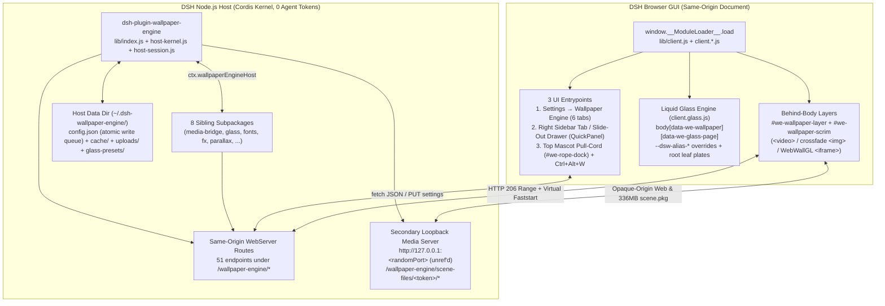

# `dsh-plugin-wallpaper-engine` Reverse-Engineering & Antigravity Parity Specification (`agy-wallpaper-prism`)

> **Author**: `dsh-inspector`  
> **Source Inspected**: Local installation at `%USERPROFILE%\.dsh\profiles\desktop\node_modules\dsh-plugin-wallpaper-engine` (`v1.4.2`, upstream `https://github.com/elysia395/dsh-wallpaper-engine`, MIT) + all **8 co-installed sibling subpackages (`v1.4.2`)**  
> **Target Plugin**: `agy-wallpaper-prism` (Google Antigravity 2.x Hub + Sidecar Studio + Zero-Enable Ephemeral CDP Prism Skin, redesigned with `obsidian-prism` UI principles)

> [!NOTE]
> **Parity Specification Status (`v2.5.0` Sync)** — Sections `§1`–`§3` remain the unaltered upstream `dsh-plugin-wallpaper-engine v1.4.2` reverse-engineering reference. Sections `§4` and `§5` below are synced to the shipped `agy-wallpaper-prism v2.5.0` runtime (including the new optional Opening Animation feature supporting Wallpaper Engine dynamic wallpapers and custom videos, while marking partially implemented `[~]` and unimplemented `[ ]` items honestly). For `v2.5.0` release history and documentation index, see [`docs/CHANGELOG.md`](./CHANGELOG.md) and [`docs/README.md`](./README.md); [`docs/V2.2_NEXT_AI_HANDOFF.md`](./V2.2_NEXT_AI_HANDOFF.md) and [`docs/AI_HANDOFF.md`](./AI_HANDOFF.md) (`D1`-frozen) preserve historical `v2.1.0`/`v2.2.0` baselines.

---

## 1. Source Location & Suite Topology

### 1.1 Exact Local Source Inventory
`dsh-plugin-wallpaper-engine` (`v1.4.2`, `engines.node >= 22.12.0`, `engines.dsh ^0.2.0-rc.1`) is deployed as a **9-package modular suite** in `%USERPROFILE%\.dsh\profiles\desktop\node_modules\` (declared via `cordis.patch.yml` and `package.json#dependencies`):

| # | Package Name (`v1.4.2`) | Patch Row ID | Primary Files Inspected | Responsibility |
|---|---|---|---|---|
| 1 | `dsh-plugin-wallpaper-engine` | `wallpaper-engine` | `lib/index.js`, `lib/client.js` (28,975 lines / 52 inlined `src/*.js` modules), `lib/settings-schema.js` (2,146 lines), `lib/kernel/*`, `lib/media/*`, `lib/steam-discovery.js`, `lib/wallpaper-scan.js`, `lib/inventory.js`, `lib/serve.js`, `lib/media-origin.js`, `lib/mp4-vfs.js`, `lib/pkg-read.js`, `lib/scene-manifest.js`, `lib/we-props.js`, `lib/shim-seed.js`, `lib/we-focus-guard.js`, `lib/webwallgl/*`, `lib/routes/*`, `lib/glass-presets/*.json` | Host kernel, Steam/WE scanner, 3-tier inventory builder, token-fenced HTTP `206 Range` streamer, virtual MP4 faststart, PKGV/LZ4/TEXB0004 parser, WebWallGL Scene/Web adapter, FFmpeg FPS-cap transcoder, 151-key schema, and main React client orchestrator |
| 2 | `dsh-plugin-wallpaper-engine-media-bridge` | `wallpaper-engine-media-bridge` | `lib/index.js`, `lib/routes/{inventory,media-bytes,media-derived,scene-serve,scene-frame,scene-media,live-frame,slides,upload,props,we-assets,now-playing,occlusion}.js`, `lib/backend.js`, `lib/supervisor.js`, `lib/occlusion/index.js`, `lib/client.media-bridge.js` | Registers 29 core wallpaper & media routes, X11 occlusion hub, OS media integration (`WASAPI` / `CoreAudio` / `PipeWire` loopback spectrum + GSMTC/MediaRemote/MPRIS Now Playing + reverse transport), and 6 Library/Playback client UI sections |
| 3 | `dsh-plugin-wallpaper-engine-glass` | `wallpaper-engine-glass` | `lib/index.js`, `lib/routes/glass-row.js`, `lib/client.glass.js` (4,450 lines: `glass-css.js`, `glass-surfaces.js`, `glass.js`, `glass-extra.js`, `glass-layer.js`, `glass-panel.js`) | Independently toggleable Liquid Glass skin: token overrides, WCAG readability floor, `::before` & root-plate `backdrop-filter` carriers, code/popover guardrails, and Appearance Glass/Preset UI |
| 4 | `dsh-plugin-wallpaper-engine-fonts` | `wallpaper-engine-fonts` | `lib/index.js`, `lib/routes/{fontsets,system-fonts}.js`, `lib/client.fonts.js` | Cross-platform system font enumeration (`PowerShell` / `system_profiler` / `fc-list`), named fontset CRUD/import/export, and Appearance Global Fonts editor |
| 5 | `dsh-plugin-wallpaper-engine-fx` | `wallpaper-engine-fx` | `lib/index.js`, `lib/client.fx.js` | Pointer click bursts (`ripple`/`spark`/`both`) and cursor trails (`comet`/`dust`) on an overlay `<canvas>` |
| 6 | `dsh-plugin-wallpaper-engine-parallax` | `wallpaper-engine-parallax` | `lib/index.js`, `lib/client.parallax.js` | Cursor-driven 3D parallax across background wallpaper, mascot, and UI layers |
| 7 | `dsh-plugin-wallpaper-engine-mascot-avatar` | `wallpaper-engine-mascot-avatar` | `lib/index.js`, `lib/routes/{mascot,avatar}.js` | Custom mascot artwork (`/mascot`) and user/AI chat avatars (`/avatar/user`, `/avatar/ai`) |
| 8 | `dsh-plugin-wallpaper-engine-pet-link` | `wallpaper-engine-pet-link` | `lib/index.js`, `lib/routes/{official-pet,pet-install}.js`, `lib/client.pet-link.js` | Optional bridge to external `dsh-pet` (`Ctrl+Shift+D` tuning panel); never bundles Electron |
| 9 | `dsh-plugin-wallpaper-engine-about-notice` | `wallpaper-engine-about-notice` | `lib/index.js`, `lib/routes/{github-stars,about-qr}.js` | Cached GitHub star count (10m TTL) and whitelisted community QR images |

---

## 2. Core DSH Architecture



### 2.1 Five Architectural Pillars Worth Preserving in `agy-wallpaper-prism`
1. **Zero Agent Context/Token Overhead**: Registers **no** model-visible tools or system prompts by default; all rendering, media streaming, and UI configuration live out-of-band from the LLM context window.
2. **Single-Source-of-Truth Schema (`lib/settings-schema.js`)**: Both host persistence (`config.json`) and client state share the exact same validator/sanitizer (`sanitizeFromSchema`), supporting atomic `.tmp<pid><seq>` + `fsync` + `rename` writes serialized through a single promise queue (`enqueueConfigWrite`) and partial per-namespace `PUT /settings/<ns>` merges.
3. **Tokenized, Path-Fenced Loopback Media Streaming (`mediaMap` + `serve.js` + `media-origin.js`)**:
   - Client never sends raw filesystem paths to media routes; host mints `base64url(absPath)` tokens stored in an in-memory `Map` (`mediaMap`) and validates `realpath` containment (`fail-closed` `403`) on every subresource request.
   - **Dual-Origin Loopback Strategy**: Desktop Electron wrappers often attach custom capability headers or throttle main-origin proxy routes; spinning up a dedicated `127.0.0.1:0` HTTP server (`server.unref()` + `socket.unref()` so it never blocks app exit) serves 100–336 MB `scene.pkg` payloads in `~0.6s` and isolates untrusted Workshop HTML wallpapers on a separate origin inside `sandbox="allow-scripts"`.
4. **Zero-Disk-Copy Virtual MP4 Faststart (`lib/mp4-vfs.js`)**:
   - Many Workshop `.mp4` files place the `moov` atom at the end of a 500–800 MB file, forcing Chromium to read the entire file sequentially (`~1.7s`) before decoding frame 1.
   - `mp4-vfs.js` parses top-level MP4 boxes via small `16B` seeks, reads only `moov` (`16–190 KB`) into RAM, adds `+len(moov)` to every `stco`/`co64` chunk offset (bailing safely on fragmented/encrypted `moof`/`senc` boxes), and serves `[ftyp][free][patched moov][mdat]` virtually with full HTTP `206 Range` support (`serveLayout`) — **0 bytes written to disk**, cutting first-frame latency to `~150ms`. Session pinning (`pinnedFaststartVariant`) ensures an active `<video>` never switches byte layouts mid-stream.
5. **Reversible DOM Skinning & Strict Readability/Focus Guardrails**:
   - Every injected `<style>`, DOM layer, observer, timer, and `data-*` attribute is tracked per lifecycle and torn down cleanly on disable/restore ("turning off = byte-identical native host").
   - Untrusted Workshop Web wallpapers get an injected **Focus Guard (`lib/we-focus-guard.js`)** + host **Focus Handback (`src/focus-handback.js`)** so background wallpapers can never steal keyboard focus from the user's chat input or code editor.

---

## 3. Complete Feature Catalog (100% DSH Feature Inventory)

### 3.1 Wallpaper Discovery, Formats & Media Pipeline

| Feature Area | Exact DSH Implementation & Behavior | Key Source Files |
|---|---|---|
| **Steam & WE Root Discovery** | Resolution order: `DSH_WE_STEAM_ROOT` env (comma/semicolon list) → Windows Registry `HKCU\Software\Valve\Steam` `SteamPath` via async `reg.exe` (5s timeout) → fallback dirs (`C:\Program Files (x86)\Steam`, `C:\Program Files\Steam`, `D:\Steam`, `D:\SteamLibrary`, `E:\SteamLibrary`) → WSL `/mnt/<letter>` DrvFS translation. Parses `steamapps/libraryfolders.vdf` for app `431960` **plus** checks `<steamRoot>/steamapps/workshop/content/431960` directly (default Steam library is omitted from VDF `path` entries). Detects both classic (`wallpaper32/64.exe` at root) and modern (`distribution/wallpaper32/64.exe` or `distribution/version.json`) WE install roots. Cached with 60s TTL + inflight Promise dedup. | `lib/steam-discovery.js` |
| **Project Enumeration & Security** | Scans `<installDir>/projects/{defaultprojects,myprojects}` and `<lib>/steamapps/workshop/content/431960/*` in async chunks of 24 (`SCAN_CHUNK = 24`). Honors WE `<root>/visibility.json` (`false` = hidden/removed default wallpapers). Enforces strict directory-containment checks (`relative(dir, abs)`) on untrusted `project.json` `file`, `preview`, and `preset.customdirectory` fields (`#252` traversal defense). | `lib/wallpaper-scan.js` |
| **3-Tier Inventory Cache** | ① 3s in-memory TTL; ② disk `cache/inventory-index.json` (`INDEX_VERSION = 2`) validated against `scanSignatureP` (SHA-1 of ordered scan roots' `mtimeMs:size` + `visibility.json` `mtimeMs:size`); ③ 30s stale-while-revalidate when signature matches. Stores raw scan records (never raw URLs) so `mediaMap` tokens are freshly reminted after restart. | `lib/inventory.js` |
| **Format 1: Static Images & WE Slideshows (`image`)** | Supports `.jpg/.jpeg/.png/.webp/.gif/.bmp/.avif`. Parses WE `project.json` `preset` (`wallpapermode` `1`=single, `2`=slideshow; walks `customdirectory` up to depth 3 / max 2,000 images in natural sort order `1.jpg < 2.jpg < 10.jpg`; maps WE `imageswitchtimes` tiers `1..5` to `1m / 5m / 10m / 30m / 60m`). Serves manifest via `GET /slides/<token>` for client crossfade playback. Downsamples large previews on-demand to `320px` (`thumbs/ip_<hash>.jpg`, `lib/media/image-preview.js`) with `ETag`/`304` revalidation. | `lib/wallpaper-scan.js`, `lib/media/image-preview.js`, `routes/slides.js` |
| **Format 2: Video Wallpapers (`video`)** | Supports `.mp4/.webm/.mkv/.avi/.mov`. Streams via `/media/<token>` with HTTP `206 Partial Content` Range + virtual `moov`-first faststart (`lib/mp4-vfs.js`). Probes video dimensions/FPS/codec via MP4 `moov` parser (`lib/media/mp4-probe.js`, `/media-info/<token>`). Generates missing preview thumbnails via `ffmpeg` (`lib/media/video-preview.js`, `/video-preview/<token>`). Pre-warms `<video preload="metadata">` on card `pointerover`/`pointerdown` (`warmVideoForPointer`). Includes `edgeCompat` `<canvas>` draw loop (`requestVideoFrameCallback`) to suppress browser media hover overlays. | `lib/mp4-vfs.js`, `lib/media/mp4-probe.js`, `lib/media/video-preview.js`, `src/video-layer.js` |
| **Format 3: HTML / Web Wallpapers (`web`)** | Supports `.html/.htm/.js`. Mounted via WebWallGL web adapter in an opaque-origin `sandbox="allow-scripts"` iframe served from the secondary loopback media origin (`/scene-files/<token>/<entry>`). Host injects 4 inline `<script>` blocks into entry HTML: ① site-root base, ② WE Web API shim (`wallpaperRegisterAudioListener`, `wallpaperPropertyListener`, pointer/media shims extracted from `webwallgl`), ③ Frame & Element Focus Guard (`window.focus` blocked; `HTMLElement`/`SVGElement.prototype.focus` gated to 1000ms after real/shim pointer gesture), ④ `window.__weSeedProps(...)` initial property values (`project.json` defaults + user overrides). Captures first rendered frame (`POST /live-frame/<token>`) as instant reload poster. Forwards host pointer moves/clicks/wheel via `__wp.pushPointer` while `pointer-events: none` keeps UI interactive. | `lib/shim-seed.js`, `lib/we-focus-guard.js`, `lib/serve.js`, `routes/live-frame.js`, `src/focus-handback.js` |
| **Format 4: Scene Wallpapers (`scene` — `scene.pkg` & `scene.json`)** | Resolves main file via `[declared, 'scene.pkg', 'scene.json', single *.pkg]`. Implements a **5-stage Scene Rendering & Fallback Chain**:<br/>1. **WebWallGL Live WebGL (`sceneLive: true`)**: Real-time 2D/3D mesh, puppet warp, particle, shader, SceneScript, parallax, and audio rendering inside `/scene-live/index.html` (`window.__wp` / `window.__wpStats`). Scales first-frame watchdog timeout dynamically by `scenePkgBytes` + `/scene-payload-progress` active byte ledger (handles 336 MB `scene.pkg`). Supports optional local WE `assets/` path (`weAssetsDir` → `/api/local-assets`) for official util/particle textures. Auto-captures live WebGL canvas (`PUT /scene-frame-cache/<token>`, `<key>_gpu.png`, monotonic area upgrade guard `409 frame-smaller`). Remembers crashed/stalled IDs in `sceneLiveFailures` (cleared when re-enabling `sceneLive`).<br/>2. **Embedded MP4 Extraction (`sceneVideo`)**: `lib/pkg-read.js` (bounds-checked PKGV header + LZ4 block-chain decompressor, 256 MB cap) + `lib/scene-manifest.js` (`TEXB0004` video flag detector excluding mask/lut/flow/ripple helper textures) extracts author-embedded MP4 animations from `scene.pkg` or loose `.tex` files and plays them natively in `<video>` via `/scene-video/<token>`, plus packaged BGM via `/scene-audio/<token>`.<br/>3. **GPU Frame / Custom Screenshot (`scene-frame?v=0|4`)**: Serves cached `<key>_gpu.png` (`v=0`) or user-imported desktop screenshot (`overrides/<id>.{png,jpg,webp}`, up to 30 MB via `POST /custom-frame/<id>`, `v=4`).<br/>4. **Workshop `preview` Image** (`/preview/<token>`).<br/>5. **`schemeColor` CSS Placeholder / `default-wallpaper/index.html` Honest Empty State**. | `lib/webwallgl/*`, `lib/pkg-read.js`, `lib/scene-manifest.js`, `lib/media/scene-probe.js`, `routes/scene-frame.js`, `routes/scene-media.js`, `src/live-layer*.js` |
| **Format 5: Application (`application`)** | Listed in raw scan for diagnostics only; `playable: false`, excluded from picker grid and rotation (never executes `.exe` / third-party binaries). | `lib/index.js`, `src/picker-model.js` |
| **Custom Uploads & Local WE Directories** | Streaming upload (`POST /upload?title=...`) for `JPG / PNG / MP4` up to **512 MB** (`UPLOAD_MAX_BYTES`), writing to `.tmp` with backpressure, 60s idle timeout, atomic rename, and **SHA-256 content deduplication** (`uploads/.meta.json`; re-uploading identical bytes returns `{ duplicate: true }` without duplicating disk space). Deletion (`POST /remove`) uses two-step inline confirmation. Configurable `uploadDir` (`POST /upload-dir`, supports `~`, auto-migrates existing `up-*` files) **also scans raw WE project subdirectories (`up-dir-*` with `project.json`)** dropped into the storage folder (vital when Steam/WE isn't installed). *(Note: DSH UI uses `<input type="file">`; drag-and-drop is an easy enhancement for `agy-wallpaper-prism`.)* | `lib/upload-dir.js`, `lib/upload-store.js`, `routes/upload.js`, `wallpaper-uploads-section.js` |
| **Cache Directory Management** | Dedicated `cacheDir` (`DSH_WE_CACHE_DIR` → `config.json#cacheDir` → `<dataDir>/cache`) storing regenerable heavy artifacts (`transcodes/`, `frames/`, `video-previews/`, `thumbs/`, `media-bridge/`). Includes an in-panel **Server-Side Directory Browser (`GET /cache-dir/browse`)** with quick chips ("This PC", "Home", "Current Cache") and automatic file migration (`POST /cache-dir`). Startup sweep (`lib/startup-sweep.js`) cleans orphaned `.tmp<deadPid>` / `.part` files. | `lib/cache-dir.js`, `routes/cache-dir.js`, `lib/startup-sweep.js` |

---

### 3.2 Playback, Playlists, Audio & Power Lifecycle Controls

| Control / Lifecycle Feature | Exact Parameters, Ranges & Behavior | Schema Key(s) & Defaults |
|---|---|---|
| **WE Playlist Discovery & Auto-Seeding** | Parses `<installDir>/config.json` (`general.playlists` + `selectedwallpapers.*.playlist`), resolving Workshop IDs, absolute paths, and `defaultprojects/<name>` folders. Auto-seeds the first playable WE playlist (`>=2` items) into `rotationGroups` once (`rotationSeeded: true`), plus offers `"从 WE 播放列表导入…"` in the playlist editor. | `rotationSeeded: false` |
| **Custom Rotation Playlists (`rotationGroups`)** | Unlimited user-named playlists (`id`, `name`, `wallpaperIds[]`), edited via in-panel drill-down card multi-select (`pickerDraft`). Requires `>= 2` eligible unhidden wallpapers. Includes manual **Next (`下一张`)**, **Play/Pause**, and **Clear (`清除`)** actions. | `rotationEnabled: false`, `rotationGroupId: ""`, `rotationGroups: []` |
| **Rotation Order, Interval & Video-End Trigger** | Per-playlist `order`: **`"sequence"`** (sequential) or **`"random"`** (shuffle). Per-playlist `trigger`: **`"interval"`** (timer in minutes, `1..1440`, default `30`, UI presets `[1, 3, 5, 10, 15, 30, 60, 120, 360, 720, 1440]`) or **`"videoEnd"`** (`"视频播完就换"` — advances automatically when a video wallpaper finishes a loop!). | `rotationInterval: 30` (`1..1440` min) |
| **Pre-Staged Switch Transitions** | Off-screen staging (`prepareSceneLiveStage` / `prepareVideoProbe`) pre-loads next wallpaper and adopts live DOM/iframe nodes without reload flicker. **7 GPU-composited transitions**: `cut` (default), `fade`, `push`, `wipe`, `iris`, `zoom`, `bars` × **4 directions** (`left`, `right`, `up`, `down` for directional transitions) × **3 speeds** (`fast`, `normal`, `slow`). | `switchTransition: "cut"`, `switchTransitionDir: "left"`, `switchTransitionSpeed: "normal"` |
| **Picture Slideshow Interval** | Controls internal crossfade period for multi-image WE Picture projects (`0` = follow WE `imageswitchtimes`, or `5, 10, 15, 30, 60, 180, 300..3600` seconds). | `pictureSlideSeconds: 0` (`0..3600` s) |
| **Video Playback Speed** | Instant `<video>.playbackRate` multiplier (`[0.5, 0.75, 1, 1.25, 1.5, 2]`), completely independent of decode FPS cap. | `playbackRate: 1` (`0.5..2`) |
| **Video Decode FPS Cap (FFmpeg Frame-Skip)** | Options: **`0` (Unlimited), `60` fps, `30` fps**. Host re-encodes high-FPS video (e.g., 4K120 → 4K60 at 1.0× speed) once via `ffmpeg` (AV1 NVENC preferred → H.264 fallback; max 2 concurrent jobs; 15m deadline; live `/transcode-progress` bar; SHA-256-pinned lazy `ffmpeg-static b6.0` provisioning; transparent fallback to original file if FFmpeg unavailable). | `fpsCap: 0` (`[0, 60, 30]`) |
| **Scene / Web Live Render Controls** | Toggle real-time WebWallGL (`sceneLive`), cap WebGL render rate (`sceneLiveFps`: **`15, 30, 60`**), toggle `sceneAutoQuality` (scales down bloom/particles/AA when `<85%` target FPS), and set `liveBootDelay` (`0, 3, 5, 10..30s` placeholder hold on cold boot). Manual `"重新截"` / `"清除 GPU 帧"` / `"导入画面…"` screenshot controls. | `sceneLive: true`, `sceneLiveFps: 30`, `sceneAutoQuality: true`, `liveBootDelay: 3` |
| **Wallpaper Audio & Volume** | Master audio toggle (`videoAudioEnabled`: `🔊 音乐开` / `🔇 音乐关`; enabling when volume is `0` auto-sets volume to `50%`) + `videoVolume` (`0..100%`, step `5%`), unified across video, `sceneVideo`, packaged `sceneAudio`, and WebWallGL. Rotation audio gate suppresses overlap during transitions. | `videoVolume: 0` (`0..1`), `videoAudioEnabled: true` |
| **System Media & Audio Spectrum Bridge** | Lazy-started `media-bridge` child supervisor: exposes OS Now Playing track/artist/timeline (`/now-playing`), cover art (`/now-playing/artwork`), reverse media transport (`POST /media-control` `play/pause/next/prev`), opt-in LRCLIB lyrics (`mediaLyricsOnline`), and real-time system output loopback FFT spectrum (`/audio-spectrum`, WASAPI/CoreAudio/PipeWire) driving audio-reactive wallpapers! Renders a spinning `VinylRecord` disc in the Current Wallpaper card. | `audioSource: "auto"`, `mediaIntegration: true`, `mediaLyricsOnline: true` (const-enabled) |
| **Visual Filters & Framing** | Wallpaper CSS adjustments: `wallpaperBlur` (`0..60px`), `backgroundBrightness` (`40..160%`), `backgroundContrast` (`40..200%`), `backgroundSaturate` (`0..200%`), `wallpaperOpacity` (`0..90%` fade toward theme canvas), `scrim` (`0..90%` contrast veil), WebWallGL filter presets (`none, blur, grayscale, sepia, vivid, warm, cool, invert, brighten, darken, contrast`). Framing: `objectFit` (`cover, contain, center, fill`), horizontal `flip` (`scaleX(-1)`), `layerPositionX` (`0..100%`), `layerPositionY` (`0..100%`), `layerScale` (`50..150%`, double-click label resets to `50/50/100%`). | `scrim: 0.25`, `wallpaperBlur: 0`, `backgroundBrightness: 100`, `backgroundContrast: 100`, `backgroundSaturate: 100`, `wallpaperOpacity: 0`, `objectFit: "cover"`, `flip: false`, `layerPositionX: 50`, `layerPositionY: 50`, `layerScale: 100` |
| **Auto-Pause Lifecycle (Hidden / Unfocused / Battery / Occlusion)** | 1. **`pauseOnHidden` (`true`)**: Pauses `<video>` / WebWallGL when `document.hidden` (window minimized / background tab), guarded by a **1200ms debounce (`HIDDEN_PAUSE_DEBOUNCE_MS`)** so virtual-desktop switches don't trigger black-screen reloads; defers rotation timers while hidden (>60s releases staging) and nudges 2-frame repaint on wake.<br/>2. **`pauseOnBlur` (`false`)**: Pauses when `!document.hasFocus()` (gated by `adapterCaps().blurPause` so desktop shells don't freeze visible unfocused windows unless configured), backed by a **3s `OCCLUSION_RECHECK_MS` self-healing poll**.<br/>3. **`pauseOnBattery` (`false`)**: Monitors `navigator.getBattery()` (`!bm.charging` + `chargingchange`) to pause automatically on battery power.<br/>4. **Window Occlusion (`GET /occlusion`)**: 1Hz X11 EWMH window-stack geometry probe (`lib/occlusion/x11.js` + `rects.js`) sending occluder rectangles to WebWallGL (`__weSetOcclusion`) with 3s staleness auto-clear. *(Fullscreen apps covering the window trigger occlusion on X11; on Windows Antigravity we add Win32/Electron fullscreen/maximized occlusion + Agent `SessionStart`/`Stop` hooks.)* | `pauseOnHidden: true`, `pauseOnBlur: false`, `pauseOnBattery: false`, `adapterTarget: "auto"` |

---

### 3.3 Appearance, Workbench Liquid Glass, Per-Wallpaper Settings & Library Curation

#### A. How DSH Makes Panes Transparent/Glassy Without Breaking Code, Terminals, or Popovers (`client.glass.js`)
1. **Orthogonal Root Gates**:
   - `body[data-we-wallpaper]` sets `--dsw-alias-bg-base: transparent !important` so the main shell canvas exposes `#we-wallpaper-layer` (`z-index` behind `#root`).
   - `body[data-we-glass-page]` activates the Liquid Glass token formulas (even when no wallpaper is active). Disabling `wallpaper-engine-glass` removes `data-we-glass-page` and its `<style>`, immediately restoring native opaque surfaces while keeping the center-canvas wallpaper intact.
   - Coexistence protocol (`skinYieldRestoreId` / `skinYieldRestoreRotation`): watches `html[data-dsh-skin]` with 450ms enter / 2600ms exit grace timers to yield cleanly to other full-theme plugins and auto-restore afterward.
2. **WCAG Readability Floor Formula (`weClampSurfaceColor` + `--we-readability-floor`)**:
   - Instead of raw `rgba(r, g, b, alpha)` (which becomes illegible over bright/busy wallpapers), every surface token blends a luminance-clamped readability base with the user's glass tint:
     ```css
     color-mix(
       in srgb,
       var(--we-readability-base) calc(var(--we-readability-floor) * 100%),
       color-mix(in srgb, var(--we-surface-tint) calc(var(--we-glass-alpha) * <layerWeight> * 100%), transparent)
         calc((1 - var(--we-readability-floor)) * 100%)
     )
     ```
   - `glassFidelity` (`0..100%`, default `100`) and `chatGlassFidelity` (`0..100%`, default `100`) scale `--we-readability-floor`, giving users an explicit dial between guaranteed `>= 4.5:1` text legibility (`100%`) and raw vivid tint (`0%`).
   - Light-mode contrast boost: when `body[data-we-wallpaper][data-we-glass-page]:not([data-ds-dark-theme])` is active, secondary/tertiary/caption gray text tokens are darkened so mid-gray labels never wash out over light scrims.
   - Constant saturation (`GLASS_SATURATE = 1.3`): decouples `saturate()` from blur radius (`--we-blur`) so high blur (`40–60px`) creates a calm frosted matte rather than neon color ghosting.
3. **`backdrop-filter` Containing-Block Safety (`#89` & `glass-surfaces.js`)**:
   - Applying `backdrop-filter` directly to a container makes it a containing block for `position: fixed` descendants, breaking anchored popovers/buttons inside chat composers and sidebars.
   - **Solution 1 (`::before` Carrier)**: On `[data-composer-card]` and user `extraGlassSelectors`, `backdrop-filter` is set to `none` on the element itself and rendered on `::before` (pseudo-elements have zero DOM children and can never trap `position: fixed`!).
   - **Solution 2 (Root-Level Leaf Plates — `glass-surfaces.js`)**: For `left-sidebar` and `right-sidebar`, `weSurfaceGeometry()` audits the ancestor chain (rejecting static `transform`, `opacity < 1`, `filter`, `isolation: isolate`, `dialog` ancestors, or `overflow: hidden/clip` clipping beyond a `0.5px` DPR epsilon; dynamically tracking finite `grid-template-columns` / `transform` animations via `rAF`) and mounts a synchronized root-level leaf backdrop plate (`[data-we-surface-root]`) behind the pane. Unsafe surfaces automatically fall back to `native` opaque backgrounds rather than breaking layout.
4. **Code Editors, Markdown Code Blocks, Diffs & Terminals Protection**:
   - **Syntax Colors Untouched**: Shiki/syntax foreground tokens and diff line addition/deletion highlights are never overridden.
   - **Single-Plate Rule (No Stacked Blur/Tint)**: In `.md-code-block`, `[data-terminal]`, `[data-read]`, `[data-grep]`, and `[data-diff]`, the outer card receives `--we-tool-glass-fill` (`glassAlpha + 0.06` extra coverage) + specular top sheen + `backdrop-filter`, while inner `pre`, `code`, and banner backgrounds are forced `transparent` with `backdrop-filter: none` so nested plates never multiply opacity or double-blur.
   - **Sticky Code Banner Re-Backing (`#156④`)**: Sticky code-block headers (`:has(> [data-code-block-banner])`) get their own readability-floored glass plate so scrolling code lines underneath don't bleed through the copy button/filename bar.
   - **Inline Code Line-Wrap Guard (`#197`)**: Inline `:not(pre) > code` chips get thin capsule mist (`--we-capsule-glass-fill`, `capsuleBlur: 8px`), except inside compact reasoning blocks where wrapped inline elements would blur the bounding box of multiple text lines.
   - **3-State Content Readability Mode**: Users can switch chat/code content between **Translucent Tint** (default), **Full Frosted Glass** (`thinkingGlass: true`), or **100% Native Opaque Content** (`thinkingNative: true` — pins code blocks, inline code, citations, and bubbles back to solid native dark/light palette while keeping the outer canvas and composer glassy!).
5. **Popovers, Menus, Dialogs & Tooltip Protection (`#161`, `#277`)**:
   - Every `[class*="_bubble"]` selector carries `:not([role="tooltip"])` so dark tooltips with white text never inherit light glass fills.
   - Floating overlays (`[role="tooltip"]`, `[role="menu"]`, `[role="listbox"]`, `[class*="popover" i]`, `[class*="dropdown" i]`, `[class*="popup" i]`, `[class*="hovercard" i]`) override surface tokens to **`color-mix(in srgb, var(--we-panel-color) 96%, transparent)`** — preventing underlying editor/chat text from showing through menus ("double-stacked text ghosting").
   - `floaterSolidBase` (default `true`) supplies solid theme bases to unrecognized third-party plugin panels/floaters.

#### B. Granular Appearance, Per-Wallpaper Memory & Library Controls
- **Per-Surface Glass & Corner Controls**:
  - Global: `accent` (`#4f8cff`), `glassColor: { light, dark }`, `glassDarkSeparate`, `glassAlpha` (`0..100`, default `20`), `blur` (`0..60px`, default `16`), `border` (`0..1`, default `0.35` mapped across all 4 border tiers `l1..l4`), `glassFidelity` (`0..100`), `chatGlassFidelity` (`0..100`), `capsuleBlur` (`0..60`), `capsuleColor`, `conversationColor`, `floaterSolidBase`, `extraGlassSelectors`.
  - Per-surface `glassMode` (`inherit | custom`) + `glassSurfacePolicy` (`auto | native`) across `leftSidebar`, `rightSidebar`, `settingsWindow`, `conversation`, `thinkingTrigger`, `titlebar`, and `floaters`.
  - Independent Left & Right Sidebar Island Corners: `leftSidebarCornerRadius` / `rightSidebarCornerRadius` (`"native" | "6" | "12" | "20"`) + individual per-corner square overrides (`SquareTL`, `SquareTR`, `SquareBR`, `SquareBL`) for flush-edge vs floating-island geometry!
- **Typography, Caret & UI Accent Palette (`fonts` + `typeColor`)**:
  - `caretColor` (`#we-caret-patch` injecting `caret-color !important` on `textarea, input, [contenteditable]` so the cursor never vanishes against bright wallpapers).
  - `uiColorCustom` + 5 semantic UI tint overrides (`uiColorSend`, `uiColorLink`, `uiColorFileIcon`, `uiColorTab`, `uiColorDeepDiving`).
  - `fontCustom` + named Fontsets (`compact.json` built-in + user CRUD/import/export): `globalFamily` (built-in stacks + lazy-scanned OS fonts via `/system-fonts`), 5 `themeColors` text roles (`primary`, `secondary`, `tertiary`, `caption`, `dimmed`), 12 `themeSize`/`themeWeight`/`themeFamily` markdown/UI roles, and 4 `componentFonts` targets (`markdown`, `codeBlock`, `terminal`, `table`).
- **Adaptive Theme Follow (`themeFollow`, default `false`)**:
  - Evaluates wallpaper brightness on change (priority: user `schemecolor` override → `project.json` `schemecolor` → agreement of preview + live frame luminance against `THEME_FOLLOW_LIGHT_ABOVE = 0.40`; disagreements prefer Dark) and switches host Light/Dark mode. Yields per-wallpaper if the user manually toggles the host theme.
- **Per-Wallpaper Saved Settings & Whole-Profile Presets**:
  - **Per-Wallpaper WE User Properties (`lib/we-props.js` + `src/we-cond.js`)**: Parses `project.json` `general.properties` (`color`, `bool`, `slider`, `combo`, `text`, `textinput`, `file`, `directory`, `group`), preserving float `order` sort + codepoint tie-breaking, mixed-type `combo` values (`number`/`string`/`boolean`), HTML entity stripping, per-key `zh-chs → zh-cht → en-us` localization, and live `condition` visibility evaluation. Saved in `userProps[token]`, hot-pushed via `__wp.updateWebProps` and seeded into HTML.
  - **Per-Wallpaper Frame Source Memory**: `frameVariants[id]` (`0` = auto GPU frame, `4` = custom screenshot `customFrames[id]`).
  - **Whole-Profile Presets (`routes/presets.js`)**: **7 built-in factory presets** (`factory-author` "作者自用", `factory-default` "黑客绿(Fish)", `factory-frosted` "重磨砂", `factory-night` "暗夜釉色", `factory-readable` "可读优先", `factory-vivid` "原色直出", `purple-mood` "紫色心情") + user snapshots (`max 8` active, copy-on-write user dir + tombstone deletion for factory presets, JSON `export` / `import` with collision auto-numbering, 4-state optional `font`/`mascot`/`avatar`/`theme` asset embedding).
  - **3-Tier Non-Destructive Reset & Inline Confirmations**: Module reset (`↺`, `RESET_MODULES`), Tab reset (`RESET_TABS`), and Global reset — all excluding content choices (`id`, `hiddenIds`, `userProps`). All destructive actions use a single-token inline confirmation row (`armedConfirm` / `renderConfirmRow`) — **zero `window.confirm()` / `alert()`** calls.
- **Library Search, Multi-Facet Filtering & Curation**:
  - Real-time case-insensitive title substring `search`.
  - Multi-select `typeFilter` (`["video", "web", "image", "scene"]`) and `contentRatingFilter` (`["everyone", "pg13", "mature", "unrated"]`, default `["everyone"]`) with live per-bucket counts and non-empty guard (cannot uncheck the last active chip).
  - `pickerLayout`: `"fixed"` (virtualized 92px-tall grid, zero pagination lag on 1,000+ items) vs `"classic"` (16:9 overlapping CD-rack view).
  - Single-card & multi-select **Batch Soft-Hide (`hiddenIds`)** + dedicated `"已隐藏"` (Hidden) recovery tab with individual `"恢复"` and `"全部恢复"` (never deletes Workshop files).
  - *(Parity Note on Favorites & Tags)*: DSH curates favorites via named `rotationGroups` playlists rather than a dedicated `favorites` boolean or WE tag array. In `agy-wallpaper-prism`, we preserve full `rotationGroups` + `hiddenIds` parity **and** add first-class `favorites: string[]` star-pinning + `project.json` `tags` search/filtering!
- **Optional Visual Extensions (`fx`, `parallax`, `mascot-avatar`)**:
  - Click & cursor trail `<canvas>` effects (`fxEnabled`, ripple/spark + comet/dust, blend modes, accent/rainbow/custom color).
  - 3D cursor parallax (`parallaxEnabled`, per-layer depth sliders + smoothing).
  - Custom user/AI chat avatars (`avatarEnabled`).

---

### 3.4 Shortcut Keys, Floating / Sidebar Triggers & i18n

| Aspect | Exact DSH Implementation |
|---|---|
| **Global Shortcut** | **`Cmd/Ctrl + Alt + W`** (`id: "wallpaper.sidebar.toggle"`, active across `page`, `editable`, and `terminal` regions) — toggles the Quick Wallpaper Sidebar / Drawer. (`Ctrl + Shift + D` opens the optional `pet-link` tuning panel.) |
| **Modal / Panel Keyboard Navigation** | **`Escape`** two-stage capture unwind: `window` capture closes the drill-down Library Picker first (`e.stopPropagation()`) without closing the parent panel; `document` capture closes the Quick Drawer on second `Escape`. **`Enter` / `Space`** activates focused wallpaper cards (`cardKeyDown`) and the Mascot pull-cord (`onRopeKeyDown`). **`Enter` / `Escape`** commits/cancels inline directory path inputs. **Double-click** slider labels resets framing (`layerPositionX/Y/Scale`). |
| **Quick Floating & Sidebar Triggers** | 1. **Mascot Pull-Cord (`#we-rope-dock`, `RopeDock`)**: Top-edge draggable pull-cord with 10 built-in AI mascots (`deepseek`, `claude`, `gemini`, `gpt`, `glm`, `grok`, `kimi`, `qwen`, `whale`, `phoebe`) + custom uploaded image (`64×96` stage, `0.5×–2.5×` scale) in a 3D ring carousel; pulling or clicking toggles the Quick Panel.<br/>2. **Quick Panel (`QuickPanel`)**: Automatically docks as an official Right Sidebar tab (`sidebar.right.pane.tab`) when supported, or falls back to a slide-out frosted drawer; exposes Current Wallpaper + VinylRecord, Rotation toggle + Next, 3 compact tabs (`Wallpaper` virtualized grid + audio / `Appearance` / `Playback`), and deep-link footer buttons into the full 6-tab Settings panel (`Library`, `Appearance`, `Playback`, `System`, `Extensions`, `About`). |
| **i18n (`zh` / `en`)** | **700+ bilingual UI strings** (`src/i18n-copy-*.js` + `src/i18n.js` + `locale/{zh,en}.json` per subpackage). Uses Chinese source text as `msgid` (`weT(zhText, params, context)`) with `\u0000` context prefixes for homographs (`"适配"` Fit vs Adapter, `"播放"` Play vs Playback, `"顺序"` Order vs Sequential). Auto-follows host locale (`zh*` vs `en`), supports `{name}` interpolation and `?we-lang=zh|en` URL override, and localizes WE `project.json` user properties via `zh-chs → zh-cht → en-us` per-key fallback. |

---

## 4. Complete Antigravity Environment Mapping (`agy-wallpaper-prism`)

### 4.1 Host Architecture Translation (DSH vs. Antigravity 2.x)

Per `legacy-audit.md` (#5), Antigravity 2.x is an Electron desktop app serving a React + Tailwind **Hub** (`https://127.0.0.1:<lsPort>/`, no `workbench.html`, CSS tokens declared on `body.dark` / `body.light` at specificity `0,1,1`), and official plugins live under `~/.gemini/config/plugins/agy-wallpaper-prism/` with a strict 10-key `plugin.json` allowlist and zero-token `SidecarApp` (`AUX_PANE`) support.

| DSH Mechanism | Antigravity `agy-wallpaper-prism` Equivalent | Architectural Rationale |
|---|---|---|
| **9-Package Cordis Bundle (`cordis.patch.yml`)** | **Single Unified Plugin + Fenced Sidecar Engine**: `plugin.json` (strict 10-key allowlist) + `sidecars/prism_studio/main.mjs` (`restart_policy: "on-failure"` in `sidecars/prism_studio/sidecar.json`, `SIDECAR_UI_ENTRYPOINT_AUX_PANE`, single-instance `instanceId` atomic fencing + `/api/shutdown` takeover + PR `#11` orphan exit + `DEV_WATCH_ENABLED` gate) + `skills/wallpaper-prism/SKILL.md` | Zero Agent token overhead in steady state; avoids crash-looping or dual-instance oscillation; eliminates multi-package symlink/junction fragility (Antigravity skips NTFS junctions) and eliminates split-brain standalone daemons. |
| **51 WebServer Routes + Secondary `media-origin`** | **Sidecar HTTP Server + Dedicated Loopback Media Server (`127.0.0.1:<port>`)**: `SidecarApp` routes (protected by global loopback `Host` DNS-rebinding guard + always-on 256-bit `X-Sidecar-Token`, plus strict non-wildcard `/api/healthz`, `/api/update/*`, `/api/studio/popout`, and `/api/inspector/{pick,cancel}`) + capped streaming proxy (`MAX_CONCURRENT_STREAM_PROXIES = 4`, TCP RST + `10s` stall cleanup) + tokenized `realpath`-fenced HTTP `206 Range`, `/scene-image/`, and `/mse-fmp4/` media server reachable by both Sidecar Studio and Hub renderer (Priority 0 `/mse-fmp4/` with byte-aware 4K60 cap, HEVC PTS alignment, non-blanking loop remount, and `F-01` unmute remount, plus uncapped `fetch+blob` with `60s` timeout and automatic MSE/poster fallback). | Preserves 100% of DSH's `mediaMap` token security, `realpath` containment, HTTP `206` Range streaming, `mp4-vfs.mjs` zero-copy virtual faststart, `pkg-scene.mjs` HD `.tex` decoding (`PNG/JPEG/WebP/RGBA8888/DXT1/3/5`), and `web-shim.mjs` HTML shim/focus-guard injection. |
| **`window.__ModuleLoader__` Client Injection** | **Zero-Enable Ephemeral CDP Bridge (`sidecars/prism_studio/cdp-bridge.mjs` inside `main.mjs`)**: Connects passively when Antigravity runs with `--remote-debugging-port` (with explicit `skinEnabled` gate + non-disruptive `enable-autostart` normal-shortcut patcher + two-phase `fsync` Boot Canary). Uses a 1-shot post-hydration `buildHostMicroBootstrap` (`<= 6144 B`) over an ephemeral WebSocket that closes immediately, followed by `/host/<capToken>/events` SSE + `/host/<capToken>/rpc` POST, plus on-demand 12-region Live Host Region Picker injection (`GET /host/<capToken>/inspector.js`, `src/host/inspector-inject.js`, **`0 B` micro-bootstrap delta**, compatible with `live`, `static-css`, `manual`, and `skinEnabled: false`). **Zero-tolerance bans `Page.enable`, `Runtime.enable`, `Page.addScriptToEvaluateOnNewDocument`, and `Runtime.addBinding`** (`test/verify-all.mjs`). Cleanly strips `#agy-prism-*` on disable/panic (`Ctrl+Alt+Shift+R` / `4× Esc`). **Never touches `app.asar`.** | Proven end-to-end on Antigravity `2.34.0`/`2.35+`; avoids Inspector Domain collisions with co-installed plugins (`#gemini-neko-pet-root`, `#ag-context-meter`, `#ag-usage-monitor-capsule`) and prevents pre-hydration black screens. |
| **`~/.dsh-wallpaper-engine/` Persistence** | **`ANTIGRAVITY_EXECUTABLE_DATA_DIR` (default `~/.gemini/antigravity/sidecar_data/agy-wallpaper-prism/prism_studio/data`, overridable via `AGY_PRISM_DATA_DIR`)**: `config.json` (atomic `.tmp<pid><seq>` + `fsync` + `rename` via `store.mjs` + `src/shared/schema.mjs`), `canary.json`, `server_info.json` (`0o600`), `sidecar-registry.json`, `shortcut-backup.json`, `uploads/`, `cache/` (`thumbs/`, `scene-media/`, `inventory-index.json`, `steam-roots.json`), `presets/`, `updates/`. Legacy `~/.agy-wallpaper-prism/` is migrated automatically and non-destructively on first v2 boot (`migrateLegacyPrismDataIfNeeded`). | Survives plugin reinstalls, 1-click updates, port changes, and Sidecar restarts; keeps caches/uploads out of `~/.gemini/config/plugins/`. |
| **Settings Section + Right Sidebar + Mascot Pull-Cord** | **Dual Obsidian-Prism UI Surfaces + Popout Visual IDE**:<br/>1. **Sidecar Studio Pane (`sidecar://agy-wallpaper-prism/prism_studio/`, `AUX_PANE`)**: Modular Style-Settings Studio (`src/studio-ui/` L0–L6 DAG) with `<840px` narrow unified `.prism-workspace` scrolling & sticky `.prism-tabs-bar` (`scroll-margin-top: 56px`), 21:9 static-first clickable preview, Library, 12-region collapsed Prism Skin accordions (`Shell Chrome` / `Chat Bubbles & Code` / `Controls, Cards & Overlays` / `Global`), **Dual-Form Visual Region Editor** (responsive in-sidebar pan/zoom modal + standalone browser Popout IDE `/?mode=visual-editor`) with **`🎯 Pick Live Host Region`**, Playback, Presets/Snapshots, and Host/System diagnostics — plus Layer B `COLD_DORMANT` -> `SOFT_SLEEP` -> `DEEP_SLEEP` (`0×0` `#app` rect guard).<br/>2. **In-Host Quick Prism Popover (`Ctrl+Alt+W` + subtle Statusbar / Bottom-Corner Prism Pill Trigger)**: Injected via CDP into Hub for instant wallpaper pick, play/pause/mute/next, 5 scene presets (`Crisp Glass`, `Crystal`, `Islands`, `Focus`, `Eco`), 12-component sliders with inline Glass Style cycler pills, and live optical tuning without opening the Sidecar. (DSH's anime mascot pull-cord is replaced by Prism's calm minimal pill trigger by default, with optional custom badge/icon support.) | Matches `RMvdesi/obsidian-prism` calm, native aesthetic while preserving DSH's instant `Ctrl+Alt+W` + 1-click floating access and full Studio depth. |
| **`--dsw-alias-*` + `client.glass.js` Liquid Glass** | **Obsidian Prism 12-Region Surface Hierarchy (`--prism-*` tokens on `html[data-agy-prism-skin] body`, specificity `>= 0,1,2`, `body[data-agy-theme]` `(0,4,1)+` controls)**: Unified **12-region `regions` schema** (`topbar`, `wco`, `sidebar`, `workspace`, `card`, `userBubble`, `assistantBubble`, `codeBlock`, `controls`, `composer`, `rightPane`, `popover`, lossless migration from `v2.1.0` `surfaceTints`), **5 selectable `GLASS_STYLES`** (`none`, `frosted`, `crystal`, `tinted`, `solid`), **zero-blur default** on all 5 `ZERO_BLUR_BY_DEFAULT_REGIONS` (`card`, `userBubble`, `assistantBubble`, `codeBlock`, `controls`), **9 optical + 6 structural properties** per region + opposite-anchor WCAG AA `>= 4.5:1` readability floor (`enforceFgContrastRgb`, `glassFidelity`, `allowRawFontColor`), zero-alpha shadow suppression (`F-02`), Light Frost & Dark Obsidian adaptive palettes + 8 Prism color schemes + Dynamic Wallpaper Accent, **Flush vs. Floating Island Layout**, 4 pure-CSS sidebar styles (`capsule`, `underline`, `accordion`, `tree`), single-carrier Composer flattening, `D18` WCO `z-index: 0` capsule, single-box `<pre>` hollowing + nested code blur suppression inside blurred `planner-response-text` (`F-04`), extended `SOLID_POPOVERS` `.surface-glass` exclusions, and 3-tier code/diff/Monaco/xterm readability modes. | Directly solves `body.dark` (`0,1,1`) and `body[data-agy-theme]` cascade specificity on Antigravity Hub and prevents every DSH-cataloged failure mode (`position: fixed` trapping, menu text bleed-through, double-boxed code, phantom shadows on transparent prose, light-mode washout). |
| **No Native Desktop WE Sync in DSH** | **Dual-Mode Rendering (In-Host `<video>` / `<iframe>` / PKGV Scene + Optional Native `wallpaper64.exe -control` Bridge)**: Runs completely standalone inside Antigravity via `<video>`, sandboxed `<iframe>`, and `PKGV`/`LZ4`/`TEXB0001..0004` extracted video/HD `.tex` image media (without needing WE running; full `webwallgl` live WebGL remains unimplemented per `§5.A`), **plus** optional one-click sync to Windows desktop `wallpaper64.exe` when installed. | Strictly superset of DSH for standalone video/web/PKGV playback: works with zero WE background process, while giving Windows WE users optional desktop sync (`openWallpaper`, `pause`, `play`, `mute`, `applyProperties`). |

---

## 5. Master Feature Parity Checklist for Implementation

Every feature below must be accounted for in `agy-wallpaper-prism` (tiered as **P0** Core Launch Parity, **P1** Prism-Enhanced Parity, or **Opt** Clean Modular Toggle):

### A. Discovery, Formats & Media Server
- [x] **[P0] Steam & Wallpaper Engine Discovery**: `AGY_PRISM_STEAM_ROOT` env → `HKCU\Software\Valve\Steam` (`reg.exe` async 5s timeout) → standard drive probes → `libraryfolders.vdf` parser + default Steam root `431960` check; classic root & `distribution/version.json` WE layout detection; 60s TTL + inflight dedup + `cache/steam-roots.json` cache.
- [x] **[P0] Safe Async Scanner & 3-Tier Inventory Cache**: Chunked (`SCAN_CHUNK_SIZE = 12` in `src/engine/scanner.mjs`) async scan of `defaultprojects`, `myprojects`, Workshop `431960`, and 4-level local `customFolders`; honors WE `visibility.json`; enforces `relative(dir, abs)` path-traversal containment; root+visibility signature + disk `inventory-index.json` + runtime token reminting.
- [x] **[P0] Static Images & Multi-Image Slideshows (`image`)**: `.jpg/.jpeg/.png/.webp/.gif/.bmp/.avif` + WE `preset` (`wallpapermode` 1/2, `customdirectory` natural-sorted up to 2,000 images; `agy-wallpaper-prism` maps `IMAGE_SWITCH_TIERS_MS` tiers `1..5` to `10s / 30s / 1m / 5m / 30m`, distinct from upstream DSH `v1.4.2`'s `1m / 5m / 10m / 30m / 60m` in `§3.1`) + thumbnail caching with `ETag`/`304` + crossfade slideshow player + static-first `?static=1` & hover library thumbnails (`>=30` virtualization).
- [x] **[P0] Video Wallpapers (`video`) + 4K60 MSE Streaming & Uncapped Blob**: `.mp4/.webm/.mkv/.avi/.mov` over HTTP `206` Range + `mp4-vfs` zero-disk-copy `moov`-first virtual layout (`stco`/`co64` patching + session pinning, bounded LRU `<= 8`) + MP4 `moov` dimension/FPS/codec probe (with tail-`moov`/HEVC/AV1 `probeMseVideoMime` detection) + FFmpeg missing-preview generator + **PR `#12` / PR `#13` / `F-01` Priority 0 loopback `/mse-fmp4/` streaming** for large/long muted videos (`>= 100 MiB` or `>= 90s`, HEVC `alignMseInitialPts`, `48/64/80 MiB` byte-aware lead cap & early rolling eviction, bounded `<2s`/paused `QuotaExceededError` recovery, non-blanking loop remount, `mediaKey` unmute auto-remount, `MAX_CONCURRENT_STREAM_PROXIES = 4` + TCP RST + `10s` stall cleanup, and `vidSeekStallCount` deadlock self-heal) + uncapped `MAX_BLOB_MEDIA_BYTES = Infinity` (`60s` timeout) direct `fetch+blob` playback (preserving native audio) with automatic fallback (`404`/`403`/`410` Fail-Open).
- [~] **[P0] HTML / Web Interactive Wallpapers (`web`)**:
  - [x] Opaque-origin `sandbox="allow-scripts"` iframe over dedicated loopback media server + `/media-proxy/web/` `<base href>` & `<meta name="viewport">` injection + WE Web API shims (`wallpaperRegisterAudioListener`, `wallpaperPropertyListener`, `wallpaperRequestRandomFileForProperty`, `wallpaperRegisterMedia*Listener`) + **Frame & Element Focus Guard** (`window.focus` & non-gesture `element.focus` blocked + host focus handback) + `window.__weSeedProps` + pointer forwarding + `2.0` AC DPR cap (`src/engine/runtime/web-shim.mjs`).
  - [ ] `/live-frame` first-frame poster capture route (`POST /live-frame/<token>` not implemented).
- [~] **[P0] Scene Wallpapers (`scene.pkg` & `scene.json`) + HD `.tex` Fallback Chain**:
  - [x] `PKGV0002` / `LZ4` / `TEXB0001..0004` embedded MP4 extractor (`/scene-video`) + **zero-dep HD `.tex` image extractor (`/scene-image/`, `PNG/JPEG/WebP/RGBA8888/DXT1/DXT3/DXT5` -> PNG)** + packaged audio (`/scene-audio`) (`src/engine/pkg-scene.mjs`), Workshop `preview` image, and built-in Prism Aurora `/scene-live/` HTML fallback (`src/engine/runtime/web-shim.mjs`). (`application` entries safely excluded from playback.)
  - [ ] Bundled `webwallgl` live WebGL renderer, local WE `assets/` materials mount, live GPU `<key>_gpu.png` frame capture, `sceneLiveFailures` recovery, and `/custom-frame` user screenshot override (`not implemented`).
- [x] **[P0] Custom Local Uploads, Drag-and-Drop & Local WE Folders**: Streaming upload (`JPG/PNG/MP4`, **plus `WebM/WebP/GIF` upgrade**) up to 512 MB with `.tmp` atomic rename + SHA-256 deduplication, **both drag-and-drop dropzone and file picker**, two-step inline delete confirmation, movable `uploadDir` with automatic file migration, and scanning raw WE project folders (`up-dir-*` with `project.json`) inside `uploadDir`.
- [x] **[P0] Movable Cache Directory & In-Panel Folder Browser**: `cacheDir` config + server-side directory browser (`This PC` / drives / `Home` / `Current`) + automatic cache migration + orphan `.tmp` startup sweep.

### B. Playback, Playlists, Audio & Auto-Pause Lifecycle
- [x] **[P0] Playlists & Rotation Engine**: Auto-import/seed from WE `config.json` playlists + user CRUD `rotationGroups` (in-panel card multi-select, `order: "sequence" | "random"`, `trigger: "interval" | "videoEnd"`, `interval: 1..1440` min, manual Prev/Next/Play/Pause/Clear) + picture internal crossfade (`pictureSlideSeconds: 0..3600s`).
- [x] **[P0] Pre-Staged GPU Switch Transitions**: Off-screen media pre-staging (node/iframe adoption without reload, plus `isSameMediaRemount` non-blanking `'cut'` for evicted MSE loops) + transitions (`cut`, `fade`, `push`, `wipe`, `iris`, `zoom`, `bars` × `left/right/up/down` × `fast/normal/slow`).
- [~] **[P0] FPS Cap, Playback Speed & Live Quality**:
  - [x] Video `playbackRate` (`0.5×–2×`), host `rAF` `fpsCap` (`0 / 60 / 30 fps` throttling parallax & particle canvas loops), `sceneLiveFps` (`15 / 30 / 60`), `sceneAutoQuality`, and `liveBootDelay` (`0..30s`).
  - [ ] FFmpeg video-decode frame-skip transcoding & `/transcode-progress` endpoint (`not implemented`).
- [x] **[P0] Visual Adjustments & Free Framing**: `wallpaperBlur` (`0..60px`, edge-clamped `.agy-prism-blur-veil` / `.mini-blur-veil`), `backgroundBrightness` (`40..160%`), `backgroundContrast` (`40..200%`), `backgroundSaturate` (`0..200%`), `wallpaperOpacity` (`0..90%`), `scrim` (`0..90%`) + `scrimColor`, preset filters, `objectFit` (`cover/contain/center/fill`), horizontal `flip`, `--prism-media-transform: none` crisp `1:1` scaling, and `layerPositionX/Y` (`0..100%`) + `layerScale` (`50..150%`) with 1-click / double-click reset.
- [x] **[P0] Wallpaper Audio & Volume**: Unified mute toggle (`videoAudioEnabled`, auto-50% when unmuting from 0, `F-01` `mediaKey` MSE-to-audio remount) + `videoVolume` (`0..100%`) + transition audio gate + OOPIF `/video-stage/` Web Audio `GainNode` audio-clock routing.
- [~] **[P0] Auto-Pause Power & Focus Lifecycle**:
  - [x] `pauseOnHidden` (1200ms debounce on minimize/tab hide + repaint nudge on wake), `pauseOnBlur` (unfocused window pause), `pauseOnBattery` (`navigator.getBattery()`), sticky `eco` pause recovery, and Studio Layer B `COLD_DORMANT` -> `SOFT_SLEEP` -> `DEEP_SLEEP` dormancy (`0×0` `#app` bounding-rect check) + `DEV_WATCH_ENABLED` production polling gate.
  - [ ] Plugin-root `hooks.json` Antigravity Agent `SessionStart`/`Stop` busy-state hook driver & Win32 fullscreen/occlusion probe (`not implemented`; `wallpaper-inject.js` checks `cfg.agentBusyPaused` but no `hooks.json` exists).
- [ ] **[P1] System Media & Audio Spectrum Integration (`media-bridge`, `/now-playing`, `/audio-spectrum`)**: Not implemented — no `media-bridge` child supervisor, no GSMTC/MPRIS/MediaRemote `/now-playing` route/UI, and no WASAPI/CoreAudio/PipeWire loopback FFT `/audio-spectrum` capture (`src/engine/runtime/web-shim.mjs` provides only a client-side synthetic `wallpaperRegisterAudioListener` shim).

### C. Obsidian-Prism Workbench Skin, Visual Editor, Shortcuts & i18n
- [x] **[P0] Obsidian-Prism 12-Region Layered Glass, Visual Editor & Live Host Picker**: Dark Obsidian & Light Frost adaptive detection (`MutationObserver` + `matchMedia`, zero-flicker CSS swap without remounting `<video>`/`<iframe>`), **Flush Integrated vs. Floating Island Panels** (configurable gap & corner radii), 8 paired Prism color schemes + Dynamic Wallpaper Accent extraction (`themeFollow` opt-in), `0..64px` macro/nested glass blur (soft-knee `<= 32px` nested clamp + Alpha-gated blur culling + `< 0.98` blur cutoff), **unified 12-region `regions` schema** (`topbar`, `wco`, `sidebar`, `workspace`, `card`, `userBubble`, `assistantBubble`, `codeBlock`, `controls`, `composer`, `rightPane`, `popover`, lossless migration from `v2.1.0` `surfaceTints`, **5 selectable `GLASS_STYLES`** `none`/`frosted`/`crystal`/`tinted`/`solid`, **default zero-blur** on `ZERO_BLUR_BY_DEFAULT_REGIONS` + `SCENE_PRESETS.crisp` `Crisp Glass`, **9 optical + 6 structural properties/region** incl. `saturation` `50..220%` & `elevation` `0..2×`, 4 pure-CSS sidebar styles + `11..15px` balanced typography, `D18` WCO `z-index: 0`, 4-layer Composer flattening, `0%` opacity-linked borders/sheen fade, and `F-02` zero-alpha shadow suppression), `hideWelcomeLogo`, `2.35+` `topbarStyle` (`pills` / `bar`), **narrow `<840px` unified Studio scroll** + `scroll-margin-top: 56px`, **Dual-Form Visual Region Editor** (responsive in-sidebar zoom/pan modal + browser Popout IDE `/?mode=visual-editor` with interactive 12-region mockups), and **12-region CDP Live Host Window Region Picker** (`src/host/inspector-inject.js`, `POST /api/inspector/{pick,cancel}`, `0 B` micro-bootstrap delta, `live` + `static-css` + `manual` support).
- [x] **[P0] Readability & Layout Guardrails**: 4-stage WCAG AA `>= 4.5:1` readability engine (`glassFidelity` / `chatGlassFidelity` + opposite-anchor `enforceFgContrastRgb` with 1-click `allowRawFontColor` unlock), `::before` `backdrop-filter` carriers (never trapping `position: fixed`), `F-03` `body[data-agy-theme]` `(0,4,1)+` host control rules (keeping micro-buttons & inline `code:not(pre code)` unblurred), `F-04` single-box `<pre>` hollowing + nested `--prism-code-backdrop: none` inside blurred `planner-response-text` + extended `SOLID_POPOVERS` `.surface-glass` exclusions (`96%` opaque popovers/menus/dialogs/tooltips via `floaterSolidBase`), untouched Monaco/Shiki/diff/xterm syntax colors with 3-tier `codeReadabilityMode` (`Translucent` / `Frosted` / `Native Solid` in `codeBlock`), custom `caretColor` guard, per-surface `auto | native` policy, and 4-layer isolation coexistence with `#gemini-neko-pet-root`, `#ag-context-meter`, `#ag-usage-monitor-capsule`, and `Antigravity-Chinese-Localization`.
- [~] **[P0] Per-Wallpaper Settings, Silent Autosave & Whole-Profile Snapshots**:
  - [x] WE `project.json` `general.properties` parser + `condition` evaluator + live hot-reload (`userProps[token]`), per-wallpaper optical overrides (`perWallpaperOverrides`), silent autosave (`keepalive` unload flush + 4-layer deep merge + `stateRev`/Epoch), whole-profile Snapshots (7 built-in factory presets + named user snapshot CRUD `save`/`overwrite`/`rename`/`duplicate`/optional `includeWallpaper` binding + import/export JSON, plus 5 optical scene presets `crisp`/`crystal`/`islands`/`focus`/`eco` resetting all 9 optical keys), `<50ms` non-destructive soft-disable (`teardownSkinDomOnly`), 3-tier reset (Module / Tab / Global), and zero-`window.confirm` inline confirmations.
  - [ ] Per-wallpaper `/custom-frame` screenshot upload & GPU frame variant overrides (`customFrames` / `/custom-frame` not implemented; `frameVariants` in `schema.mjs` is an unused placeholder key).
- [x] **[P0] Library Search, Favorites, Tags & Soft-Hide**: Substring title + WE `tags` search, multi-select `typeFilter` & `contentRatingFilter` with live counts, virtualized grid (`>=30` threshold with `<840px` unified scroll fix past item 27, `fixed` + `classic` aspect mode), `favorites` star-pinning, and single/batch `hiddenIds` soft-hide + recovery view.
- [x] **[P0] Shortcuts, Triggers & Bilingual i18n (`zh` / `en`)**: **`Ctrl+Alt+W`** global toggle for In-Host Quick Prism Popover (5-column scene presets + inline per-component Glass Style cycler pills + 9-key optical reset), persistent `#agy-prism-pill` composer-footer trigger (`Shift+Click` / middle-click 1-click skin toggle) & optional corner orb, Sidecar Studio Pane (`sidecar://agy-wallpaper-prism/prism_studio/`), two-stage `Escape` unwind (with Live Region Picker `Esc` priority), **`Ctrl+Alt+Shift+R` / `4× Esc`** instant panic strip, keyboard-accessible cards/controls, and complete **Chinese (`zh`) + English (`en`)** live-switchable localization (`498` keys in `src/shared/i18n.mjs`).
- [x] **[Opt] Modular Visual Extensions**: Clean opt-in toggles in Extensions for Pointer Click/Trail `<canvas>` FX (`fx`, `fxClickMode`, `fxTrailMode`) and 3D Cursor Parallax (`parallax`), plus optional Windows `wallpaper64.exe -control` desktop sync.
