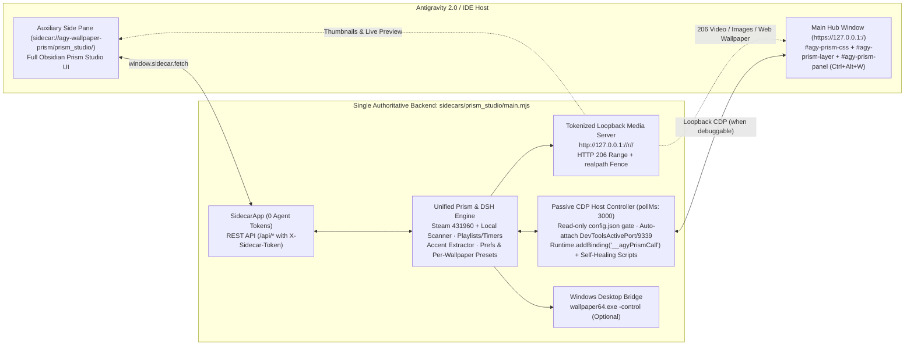

# Legacy Wallpaper Engine Audit & Antigravity Host Architecture Report

> **Target Plugin**: `agy-wallpaper-prism` (replacing `agy-plugin-wallpaper-engine` / `Wallpaper Studio`)  
> **Audited By**: `legacy-cleaner`  
> **Date**: 2026-11-22  
> **Scope**: Runtime cleanup audit of `agy-plugin-wallpaper-engine`, Language Server plugin collision check, official Antigravity plugin/sidecar/hook/MCP contracts, Hub/Workbench DOM & CSS realities, comparative host-injection analysis (`agy-plugin-wallpaper-engine` vs. `antigravity-observer`), and recommended target architecture.

---

## 1. Legacy Runtime State & Cleanup Audit

### 1.1 Live Host & Runtime Inspection Results

Read-only inspection of `%USERPROFILE%\.agy-wallpaper-skin\{state,prefs}.json`, `node "...\agy-plugin-wallpaper-engine\host\cli.mjs" status`, and `Win32_Process` enumeration established the exact state of the running machine:

| Check | Observed Value | Verdict |
| :--- | :--- | :--- |
| **Antigravity Executable** | `%LOCALAPPDATA%\Programs\antigravity\Antigravity.exe` | Active (`13` processes, main PID `11736`) |
| **Host Debuggability (`CDP`)** | `debuggable: false` (`%APPDATA%\Antigravity\DevToolsActivePort` absent; `127.0.0.1:9339` `ECONNREFUSED`) | Current host session was launched normally without `--remote-debugging-port` |
| **Live Injected Skin / Panel** | **None** (`#agy-ws-css`, `#agy-ws-layer`, `#agy-ws-panel`, `window.__agyWs` all absent) | **Clean** — zero legacy DOM/CSS skin or panel is active in the live Antigravity window |
| **`~/.agy-wallpaper-skin/state.json`** | `{"pid": 42604, "port": 9339, "kernel": "0.4.0", "target": "https://127.0.0.1:64016/", "startedAt": "2026-11-22T04:47:22.482Z"}` | Stale attachment record from an earlier debuggable session |
| **Standalone Daemon Process** | PID `42604` (`node.exe ...\agy-plugin-wallpaper-engine\host\daemon.mjs --port 9339 --quiet`) | **Alive but idle** (cannot attach because CDP port `9339` is closed) |
| **Host `config.json` Gate** | `agy-plugin-wallpaper-engine` currently `enabled` (`disabled: false`) | Untouched (per safety rule: never hand-edit `config.json` or delete plugin dir on disk) |

### 1.2 Cleanup Execution & Remaining User Handoff Steps

1. **Live Window**: Confirmed **100% clean** — no Route D wallpaper CSS or control panel is injected into the running Antigravity window (`main pid 11736`), and no host restart was triggered.
2. **Orphaned Standalone Daemon (`PID 42604`)**:
   - Executing `node "%USERPROFILE%\.gemini\config\plugins\agy-plugin-wallpaper-engine\host\cli.mjs" restore` inside the terminal sandbox returned `EPERM` on `~/.agy-wallpaper-skin/state.json` (outside workspace), and the unsandboxed retry timed out after 60s awaiting interactive user approval. Per strict permission guardrails, no circumvention or alternative kill command was run.
   - Because CDP (`127.0.0.1:9339`) is closed on the running host, PID `42604` is completely inert right now.
3. **Clean Retirement Steps for the User**:
   - **Step A (Optional — Retire idle PID `42604`)**: Approve or run in terminal:
     ```powershell
     node "$env:USERPROFILE\.gemini\config\plugins\agy-plugin-wallpaper-engine\host\cli.mjs" restore
     ```
     *(Safe: terminates PID `42604`, marks `~/.agy-wallpaper-skin/state.json` stopped, and never restarts Antigravity.)*
   - **Step B (Sync Language Server & Uninstall Legacy Plugin)**: Open `[Wallpaper Studio](customization://agy-plugin-wallpaper-engine)` in Antigravity's **Customizations** UI and click **Disable** or **Uninstall**. Never delete `~/.gemini/config/plugins/agy-plugin-wallpaper-engine` manually on disk or edit `~/.gemini/config/config.json` directly.
4. **Zero-Interference Guarantee**: `agy-wallpaper-prism` uses a completely separate state directory, DOM ID prefix, CSS attribute namespace, and CDP RPC binding (see §5.3), so even if `agy-plugin-wallpaper-engine` remains installed temporarily, the two plugins will not share state files or overwrite each other's globals.

---

## 2. Language Server Plugin Inventory & Collision Check

Queried `http://${ANTIGRAVITY_LS_ADDRESS}/exa.language_server_pb.LanguageServerService/GetAllPlugins` (filtered via `ConvertFrom-Json` to strip `SKILL.md` bodies):

| `name` (`plugin.json`) | `displayName` | Install `dir` | `disabled` | `isGlobal` | `skills` | `mcp` | `hasHooks` |
| :--- | :--- | :--- | :--- | :--- | :--- | :--- | :--- |
| `agy-plugin-wallpaper-engine` | Wallpaper Studio | `agy-plugin-wallpaper-engine` | `false` | `true` | `wallpaper-studio` | — | `false` |
| `antigravity-plugin-context-mode` | Context Mode | `antigravity-plugin-context-mode` | `false` | `true` | `context-mode` | — | `true` |
| `gemini-neko-cockpit` | Gemini 猫娘观察台 · Antigravity Observer | `gemini-neko-cockpit` | `false` | `true` | `gemini-neko-cockpit` | — | `false` |
| `swarm` | Swarm | `swarm` | `false` | `true` | — | — | `false` |

### Collision Verification for `agy-wallpaper-prism`

- **Plugin `name` & Install `dir`**: `agy-wallpaper-prism` -> **0 collisions** (plugins share one global `name` namespace where duplicates are dropped silently).
- **`displayName`**: `Wallpaper Prism` -> **0 collisions**.
- **Sidecar ID**: `sidecars/prism_studio` -> namespaced as `agy-wallpaper-prism/prism_studio` -> **0 collisions**.
- **Skill Name**: `skills/wallpaper-prism/SKILL.md` (`name: wallpaper-prism`) -> **0 collisions**.
- **Optional MCP Server Name**: `agy-wallpaper-prism-*` -> **0 collisions** (MCP server names are global across `~/.gemini/config/mcp_config.json` and all enabled plugins).

---

## 3. Antigravity Official Plugin, Sidecar & Workbench Specifications

### 3.1 Plugin Bundle Structure & `plugin.json` Contract

 Plugins install to `~/.gemini/config/plugins/<dir>/` (or workspace `.agents/plugins/<dir>/`).

> [!IMPORTANT]
> **Windows NTFS Junctions Are Silently Ignored**: `GetAllPlugins` skips NTFS junctions/symlinks under `~/.gemini/config/plugins/`. Local install scripts (`scripts/install-local.mjs`) **must copy real directories and files**, never create junctions.

```text
~/.gemini/config/plugins/agy-wallpaper-prism/
├── plugin.json                        # Required manifest (JSONC, strict 10-key allowlist)
├── README.md                          # User-facing docs (never loaded into agent prompt)
├── assets/
│   └── logo.svg                       # Relative path only (.svg/.png/.jpg/.jpeg/.webp; square >=128x128, ~10% margin)
├── sidecars/
│   └── prism_studio/
│       ├── sidecar.json               # Sidecar manifest (AUX_PANE web UI + background daemon)
│       ├── main.mjs                   # Node entrypoint launched by Antigravity
│       └── index.html                 # Single-file bundled Studio UI (IIFE + CSS inlined)
├── skills/
│   └── wallpaper-prism/
│       └── SKILL.md                   # On-demand agent skill (progressive disclosure)
├── hooks.json                         # Optional: MUST sit at plugin root, NEVER hooks/hooks.json
├── mcp_config.json                    # Optional: Stdio or Streamable HTTP MCP servers
└── rules/
    └── AGENTS.md                      # Optional: Plain markdown (avoid unless needed; consumes always-on rule budget)
```

#### Strict `plugin.json` Top-Level Fields (Unknown Fields Silently Discarded)

| Field | Type | Rules & Constraints |
| :--- | :--- | :--- |
| `name` | `string` | Global unique key, lowercase `kebab-case` (`"agy-wallpaper-prism"`). Defaults to directory name if omitted. |
| `displayName` | `string` | Optional human-readable title (`"Wallpaper Prism"`). |
| `description` | `string` | 1–2 sentences describing purpose & audience (indexed by Marketplace search & `ui-plugin-navigation`). |
| `version` | `string` | Optional semver string (`"1.0.0"`). |
| `logo` | `string` | Optional relative path (`"assets/logo.svg"`). Absolute paths and `https://` URLs fail silently. |
| `suggestedPrompts` | `string[]` | Optional array of **up to 3** starter prompts (exactly 3 recommended for card layouts; >3 ignored). |
| `author` | `string \| {name, url?}` | Optional developer/team metadata (`url` must be `https://`). |
| `homepage` | `string` | Optional `https://` documentation URL. |
| `repository` | `string \| {type, url}` | Optional `https://` source repository. |
| `disabled` | `boolean` | Optional (`true` ships disabled by default; user choice in `config.json` always overrides). |

#### Management Link & Lifecycle Rules
- **Settings UI Link**: Always emit `[Wallpaper Prism](customization://agy-wallpaper-prism)` keyed on the **install directory name** `<dir>` (never `plugin://` or `plugins://`, which render as dead text).
- **Restricted RPCs & `config.json`**: `JetboxWriteState`, `DeletePlugin`, and `InstallCustomization` are blocked from `run_command`, and `~/.gemini/config/config.json` is written atomically at mode `0600` alongside `userSettings` and permission grants. Plugins may **read** `config.json` (`raw?.plugins?.['agy-wallpaper-prism']?.enabled !== false`) as a live enablement gate, and **never write** to it.

---

### 3.2 Sidecar Architecture & `sidecar://` Navigation Contract

#### `sidecars/prism_studio/sidecar.json` Schema

```json
{
  "command": "node",
  "args": ["main.mjs"],
  "restart_policy": "always",
  "display_name": "Wallpaper Prism",
  "description": "Obsidian Prism glass skin controller and Wallpaper Engine studio for Antigravity — browse Steam Workshop & local wallpapers, playlists, and glass surface presets.",
  "has_web_ui": true,
  "agent_permissions": {
    "allows_user_interactions": false
  },
  "ui_config": {
    "display_name": "Wallpaper Prism",
    "views": [
      {
        "path": "/",
        "entrypoint": "SIDECAR_UI_ENTRYPOINT_AUX_PANE",
        "title": "Wallpaper Prism"
      }
    ]
  }
}
```

#### `sidecar://` Pill Link Convention (`ui-plugin-navigation`)
- Plugin sidecar IDs are namespaced as `<plugin-dir>/<sidecar-folder>`:
  - **sidecar-id**: `agy-wallpaper-prism/prism_studio`
  - **view-path**: `/` (from `ui_config.views[0].path`)
  - **Chat Pill Markdown**: `[Wallpaper Prism](sidecar://agy-wallpaper-prism/prism_studio/)`
- Clicking the pill opens/toggles the Auxiliary (right-hand) Pane. Only emit when the plugin is enabled and running.

#### `sidecar_sdk` Runtime Environment & Hard-Won Pitfalls
1. **Electron-as-Node `process.execPath` Trap**:
   - Antigravity launches sidecars using `Antigravity.exe` with `ELECTRON_RUN_AS_NODE=1` and `register_loader.js` (which resolves `import { SidecarApp, Response } from 'sidecar_sdk'`).
   - If the sidecar spawns a helper process with `ELECTRON_RUN_AS_NODE` stripped while using `process.execPath`, **it accidentally launches a second GUI `Antigravity.exe` instance** instead of running Node! Always resolve a real `node.exe` binary (`AGY_NODE_EXE` -> `PATH` -> `%LOCALAPPDATA%\Programs\nodejs\node.exe` -> `C:\Program Files\nodejs\node.exe`) before spawning standalone scripts, or run the passive CDP controller in-process inside `main.mjs`.
2. **Persistent Storage Location**:
   - Use `process.env.ANTIGRAVITY_EXECUTABLE_DATA_DIR` (`~/.gemini/antigravity/sidecar_data/agy-wallpaper-prism/prism_studio/data/`) so user preferences, playlists, favorites, and imported wallpapers survive plugin updates/reinstalls.
3. **`SidecarApp` Auth & `/preload.js` Bridge**:
   - `SidecarApp` automatically injects `/preload.js` into HTML pages, providing:
     - `window.sidecar.fetch(url, options)` — automatically attaches `X-Sidecar-Token` (parsed from iframe `?token=`). **All `POST` routes require `X-Sidecar-Token`** (`GET` routes bypass token validation); raw `window.fetch('/api/...', { method: 'POST' })` will fail auth!
     - `message` listener for `theme-change` (syncs host CSS variables one-way onto `:root`) and `workspace-change`.
     - `window.sidecar.ui.toggleAuxPane(...)` & `window.sidecar.agent.sendMessage(...)`.
4. **Bundle Format & Layout Height Trap**:
   - **Single-File Bundle**: Serving external ES module routes (`/app.mjs`) through `SidecarApp` caused module load timeouts in Route B PoC. Bundle `web/*.{mjs,css}` via `esbuild` (`--bundle --format=iife`) and inline into `index.html`.
   - **`#app` Height Collapse Bug**: Always set `html, body, #app { width: 100%; height: 100%; margin: 0; }` in Studio CSS. Without an explicit height on `#app`, `position: absolute` immersive/preview stages collapse `#app` to `auto` content height (`197px` strip over black `body`).
5. **Zero CSP Block on Loopback Media**:
   - Sidecar views render inside an OOPIF at `plugin://agy-wallpaper-prism--prism_studio-<port>` with **0 CSP violations** loading ``, `<video>` (HTTP `206 Partial Content`), and `<iframe>` web wallpapers from `http://127.0.0.1:<media-port>/`.

---

### 3.3 `skills/`, `hooks.json`, and `mcp_config.json` Tradeoffs

- **Skills (`skills/wallpaper-prism/SKILL.md`)**: Zero token cost while idle (only `name` + `description` in system prompt). Teaches the agent how to emit `[Wallpaper Prism](sidecar://agy-wallpaper-prism/prism_studio/)`, inspect status, switch presets/wallpapers, and obey the no-unprompted-relaunch rule.
- **Hooks (`hooks.json` at plugin root)**: Supports `SessionStart`, `PreToolUse`, `PostToolUse`, `PreInvocation`, `PostInvocation`, `Stop` (camelCase JSON over stdin/stdout; receives `PLUGIN_ROOT` & `PLUGIN_DATA`). Optional use case: auto-pause heavy video/WE wallpapers during active tool invocations if user enables "Pause on Agent Busy". Keep disabled or omitted by default unless needed so tool-call latency remains 0 ms.
- **MCP Servers (`mcp_config.json`)**: Route B PoC proved that MCP Apps (`ui://`) cost tool schema tokens on every turn (~33+ tokens/tool) and did **not** render `global` full-page views in Antigravity 2.0, whereas Sidecar Web UI costs **0 Agent Tokens** and renders reliably. Therefore, **Sidecar + Local HTTP/CDP RPC should be primary**, with MCP omitted by default (or strictly optional if conversational tool control is desired).

---

### 3.4 Antigravity 2.0 Host ("Hub") vs. Antigravity IDE DOM & CSS Realities

> [!WARNING]
> **Antigravity 2.0 Is NOT a VS Code `monaco-workbench` Window**: Unpacking `resources/app.asar` (1,187 files) and probing the live renderer confirmed there is **no `workbench.html`** in Antigravity 2.0. The main window is an Electron `BrowserWindow` + `WebContentsView` loading a **React + Tailwind CSS "Hub" application** served by `language_server.exe` at `https://127.0.0.1:<dynamic-port>/`. (Antigravity IDE, by contrast, is VS Code-based and uses `.monaco-workbench`.)

1. **The `body.dark` / `body.light` Specificity Trap (`0,1,1`)**:
   - Antigravity Hub declares its ~290 Tailwind CSS custom properties (`--background: #070708`, `--card: #131317`, `--sidebar: #111114`, `--popover`, `--foreground: #FFFFFF`, `--border: rgb(255 255 255 / 0.06)`, `--primary: #2F71E3`, etc.) on **`body.dark`** and **`body.light`** (specificity `0,1,1`), **not** `:root` (`0,1,0`).
   - Overriding tokens on `:root` loses the cascade silently! Token overrides **must** be anchored at `html[data-agy-prism-skin] body` (specificity `0,1,2`+) with `!important`.
2. **Verified Antigravity 2.0 Hub Structural Selectors**:
   - **Full-bleed wrappers that must be transparent (`background-color: transparent !important`)**:
     `#root`, `#root > div`, `#root > div > div`, `#root > div > div > div`, `.agy-shell`, `.agy-inset-shell`, `.agy-sheet`, `.browser-hole-ancestor`, `[class*="bg-background"]`. *(Never set `body` itself to remove `background-image` if painting static wallpapers on `body`, though rendering all media inside a unified fixed `#agy-prism-layer` at `z-index: 0` with `#root { position: relative; z-index: 1 }` is cleaner and avoids `body` background special cases.)*
   - **Primary Glass Chrome Surfaces (Sidebar, Composer, Cards)**:
     `.agy-sidebar`, `[class*="bg-sidebar"]`, `.agy-composer`, `.surface-composer`, `.surface-composer-card`, `[class*="bg-card"]`.
   - **Elevated Floating Modals / Menus / Popovers (Must retain high legibility + stronger blur)**:
     `.agy-dialog`, `.agy-popover`, `.agy-menu`, `[role="dialog"]`, `[role="menu"]`, `[role="listbox"]`, `[role="tooltip"]`, `[data-radix-popper-content-wrapper]`, `[class*="bg-popover"]`.
   - **Dual-Target Compatibility (Antigravity IDE fallback)**:
     CSS selector groups can harmlessly co-target VS Code workbench equivalents (`.monaco-workbench`, `.part.sidebar`, `.part.editor`, `.part.panel`, `.part.auxiliarybar`, `.part.titlebar`, `.part.statusbar`, `.xterm-viewport`) while keeping `.view-lines` / `.monaco-editor-background` / diff gutters protected for code readability.
3. **Sibling Plugin DOM Coexistence (Critical)**:
   - `gemini-neko-cockpit` injects `#gemini-neko-pet-root` (`position: fixed; z-index: 2147482800`), `#gemini-neko-observer-modal`, and `#gemini-neko-stats-bar` (inside composer area), and other tools inject `#ag-context-meter`.
   - Never apply wildcard resets or opaque backgrounds to direct `body > div` children. Keep `#agy-prism-layer` at `z-index: 0; pointer-events: none`, `#root` at `z-index: 1`, and the Quick Prism Popover `#agy-prism-panel` at `z-index: 45` (`all: initial` scoped inside `#agy-prism-panel` only).
4. **Loopback Media & Autoplay Rules**:
   - Chromium treats `http://127.0.0.1:<port>` as potentially trustworthy even inside `https://127.0.0.1:<ls-port>/` (no mixed-content block, `metaCsp = null`).
   - `<video>` elements **must** default to `muted = true` (`defaultMuted = true`, `playsInline = true`) on initial mount or Chromium's autoplay policy will silently block playback; unmuting can be enabled after user gesture or explicit audio toggle with graceful fallback if autoplay rejects.

---

## 4. Host Injection Architecture Comparison

Inspection of `<workspace>\agy-plugin-wallpaper-engine` (`host/*.mjs`, `wallpaper-inject.js`, `panel-inject.js`) and `<workspace>\antigravity-observer` (`setup.cjs`, `src/asar_patcher.js`, `hud/main_bridge.js`, `hud/preload_hud.js`, `sidecars/neko-cockpit/server.cjs`) reveals three distinct architectures:

| Dimension | 1. ASAR Bootstrap Patch (`antigravity-observer`) | 2. Runtime CDP Attach (`agy-plugin-wallpaper-engine` Route D) | 3. Official Sidecar Pane (`sidecar.json` + `SidecarApp`) |
| :--- | :--- | :--- | :--- |
| **Mechanism** | `asar_patcher.js` unpacks & rewrites `resources/app.asar` (`dist/main.js` + `dist/preload.js`), recomputing SHA-256 block integrity; injects via Electron preload + `ipcMain` | Host runs with `--remote-debugging-port=9339`; daemon attaches over loopback CDP (`Runtime.addBinding` + `Page.addScriptToEvaluateOnNewDocument` + `Runtime.evaluate`) | Antigravity spawns `sidecars/<id>/main.mjs` (`restart_policy: "always"`) and mounts `index.html` inside Auxiliary Pane OOPIF |
| **Modifies Host Install (`app.asar`)?** | **Yes** (destructive install-tree mutation) | **No** (100% runtime-only, zero install files touched) | **No** (100% official customization API) |
| **Works on Windows While Host Is Open?** | **No** — `app.asar` is file-locked (`EBUSY`/`EPERM`) while `Antigravity.exe` runs; requires `.neko-staged` + killing/closing Antigravity | **Yes** once CDP port is active (instant live attach, hot-swap, and zero-restart restore); requires 1-time `--remote-debugging-port` flag | **Yes** — discovered and started live within ~1s, zero host restart ever needed |
| **Survives Antigravity Auto-Updates?** | **No** — overwritten on every client update; user must re-run `setup.cjs` / `.bat` | **Yes** — zero `app.asar` coupling; survives updates automatically | **Yes** — stored in `~/.gemini/config/plugins/` |
| **Multi-Plugin Patch Collision Risk** | **High** — `app.asar` already carries `AG_ZH_BEGIN` localization + `GEMINI_NEKO_HUD_BEGIN` markers; adding a third ASAR patcher compounds corruption risk | **Zero** — isolated DOM IDs (`#agy-prism-*`) and dedicated CDP binding (`__agyPrismCall`) | **Zero** — isolated `plugin://` origin and port |
| **Whole-Window Glass & Wallpaper Behind Chat?** | Capable | **Capable (Proven on Antigravity 2.34+ with 144MB+ MP4s & adaptive light/dark glass)** | **No** — sandboxed inside Auxiliary Pane iframe |
| **Agent Context Token Cost** | 0 tokens | 0 tokens | 0 tokens |

### Key Lessons Learned & Legacy Bugs Identified in `agy-plugin-wallpaper-engine`

1. **Reject ASAR Patching (`NO-GO` for `agy-wallpaper-prism`)**: `antigravity-observer` needed `app.asar` patching only to avoid `--remote-debugging-port`, at the cost of Windows file-lock failures (`app.asar.neko-staged`), batch-file workarounds (`双击安装观察窗补丁.bat`), update breakage, and collision risk with `AG_ZH` and `GEMINI_NEKO_HUD`. We should **never** touch `app.asar`.
2. **Fix Legacy Split-Brain Daemon Race Condition**:
   - `agy-plugin-wallpaper-engine` had *two* competing daemons: a standalone detached `daemon.mjs` spawned by `cli.mjs` (`PID 42604`) AND `startPassiveDaemon()` inside `sidecars/wallpaper_studio/main.mjs`.
   - **Bug A (Orphaned PID + Recycled PID Hazard)**: When Antigravity restarted normally without CDP, standalone `PID 42604` stayed orphaned in the background indefinitely. Worse, `cli.mjs restore` called `process.kill(state.pid, 'SIGTERM')` without checking whether `state.pid` was still `daemon.mjs` (risking killing an unrelated recycled Windows PID hours later).
   - **Bug B (Sidecar Auto-Reinject after Restore)**: In `cli.mjs restore`, when `state.mode !== 'sidecar'`, it killed standalone `state.pid` **without** setting `kind: 'none'` in `prefs.json`. Within `4000ms`, the Sidecar's `startPassiveDaemon()` saw `state.pid` gone and **re-injected the wallpaper skin automatically**!
3. **Fix Legacy `ELECTRON_RUN_AS_NODE` Launch Trap**: Any script that spawns `Antigravity.exe` (or spawns `node` from inside a Sidecar) must sanitize `ELECTRON_RUN_AS_NODE`, `ELECTRON_NO_ATTACH_CONSOLE`, `NODE_OPTIONS`, `NODE_PATH`, and `NODE_REPL_EXTERNAL_MODULE` (`cleanHostEnv()`), while resolving a real `node.exe` binary for Node child scripts.
4. **Fix Legacy Flat CSS Token Model**: `wallpaper-inject.js` (`v0.5.0`) collapsed all surface styling into a single `widgetFill` multiplier with flat `rgba()` values — lacking Obsidian Prism's multi-tiered glass elevation tokens, specular `1px` borders, **Floating Panels / Island layout** (rounded pane gaps showing wallpaper through seams), Pt/Tint/Shade color schemes, dynamic wallpaper accent extraction, and DSH's playlist/FPS/auto-pause lifecycle controls.

---

## 5. Recommended Architecture for `agy-wallpaper-prism`

### 5.1 Unified Sidecar-Owned Engine + Passive CDP Prism Host Bridge



### 5.2 Core Architectural Guardrails for the Swarm

1. **Single Process Authority (Eliminate Standalone Daemon Orphans)**:
   - Make `sidecars/prism_studio/main.mjs` (`restart_policy: "always"`) the **primary owner** of library scanning, playlist rotation timers, the HTTP `206 Range` media server, and the Passive CDP Host Controller.
   - Because Antigravity manages the Sidecar process lifecycle, disabling or uninstalling `agy-wallpaper-prism` in Customizations UI automatically stops the Sidecar (and `SIGTERM` triggers `detachAll()` to strip `#agy-prism-css`, `#agy-prism-layer`, and `#agy-prism-panel` cleanly).
   - If a thin CLI (`host/cli.mjs`) is provided for terminal diagnostics/automation, it should communicate with the running Sidecar API (recorded in `ANTIGRAVITY_EXECUTABLE_DATA_DIR/server_info.json` or `~/.agy-wallpaper-prism/state.json` with **verified PID + process name check**) rather than spawning competing long-lived daemons, and store an explicit `skinEnabled: boolean` flag in `prefs.json` so `restore` never causes passive re-injection.
2. **Zero Unprompted Host Relaunch + Frictionless Shortcut Helper**:
   - When Antigravity is running without `--remote-debugging-port` (`debuggable: false`), the Sidecar Studio Pane still works 100% out-of-the-box (library browsing, preview canvas, playlists, Prism theme customization, Windows Desktop `wallpaper64.exe` apply) while the Passive CDP Controller waits quietly in `standby`.
   - Expose two clear opt-in actions in the Studio UI's **Host Connection** banner when `cdpReachable === false`:
     1. **"Create / Update Debuggable Shortcut (Recommended, No Restart Now)"** — creates a user Desktop/Start-Menu `.lnk` or launcher with `--remote-debugging-port=9339` so every future Antigravity launch attaches automatically with zero restarts.
     2. **"Relaunch Antigravity with CDP Now"** — protected behind an explicit two-step user confirmation warning that active conversations will reload (and **never** callable automatically by agents).
3. **Complete Namespace Isolation (`agy-wallpaper-prism` vs. Legacy)**:

| Resource | Legacy (`agy-plugin-wallpaper-engine`) | New (`agy-wallpaper-prism`) |
| :--- | :--- | :--- |
| **Plugin Dir & `name`** | `agy-plugin-wallpaper-engine` | `agy-wallpaper-prism` |
| **Sidecar Route** | `sidecar://agy-plugin-wallpaper-engine/wallpaper_studio/` | `sidecar://agy-wallpaper-prism/prism_studio/` |
| **Host State Dir** | `~/.agy-wallpaper-skin/` | `~/.agy-wallpaper-prism/` (plus `ANTIGRAVITY_EXECUTABLE_DATA_DIR`) |
| **DOM Elements & Attrs** | `#agy-ws-css`, `#agy-ws-layer`, `#agy-ws-panel`, `data-agy-ws-*` | `#agy-prism-css`, `#agy-prism-layer`, `#agy-prism-panel`, `data-agy-prism-*` |
| **CSS Custom Properties** | `--agy-ws-*` | `--prism-*` |
| **Window Globals & CDP RPC** | `window.__agyWs`, `window.__agyWsPanel`, `__agyWsCall` | `window.__agyPrism`, `window.__agyPrismPanel`, `__agyPrismCall` |
